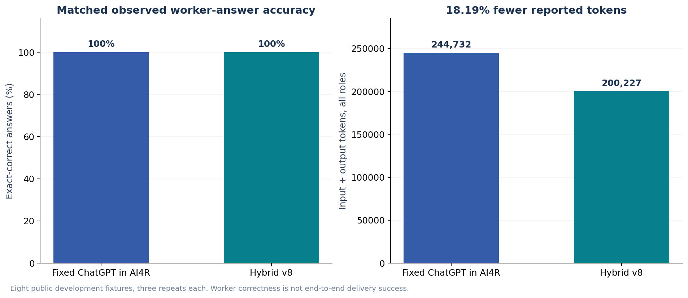
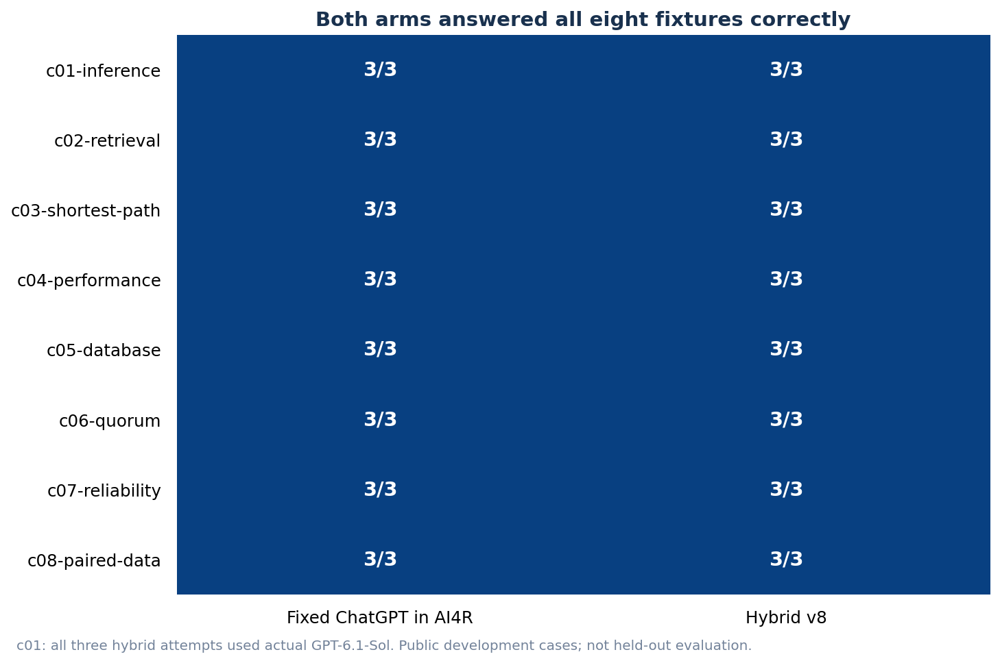

# AI4R Hybrid v8: Same Observed Worker Accuracy, 18.19% Fewer Tokens

External presentation | measured and prepared 27 October 2026

> **18.19% fewer reported tokens, with both arms answering 24/24 assignments correctly.** Hybrid v8 used 200,227 tokens versus 244,732 for fixed ChatGPT inside AI4R: 44,505 fewer tokens, including selection and independent verification overhead. All eight fixtures matched reference worker correctness. This is an observed result on a small development set, not demonstrated general accuracy equivalence.

Figure 1. Both arms reached 100% observed worker-answer accuracy; Hybrid v8 used fewer total adapter-reported tokens.

## 1. Matched AI4R reference

The reference now uses subscription ChatGPT as the fixed worker inside AI4R. Both arms share the same model bridge, independent gpt-oss-20b verification and structural check. This replaces the historical direct-ChatGPT comparison for the current campaign. The report measures generated worker answers and component resource use, not end-to-end user delivery.

| Metric | Fixed ChatGPT in AI4R | Hybrid v8 |
| --- | --- | --- |
| Observations | 24 | 24 |
| Exact-correct worker answers | 24/24 (100%) | 24/24 (100%) |
| Total reported tokens | 244,732 | 200,227 |
| Token reduction | Reference | 44,505 (18.19%) |
| Worker dispatch | 24 ChatGPT | 18 ChatGPT + 6 Lightning |
| Model calls, all roles | 48 | 54 |
| Cumulative observed component time | 271.16 s | 313.69 s |
| Median per observation | 10.43 s | 9.76 s |
| Monetary cost / savings | Not measured | Not measured |

Hybrid used 25% fewer subscription worker calls, while retaining all observed exact-correct worker answers. It took 42.53 seconds more cumulatively in this campaign. No latency improvement, dollar saving or broad quality-equivalence claim is made.

## 2. Complete token accounting and actual routing

Figure 2. Both arms include verifier usage; all six hybrid selector calls are also counted.

| Role | Reference input / output / total | Hybrid input / output / total |
| --- | --- | --- |
| Worker | 225,939 / 1,100 / 227,039 | 170,742 / 5,424 / 176,166 |
| Verifier | 5,295 / 12,398 / 17,693 | 5,295 / 9,176 / 14,471 |
| Selector | 0 / 0 / 0 | 7,311 / 2,279 / 9,590 |

gpt-oss-20b performed six successful selection calls; all six selected Lightning, which answered correctly. Protected task-risk rules routed the other eighteen workers directly to ChatGPT. No selector failed or required fallback. gpt-oss-120b remained an eligible candidate; it was not selected as a worker in this campaign.

## 3. Fixture-level worker results

Figure 3. Both arms answered all three repeats of every fixture correctly, including c01-inference.

| Fixture | Fixed ChatGPT in AI4R | Hybrid v8 |
| --- | --- | --- |
| c01-inference | 3/3 | 3/3 |
| c02-retrieval | 3/3 | 3/3 |
| c03-shortest-path | 3/3 | 3/3 |
| c04-performance | 3/3 | 3/3 |
| c05-database | 3/3 | 3/3 |
| c06-quorum | 3/3 | 3/3 |
| c07-reliability | 3/3 | 3/3 |
| c08-paired-data | 3/3 | 3/3 |

All three c01 hybrid workers used actual GPT-6.1-Sol and returned the correct threshold result. This addresses the earlier routing weakness on this development fixture through general risk rules, not a case-specific answer or post-failure retry.

## Method, scope and evidence

| Property | Recorded method |
| --- | --- |
| Assignments | MR01: inference, retrieval, shortest path, performance, database, quorum, reliability and paired data. |
| Sample | Eight public development fixtures, each repeated three times in each arm; 24 observations per arm, not 24 independent tasks. |
| Reference | GPT-6.1-Sol / medium as the fixed worker through AI4R, with the same independent local verifier and structural check as hybrid. |
| Routing | General task-risk guards, then bounded gpt-oss-20b selection among eligible models; no case-ID or answer lookup. |
| Execution | Sequential isolated component observations through the actual production model bridge; no external tools or downloads. |
| Time envelopes | Worker 90 s, including selector time when used; selector at most 30 s / 1,024 output tokens; verifier separately 60 s. |
| Scoring | Offline exact JSON comparison with pinned reviewer answers. No LLM answer judge, answer repair or model-call replay. |
| Verifier input | Declaration and produced output only; no original user input or reviewer answers. |
| Scope | Router/model-bridge component comparison, not complete admitted research-DAG or frontend acceptance. |
| Host | gx10-004d / DGX Spark / NVIDIA GB10. Local models run on Spark; subscription inference is remote. |
| Timing limits | Shared host, sequential arm order and overlapping application image builds; no controlled latency, peak-memory or power claim. |

The policy and candidates were refined on these public development fixtures. Matching 24/24 observed worker answers is not a statistical equivalence result or a claim of general performance on unseen tasks. Different tokenizers and subscription wrapper overhead affect token comparisons. Monetary costs and savings were not measured.

| Local candidate | Precision | Direct development qualification |
| --- | --- | --- |
| gpt-oss-20b | MXFP4 | 8/8 once; assessor, eligible worker and separate verifier |
| Nemotron 3.5 Lightning 30B-A3B | Q4_0 | 8/8 once; all six local workers in this campaign |
| gpt-oss-120b | MXFP4 | 8/8 once; eligible but not selected as a worker in this campaign |

Candidate qualification is a separate, single-repeat observation on the same development fixtures; it does not establish universal model superiority. Model revisions, file hashes and resource ceilings are included in the pool selection data.

## Reproducibility and source identity

| Field | Identity |
| --- | --- |
| Measured image | sha256:a677ce5f4271c9da3c567dc63679ee02c041e1e438e6a976abf03a0f7d1149c0 |
| Source manifest SHA-256 | 7350cf99e28dfdd89aaec7c66c38e3beba07d87fa246f087f7b9ba5b97358a0e |
| Source Git base | a78f9dcf021b8dbbc2bf45b8d67d4a1f355f494c; dirty source overlay identified by inventory/image |
| Reference plan SHA-256 | d286e91b0e4d8bdecd16ff9c8929a4cc9e38b3f0851022342dc0a9152fd71f70 |
| Hybrid plan SHA-256 | c54a036bd07030f6e6a5a509e056d3f635b6f0d6894188289be876f803ebb6d7 |
| Original public source-plan SHA-256 | e770c24bcbd54b268941c8aeaf2db4ba9f29ab555964f3b746c4a1201dc2e1e8 |
| Reviewer pin, answers not exported | 37e04a79423d2d145b9e1cb4d60e0f704424b9c87b917fb3ad67b95786d98c00 |
| Native evidence | 42 subscription executions checked: 24 reference + 18 hybrid; original prompt hash, resolved model, medium effort and completed terminal event. |

The measured image is distinguished from the later released image. The release changed two locale files, documentation and one readiness explanatory string; the routing and benchmark call path were unchanged. Original receipts and native packets remain on Spark. Exported call summaries are explicitly labeled projections, not complete receipts.

[Measurements and observation index](data/measurements.json)

[Flat observation metrics](data/observations.csv)

[Unmodified public input/output manifest](data/originals/manifest.json)

[Call/dispatch receipt projections](data/receipt-projections.json)

[Local model pins](data/pool-selection.json)

[Separate candidate qualification](data/candidate-qualification.json)

[Measured source provenance](data/source-provenance.json)

[Released image provenance](data/release-provenance.json)

[Data definitions and integrity checks](README.md)
