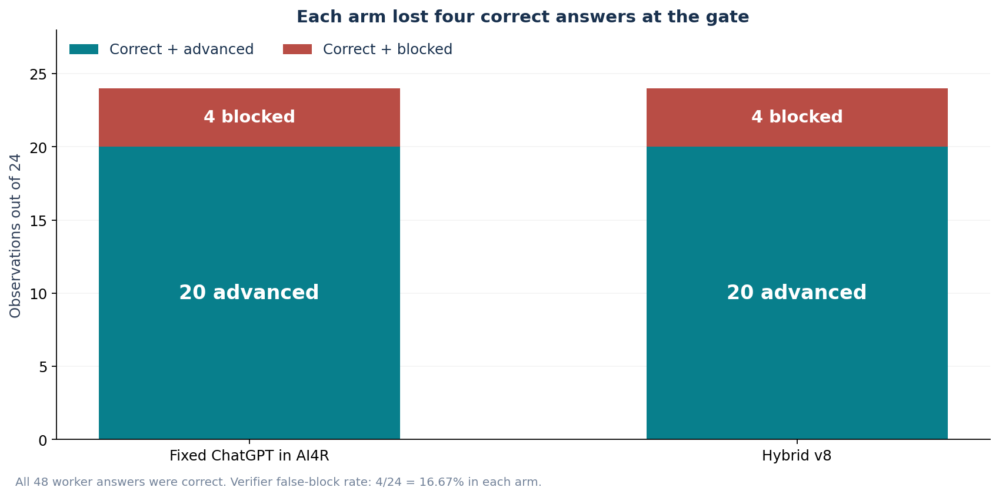
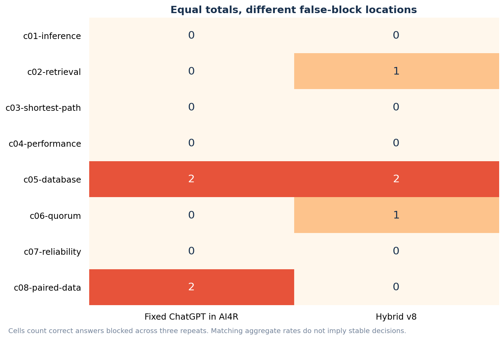
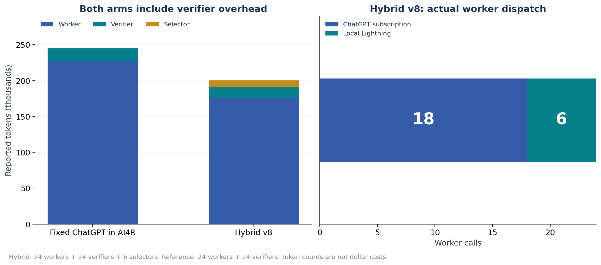

# AI4R Internal Benchmark: Equal Worker Accuracy, Persistent Verifier False Blocks

Internal presentation | measured and prepared 27 October 2026

> **The routing changes preserved 24/24 worker correctness, but each arm lost four correct answers at the gate.** Fixed ChatGPT and Hybrid v8 each advanced only 20/24 correct answers (83.33%). Hybrid used 18.19% fewer total reported tokens. The verifier defect remains; no FAIL was overridden and these are component outcomes, not completed product Delivery.

Figure 1. Each arm blocked 4 of 24 correct answers: a 16.67% false-block rate among correct answers.

## 1. Worker quality and gate outcome are separate

| Metric | Fixed ChatGPT in AI4R | Hybrid v8 |
| --- | --- | --- |
| Exact-correct worker answers | 24/24 | 24/24 |
| Correct + advanced | 20/24 (83.33%) | 20/24 (83.33%) |
| Correct + blocked | 4/24 (16.67%) | 4/24 (16.67%) |
| Incorrect answers in sample | 0 | 0 |
| Wrong-answer rejection capability | Not established: no wrong worker answers | Not established: no wrong worker answers |
| Actual verifier replies | 20 PASS / 4 FAIL | 20 PASS / 4 FAIL |
| Failed model calls / selector fallbacks | 0 / 0 | 0 / 0 |

A correct generated answer is not a completed delivery. Conversely, zero incorrect answers advancing in this sample is not evidence that the verifier detects wrong answers: no incorrect worker answer was observed.

## 2. Every false block

Figure 2. The equal aggregate rates conceal different blocked fixtures and repeats.

| Fixture | Reference correct / advanced / blocked | Hybrid correct / advanced / blocked |
| --- | --- | --- |
| c01-inference | 3 / 3 / 0 | 3 / 3 / 0 |
| c02-retrieval | 3 / 3 / 0 | 3 / 2 / 1 |
| c03-shortest-path | 3 / 3 / 0 | 3 / 3 / 0 |
| c04-performance | 3 / 3 / 0 | 3 / 3 / 0 |
| c05-database | 3 / 1 / 2 | 3 / 1 / 2 |
| c06-quorum | 3 / 3 / 0 | 3 / 2 / 1 |
| c07-reliability | 3 / 3 / 0 | 3 / 3 / 0 |
| c08-paired-data | 3 / 1 / 2 | 3 / 3 / 0 |

Repeat numbers below are zero-based. Exact worker/verifier strings and source receipt hashes are retained in the internal data. All eight false blocks were explicit verifier FAIL replies, not absent model responses.

| Arm / fixture / repeat | Actual worker | Worker output (exact) | Verifier output (exact) |
| --- | --- | --- | --- |
| chatgpt-ai4r / c05-database / 1 | subscription:gpt-6.1-sol | {"retained_ids":["a","b","c"],"sum":18} | {"verdict":"FAIL"} |
| chatgpt-ai4r / c05-database / 2 | subscription:gpt-6.1-sol | {"retained_ids":["a","b","c"],"sum":18} | {"verdict":"FAIL"} |
| chatgpt-ai4r / c08-paired-data / 0 | subscription:gpt-6.1-sol | {"paired_improvements_ms":[1,5,-2,6],"mean_improvement_ms":2.5,"positive_pairs":3,"total_pairs":4} | {"verdict":"FAIL"} |
| chatgpt-ai4r / c08-paired-data / 1 | subscription:gpt-6.1-sol | {"paired_improvements_ms":[1,5,-2,6],"mean_improvement_ms":2.5,"positive_pairs":3,"total_pairs":4} | {"verdict":"FAIL"} |
| hybrid / c02-retrieval / 2 | subscription:gpt-6.1-sol | {"best":"b","precision_at_2":1} | {"verdict":"FAIL"} |
| hybrid / c05-database / 0 | local:lightning | {"retained_ids":["a","b","c"],"sum":18} | {"verdict":"FAIL"} |
| hybrid / c05-database / 1 | local:lightning | {"retained_ids": ["a", "b", "c"], "sum": 18} | {"verdict":"FAIL"} |
| hybrid / c06-quorum / 2 | subscription:gpt-6.1-sol | {"guaranteed_intersection":false,"disjoint_example":{"read":["a","b"],"write":["c","d","e"]}} | {"verdict":"FAIL"} |

## 3. Verified behavior and diagnosis limits

The gpt-oss-20b verifier receives only the generic component declaration and produced JSON. It does not receive user input values, the original task or reviewer answers. The harness advances only for an exact decoded {"verdict":"PASS"}; otherwise it halts. All 48 verifier model calls completed, and all eight halts were decoded FAIL replies.

Baseline c05 repeats produced the same correct worker text, yet repeat 0 passed and repeats 1/2 failed. The observed inconsistency is real. The one-field verdict carries no criterion or reason, so the campaign cannot establish why each rejection occurred. The shared generic declaration lacks fixture-specific output fields and source-independent acceptance predicates; underspecification and unjustified judgments about hidden facts are plausible contributors, not proven single causes.

Both arms used the same verifier configuration, but stochastic decisions and different per-request outputs can change verdicts and token use. Equal 20/24 totals do not establish equivalent gate behavior. These are generic component-verifier findings, not evidence that every admitted production Capsule verifier has the same failure.

## 4. Router repair and total token cost

Figure 3. The saving survives selection and verifier overhead; both reference and hybrid include independent verification.

| Role | Reference tokens / calls | Hybrid tokens / calls |
| --- | --- | --- |
| Worker | 227,039 / 24 | 176,166 / 24 |
| Verifier | 17,693 / 24 | 14,471 / 24 |
| Selector | 0 / 0 | 9,590 / 6 |

The reference totals 244,732 tokens; hybrid totals 200,227, saving 44,505 (18.19%). Verifier usage was 17,693 versus 14,471 tokens; hybrid additionally spent 9,590 selector tokens. The verifier difference is an observation, not proof that routing itself made verification cheaper. Historical v5 used a direct reference without verifier overhead; its headline savings must not be treated as the same matched comparison.

The former c01 routing failure did not recur: all three hybrid attempts used ChatGPT, answered correctly and advanced. The six actual local workers were Lightning and all answered correctly. Every selector completed successfully. The new pool contains gpt-oss-20b, Lightning and gpt-oss-120b; no Qwen worker is in the current automatic pool.

## 5. Remaining repair boundaries — not changed by this report

| Area | General repair to consider | Required evidence |
| --- | --- | --- |
| Declarations | Define output schema and source-independent semantic criteria; preserve the declaration/output-only verifier boundary. | Each decision can name an observable declared criterion. |
| Verifier response | Version the response if adding criterion IDs, reasons or an uncheckable disposition. | Raw verdict reasons distinguish actual contradiction from unavailable source evidence. |
| Decision stability | Evaluate repeated identical declaration/output pairs with a frozen reviewer configuration. | Stable behavior without case IDs, gold-answer exposure or forced PASS. |
| Gate | Keep deterministic control and explicit blocking. | Malformed, unavailable and negative outcomes are never silently advanced. |
| Acceptance | Measure unseen tasks and a separate admitted frontend-to-Delivery run after general repairs. | Do not substitute component worker correctness for product delivery. |

## Method, scope and evidence

| Property | Recorded method |
| --- | --- |
| Assignments | MR01: inference, retrieval, shortest path, performance, database, quorum, reliability and paired data. |
| Sample | Eight public development fixtures, each repeated three times in each arm; 24 observations per arm, not 24 independent tasks. |
| Reference | GPT-6.1-Sol / medium as the fixed worker through AI4R, with the same independent local verifier and structural check as hybrid. |
| Routing | General task-risk guards, then bounded gpt-oss-20b selection among eligible models; no case-ID or answer lookup. |
| Execution | Sequential isolated component observations through the actual production model bridge; no external tools or downloads. |
| Time envelopes | Worker 90 s, including selector time when used; selector at most 30 s / 1,024 output tokens; verifier separately 60 s. |
| Scoring | Offline exact JSON comparison with pinned reviewer answers. No LLM answer judge, answer repair or model-call replay. |
| Verifier input | Declaration and produced output only; no original user input or reviewer answers. |
| Scope | Router/model-bridge component comparison, not complete admitted research-DAG or frontend acceptance. |
| Host | gx10-004d / DGX Spark / NVIDIA GB10. Local models run on Spark; subscription inference is remote. |
| Timing limits | Shared host, sequential arm order and overlapping application image builds; no controlled latency, peak-memory or power claim. |

The policy and candidates were refined on these public development fixtures. Matching 24/24 observed worker answers is not a statistical equivalence result or a claim of general performance on unseen tasks. Different tokenizers and subscription wrapper overhead affect token comparisons. Monetary costs and savings were not measured.

| Local candidate | Precision | Direct development qualification |
| --- | --- | --- |
| gpt-oss-20b | MXFP4 | 8/8 once; assessor, eligible worker and separate verifier |
| Nemotron 3.5 Lightning 30B-A3B | Q4_0 | 8/8 once; all six local workers in this campaign |
| gpt-oss-120b | MXFP4 | 8/8 once; eligible but not selected as a worker in this campaign |

Candidate qualification is a separate, single-repeat observation on the same development fixtures; it does not establish universal model superiority. Model revisions, file hashes and resource ceilings are included in the pool selection data.

## Reproducibility and source identity

| Field | Identity |
| --- | --- |
| Measured image | sha256:a677ce5f4271c9da3c567dc63679ee02c041e1e438e6a976abf03a0f7d1149c0 |
| Source manifest SHA-256 | 7350cf99e28dfdd89aaec7c66c38e3beba07d87fa246f087f7b9ba5b97358a0e |
| Source Git base | a78f9dcf021b8dbbc2bf45b8d67d4a1f355f494c; dirty source overlay identified by inventory/image |
| Reference plan SHA-256 | d286e91b0e4d8bdecd16ff9c8929a4cc9e38b3f0851022342dc0a9152fd71f70 |
| Hybrid plan SHA-256 | c54a036bd07030f6e6a5a509e056d3f635b6f0d6894188289be876f803ebb6d7 |
| Original public source-plan SHA-256 | e770c24bcbd54b268941c8aeaf2db4ba9f29ab555964f3b746c4a1201dc2e1e8 |
| Reviewer pin, answers not exported | 37e04a79423d2d145b9e1cb4d60e0f704424b9c87b917fb3ad67b95786d98c00 |
| Native evidence | 42 subscription executions checked: 24 reference + 18 hybrid; original prompt hash, resolved model, medium effort and completed terminal event. |

The measured image is distinguished from the later released image. The release changed two locale files, documentation and one readiness explanatory string; the routing and benchmark call path were unchanged. Original receipts and native packets remain on Spark. Exported call summaries are explicitly labeled projections, not complete receipts.

[Measurements and observation index](data/assessment.json)

[Flat observation metrics](data/observations.csv)

[Unmodified public input/output manifest](data/originals/manifest.json)

[Call/dispatch receipt projections](data/receipt-projections.json)

[Local model pins](data/pool-selection.json)

[Separate candidate qualification](data/candidate-qualification.json)

[Measured source provenance](data/source-provenance.json)

[Released image provenance](data/release-provenance.json)

[Data definitions and integrity checks](README.md)
