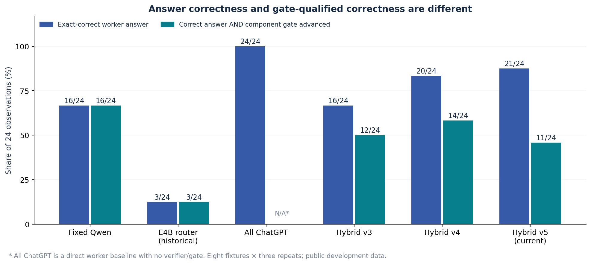
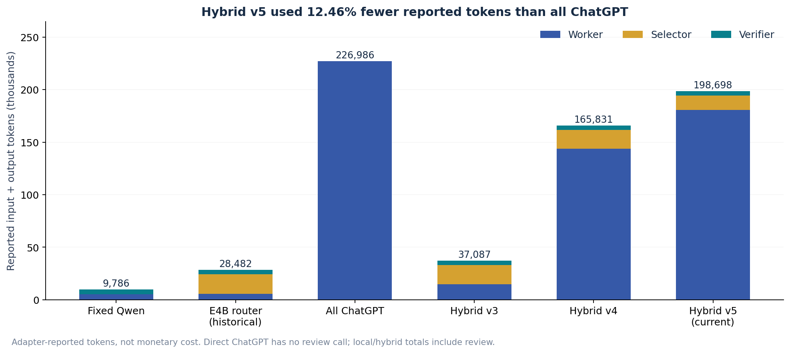
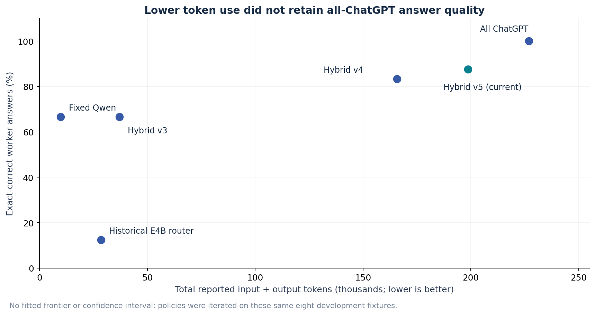
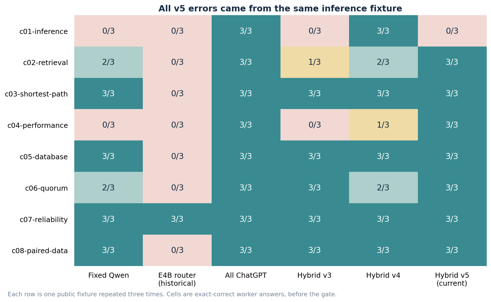
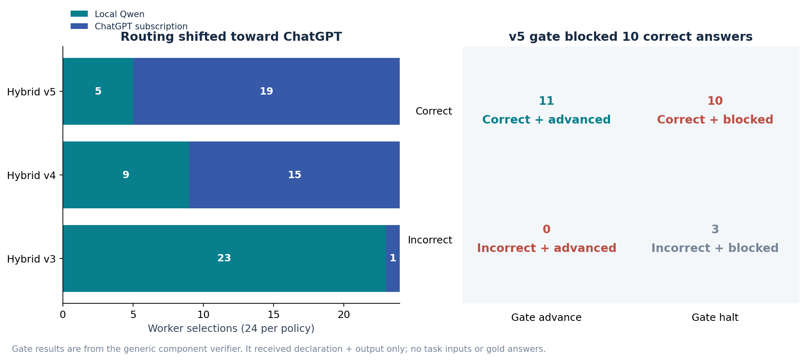

# AI4R Hybrid Model Routing Benchmark

26 October 2026 · DGX Spark + ChatGPT subscription · Public MR01 development fixtures

> **Decision: mixed-access routing works in the measured component, but the quality-preservation target is not met.** Current v5 produced 21/24 exact-correct worker answers (87.5%) using 198,698 reported tokens, 12.46% below the all-ChatGPT baseline. All ChatGPT answered 24/24 correctly. The independent component verifier blocked 10 correct v5 answers, leaving 11/24 both correct and gate-advanced.

This report evaluates the real model-router/bridge component and its bounded verifier/gate. It does not certify a complete frontend → Intent Compiler → Planner → task Capsules → Delivery run. No paper-summary or ML experiment was part of this campaign. Measurements are real completed receipts; no missing prices, answers, or timings were filled in.

## 1. What was measured

The objective was to reduce reported token use relative to running every assignment on subscription ChatGPT 6.1 Sol, while retaining as much answer correctness as possible. Six configurations were compared on the same eight public technical fixtures, each repeated three times: 24 observations per configuration, 144 observations in the tables below. The three repeats reuse the same input; they are not three independent tasks.

| Item | Recorded method |
| --- | --- |
| Source | Original AI4Research benchmark ZIP, MR01 public development cases; source ZIP unchanged. |
| Domains | Inference thresholds; retrieval; shortest path; performance; database; quorum; reliability; paired measurements. |
| Task form | Bounded supplied facts and public fixture rule; one JSON answer; no tools, downloads, or external sources. |
| Worker scoring | Offline exact JSON comparison with frozen reviewer answers: exact keys, ordered lists, finite numeric equality; no answer repair and no LLM judge. |
| Reviewer isolation | Reviewer answers remained on the reviewer side. The collector used them offline to score outputs; the exported report data does not include gold answers. |
| Verifier input | Capsule declaration + produced output only. User request, input values, and reviewer answers were hidden. |
| Scheduling | Sequential observations, concurrency 1. New finite component state per observation. |
| Budget | Worker: 90 s / 1,024 output tokens; verifier: 60 s. Hybrid selector: 15 s / 256 output tokens. |
| Reported token metric | Sum of actual adapter-reported input + output tokens, including selector and verifier where present. No monetary cost inferred. |

The local fixed/routed arms used the original local-routing component harness. Hybrid v3–v5 used an isolated ComponentAuthority wired to production AutomaticRouting, GovernedBridge, the local Qwen adapter, and the signed-in native ChatGPT owner. These are component observations, not admitted product Capsules or Planner-generated DAG runs. The direct all-ChatGPT arm has one worker call and no verifier; local/hybrid arms include Qwen verification. Consequently, total tokens and elapsed time compare the measured configurations, not equal-overhead end-to-end products.

## 2. Results across all measured configurations

| Configuration | Worker correct | Correct + gate advanced | Reported tokens | Worker choices | Model calls |
| --- | --- | --- | --- | --- | --- |
| Fixed Qwen | 16/24 (66.7%) | 16/24 | 9,786 | 24 Qwen | 48 |
| Historical E4B router | 3/24 (12.5%) | 3/24 | 28,482 | 24 E4B | 72 |
| All ChatGPT | 24/24 (100.0%) | N/A: no gate | 226,986 | 24 ChatGPT | 24 |
| Hybrid v3 | 16/24 (66.7%) | 12/24 | 37,087 | 23 Qwen, 1 ChatGPT | 72 |
| Hybrid v4 | 20/24 (83.3%) | 14/24 | 165,831 | 15 ChatGPT, 9 Qwen | 72 |
| Hybrid v5 (current) | 21/24 (87.5%) | 11/24 | 198,698 | 5 Qwen, 19 ChatGPT | 72 |

Figure 1. Worker answer correctness is distinct from correctness after the component gate. All-ChatGPT gated correctness was not measured.

Historical E4B routing selected E4B for all 24 workers and answered only 3/24 correctly. Qwen self-selection in hybrid v3 shifted only one worker to ChatGPT and still scored 16/24. Difficulty-band routing in v4 increased raw correctness to 20/24. Operation classification in current v5 increased it to 21/24, but at higher token use than v4 and with fewer correct answers advanced by the gate. v5 is not an across-the-board improvement over v4.

| Hybrid version | ChatGPT workers | Qwen workers | Worker accuracy | Token reduction vs all ChatGPT | Correct + advanced |
| --- | --- | --- | --- | --- | --- |
| Hybrid v3 | 1 | 23 | 66.7% | 83.66% | 12/24 |
| Hybrid v4 | 15 | 9 | 83.3% | 26.94% | 14/24 |
| Hybrid v5 (current) | 19 | 5 | 87.5% | 12.46% | 11/24 |

## 3. Token use, time, and cost

Figure 2. Totals include the calls actually made. The subscription adapter reports substantial input overhead; tokens are not comparable monetary units across providers.

| Configuration | Selector in / out | Worker in / out | Verifier in / out | Cumulative time | Median / observation |
| --- | --- | --- | --- | --- | --- |
| Fixed Qwen | Not run | 4,833 / 632 | 4,153 / 168 | 120.19 s | 3.99 s |
| Historical E4B router | 17,640 / 991 | 4,830 / 661 | 4,192 / 168 | 76.61 s | 3.15 s |
| All ChatGPT | Not run | 225,939 / 1,047 | Not run | 86.67 s | 3.41 s |
| Hybrid v3 | 16,554 / 1,557 | 14,057 / 725 | 4,026 / 168 | 344.27 s | 13.80 s |
| Hybrid v4 | 16,675 / 1,034 | 143,039 / 901 | 4,014 / 168 | 277.53 s | 11.56 s |
| Hybrid v5 (current) | 12,235 / 1,475 | 179,862 / 944 | 4,014 / 168 | 337.91 s | 13.71 s |

Current v5 saved 28,288 reported tokens (12.46%) relative to all ChatGPT, with an answer-accuracy decrease of 12.5 percentage points. It made 72 calls: 24 Qwen selectors, 24 workers (19 ChatGPT + 5 Qwen), and 24 Qwen verifiers. Its cumulative component time was 337.91 s versus 86.67 s for direct ChatGPT; it did not improve observed latency.

**Monetary cost and monetary savings: unavailable.** There is no reliable per-request subscription marginal price or measured local power/amortization cost in these receipts. Provider tokenizers, subscription wrapper overhead, reasoning accounting, and local execution differ. These figures establish lower adapter-reported token totals, not a dollar saving. Shared-host contention, sequential campaign order, and unequal call counts also limit latency comparisons; no controlled wall-time speedup claim is made.

Figure 3. The observed quality/token trade-off on development fixtures. No statistical frontier or held-out generalization is claimed.

## 4. Routing and verifier failures

Figure 4. Per-fixture exact correctness. Every current-v5 error is in c01-inference; the other seven fixtures scored 3/3.

In v5, the router sent c01-inference to Qwen in all three repeats, and Qwen answered it incorrectly each time. The route rationale classified its operations as extraction/comparison/formatting. The selector sees a bounded task summary, declaration, candidate capabilities, and budget metadata, but not the actual input values. Insufficient task/structure information is a plausible explanation for the misclassification; this campaign does not establish it as the sole cause. Two other Qwen executions and all 19 ChatGPT executions were correct.

Figure 5. Left: actual worker choices. Right: current-v5 gate outcomes checked against offline correctness, not against a model judge.

The current verifier produced 13 halts and 11 advances. All 11 advanced answers were correct; all three wrong answers were halted. However, 10 of the 21 correct answers were also halted: 47.6% of correct answers were blocked. These were real verifier FAIL decisions, not just display errors. This generic declaration-only component verifier cannot establish source-fact correctness without input evidence; its result must not be reported as the offline answer score. Passing this component gate also does not prove full product Delivery succeeded.

| v5 output correctness | Gate advanced | Gate halted | Total |
| --- | --- | --- | --- |
| Correct | 11 | 10 | 21 |
| Incorrect | 0 | 3 | 3 |
| Total | 11 | 13 | 24 |

The main development priorities are a generally informative routing descriptor that reduces missed reasoning work without leaking reviewer answers, and verifier declarations/criteria that distinguish internal soundness from unverifiable source claims. User input must remain hidden from the verifier as requested. Neither issue should be patched with case IDs, answer lookup, forced gold decisions, or bypassed gates. A frozen policy should then be evaluated on genuinely new fixtures and on one complete app workflow.

## 5. What is deployed and what this benchmark exercises

| Component | Current v5 behavior | Coverage here |
| --- | --- | --- |
| Execution candidates | Local Qwen and subscription gpt-6.1-sol; E4B/Bolt shared services retained outside this execution pool. | Both access paths executed; 19 native ChatGPT and 5 Qwen workers. |
| Selection | Qwen classifies a closed set of task operations; host rules choose a compatible worker. Router calls cannot recursively route themselves. | 24 actual operation-selector calls; no fixture-specific dispatch code. |
| Compatibility and dispatch | Candidate filtering and recorded decisions precede actual GovernedBridge dispatch; no post-failure switch to another worker. | Actual route decisions, model identities, and completed call records captured. |
| Verifier | Fixed Qwen, separately accounted; declaration + output only. | 24 actual verifier calls; their advance/halt results controlled the component gate. |
| Run policy | At most four subscription CC invocations per run; some trusted Capsule scopes use predeclared routing rules. | Each benchmark observation contains one generic work CC. Multi-node quota behavior and trusted-scope routing are not exercised here. |
| App integration | Same deployed AI4R service and Settings → Model; single local frontend endpoint 5175. | Component invoked via private native RPC, not frontend submission. Frontend and entire DAG acceptance are not established by these scores. |

Planner remains a capability capsule. Model selection does not replace the Intent → Requirements → Planner → task Capsules → verifiers/gates → Delivery orchestration. This benchmark demonstrates dispatch through the real router and model bridge; it must not be used as proof that the entire orchestration completed without bugs.

## 6. Environment and provenance

| Field | Value |
| --- | --- |
| Host | gx10-004d |
| OS / architecture | Linux 7.0.0-1019-nvidia aarch64 GNU/Linux |
| GPU / driver | NVIDIA GB10, 580.178.04, [N/A] |
| Docker server | 29.6.2 |
| Local model | Qwen3.8-27B FP8; served ID ai4r-qwen-017b9c7af6b5; NVIDIA vLLM 26.09 configured runtime. |
| Historical E4B | Nemotron 3.5 Bolt E4B Q4_K_M; served ID ai4r-e4b-1db54d5b1253; llama.cpp CUDA service. |
| ChatGPT transport | Packaged Codex App Server 0.163.0; resolved model gpt-6.1-sol, reasoning medium. App Server is the subscription transport, not the AI4R orchestrator. |
| Remote Git base | b983328d62fd8c5bfe7825bc6dd259f31e39ba85 |
| Source state | Dirty source overlays; base Git commit alone does not identify the measured code. Image IDs and controller hashes below identify each campaign. |
| Current app image | sha256:dcb5f77624f9f57d3eb595339a0eb2a0b647d1e58e3e63bf93aa64a83af58f3e |
| Current routing-source SHA-256 | e375899ea2d8613b9f6fde5467b098118f41a7bf410c612e88d961cc74173d2e |
| Snapshot time (UTC) | 2026-10-26T23:02:38.344707+00:00 |
| Measurement export time (UTC) | 2026-10-26T23:01:58.851993+00:00 |

GPU memory is reported as N/A by this unified-memory device query. No peak-memory or power metric was collected. The environment snapshot was taken after the campaigns and is not a per-observation utilization measurement. The all-ChatGPT worker runs remotely through the subscription; it does not run on the Spark GPU.

| Configuration | Campaign directory | Image ID |
| --- | --- | --- |
| Fixed Qwen | /home/user2/ai4r-data/benchmarks/local-routing-v1/results/campaign-001 | Original local campaign: code_pins in frozen plan |
| Historical E4B router | /home/user2/ai4r-data/benchmarks/local-routing-v1/results/campaign-001 | Original local campaign: code_pins in frozen plan |
| All ChatGPT | /home/user2/ai4r-data/benchmarks/chatgpt-baseline-002 | sha256:dc0de7065dd5b8362c3c9b4fc4a9a8640bd18fc875eae06393a3dae635b5ed4d |
| Hybrid v3 | /home/user2/ai4r-data/benchmarks/hybrid-routing-002 | sha256:92024f9619e41f398b05eed5b2f0725175df1ae22845d6d7f8d68da3bef715f4 |
| Hybrid v4 | /home/user2/ai4r-data/benchmarks/hybrid-riskbands-001 | sha256:8c35773a0b03905c92c5c75ba4a9c1867334e95f8c666c8917cd9ea5d394aa91 |
| Hybrid v5 (current) | /home/user2/ai4r-data/benchmarks/hybrid-operations-001 | sha256:dcb5f77624f9f57d3eb595339a0eb2a0b647d1e58e3e63bf93aa64a83af58f3e |

| Configuration | Frozen plan SHA-256 | Controller SHA-256 |
| --- | --- | --- |
| Fixed Qwen | e770c24bcbd54b268941c8aeaf2db4ba9f29ab555964f3b746c4a1201dc2e1e8 | See original plan code_pins |
| Historical E4B router | e770c24bcbd54b268941c8aeaf2db4ba9f29ab555964f3b746c4a1201dc2e1e8 | See original plan code_pins |
| All ChatGPT | 0592e643818e10efe016a37b8c715a5e9424ba8a0bc7402c1ad5e093da1049ef | fe862946d982007386ef881d32611339448d8e2f18ed2c4bbb6a5bdc4b155cb4 |
| Hybrid v3 | e4a4be353bb4689ce98548aab4819dc14f7fccfc14fbfee690d7d6c3ae29a894 | 7faf6cfbf5642c980401cd0f222c092fa11d9ad3ea2d8c531693a20699773456 |
| Hybrid v4 | d5653d1d86ffe130497519f47166b7af0d0ba4913f4ff2a115d83a34c16b7215 | 7faf6cfbf5642c980401cd0f222c092fa11d9ad3ea2d8c531693a20699773456 |
| Hybrid v5 (current) | c6786997e30d4f7b5a414cbc04dd0f8146dfb663f1c0153949227efccc4fc32b | 3f2424758b04a0e6a3523b4f9c2856095f2c69704bddc21feb465d346f444f01 |

The collector verified the frozen reviewer-file hash, plan pins, and source-plan continuity before scoring. It checked canonical captured-record hashes and native-packet hashes, then matched the dispatched prompt hash, resolved gpt-6.1-sol model, medium reasoning, and completed terminal event. All 59 subscription executions across the direct baseline and hybrid v3–v5 had this native evidence (24 + 1 + 15 + 19). Authentication/account packets and credentials were not exported.

| Integrity item | SHA-256 / record |
| --- | --- |
| Original benchmark ZIP | d693481998808b5747cff37e4cc4ffccffa5a1cf9d33bc76b07c00a49f268d95 |
| Common source plan | e770c24bcbd54b268941c8aeaf2db4ba9f29ab555964f3b746c4a1201dc2e1e8 |
| Reviewer-only MR01 criteria | 37e04a79423d2d145b9e1cb4d60e0f704424b9c87b917fb3ad67b95786d98c00 |
| Observation coverage | 144 observations; 360 completed model calls in these six arms. Historical calibration calls are excluded from these tables. |
| Native proof coverage | 59 subscription executions; every exported native packet rehashed during report collection. |

## 7. Interrupted attempts and limits

| Attempt / scope | Disposition |
| --- | --- |
| chatgpt-baseline-001 | One real response preceded a host-side public-prompt hash mismatch caused by canonical key ordering. The controller was fixed; this interrupted batch was retained and excluded. The complete baseline is chatgpt-baseline-002. |
| hybrid-routing-001 | Started before the recreated app owner was ready; controller reported delivery unknown. No component/model observation was found. It was retained, not replayed. A readiness probe preceded new campaign hybrid-routing-002. |
| Original local MR02 | An earlier compatibility/fault campaign stopped on a router-timeout/uncertainty handling issue. It is not a completed MR02 acceptance result and is not included in these MR01 quality scores. |
| Calibration observations | The historical original MR01 also had 72 calibration observations. They are outside the fixed/routed comparison arms summarized here; source campaign remains intact. |
| Held-out/general tasks | Not measured. These public development fixtures were reused while refining routing policies. No independent-task confidence interval, universal accuracy claim, or unseen-task quality guarantee is justified. |
| Complete AI4R workflow | Not established by this component campaign: no full Planner DAG, document upload, POC execution, or frontend Delivery acceptance measurement here. |

> **Conclusion:** the current hybrid system really dispatches to both local Qwen and subscription ChatGPT, with separately recorded selection, execution, and verification. On these development fixtures it reduces reported token use by 12.46% relative to all ChatGPT, while lowering raw accuracy from 100% to 87.5%. The gate advances only 11/24 correct outcomes, so neither quality preservation nor reliable gated delivery is demonstrated. These failures remain visible in the report and raw observation index.

## 8. Files and reproduction

The HTML report embeds all five figures and can be opened directly without a web server. Markdown references the same local PNG figures. The compact dataset contains actual worker/verifier outputs and source receipt hashes/paths, but no reviewer answer file or credential material. Full native packet receipts remain on Spark; the report contains verified proof summaries rather than another large packet archive.

[Captured measurements and per-observation evidence index](data/measurements.json)

[Flat observation table](data/observations.csv)

[Post-campaign environment snapshot](data/runtime.json)

[Read-only Spark collector](collect_spark.py)

[Figure and report builder](build_report.py)

[Current production router source](../../../jiuwenswarm/research/automatic_routing.py)

[Component harness source](../../../jiuwenswarm/research/hybrid_benchmark.py)

[Subscription comparison controller](../../../deploy/m1/chatgpt_baseline.py)

To rebuild from the captured data, run: `python benchmarks/reports/2026-10-26-hybrid-router/build_report.py`. This performs no model inference. It requires matplotlib and numpy. To recollect the same completed receipts, run the collector with `--ssh user2@100.105.127.48 --output benchmarks/reports/2026-10-26-hybrid-router/data/measurements.json`; SSH access and the existing D-drive known-hosts file are required. Recollection is read-only and does not rerun the campaign.
