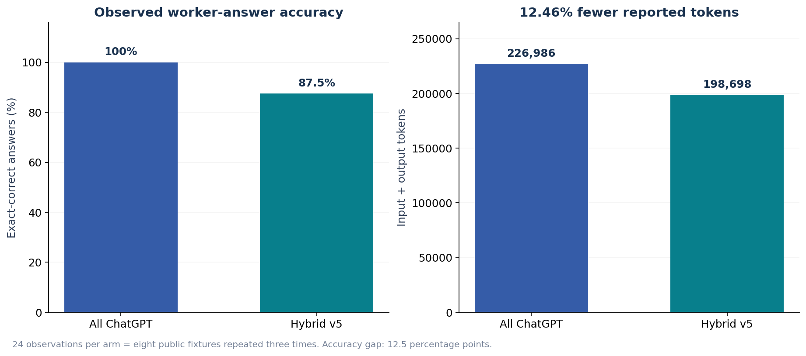
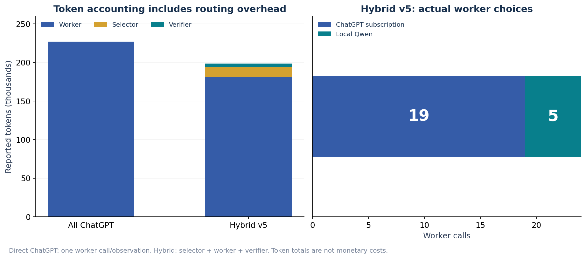
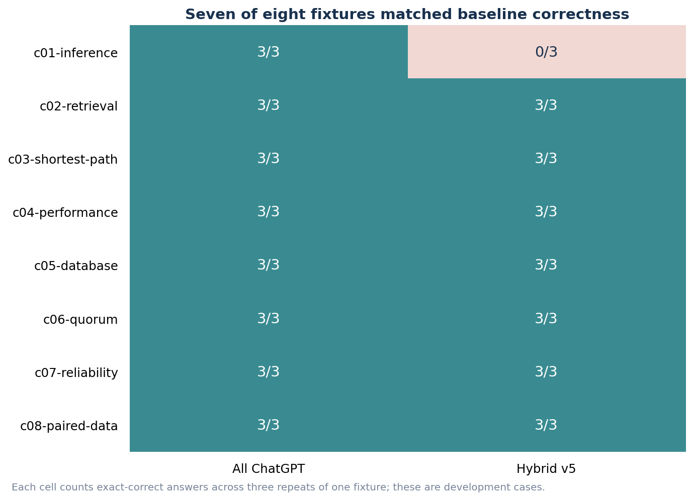

# AI4R Hybrid v5: Fewer Tokens, Strong Observed Answer Accuracy

External presentation | measured 26 October 2026 | prepared 27 October 2026

> **12.46% fewer reported tokens, with 87.5% observed worker-answer accuracy.** Hybrid v5 answered 21/24 assignments correctly using 198,698 tokens, compared with 24/24 and 226,986 tokens for all ChatGPT. It matched baseline correctness on seven of eight fixtures. This is a measured token/quality trade-off: three fewer correct answers and 28,288 fewer reported tokens, not demonstrated accuracy equivalence.

Figure 1. Hybrid v5 reduced adapter-reported tokens while retaining 87.5% of baseline answer accuracy on this development set.

## 1. Why hybrid routing

AI4R chooses an execution model for each bounded task rather than using subscription ChatGPT for every worker call. Local Qwen performs operation classification; protected host rules select either local Qwen or the signed-in ChatGPT 6.1 Sol transport. Hybrid v5 used Qwen for five worker calls and ChatGPT for nineteen. The hypothesis is that local execution can cover suitable work while reserving the stronger remote model for reasoning-intensive work.

The evaluation here covers the real router/model bridge and generated worker answers. It is not an end-to-end user-delivery benchmark or a claim that full AI4R workflows achieved these success rates. Hybrid v5 is the only hybrid configuration presented; all ChatGPT is retained as the reference arm.

## 2. Headline results

| Metric | All ChatGPT reference | Hybrid v5 |
| --- | --- | --- |
| Observations | 24 | 24 |
| Exact-correct worker answers | 24/24 (100.0%) | 21/24 (87.5%) |
| Accuracy difference | Reference | 12.5 percentage points lower |
| Total reported input + output tokens | 226,986 | 198,698 |
| Token reduction | Reference | 28,288 (12.46%) |
| Worker calls | 24 ChatGPT | 19 ChatGPT + 5 local Qwen |
| Total model calls | 24 | 72 (24 selector + 24 worker + 24 verifier) |
| Cumulative observed component time | 86.67 s | 337.91 s |
| Median per observation | 3.41 s | 13.71 s |
| Monetary cost / savings | Not measured | Not measured |

The result supports the narrower statement that hybrid routing reduced reported token use with a substantial portion of baseline answer quality retained. It does not establish equal quality: the absolute answer-accuracy gap is 12.5 percentage points. Hybrid v5 also took longer in this campaign. No latency improvement or monetary saving is claimed.

## 3. Token accounting and actual routing

Figure 2. All observed hybrid overhead is included in its token total. The worker split is based on captured dispatch decisions, not intended configuration.

| Role | All ChatGPT input / output | Hybrid v5 input / output |
| --- | --- | --- |
| Selector | Not run | 12,235 / 1,475 |
| Worker | 225,939 / 1,047 | 179,862 / 944 |
| Verifier | Not run | 4,014 / 168 |
| Total | 226,986 | 198,698 |

Token totals are the sums reported by the actual adapters, including selection and verification calls in Hybrid v5. The direct reference makes one worker call per assignment and has no extra review call. Different tokenizers, subscription wrapper overhead, and unreported reasoning accounting limit interpretation. These totals are not converted into dollars: subscription marginal price, local electricity and hardware amortization were not measured.

## 4. What tasks were used

| Benchmark property | Method |
| --- | --- |
| Source | MR01 public development fixtures from the original AI4Research benchmark archive. |
| Coverage | Eight small technical fixtures: inference, retrieval, shortest path, performance, database, quorum, reliability and paired data. |
| Repetition | Three repeats of each fixed input; 24 observations per arm. Repeats are not independent tasks. |
| Input | Supplied public facts and a public fixture rule; one bounded JSON answer. No external tools or downloads. |
| Scoring | Offline exact JSON comparison with frozen reviewer answers; no LLM answer judge or output repair. Reviewer answers were not sent to workers. |
| Budgets | Worker 90 s / 1,024 output tokens; selector 15 s / 256 output tokens; verifier 60 s. |
| Execution | Sequential component observations using the production routing and model bridge, isolated finite authority and fresh per-observation state. |

Figure 3. Hybrid v5 matched all-ChatGPT correctness on seven fixtures; all three errors were repeats of the inference fixture.

| Fixture | All ChatGPT correct | Hybrid v5 correct |
| --- | --- | --- |
| c01-inference | 3/3 | 0/3 |
| c02-retrieval | 3/3 | 3/3 |
| c03-shortest-path | 3/3 | 3/3 |
| c04-performance | 3/3 | 3/3 |
| c05-database | 3/3 | 3/3 |
| c06-quorum | 3/3 | 3/3 |
| c07-reliability | 3/3 | 3/3 |
| c08-paired-data | 3/3 | 3/3 |

All nineteen ChatGPT-routed hybrid worker calls were correct. Two of five Qwen worker calls were correct; the three incorrect Qwen calls were repeats of c01-inference. Thus the dataset indicates a specific routing weakness as well as a saving opportunity. It does not show that local execution is generally accurate for all simple-looking requests.

## 5. Environment and evidence

| Field | Recorded value |
| --- | --- |
| Local host | DGX Spark / gx10-004d; NVIDIA GB10 |
| OS | Linux 7.0.0-1019-nvidia aarch64 GNU/Linux |
| GPU driver | 580.178.04 |
| Docker server | 29.6.2 |
| Local model | Qwen3.8-27B FP8; served ID ai4r-qwen-017b9c7af6b5. |
| Subscription worker | gpt-6.1-sol, medium reasoning, packaged App Server 0.163.0. Subscription inference is remote, not executed on the Spark GPU. |
| Source identity | Image ID + frozen plan/controller hashes identify the measured code; Git base has source overlays. |
| Native model evidence | 43 subscription executions checked: 24 reference + 19 hybrid. Prompt hash, resolved model, medium reasoning and completed terminal event verified. |
| Measurement scope | Component observations, not document-upload, Planner DAG or POC application acceptance. |

| Arm | App image ID | Frozen plan SHA-256 | Controller SHA-256 |
| --- | --- | --- | --- |
| All ChatGPT | sha256:dc0de7065dd5b8362c3c9b4fc4a9a8640bd18fc875eae06393a3dae635b5ed4d | 0592e643818e10efe016a37b8c715a5e9424ba8a0bc7402c1ad5e093da1049ef | fe862946d982007386ef881d32611339448d8e2f18ed2c4bbb6a5bdc4b155cb4 |
| Hybrid v5 (current) | sha256:dcb5f77624f9f57d3eb595339a0eb2a0b647d1e58e3e63bf93aa64a83af58f3e | c6786997e30d4f7b5a414cbc04dd0f8146dfb663f1c0153949227efccc4fc32b | 3f2424758b04a0e6a3523b4f9c2856095f2c69704bddc21feb465d346f444f01 |

The full evidence index retains original receipt SHA-256 values. Original input request files, original worker output files and frozen campaign metadata are included byte-for-byte. Numerical observation tables and call summaries are explicitly labeled projections of the fuller internal receipts; they are not represented as complete original receipts. No account credentials, auth packets or reviewer answer file is included.

## 6. Interpretation and limits

These are public development fixtures used during policy refinement, not held-out evaluation. Eight distinct inputs are too few to establish broad quality equivalence, and three repeats do not turn them into 24 independent tasks. The observed 12.46% token reduction and 87.5% answer accuracy describe this campaign only. Shared-host contention, different call counts and sequential campaign order limit timing comparisons. Peak memory, power and monetary costs were not collected.

> **Takeaway:** Hybrid v5 demonstrates a real, measurable way to reduce reported model-token use while preserving much of the reference answer quality on a small development set. The remaining accuracy gap is explicit. Broader quality claims require a frozen policy evaluated on new tasks.

## 7. Included data

[Measurements and worker-performance evidence index](data/measurements.json)

[Flat observation metrics](data/observations.csv)

[Unmodified input/output file manifest](data/originals/manifest.json)

[Call and dispatch receipt projections](data/receipt-projections.json)

[Environment snapshot](data/runtime.json)

[Data definitions and integrity checks](README.md)
