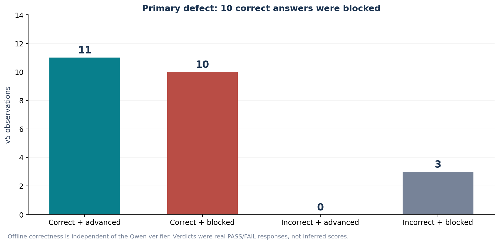
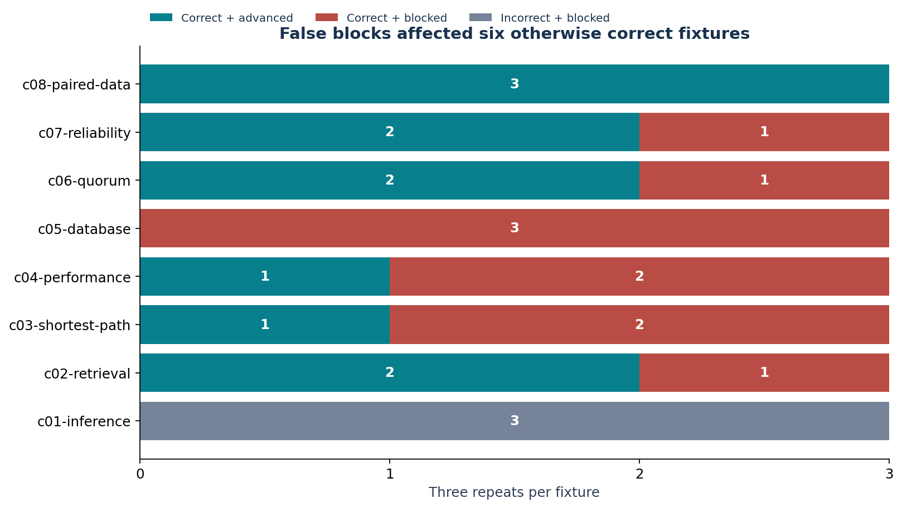
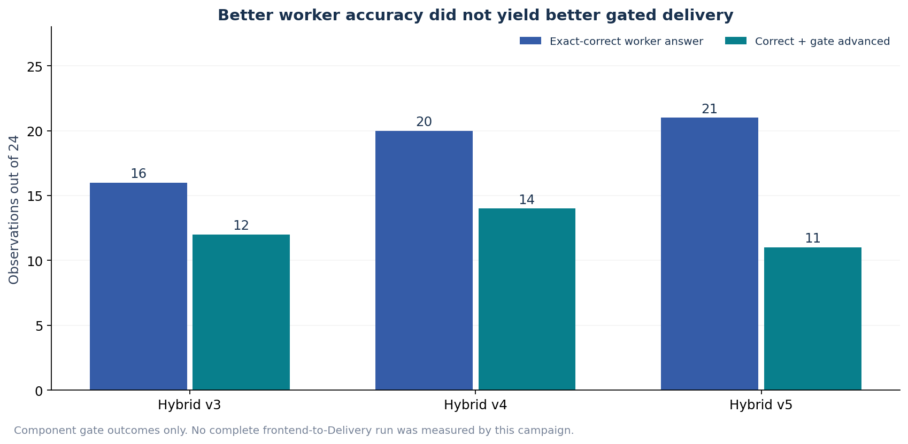

# AI4R Internal Benchmark: Verifier False Blocks in Hybrid v5

Internal presentation | measured 26 October 2026 | prepared 27 October 2026

> **Priority defect: the verifier blocked 10 correct worker answers.** Hybrid v5 generated 21/24 exact-correct answers, but only 11/24 were both correct and gate-advanced. The gate halted all three incorrect answers and ten correct ones. This is a real component-verifier decision defect, not a chart/display issue or evidence of completed product Delivery.

Figure 1. Offline gold scoring versus the actual v5 verifier/gate outcome. Correct answers were lost after generation.

## 1. Defect magnitude

| Measure | v5 result |
| --- | --- |
| Worker exact correctness | 21/24 = 87.5% |
| Correct + gate advanced | 11/24 = 45.83% |
| Correct answers blocked | 10/21 correct answers = 47.62% |
| False-block share of all observations | 10/24 = 41.67% |
| Correctness lost after the gate | 10 observations = 41.67 percentage points of the 24-observation denominator |
| Incorrect answers advanced | 0/3 incorrect answers |
| All gate decisions | 11 advance; 13 halt |
| Verifier replies | 11 exact {"verdict":"PASS"}; 13 exact {"verdict":"FAIL"} |
| Selector / worker / verifier calls | 24 / 24 / 24; all recorded completed |

| Offline worker correctness | Gate advance | Gate halt | Total |
| --- | --- | --- | --- |
| Correct | 11 | 10 | 21 |
| Incorrect | 0 | 3 | 3 |
| Total | 11 | 13 | 24 |

## 2. Where correct answers were blocked

Figure 2. False blocks affected six fixtures. Database had three correct answers and three verifier failures.

| Fixture | Worker correct | Correct + advanced | Correct + blocked | Incorrect + blocked |
| --- | --- | --- | --- | --- |
| c01-inference | 0 | 0 | 0 | 3 |
| c02-retrieval | 3 | 2 | 1 | 0 |
| c03-shortest-path | 3 | 1 | 2 | 0 |
| c04-performance | 3 | 1 | 2 | 0 |
| c05-database | 3 | 0 | 3 | 0 |
| c06-quorum | 3 | 2 | 1 | 0 |
| c07-reliability | 3 | 2 | 1 | 0 |
| c08-paired-data | 3 | 3 | 0 | 0 |

Every false block is listed below, using the actual worker text and verifier reply from the preserved observation index. Correctness is from offline exact JSON scoring against the frozen reviewer criteria, not a new model judge. Repeat numbers are zero-based.

| Fixture / repeat | Selected worker | Worker output (exact) | Verifier output (exact) |
| --- | --- | --- | --- |
| c02-retrieval / 2 | ChatGPT | {"best":"b","precision_at_2":1} | {"verdict":"FAIL"} |
| c03-shortest-path / 0 | ChatGPT | {"path":["s","a","b","t"],"cost":5} | {"verdict":"FAIL"} |
| c03-shortest-path / 2 | Qwen | {"path":["s","a","b","t"],"cost":5} | {"verdict":"FAIL"} |
| c04-performance / 1 | ChatGPT | {"baseline_mean_ms":28,"candidate_mean_ms":13.6,"candidate_p95_ms":20,"accept":true} | {"verdict":"FAIL"} |
| c04-performance / 2 | ChatGPT | {"baseline_mean_ms":28,"candidate_mean_ms":13.6,"candidate_p95_ms":20,"accept":true} | {"verdict":"FAIL"} |
| c05-database / 0 | ChatGPT | {"retained_ids":["a","b","c"],"sum":18} | {"verdict":"FAIL"} |
| c05-database / 1 | ChatGPT | {"retained_ids":["a","b","c"],"sum":18} | {"verdict":"FAIL"} |
| c05-database / 2 | ChatGPT | {"retained_ids":["a","b","c"],"sum":18} | {"verdict":"FAIL"} |
| c06-quorum / 2 | ChatGPT | {"guaranteed_intersection":false,"disjoint_example":{"read":["a","b"],"write":["c","d","e"]}} | {"verdict":"FAIL"} |
| c07-reliability / 0 | ChatGPT | {"allowed":["r1"],"denied":["r2","r3","r4"]} | {"verdict":"FAIL"} |

## 3. Verified behavior and limits of diagnosis

The component harness sends the independent Qwen verifier only a generic declaration and the produced JSON output. It does not send the original request, input values or reviewer answers. This preserves the required verifier boundary. The declaration requires a finite JSON object, supplied facts and no external tools, but does not define fixture-specific output fields or a source-independent semantic acceptance predicate.

The harness deterministically advances only when the decoded verifier reply equals {"verdict":"PASS"}; otherwise it halts. All thirteen observed halts were explicit FAIL replies. The ten false blocks therefore cannot be explained solely by JSON parsing, an absent response or a UI error. However, the one-field verdict contains no reason, and the campaign does not prove why Qwen rejected each answer. Declaration underspecification and unjustified source-fact judgments are plausible contributors, not established single causes.

This verifier is the generic benchmark component verifier. Its failures must not be silently generalized to every qualified production Capsule verifier. Conversely, a correct worker answer must not be counted as delivered merely because the model produced it. The component gate did control progression, and no failed verdict was bypassed.

## 4. Historical context and retained measurements

Figure 3. v5 improved worker correctness over v4 but advanced fewer correct answers. Preserving v5 is not a claim that it dominates every metric.

| Configuration | Worker correct | Correct + advanced | Correct + blocked | Wrong + advanced | Total tokens | Cumulative s |
| --- | --- | --- | --- | --- | --- | --- |
| Fixed Qwen | 16/24 | 16/24 | 0 | 5 | 9,786 | 120.19 |
| Historical E4B router | 3/24 | 3/24 | 0 | 17 | 28,482 | 76.61 |
| All ChatGPT | 24/24 | N/A | N/A | N/A | 226,986 | 86.67 |
| Hybrid v3 | 16/24 | 12/24 | 4 | 4 | 37,087 | 344.27 |
| Hybrid v4 | 20/24 | 14/24 | 6 | 2 | 165,831 | 277.53 |
| Hybrid v5 (current) | 21/24 | 11/24 | 10 | 0 | 198,698 | 337.91 |

v5 used 198,698 reported tokens, 12.46% below direct all ChatGPT (226,986). It scored 87.5% worker accuracy versus 100%, took 337.91 s versus 86.67 s cumulatively and used 19 ChatGPT / 5 Qwen workers. Token totals include selector and verifier overhead for hybrid arms, while the direct ChatGPT reference has no reviewer. Monetary savings are not measurable from these receipts. All six configurations and 144 observation records remain in the internal dataset.

A separate routing defect remains: all three c01-inference repeats were assigned to Qwen and answered incorrectly. The task-operation selector sees summary/declaration/budget metadata, not the actual input values. This is separate from the ten correct-answer false blocks. No case-ID routing rule or gold-answer workaround is justified.

## 5. Recommended repair boundaries — not implemented by this report

| Work item | General pipeline change to consider | Evidence required |
| --- | --- | --- |
| Declaration quality | Specify each Capsule output schema and source-independent semantic checks in its declaration. Do not inject user input or gold answers into the verifier. | Show the verifier can explain which declared criterion failed. |
| Verifier behavior | Limit semantic assessment to observable output and declared obligations; do not invent inaccessible source facts. Distinguish failure from an uncheckable criterion if the contract allows it. | Correct known outputs are not rejected merely because the original source is hidden. |
| Failure evidence | Version the verifier response contract if adding criterion IDs/reasons; preserve deterministic validation and existing record compatibility. | Stored reason and criterion trace each actual gate decision. |
| Gate policy | Retain deterministic control. Do not force PASS, count blocked answers as delivered, or bypass Qwen failures. | Unknown, malformed and negative decisions remain explicit and governed. |
| Routing descriptor | Provide sufficient general task structure to expose reasoning work without fixture IDs or answer leakage. | A frozen selector performs on new unseen fixtures. |
| Acceptance scope | After fixing the general behavior, run a real frontend request through admitted CCs and Delivery, separately from component scoring. | Input, admitted workflow execution, gate outcomes and returned output trace the same run. |

## 6. Reproducibility, source identity and exclusions

This is offline analysis of already completed measurements; no model calls or app fixes were performed to produce these presentations. The dataset is public development MR01: eight fixtures repeated three times. Policies were refined on these fixtures; repeats are not independent tasks, and no held-out confidence or general bug-free claim is justified.

| Field | Value |
| --- | --- |
| Host / GPU | gx10-004d / NVIDIA GB10 |
| OS | Linux 7.0.0-1019-nvidia aarch64 GNU/Linux |
| Current measured v5 image | sha256:dcb5f77624f9f57d3eb595339a0eb2a0b647d1e58e3e63bf93aa64a83af58f3e |
| v5 frozen plan SHA-256 | c6786997e30d4f7b5a414cbc04dd0f8146dfb663f1c0153949227efccc4fc32b |
| v5 controller SHA-256 | 3f2424758b04a0e6a3523b4f9c2856095f2c69704bddc21feb465d346f444f01 |
| Reviewer criteria SHA-256 | 37e04a79423d2d145b9e1cb4d60e0f704424b9c87b917fb3ad67b95786d98c00 |
| Source record scope | Isolated component authority + real router/bridge, not Planner DAG acceptance. |

Earlier interrupted chatgpt-baseline-001 and hybrid-routing-001 are excluded from completed comparison scores; the complete arms use chatgpt-baseline-002 and hybrid-routing-002. The historical MR02 compatibility campaign did not complete. These exclusions and the older calibration observations remain documented in the unchanged original report. No full diagnostic receipt or reviewer answer file is included in the external presentation package.

## 7. Internal evidence files

[Complete original measurement export (all six configurations)](data/measurements.json)

[Original flat observation table](data/observations.csv)

[Full original illustrated report](../benchmark-report.md)

[External worker-performance presentation](../external/benchmark-report.md)

Per-observation source paths and SHA-256 values remain in the internal measurement JSON. Full native packets and component receipts remain on Spark. The external view omits this gate-diagnostic narrative and verdict data, but keeps the same worker accuracy, tokens, timings, routing choices and scope limitations.
