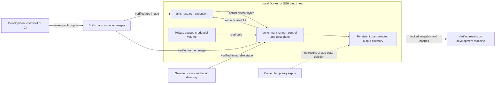

# AI4R build, run and benchmark operations

The default local path uses Docker Compose and the existing app and
benchmark-runner images. No host Python launcher or private operator config is
required. The optional `python deploy/m1/ai4r.py` workflow remains available for
managed staging and SSH deployments. The benchmark CLI keeps its existing
authenticated interface and sequential queue.

For benchmark runs, Harbor adds trial orchestration and independent grading
above this deployment workflow. See
[HARBOR-INTEGRATION.md](HARBOR-INTEGRATION.md). It covers separate application,
Harbor and inference hosts, public-only staging and recovery over SSH.
Standard application runs do not require Harbor.

For the key-free E4B router, local executor pool and fixed Qwen verifier on a
single DGX Spark, use [SPARK-LOCAL-MODELS.md](SPARK-LOCAL-MODELS.md). It extends
this same operator/app on 5175 and preserves the existing comparison mode.

## Start here: ordinary Docker, no sudo

Build the images, then start the existing app. Its explicit local-research mode
captures the authored local operator config and bootstrap bindings in the app's
state volume. This initializes local wiring only; it does not admit science
resources, establish readiness or qualify a research result.

```sh
export AI4R_LOCAL_WORKSPACE=1
export AI4R_LOCAL_CHAT=1
docker compose -p ai4r-local -f deploy/m1/compose.benchmark-runner.yaml \
  --profile benchmark build ai4r benchmark-runner
docker compose -p ai4r-local -f deploy/m1/compose.benchmark-runner.yaml \
  up -d ai4r
docker compose -p ai4r-local -f deploy/m1/compose.benchmark-runner.yaml \
  logs --tail 100 ai4r
```

Open the complete private bootstrap URL from the app log at
`http://127.0.0.1:5175` and complete the existing model sign-in. Keep the URL
private. Do not place provider credentials in Compose environment variables.
Sign in before issuing the runner grant. The grant command runs the existing
app image as a short-lived root provisioning container with the app account
volume and private runner-credential volume attached; it has no network and no
Docker socket. The app service itself never mounts the runner credential
volume. The token is written mode `0600`, owned by runner UID `11001`, and
mounted read-only at `/run/benchmark-runner/token`.

The public synthetic example explicitly selects the planned workflow and supplies
one PDF to the installed Summary and Delivery capsules. The static scientific
workflow requires additional experimental resources and cannot fulfill this
summary smoke. Replace the case and input paths with your selected files.

```sh
mkdir -p ./results
docker volume create ai4r-local_runner_credentials
docker run --rm --network none --read-only --cap-drop ALL \
  --cap-add SETUID --cap-add CHOWN --cap-add DAC_OVERRIDE \
  --security-opt no-new-privileges:true \
  --mount source=ai4r-local_accounts,target=/var/lib/ai4r-accounts \
  --mount source=ai4r-local_runner_credentials,target=/credential \
  --tmpfs /tmp:rw,nosuid,nodev,size=16m \
  --entrypoint /opt/venv/bin/python ai4r:local \
  -m jiuwenswarm.research.runner_grants issue-runner --output /credential/token

export AI4R_BENCH_CASES="$PWD/deploy/m1/examples"
export AI4R_BENCH_INPUTS="$PWD/deploy/m1/examples/inputs"
export AI4R_EXPECTED_BUILD="$(docker compose -p ai4r-local \
  -f deploy/m1/compose.benchmark-runner.yaml exec -T ai4r python -c \
  "import json; print(json.load(open('/usr/local/share/ai4r-build-identity.json'))['build_id'])")"
docker compose -p ai4r-local -f deploy/m1/compose.benchmark-runner.yaml \
  --profile benchmark up -d benchmark-runner
docker compose -p ai4r-local -f deploy/m1/compose.benchmark-runner.yaml \
  exec benchmark-runner benchmark-runner doctor --cases /cases/cases.json \
  --inputs /inputs --output /results --json
docker compose -p ai4r-local -f deploy/m1/compose.benchmark-runner.yaml \
  exec benchmark-runner benchmark-runner run --cases /cases/cases.json \
  --inputs /inputs --output /results --campaign-id trial-001 --json
mkdir -p ./results
docker cp "$(docker compose -p ai4r-local \
  -f deploy/m1/compose.benchmark-runner.yaml ps -q benchmark-runner):/results/." ./results/
```

The Compose app publishes only `127.0.0.1:5175`. Runner inputs/cases are
read-only binds; results persist in the deployment's named `results` volume and
the final command copies them to the selected host directory. Use a fresh campaign
ID for each run. Generated jobs use `AI4R_EXECUTION_MODE=m1_app_process` and
ordinary app-container processes. The app container has a 4 GiB / 256 PID
envelope; generated per-job resources use the fixed app runtime controls.

To load supplied images instead of building from this checkout:

```sh
docker load -i ai4r.tar
docker load -i benchmark-runner.tar
python deploy/m1/ai4r.py up --cases ./cases.json --inputs ./inputs --output ./results
```

Use `--app-image NAME --runner-image NAME` if the supplied images have other
names. `up` never builds or pulls implicitly. It creates a profile, pins the
actual image IDs/platform, stages only selected data, and starts the app. Use `python deploy/m1/ai4r.py logs` to find the private bootstrap/login
URL on localhost:5175, open that full URL, and complete the app's model
authentication. Then:

```sh
python deploy/m1/ai4r.py start --refresh-credential
python deploy/m1/ai4r.py runner doctor --json
python deploy/m1/ai4r.py runner run --campaign-id trial-001 --json
python deploy/m1/ai4r.py logs
```

If images need building from this checkout, ordinary Docker commands work:

```sh
docker build -f deploy/m1/Dockerfile.app --target production -t ai4r:local .
docker build -f deploy/m1/Dockerfile.sidecar --target benchmark-runner -t benchmark-runner:local .
```

Build for the execution machine's architecture. For Spark, build/load
`linux/arm64` images on the workstation using `docker buildx build --platform
linux/arm64 --load` in place of `docker build`. Do not infer ARM64 compatibility
from an AMD64 image name. Running existing images needs Docker/Compose, not a
Buildx installation.

For Spark from a workstation with the image pair already available locally:

```sh
python deploy/m1/ai4r.py --profile ./spark.json up --ssh spark --platform linux/arm64 --cases ./cases.json --inputs ./inputs --output /home/YOUR_USER/ai4r-results
ssh -N -L 5175:127.0.0.1:5175 spark
```

The same command transfers missing images and data, loads the images and starts
the app. The checked-in helper travels over SSH; no Spark source checkout,
registry, private scripts, build or host service installation is required.
Remote output paths are absolute paths on Spark. Replace `YOUR_USER` with your
actual writable location. After authentication, use `start --refresh-credential`
and `runner run` with `--profile ./spark.json` before the subcommand. Retrieve:

```sh
python deploy/m1/ai4r.py --profile ./spark.json fetch --campaign trial-001 --output ./retrieved-trial-001
```

`up` prints the generated `compose_file` path, so standard Docker inspection is
available on the execution host too:

```sh
docker compose -p ai4r-bench -f /path/from/up/compose.json ps
docker compose -p ai4r-bench -f /path/from/up/compose.json logs --tail 100 ai4r
docker compose -p ai4r-bench -f /path/from/up/compose.json exec benchmark-runner benchmark-runner --help
```

Normal `up`/`start` makes no host cgroup changes, invokes no sudo, and requests
no privileged container or Docker socket mount. WSL uses its configured default
user. Existing app/root-broker identities *inside* the image are unchanged.
The app can start and run explicitly selected M1 process jobs without a delegated
executor cgroup. This mode uses ordinary app-container processes and reports its
shared namespaces and inherited network honestly. Existing restricted-mode
captures retain their original requirements; they are never silently downgraded.

## Driving AI4R from another agent

Compose starts the application; the benchmark runner is an authenticated HTTP
client which starts research runs. It has neither a Docker socket nor direct
access to the application store. An external agent can execute the same runner
commands and inspect their JSON results, or use the typed HTTP interface:

| Operation | HTTP interface |
| --- | --- |
| Inspect context/readiness | `GET /api/v1/context`, `GET /api/v1/readiness` |
| Upload selected files | `POST /api/v1/inputs/{docs,repo,datasets}` |
| Qualify task and inputs | `POST /api/v1/intakes` |
| Submit research run | `POST /api/v1/runs` |
| Poll status/events | `GET /api/v1/runs/{id}`, `GET /api/v1/runs/{id}/events` |
| Reconcile uncertain submission | `GET /api/v1/runs?client_request_id=...` |
| Cancel | `POST /api/v1/runs/{id}/cancel` |
| Retrieve artifacts/evidence | `GET /api/v1/runs/{id}/artifacts`, `GET /api/v1/runs/{id}/export` |

Use the existing finite workspace-scoped runner grant and `ResearchClient`
contract validation. Prefer the CLI for campaign scheduling, reconciliation and
verified collection. Inside Compose the endpoint is `http://ai4r:5173`, with
the configured HTTP authority `127.0.0.1:5175`; a host client uses
`http://127.0.0.1:5175`. Tokens stay in private volumes and must not enter prompts
or logs. Docker availability, browser sign-in/MFA and explicit activation remain
human responsibilities. Routine invocations require no further browser driving.

## Isolated capability and verifier checks

Prefer [check-capsules.ps1](check-capsules.ps1) for retained, bounded checks:

```powershell
./deploy/m1/check-capsules.ps1 -Group all -Build
./deploy/m1/check-capsules.ps1 -Group capabilities -RepeatCount 2
./deploy/m1/check-capsules.ps1 -Group replay
```

It saves commands, image/source identities, logs, JUnit and result counts. See
[the reproduction guide](../../docs/capsules/reliability-reproduction.md) for
individual tests, failure controls and the limits of the recorded results.
The direct commands below remain available.

Build the existing verification target once. The following PowerShell commands
run individual capsules and their independent checks, without a research DAG,
login or network. Python and test dependencies stay in the image.

```powershell
docker build -f deploy/m1/Dockerfile.app --target verify -t ai4r-verify:local .
$checks = @(
  'tests/unit_tests/research/test_generalist_capsule.py',
  'tests/unit_tests/research/test_table_normalize_capsule.py',
  'tests/unit_tests/research/test_calculate_capsule.py',
  'tests/unit_tests/research/test_markdown_report_capsule.py',
  'tests/unit_tests/research/test_evaluation_replay.py'
)
docker run --rm --network none --workdir /workspace `
  --tmpfs /workspace/logs:rw,nosuid,nodev,size=64m `
  --mount "type=bind,source=$PWD,target=/workspace,readonly" `
  -e PYTHONPATH=/workspace ai4r-verify:local python -m pytest `
  -o addopts= -o log_cli=false -p no:cacheprovider `
  -W ignore::SyntaxWarning -q @checks
```

Select one file or `file.py::test_name` for a smaller test. These tests execute
actual capsule/check code with controlled model responses. They cover wrong
computed results, changed task identity/provenance, malformed tables, path
escapes, and replay custody failures. They verify mechanics, not live model
quality. An upstream SDK dependency emits the filtered Python SyntaxWarning.

For live repeated tests, the existing E3 single-capsule and E2 node-replay API
paths require a separately frozen evaluation profile, assets and runtime.
The local product capture has no evaluation profile, and this checkout has no
production command to prepare that closure from a captured run. That preparation
is still required; do not replace a product run's accepted output bytes.
Evaluation results are explicitly excluded from product acceptance.

A live campaign should retain each frozen input boundary and capsule/check pins,
then give every repeat a fresh bounded request and evidence record. Test valid
outputs alongside malformed evidence (Tier1 stops before inference) and
well-formed unsupported claims (independent semantic verifier must reject).
Record incorrect acceptance and incorrect rejection separately. A replayed gate
does not establish live scheduler locking or downstream release.

Re-run `up` with the same paths/profile to resume setup. Inputs, results and app
state are preserved. Use a new project/profile for a different app image; existing
installations are not silently upgraded. Scheduling remains optional (`maintenance
install`); ordinary launch installs no service.

## Design



The operator profile is generated data: target, project/deployment identity,
platform, immutable image IDs, paths and credential references. It contains no
token bytes. Default: `~/.local/share/ai4r/operator.json`; use `--profile PATH`
before the command to keep deployments independent. The target deployment root
holds generated Compose/configuration and data. No private workstation scripts
are imported. A remote host receives the checked-in helper source over SSH stdin.

## Prerequisites

- Python 3.10+; Docker with Compose and Buildx on the build machine.
- Docker access, Compose and writable deployment/input/output locations on the
  execution host. Linux executor prerequisites are needed only for tasks that
  actually use that executor. Preserve the host's NVIDIA environment.
- SSH trust/access and Python 3 on a remote host. Use an SSH config alias for
  hostname, user, key and port. Authentication is never bypassed.
- Buildx support for the requested platform. Spark uses `linux/arm64`;
  native/emulated builds do not establish native Spark execution or performance.

Windows uses the selected Docker context by default. To use a Linux Docker daemon
inside WSL, explicitly select `setup --wsl-distro Ubuntu-24.04` (or your actual
distribution). No distribution name or daemon socket is assumed. Docker Desktop
availability alone does not establish the app's Linux executor/cgroup support.

## Local workflow

Run from the repository root. Paths following `--root` and setup's `--output`
refer to the execution host; build output, stage sources and fetch output refer
to the development machine. For a WSL target use absolute WSL paths for target
directories. Generated deployment state stays outside the checkout.

```sh
python deploy/m1/ai4r.py setup
python deploy/m1/ai4r.py doctor
python deploy/m1/ai4r.py build --output /path/to/new-build-receipt-directory
python deploy/m1/ai4r.py stage --cases /path/to/cases.json --inputs /path/to/permitted-inputs
python deploy/m1/ai4r.py start
python deploy/m1/ai4r.py logs --service ai4r --tail 100
```

Open the complete private bootstrap/login URL from the app log on
`http://127.0.0.1:5175`. Complete the existing model sign-in in the app's settings.
Keep that URL private. Initialization makes no model calls or qualification claim.
Then provision a finite scoped runner grant and check the real app interface:

```sh
python deploy/m1/ai4r.py start --refresh-credential
python deploy/m1/ai4r.py runner doctor --json
python deploy/m1/ai4r.py runner run --campaign-id trial-001 --json
python deploy/m1/ai4r.py runner status --campaign-dir /results/trial-001 --json
python deploy/m1/ai4r.py fetch --campaign trial-001 --output /path/to/new-results-directory
```

Use a fresh campaign ID. `stage` supplies the default case filename, `/inputs`
and `/results` to the runner. An explicitly selected input directory is the
transfer unit: it must contain only permitted input material. The runner uploads
only case-referenced inputs to the app. JSON/YAML case validation stays in the
existing runner. A small **public synthetic** example is under `examples/`;
it is an execution fixture, not a held-out evaluation or a correctness claim.

The first `start` initializes the native catalog and recreates the app once.
Subsequent starts preserve state and avoid reinitialization. Runner grants are
renewed after app recreation or expiry. Linux non-root operators run the runner
under their UID/GID so its host files remain accessible; other targets use the
image's UID11001. The private credential volume always enforces mode0600.

Host executor provisioning is outside ordinary launch. The repository retains
`prepare-local-executor.sh` for previously managed installations, but `up` and
`start` never call it. No elevated host setup is required to start the containers.
The app continues reporting which execution capabilities are actually available.

For separate image build machines, use `stage --receipt PATH/receipt.json` after
making the receipt's exact images available in the selected local Docker engine.
Cached/offline rebuilds remain available through `build_two_images.py`, with an
explicit dependency image ID and `--platform`; the integrated default is a full
source build using the frozen lock and a dedicated bounded BuildKit cache.

## SSH / Spark workflow

Use another profile; the workstation remains the build host. A registry and a
Spark source checkout are unnecessary.

```sh
python deploy/m1/ai4r.py --profile /path/to/spark.json setup --ssh spark --platform linux/arm64
python deploy/m1/ai4r.py --profile /path/to/spark.json build --output /path/to/new-arm64-build
python deploy/m1/ai4r.py --profile /path/to/spark.json stage --cases /path/to/cases.json --inputs /path/to/permitted-inputs
python deploy/m1/ai4r.py --profile /path/to/spark.json start
ssh -N -L 5175:127.0.0.1:5175 spark
```

Use the tunnel for app sign-in; then use the same `start --refresh-credential`,
`runner`, `logs` and `fetch` commands with that profile. Keep 5175 free locally.
The app remains bound to loopback on the execution host.

Staging checks image IDs/platforms before loading and verifies file sizes/hashes.
SCP uses SFTP mode; where unavailable, bounded SSH-stdin chunks provide the same
verified transfer. Completed files/images are skipped on repeat. A partially
transferred file is retried from its beginning, not adopted blindly. Loaded image
transport archives are removed once the exact engine image verifies.

`fetch` takes the campaign's real runner lock, creates a stable snapshot, and
verifies every copied file before publishing a new local directory. Repeating a
failed fetch with the same destination resumes its saved snapshot and skips
verified files; an interrupted file is retransferred. Results on the execution
host are retained. Reports remain for human judgment.

## Recovery and expiry

```sh
python deploy/m1/ai4r.py runner cancel --campaign-dir /results/trial-001 --json
python deploy/m1/ai4r.py runner resume --campaign-dir /results/trial-001 --json
python deploy/m1/ai4r.py runner export --campaign-dir /results/trial-001 --json
python deploy/m1/ai4r.py stop
python deploy/m1/ai4r.py gc --dry-run
python deploy/m1/ai4r.py gc
python deploy/m1/ai4r.py maintenance install
```

Default expiry is **seven days** (`setup --ttl-days N` for a new profile).
Completed owned transfer/snapshot/build-context staging expires. Unused image
candidates require this deployment's exact labels, an expired TTL, no container
references and no current/rollback pin. There is no force removal or global prune.
Results, selected inputs, models, credentials and app/account volumes never expire.
Incomplete/unknown operations remain retained until reconciled; age is not proof
that execution stopped. Stop/start or cleanup cannot erase uncollected evidence.

Expiry runs during repeat setup, start and allocation. `maintenance install`
adds a daily Linux systemd user timer or Windows Task Scheduler job. Linux installs
an immutable, hashed copy of this repository's helper under `~/.local/lib/ai4r/`;
its deployment directory still contains no private executable dependency. A user
manager/host-managed lingering is required for Linux operation after logout. If
scheduling is unavailable, commands continue with opportunistic expiry and report
that limitation. Local build-context expiry on a workstation also runs with `gc`.

Container logs rotate at 3 × 10MiB; GC receipts rotate; the dedicated builder cache
has a 10GB GC target. Filesystem growth checks retain 20% headroom, including
transfer and fetch overlap. Builds monitor the client filesystem while active;
Docker Desktop's separate virtual disk still needs operator capacity monitoring.
Retained evidence and pins consume space: expiry never silently removes them to
make a run fit. When storage is insufficient, move retained data explicitly or
decline new work.

Existing installations are never automatically adopted. A new project refuses
foreign containers, networks and volumes even when names match. An initialized
deployment also refuses a changed app image; use a new project/profile for a new
candidate or an explicit operator-reviewed app/state upgrade. Historical native
profiles remain available but are not the new quick-start path.

Lifecycle commands inspect both campaign records and the app's actual run,
executor-claim and lease metadata through a read-only operator probe. Ordinary
active research also blocks stop/recreation. This is not an atomic admission-drain
API: keep the dedicated deployment idle while requesting lifecycle changes.

## Current validation

See [delivery status and verification extent](IMPLEMENTATION-STATUS.md) for the
exact pushed revisions, separate feature branches and remaining checks.

Host tests run with `python -m unittest discover -s tests/deployment -v`. They cover
real filesystem transfers/recovery and Compose rendering without a daemon, plus
transport/ownership/expiry boundaries. Existing sequential runner/report/archive
checks run separately. Windows and Linux/WSL were exercised during development.

The user reported a Docker ingest socket rename error. The latest direct probe
could not connect to the Linux engine pipe; the exact cause was not diagnosed. Image builds, live two-container campaigns, native ARM64 builds,
real SSH/Docker execution, scheduler activation and actual Spark operation remain
**NOT RUN**. Source/fixture checks do not establish these outcomes.

## Planned benchmark cases

Use `plan_source: planned` on a supplied `sequential-cases:1` case to exercise the
normal core typed Planner. `static` is also accepted; omission keeps the app
default. The choice is frozen before submission and preserved on resume. Read
[Planner operation and migration](../../docs/capsules/typed-planner-m1.md) before
reusing a deployment with an older captured catalog. Setup does not overwrite
existing app state or silently qualify a changed release.
