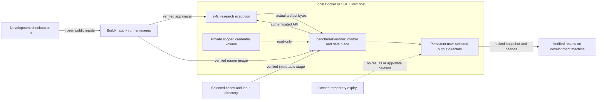

# AI4R build, run and benchmark operations

All executable source is in this repository. Start with `python deploy/m1/ai4r.py
--help`. Host tooling uses only Python's standard library. It controls Docker;
the app and benchmark CLI run in the two separate containers. The benchmark CLI
keeps its existing authenticated interface and sequential queue.

## Design



The operator profile is generated data: target, project/deployment identity,
platform, immutable image IDs, paths and credential references. It contains no
token bytes. Default: `~/.local/share/ai4r/operator.json`; use `--profile PATH`
before the command to keep deployments independent. The target deployment root
holds generated Compose/configuration and data. No private workstation scripts
are imported. A remote host receives the checked-in helper source over SSH stdin.

## Prerequisites

- Python 3.10+; Docker with Compose and Buildx on the build machine.
- A Linux Docker execution host with cgroup v2, the existing AI4R executor
  prerequisites and Docker access. Preserve the host's NVIDIA environment.
- SSH trust/access and Python 3 on a remote host. Use an SSH config alias for
  hostname, user, key and port. Authentication is never bypassed.
- Buildx support for the requested platform. Spark uses `linux/arm64`;
  native/emulated builds do not establish native Spark execution or performance.

Windows uses the selected Docker context by default. To use a Linux Docker daemon
inside WSL, explicitly select `setup --wsl-distro Ubuntu-24.04` (or your actual
distribution). No distribution name or daemon socket is assumed. Docker Desktop
availability alone does not establish the app's Linux executor/cgroup support.

## Local workflow

Run from the repository root. Paths following `--root` and setup's `--output`
refer to the execution host; build output, stage sources and fetch output refer
to the development machine. For a WSL target use absolute WSL paths for target
directories. Generated deployment state stays outside the checkout.

```sh
python deploy/m1/ai4r.py setup
python deploy/m1/ai4r.py doctor
python deploy/m1/ai4r.py build --output /path/to/new-build-receipt-directory
python deploy/m1/ai4r.py stage --cases /path/to/cases.json --inputs /path/to/permitted-inputs
python deploy/m1/ai4r.py start
python deploy/m1/ai4r.py logs --service ai4r --tail 100
```

Open the complete private bootstrap/login URL from the app log on
`http://127.0.0.1:5175`. Complete the existing model sign-in in the app's settings.
Keep that URL private. Initialization makes no model calls or qualification claim.
Then provision a finite scoped runner grant and check the real app interface:

```sh
python deploy/m1/ai4r.py start --refresh-credential
python deploy/m1/ai4r.py runner doctor --json
python deploy/m1/ai4r.py runner run --campaign-id trial-001 --json
python deploy/m1/ai4r.py runner status --campaign-dir /results/trial-001 --json
python deploy/m1/ai4r.py fetch --campaign trial-001 --output /path/to/new-results-directory
```

Use a fresh campaign ID. `stage` supplies the default case filename, `/inputs`
and `/results` to the runner. An explicitly selected input directory is the
transfer unit: it must contain only permitted input material. The runner uploads
only case-referenced inputs to the app. JSON/YAML case validation stays in the
existing runner. A small **public synthetic** example is under `examples/`;
it is an execution fixture, not a held-out evaluation or a correctness claim.

The first `start` initializes the native catalog and recreates the app once.
Subsequent starts preserve state and avoid reinitialization. Runner grants are
renewed after app recreation or expiry. Linux non-root operators run the runner
under their UID/GID so its host files remain accessible; other targets use the
image's UID11001. The private credential volume always enforces mode0600.

The executor preparer uses a project-specific cgroup branch. If noninteractive
sudo is unavailable, `start` provides this explicit preparation command, which
must run on the actual Docker host:

```sh
sudo env AI4R_EXECUTOR_PROJECT=ai4r-bench bash deploy/m1/prepare-local-executor.sh
```

For separate image build machines, use `stage --receipt PATH/receipt.json` after
making the receipt's exact images available in the selected local Docker engine.
Cached/offline rebuilds remain available through `build_two_images.py`, with an
explicit dependency image ID and `--platform`; the integrated default is a full
source build using the frozen lock and a dedicated bounded BuildKit cache.

## SSH / Spark workflow

Use another profile; the workstation remains the build host. A registry and a
Spark source checkout are unnecessary.

```sh
python deploy/m1/ai4r.py --profile /path/to/spark.json setup --ssh spark --platform linux/arm64
python deploy/m1/ai4r.py --profile /path/to/spark.json build --output /path/to/new-arm64-build
python deploy/m1/ai4r.py --profile /path/to/spark.json stage --cases /path/to/cases.json --inputs /path/to/permitted-inputs
python deploy/m1/ai4r.py --profile /path/to/spark.json start
ssh -N -L 5175:127.0.0.1:5175 spark
```

Use the tunnel for app sign-in; then use the same `start --refresh-credential`,
`runner`, `logs` and `fetch` commands with that profile. Keep 5175 free locally.
The app remains bound to loopback on the execution host.

Staging checks image IDs/platforms before loading and verifies file sizes/hashes.
SCP uses SFTP mode; where unavailable, bounded SSH-stdin chunks provide the same
verified transfer. Completed files/images are skipped on repeat. A partially
transferred file is retried from its beginning, not adopted blindly. Loaded image
transport archives are removed once the exact engine image verifies.

`fetch` takes the campaign's real runner lock, creates a stable snapshot, and
verifies every copied file before publishing a new local directory. Repeating a
failed fetch with the same destination resumes its saved snapshot and skips
verified files; an interrupted file is retransferred. Results on the execution
host are retained. Reports remain for human judgment.

## Recovery and expiry

```sh
python deploy/m1/ai4r.py runner cancel --campaign-dir /results/trial-001 --json
python deploy/m1/ai4r.py runner resume --campaign-dir /results/trial-001 --json
python deploy/m1/ai4r.py runner export --campaign-dir /results/trial-001 --json
python deploy/m1/ai4r.py stop
python deploy/m1/ai4r.py gc --dry-run
python deploy/m1/ai4r.py gc
python deploy/m1/ai4r.py maintenance install
```

Default expiry is **seven days** (`setup --ttl-days N` for a new profile).
Completed owned transfer/snapshot/build-context staging expires. Unused image
candidates require this deployment's exact labels, an expired TTL, no container
references and no current/rollback pin. There is no force removal or global prune.
Results, selected inputs, models, credentials and app/account volumes never expire.
Incomplete/unknown operations remain retained until reconciled; age is not proof
that execution stopped. Stop/start or cleanup cannot erase uncollected evidence.

Expiry runs during repeat setup, start and allocation. `maintenance install`
adds a daily Linux systemd user timer or Windows Task Scheduler job. Linux installs
an immutable, hashed copy of this repository's helper under `~/.local/lib/ai4r/`;
its deployment directory still contains no private executable dependency. A user
manager/host-managed lingering is required for Linux operation after logout. If
scheduling is unavailable, commands continue with opportunistic expiry and report
that limitation. Local build-context expiry on a workstation also runs with `gc`.

Container logs rotate at 3 × 10MiB; GC receipts rotate; the dedicated builder cache
has a 10GB GC target. Filesystem growth checks retain 20% headroom, including
transfer and fetch overlap. Builds monitor the client filesystem while active;
Docker Desktop's separate virtual disk still needs operator capacity monitoring.
Retained evidence and pins consume space: expiry never silently removes them to
make a run fit. When storage is insufficient, move retained data explicitly or
decline new work.

Existing installations are never automatically adopted. A new project refuses
foreign containers, networks and volumes even when names match. An initialized
deployment also refuses a changed app image; use a new project/profile for a new
candidate or an explicit operator-reviewed app/state upgrade. Historical native
profiles remain available but are not the new quick-start path.

Lifecycle commands inspect both campaign records and the app's actual run,
executor-claim and lease metadata through a read-only operator probe. Ordinary
active research also blocks stop/recreation. This is not an atomic admission-drain
API: keep the dedicated deployment idle while requesting lifecycle changes.

## Current validation

Host tests run with `python -m unittest discover -s tests/deployment -v`. They cover
real filesystem transfers/recovery and Compose rendering without a daemon, plus
transport/ownership/expiry boundaries. Existing sequential runner/report/archive
checks run separately. Windows and Linux/WSL were exercised during development.

Docker Desktop on this machine failed to start because its ingest socket could
not be renamed. Image builds, live two-container campaigns, native ARM64 builds,
real SSH/Docker execution, scheduler activation and actual Spark operation remain
**NOT RUN**. Source/fixture checks do not establish these outcomes.

## Planned benchmark cases

Use `plan_source: planned` on a supplied `sequential-cases:1` case to exercise the
normal core typed Planner. `static` is also accepted; omission keeps the app
default. The choice is frozen before submission and preserved on resume. Read
[Planner operation and migration](../../docs/capsules/typed-planner-m1.md) before
reusing a deployment with an older captured catalog. Setup does not overwrite
existing app state or silently qualify a changed release.
