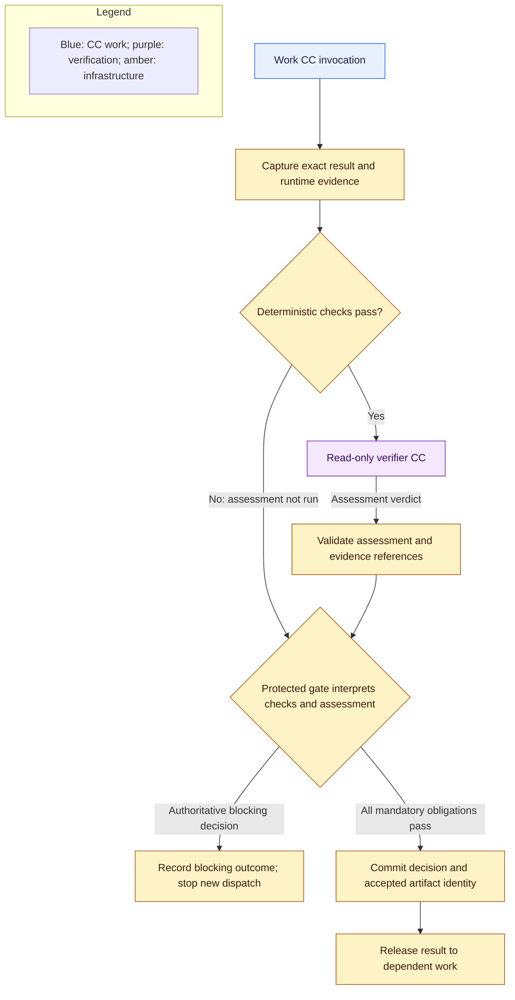

# Capsules, verification, and library

**Reading level: human potential.** Question answered: How do reusable CCs execute, get checked and enter the library; what composition remains future work?

## Invocation and authority

`V ⊆ C`: runtime verifier capsules are a subset of capability capsules. `G ∩ C = ∅`: protected gates are separate infrastructure roles. The [composition notation](glossary.md#composition-notation) distinguishes subtype, dependency, binding and permission intersection. A gate uses a verifier assessment; it does not inherit capsule identity or delegate release authority to the capsule author.

**Required now.** A CC describes a reusable capability; a node encapsulates a product responsibility under a Node Execution Contract; each internal subnode binds one pinned CC. The [field reference](capsule/declaration.md) defines one reconciled current declaration and [exact schema](reference/schemas/capsule-declaration.schema.json). A code/tool CC, agent/prompt CC or supported service adapter has the same declared boundary. Composite CC creation and execution remain later work. The runner resolves the pinned implementation, binds accepted inputs and scoped context, enforces permissions and limits, executes known code or a bounded native agent loop, and captures actual outcomes.

A node contract restricts each CC independently: effective authority is the intersection of that CC’s admission, the node and subnode contracts and run policy. Permissions from another bound CC are never transferred or unioned into its authority. Node-wide budgets cover every invocation, and each invocation also obeys its own limits. Additional work CCs use separate gated subnodes within their declared node. Unsupported composition blocks admission/binding.

An agent loop may call permitted tools; M1 does not support internal CC dispatch. It cannot rewrite the outer graph, upstream requirements, checking criteria, permissions, or accepted artifacts. Ordinary private helpers are not automatically separate CCs; their behavior remains the invoking capsule's responsibility.

Reusable guard definitions, full-context check-plan binding, independent profile ownership and output-led evidence disclosure are specified in [guard design](guard-design.md). Capsule authors can document guarantees, propose candidate checks and run self-tests; they do not author or approve the mandatory deterministic check bundle associated with their usable CC version.

Every admitted/usable CC version is explicitly associated with an immutable, independently owned deterministic check bundle. The bundle is a separately versioned library record, not capsule-author-controlled declaration or implementation content. Reuse across CC versions requires an explicit compatibility association. Admission binds the exact CC version, bundle version and compatibility evidence; execution and freeze pin those identities together. A new CC version or changed bundle requires a new association and applicable admission. Existing frozen runs retain the old pins. This reusable capsule baseline supplements, and never replaces, checks derived from the run-specific Subnode/Node Execution Contracts and policy.

## Exact verification boundary

Checking has one owner page. [Guard design](guard-design.md) specifies the host check bundle, the declaration-and-output-only verifier, assessment validation, the protected gate and how the binder attaches the pinned bundle and profile. [Verifier page](reference/capsules/verifier.md) lists the verifier criteria. Every work invocation, including planning and delivery, has a pinned verification assignment. A CC without an eligible explicit bundle association blocks readiness, binding and graph freeze.

## Evaluator Gate internals and referee protection

The gate, its verdict and its commit rules are in [guard design](guard-design.md). The verifier CC ends the semantic checking branch, so no verifier-of-verifier chain exists. [Human callbacks](failure-and-human.md) define every non-advancing outcome.

## Library lifecycle

**Required now.** Publish declarations and referenced implementation closure together as immutable versions. The M1 bootstrap catalog is an explicit, bounded set of existing versions designated for the initial build; file presence alone never grants use. Bind each bootstrap version to an immutable independently maintained shared checking bundle and record its exact identity. This bootstrap record enables the first main path but is not evidence of capsule-specific correctness or a completed governed admission gate. Keep activation and suspension under human standing control. Once the governed admission gate is implemented, disable bootstrap defaults for every new or changed version; those candidates require a protected eligibility decision with independent evidence and an exact compatible bundle. Existing bootstrap records remain usable unless suspended or revoked. Retain versions, bundle associations and decisions.

Admission eligibility and activation are distinct. The explicit M1 bootstrap set is available to the initial planner; human standing controls later activation, suspension and rollback. Bootstrap is temporary admission policy, not a capsule-specific quality verdict. Once the governed gate exists, every new or changed version needs protected eligibility based on identity, dependency closure, permissions, independent evidence and an exact compatible bundle. Under D21, M2 may automatically admit an RSI-produced version only after that same protected gate passes. The candidate cannot choose or alter its bundle; protected admission may resolve one only from a pre-approved compatibility association uniquely covering the exact version. Missing or ambiguous coverage blocks. Passing eligibility may make a version available to future plans without separate human activation; it never changes a frozen run. Existing runs keep exact CC and bundle pins. Suspension blocks new starts; preserve in-flight evidence and recheck eligibility before release. Never substitute a version silently. Hand-authored and generated candidates follow the same governed path after bootstrap ends; RSI is not required to author or use the library.

## RSI boundary

RSI is an optional, separately buildable target. It has no import, startup, test, or core acceptance dependency; the core parent export remains independent of RSI availability. RSI cannot change live workflow or mandatory verifier/referee boundaries.

Any CC or dependency supplying the checking assessment for a mandatory gate is outside RSI's mutation scope. Protection includes its prompts and rubrics, deterministic checks and runners, policy, hidden fixtures, permission enforcement, library activation, and authoritative evidence storage. Capsule-local evolution metadata cannot expand that scope. Screening's explicitly mutable ranking helper is a work implementation, not permission to alter its verifier or gate criteria.

## Composition and optimization

**M1 distinction.** A node may contain predefined work/verifier subnodes and protected gates, each governed by its own assignment. Composite/merged CC creation and arbitrary intra-capsule dispatch remain later work; fixed node cooperation does not create a reusable composite capability.

**Future direction; not M1 implementation.** A composite would declare pinned members and wiring as an internal DAG with its own boundary ports. Resolve its complete dependency closure and preserve scoped member calls, required verification, effects, and attributable evidence. An outer verifier does not erase member checks. Detect recursive dependencies; nesting must not bypass limits or grant additional authority.

**NOV-only future; not M1:** fusion replaces an admitted member graph with a separately admitted implementation after comparative evidence establishes the same contract meaning, effects, required verification, and traceability. Retain the unfused reference and member-to-fused provenance. Do not remove checking boundaries merely because the combined output looks correct. Fusion must be justified by this system's comparative evidence.

**Future compatibility:** interaction findings bind to versions, context, and evidence; record whether risk was predicted or execution-confirmed. **M2 target: November 2026; not M1:** Generalist behavior and automatic RSI generation/admission. **M3 target: December 2026:** composition/fusion. **2027 target:** spatiotemporal lifecycle. Any borrowed skill-interaction analysis must be evaluated against the isolated CC execution boundary. Predicted risk cannot certify safety or replace live verification.

**Future compatibility (not M1).** Preserve dependency, effect, idempotency, reversibility, and lifecycle declarations for spatiotemporal composition, planned for 2027. **Future direction:** install, drain, replace, and compensate capabilities during long runs through a separate lifecycle mechanism. M1 changes take effect between runs. Removal from routing must never delete historical evidence or pretend external emissions were undone.

## Per-CC build coverage

See [CC ports and checking map](cc-build-coverage.md).
