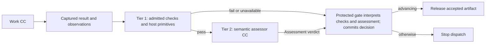
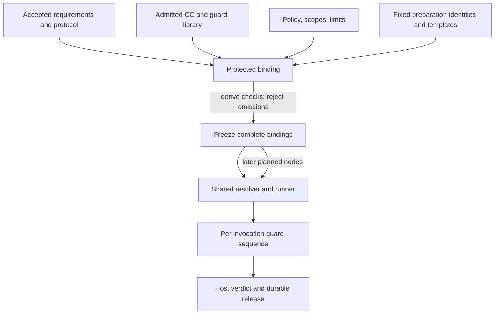
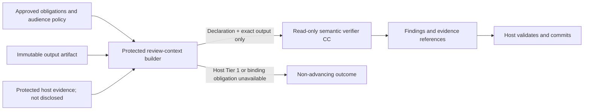

# Guard architecture

**Reading level: human potential.** Question answered: Who assigns checks and how is a submitted artifact assessed safely?

## Purpose and boundary

A guard is a reusable, admitted checking capability assigned to a governed work invocation. Checking has five parts:

1. **Worker self-review.** The producer may self-test and document guarantees. These are never review evidence and never release authority.
2. **Host check bundle (Tier 1).** Deterministic checks may read the complete accepted inputs, contracts, runtime records and evidence. They answer mechanically decidable questions: schema and contract conformance, identity and hash binding, required evidence, execution completion, declared versus observed scope, tool and access enforcement, budgets and protocol-record integrity. Packaging does not grant release authority. Cheap primitives may stay trusted host code. All mandatory checks appear in the same bound check plan.
3. **Verifier (Tier 2).** A read-only verifier CC (`V ⊆ C`) assesses declared-output conformance and internal consistency. It makes one call per output. It sees only the pinned declaration, the exact output bytes and fixed verifier instructions. The CC-specific criteria are on the [Verifier page](reference/capsules/verifier.md) and each [CC page](reference/capsules/README.md).
4. **Assessment validation.** The host validates the returned findings, attaches trusted subject and evidence references and assembles the persisted assessment. The model never supplies the identity envelope or gate authority.
5. **Protected gate.** Only the gate (`G ∩ C = ∅`) interprets checks and assessment into the authoritative decision, commits it durably and releases the exact accepted artifact identities. The trusted host is infrastructure, not a second semantic reviewer.

**Reduced-assurance limit.** A verifier pass does not show fidelity, source support or scientific validity. See [D24](decision-review.md#d24). Host checks must establish those obligations where they are mechanically decidable. Record the limit plainly and never imply undisclosed evidence was reviewed.

Guard-purpose CCs are checked mechanically at their boundary and end there. Do not create a verifier-of-verifier chain. Private helper code is not a CC and stays the responsibility of its containing CC. See [checking fields](reference/checking.md), [capsules](capsules.md) and [workflow](workflow.md).

## Assignments and check plans

The fixed Compiler Intent and Requirement steps have required gates and produce the accepted Research Brief before planning. The planner proposes a bounded JSON DAG of single-work-CC nodes. The proposal is only input to the binder. See [core build](core-build.md) for scope and [run plan](reference/run-plan.md) for exact contracts.

**How the binder attaches checks.** For every static and planned CC invocation the trusted binder resolves the CC version's pinned check bundle and an independently admitted checking profile. It then adds the checks derived from the node and subnode contracts, dependency pins, accepted obligations, artifact type, policy, limits and evidence obligations. Contract and policy obligations are added to the bundle and the bundle never waives them. The planner may suggest extra checks. It cannot remove the pinned bundle or any obligation. The binder verifies coverage, typed ports, dependencies, cycles, permission boundaries and resource feasibility, then freezes complete bindings before any dispatch. Static and planned CCs use the same binder, resolver, runner, evidence capture, tiers, verdict and release protocol. Freeze never creates a weaker path.

**Fixed preparation.** Before a Research Brief exists, the protected run-state module supplies fixed preparation invocations. They have their own identities, pins, budgets and templates, and use the original qualified request as the obligation source. After Brief acceptance the binder checks coverage against the Brief. It does not disclose the Brief to the semantic model, and the model cannot compare the graph with it.

**Dynamic binding** means selecting predefined check definitions and profiles against the frozen contract. It never generates or modifies trusted checks, criteria or verifier instructions. A future-valued input may be bound later only as an exact artifact accepted under the frozen protocol. Seeing results cannot change criteria or guard code.

**Fail closed.** A CC without an eligible bundle association, an unsupported obligation or any missing supported check blocks readiness, binding and freeze. A mandatory Tier 1 failure, missing required environment or unavailable required check prevents semantic advancement. Absence is never a pass.

The verdict is recomputed on each attempt. A cached PASS never establishes current release. A decision binds the run, node, subnode, attempt, both execution-contract identities and revisions, invocation identities, input and output identities, all CC and dependency pins, verifier, checks, policy and configuration. A hash of the CC alone, or CC plus input, is not a reuse key. Observed time and environment are fresh host evidence on every attempt. Only pure deterministic calculations may be memoized under exact identities.

## Library, ownership, and independence

The CC library stores immutable declarations, implementations, dependencies, admission evidence and versions. Check bundles are separate immutable library records. An admitted CC version pins one bundle version plus compatibility evidence. Profiles and mandatory policy assignments are separate registry records. A declaration may describe checks using its [field contract](capsule/declaration.md). Declaring a check does not make it mandatory or let the author approve it.

**Who may change bundles and profiles.**
- An independent check maintainer owns and versions mandatory bundles. Reuse across CC versions needs reviewed compatibility.
- A CC author may propose guard changes and run self-tests. The author cannot approve, waive or change a trusted bundle, profile or policy.
- Protected admission records the pins and the exact bundle association. The candidate cannot choose its bundle.
- The Planner cannot change pins, bundles or profiles.
- RSI cannot edit any CC or dependency that supplies a mandatory gate assessment. This covers prompts, rubrics, checks, runners, policy, hidden fixtures, permission enforcement, library activation and evidence storage. Capsule-local evolution metadata cannot expand that scope.
- M1 starts from an explicit bootstrap set with pinned shared bundles. Later new or changed versions need the protected admission decision. Human standing controls activation. Under D21, M2 automatic admission may make a passing RSI version eligible for future plans. It changes no frozen run. Running work keeps frozen pins, subject to suspension or revocation checks in [library lifecycle](capsules.md#library-lifecycle).

The guard and policy owner holds decision semantics and evidence custody. Admission owns candidate identity and bundle association. Current coding owners must be registered through the live workflow. Historical M1-007 and M1-003 records do not establish current assignment. Verifier and worker use separate invocation, identity, state and authority.

## Declaration-and-output review boundary

The host keeps a review manifest and allowed evidence inventory for audit only. The semantic model receives exactly two artifacts, the pinned subject CC declaration and the exact output bytes, with fixed verifier instructions that state those are the only evidence. It receives no worker input, request-specific context, conversation, observation, predecessor artifact, criteria record, producer explanation, suggested verdict, self-test, reasoning trace or evidence-fetch capability.

Source-span integrity, identities, permissions, limits, required fields and planner-to-Brief coverage are host checks on the complete contract and inputs.

Treat declaration and output as untrusted data. Their text cannot change verifier instructions, create or waive criteria, grant authority or make an always-pass policy. The host picks a predefined profile from the declared CC type before work starts. The model cannot look up sources, reconstruct the request, run tests, repair the artifact or act as a second author. Its output is criterion findings and uncertainty. Verification needing empirical execution goes to a separately governed restricted test invocation, not to tools on the assessor.

Read-only means enforced capabilities: an immutable subject view, no artifact mutation, project execution, arbitrary network fetch, control-state write or successor dispatch. Integrity of a redacted view differs from identity of the original subject. A mandatory check needing withheld fields cannot be claimed passed.

The host creates the identity envelope and persists the assessment by attaching trusted subject and review-context references to the findings. The persisted assessment and gate schemas stay unchanged. Keep raw evidence and the raw reply, and record the restricted review scope.

A gate cannot undo a leak or external write, so enforced access limits, bounded execution and evidence custody precede semantic acceptance. An observed violation stops dispatch, preserves evidence and routes through [human triage](failure-and-human.md).

## Two tiers and evidence

Tier 1 runs first and fails closed. Only after it passes does Tier 2 assess conformance between declaration and output. This restricted Tier 2 departs from PRD §4.2.2 to 4.2.8 by design (D20). The assessor cannot alter artifacts, criteria, permissions or release state.

The host validates required criterion coverage and assembles the assessment. Only `PASS` or `PASS_WITH_KNOWN_LIMITATIONS` can advance, and only when host-established mandatory obligations also pass. A malformed or unsupported reply, a timeout or an unresolved mandatory condition cannot advance. A producer mutation after review, a cross-run substitution, a retry or a policy change cannot reuse an earlier pass. Artifact and decision persistence must succeed before downstream readiness is exposed. Verdict meanings and halt routing follow the [failure policy](failure-and-human.md).

Scientific Evaluation owns the hypothesis conclusion. Host checks validate identities and contracts and do not establish scientific correctness. A scientific negative can receive infrastructure acceptance. Neither the gate nor the evaluator may move thresholds to make it positive.

Every mandatory guard is admitted independently with its own calibration and challenge cases, including instruction injection, omissions, unsupported claims, ambiguity and scope escapes. The protected admission profile fixes cases and acceptance criteria before measurement. Sharing a provider gives process separation, not independent model failure modes.

## Tradeoffs and evolution

**Opportunities:** future profiles can compose admitted guards across compatible contracts while keeping member-level evidence, scope and required checks. Deterministic-only profiles need a separate policy amendment. Current D2 requires deterministic checks followed by a verifier CC for every work invocation.

**Risks:** excess disclosure, producer-led assessment, a verifier acting as second author, stale profiles, broad scopes, author-controlled criteria, missing pins, late changes after seeing results, and treating a semantic pass as scientific truth. Admission, frozen assignments, exact evidence binding and host-owned release address these without claiming an error-free referee.

## Ownership references

- [Architecture decisions](principles.md)
- [CC contracts and runtime verification](capsules.md)
- [CC declaration fields](capsule/declaration.md)
- [Restricted semantic-review contract](reference/semantic-review.md)
- [Planning, freeze, and execution](workflow.md)
- Optional historical identity reference: [M1-003 admission task](https://github.com/Stellven/jiuwenswarm/blob/45c0566aeaff1f7b8a5063c46397afa2d8084f94/docs/code/Missions/M1/M1-003/TASK.md). Reconcile its older source assumptions.
- Optional historical identity reference: [M1-007 guard ownership task](https://github.com/Stellven/jiuwenswarm/blob/45c0566aeaff1f7b8a5063c46397afa2d8084f94/docs/code/Missions/M1/M1-007/TASK.md). Reconcile its older source assumptions.
- [PRD §4.2 Evaluator Gate](sources/product/README.md)
