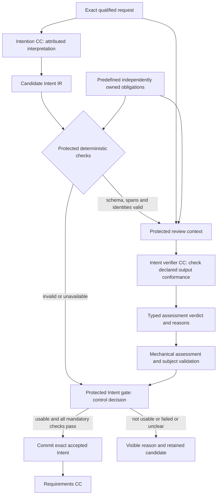
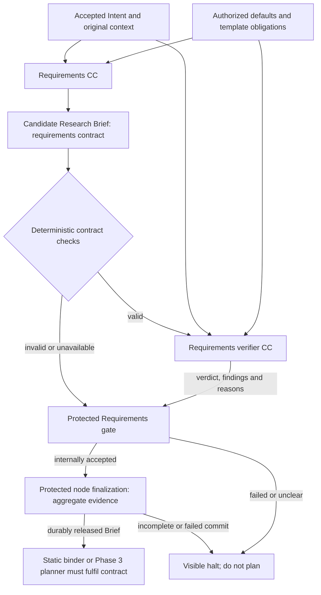

# Intention Compiler node: interpretation, requirements and release

**Reading level: human potential.** Question: what does the compiler need to understand, what must its verifier establish, and why does Requirements wait? [Immediate Plan](immediate-plan.md) selects the first build; [field contracts](reference/intent-and-requirements.md) define its interoperable data.

## Intention CC responsibility

The Intention Compiler is the enclosing node. This section describes its first work subnode; accepted Intent IR is intermediate. The Requirements subnode and both verification/gate paths are also mandatory. [Current build](builds/intention-compiler/README.md) reaches the Research Brief.

The Intention CC takes the exact qualified original request and permitted context. In a bounded generative pass it extracts the problem/research purpose, desired change, requested result, affected entities, scope, exclusions, constraints, preferences and stated targets. It preserves source attribution and separates absent information from stated values. It produces **Intent IR**, not a Research Brief or proposed scientific solution.

## Deterministic boundary

## Intent verifier responsibility

The arrows through Context in the diagram show host-side control and evidence custody; that review-context record is not sent to the semantic model. Its payload contains exactly the pinned Intent CC declaration and exact candidate IR bytes, plus fixed verifier instructions. The model receives no original request/source text, request-specific context, criteria records, observations, conversation or evidence-fetch capability. The verifier answers four questions: `declared_output_conformance`, `internal_consistency`, `limitations_consistency` and `uncertainty_consistency` ([definitions](reference/intent-and-requirements.md#verifier-criteria-intent)). Fidelity to the request and usefulness to Requirements belong to the Intent CC, which self-reviews its IR. Host checks on span bounds and reference resolution back that review ([producer obligations](reference/intent-and-requirements.md#producer-obligations-intent-cc)). A candidate saying it cannot determine the work carries `needs_clarification` and a blocking uncertainty, and the gate halts on it.

## Gate responsibility and human outcome

Protected host code validates the restricted declaration/output findings plus deterministic results, then writes the authoritative decision. It alone publishes accepted output after persistence succeeds. Missing references, contradictory output findings, failed mandatory obligations, explicit blocking uncertainty markers or unavailable mandatory host evidence cannot advance. The model cannot resolve request fidelity against undisclosed input; retain that reduced assurance as a limitation. A compiler-generated readiness flag is advisory.

## Requirements CC and the second boundary

Requirements receives **accepted** Intent, original context, supplied resource references and protected defaults. A second bounded generative pass produces the Research Brief: objective, scope, mandatory outcomes, optional preferences, constraints, targets, deliverables, acceptance expectations, evidence obligations, attributed assumptions/defaults and remaining uncertainty. It cannot silently repair misunderstood intent or select the eventual experiment.

The Requirements diagram shows host-side data flow. Its semantic model invocation contains exactly the Requirements CC declaration and exact candidate Brief output, plus fixed instructions; it receives no Intent, original context, defaults policy or other evidence. The host retains those records for binding and deterministic checks.

The Requirements verifier answers four questions: `declared_output_conformance`, `internal_consistency`, `limitations_consistency` and `requirement_link_completeness`. The Requirement CC owns preservation of accepted Intent and self-reviews its Brief. The host backs that review with deterministic checks on reference resolution, requirement-link coverage and default authorization ([producer obligations](reference/intent-and-requirements.md#producer-obligations-requirement-cc)). Conditions that host checks cannot establish must block.

## Source and build boundaries

D5 permits the selected fixed multi-pass sequence instead of the unchanged PRD's literal single bounded generation. Combined limits are frozen; each compilation remains bounded/non-interactive in the baseline. Verifier calls are separate checking work. The current Immediate Plan builds the whole compiler through accepted Research Brief. Complete Stage 2 includes qualified documents/resources, accepted Brief and initialized baseline graph; the Intent verifier is not downstream work Node B.

## Connected behavior summary

Intent compiler's candidate records its interpretation. Capture candidate → deterministic structure/reference/identity checks → restricted declaration/output conformance review → host assembles the existing Assessment → protected gate commits or halts. Invalid structure prevents verifier spend. Since the model cannot see source inputs, its pass does not establish fidelity, coherence or usability. Topic-only output may pass structural checks but must not be presented as verified actionable meaning.

Only host-accepted Intent reaches Requirements. Requirements produces a Research Brief for downstream use: objective, mandatory outcomes/preferences, scope, constraints, target metrics, deliverables, evidence and attributed authorized defaults. Never attribute defaults to the user; do not default missing purpose/result. Host checks and restricted declaration/output review apply; semantic preservation of Intent and completeness against it are not established. Conditions not decidable from host records block binder/planner. Defaults/profile cannot widen permissions. Hypothesis later registers experiment-specific criteria; Brief is not measured scientific success.

Phase 1 uses two bounded compiler passes under D5, no dialogue/repair. Phase 3 may declare bounded pre-acceptance clarification; accepted meaning/Brief and downstream contract remain governed. [Fields](reference/intent-and-requirements.md) connect producer obligations, deterministic checks and semantic obligations; examples show actionable, unusable, contradictory and negative-science cases.

## Connections and reference route

The whole node receives qualified intake and protected defaults, exposes accepted Research Brief, and connects to later static binding or Phase 3 Leader integration. Intent IR stays the verified intermediate between its work subnodes. [Fields and purpose](reference/intent-and-requirements.md), [node/subnode ownership](reference/node-execution.md), [verification cases](reference/compiler-verification.md) and [build scope](builds/intention-compiler/README.md) define the connected boundary.
