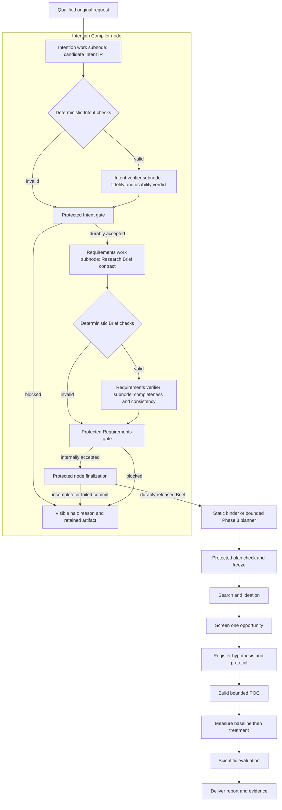
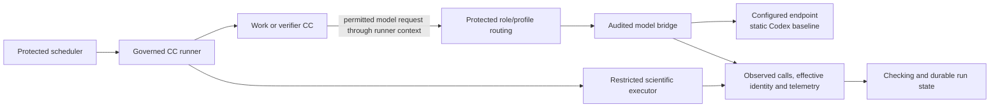
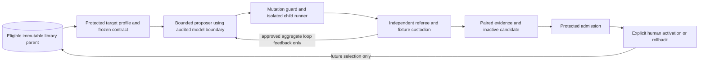

# System architecture

**Reading level: human immediate.** This page connects the whole M1 system. [Research design](research-design.md) expands each responsibility. [Reference](reference/README.md) defines the information crossing boundaries.

## From meaning to a governed research program

Intake captures the original request and qualifies permitted local documents/assets. It rejects unreadable required inputs rather than silently losing them. Intent compilation identifies the user's problem, desired change and requested result. Requirements turns accepted meaning into the Research Brief contract. Neither compiler chooses the scientific solution.

Search → Screening → Hypothesis → Builder → Benchmark → Scientific Evaluation → Delivery is one governed research sequence. Every stage uses the shared capture/check/verifier/protected-commit boundary. The diagram abbreviates those repeated boundaries. Scientific FAIL may be a valid accepted result, not infrastructure failure. The static template and the Planner both yield a [`run_plan`](reference/run-plan.md) ([D26](decision-review.md#d26)). An infeasible plan starts a linked Intention Compiler attempt. The scientific Research Benchmark CC is not the platform benchmark. Builder produces build evidence only.

## Execution and model routing

Each execution subnode binds one admitted CC version and its exact associated deterministic check-bundle version. The enclosing node contains its bounded work/verifier structure; protected binding adds applicable contract and policy checks. Additional work CCs use separate gated subnodes within their declared node. Verifier invocations remain separately governed checking assignments. Composite/merged CCs and arbitrary capsule member graphs remain later work.

## Where RSI connects

## Placement, state and human inspection

The application image contains the frontend, same-origin web/control API and workflow runtime. Its entrypoint starts the product. The browser reaches container port 5173 through host-loopback publication, normally `127.0.0.1:5173:5173`. No external UI script or separate frontend container is required. A separate sidecar/benchmarker uses configured private-network service DNS, the container port, scoped authentication and a compatibility handshake. Its own localhost is not the application.

SQLite owns durable lifecycle/release state. Immutable files retain artifacts and observations. Account/profile state survives run/workspace deletion. Readable views come from the same records. Restart pauses without replay, and saved inspection never executes work.

## Full product coverage and assigned core

| Scope | Build and acceptance meaning |
|---|---|
| Assigned core | Fixed Compiler → bounded Planner proposal → independent binding/checking/freeze → governed Search-to-Delivery journey, required resources, evidence and product control/inspection boundaries |
| Static template | Built first, selected before a run, same [`run_plan`](reference/run-plan.md) type. Not silent recovery or proof that planning works |
| Independent RSI | Separate offline target, pinned parent, unchanged referee and isolated candidate evidence; absence cannot block the core |
| Broader product continuation | Advanced compilation, heterogeneous routing, alternate-verifier studies and Code Mode remain separately scoped; Generalist/MCTS/composition refinement and later lifecycle work do not enter the core by implication |

The [Core build](core-build.md) owns the current assignment. The [complete Compiler route](builds/intention-compiler/README.md) remains reusable preflight/component context; its success alone does not establish a working Planner or research journey. [D19](decision-review.md#decisions-and-source-amendments) records the authorized difference from original Phase 1/2/3 allocations. Frozen source inputs and earlier evidence retain their identities. The [phase account](delivery-phases.md) keeps broader product obligations visible.
