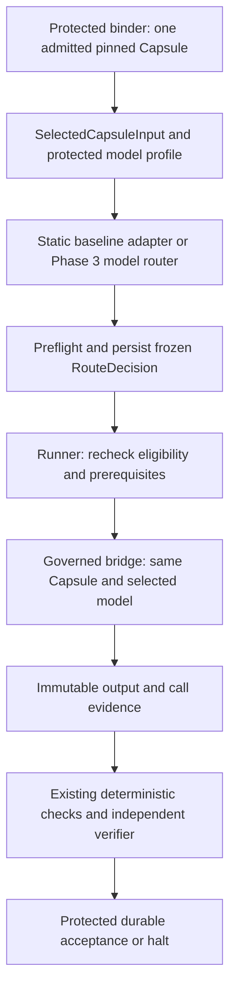

# Capsule–model-routing integration

**Architecture-owned shared contract.** The binder/runner owns this export, dispatch and authority; the routing owner owns model selection and the provider binding. The [router design](../model-routing/router-design.md) explains algorithms. Existing [declaration](../capsule/declaration.md) schema 1.0.0, [Subnode Contract](node-execution.md) 1.0.0 and enclosing Node field contract 2.0.0 remain unchanged. Machine field projections are in [field-contracts.json](field-contracts.json).

## Shared flow

Finalize node/subnode contracts before routing. The decision references those pins through the export; invocation evidence references the decision. Do not add the decision back into a finalized contract and create a hash cycle. The profile travels alongside the binding and is resolved under its protected configuration, never from Capsule extensions or producer preferences.

## Pinning, trust and readiness

Hash original captured artifact bytes, not reserialized JSON. The parsed declaration must equal the parsed pinned bytes; all implementation, overlay and dependency refs resolve to original artifacts. Keep exact-byte identity distinct from any separately pinned semantic hash profile. Overlay refs come from `identity.overlays`; implementation/dependency refs come from the selected binding and validated declaration closure. Upstream resolves floating dependencies before governed use.

Project the assigned subnode objective, concrete accepted inputs/required outputs, selected binding and runtime identities. Effective permissions are the existing intersection of admission, node, subnode and run policy. Routing cannot grant effects. Admission is immutable evidence; eligibility is current standing, so recheck suspension/revocation at dispatch. Preserve predicate timing: mandatory unknown/unavailable planning prerequisites block; explicitly deferred dispatch predicates must pass against the actual chosen deployment before execution.

`needs.model` already supplies tool calling, context, modalities, families and excludes. Authors populate actual requirements, without fabricated family restrictions or minimums. Supported loading modes/overlays, real context and declared ports contribute requirements. JSON serialization alone does not demand native provider JSON mode. Code-only/tool-only CCs needing no executor model bypass routing while retaining the governed runner. Scientific service pins remain tool dependencies.

## Identities, budgets and execution

Each `execution_id` maps explicitly to one governed CC invocation and its run/node/subnode/attempt. `workflow_id/task_id` are recorded correlation labels, not authorization or assumed aliases. Provider call IDs are separate. Router decision identity is not `ModelSelection.route_id`, which already means a model-group member.

Invocation and subnode model-call ceilings govern CC execution. A Judge consumes a separate protected routing allowance, included in node/run totals. Protect independent verifier execution and routing reservations, plus other required sibling work, before spending on the selected invocation. Apply stricter comparable execution caps (including declaration `wall_s` mapped to runtime `time_s`); do not mix invocation counts with model calls, currencies, or declared enforcement modes. Memory is a resource ceiling, not additive money. The pinned derived routing context retains the original Capsule budget/enforcement and effective limits, including applicable token/cost/tool/iteration obligations rather than dropping dimensions absent from the three-field runtime ceiling. Original request snapshots remain immutable; dispatch checks the live protected ledger. Unknown optional balances stay unavailable; a required unsupported hard cap blocks. Routing cannot borrow a verifier reservation.

One candidate skips Judge; zero fails; multiple candidates permit at most one profile-authorized Judge and at most one compatible predefined fallback before freeze. Judge calls use a pinned deployment and distinct purpose through the governed bridge, without recursively needing their subject's final task decision. Persist their attempt/call evidence first, then append the final decision link. The selection Judge is not the semantic verifier.

The runner consumes a persisted decision, rechecks the same Capsule/model and executes that pinned Capsule. Once frozen, no fallback rewrites the decision. Expiry, changed authorization or failed prerequisites terminate it. An explicit upstream retry creates a linked new attempt/invocation/execution. Repeated immutable requests are idempotent; changed bindings/inputs/profiles under the same key conflict. Disable implicit defaults, group failover and automatic provider replay. Record partial/uncertain effects rather than claiming exactly-once execution.

## Phase and review compatibility

Phase 1's static adapter projects this contract with the run-entry Codex route, `single_candidate`, no Judge, no API catalog snapshot and truthful configured-versus-served identity. Phase 3's API router requires approved endpoint access and qualification. Disabling experimental routing restores availability of the baseline configuration, not replay of a failed API task.

Verifier assignment, read-only context, guard profile and reserved spend remain independent. Its typed output is [Verifier Assessment](checking.md#verifier-assessment). The routing draft's separate engineering-review example does not replace that contract or the protected gate. Routing settings never become checking criteria.

## Contract versions

SelectedCapsuleInput, RouteRequest, ModelSelectionProfile and CallRecord start at 1.0.0. The existing `model-route` becomes 2.0.0 and is named RouteDecision at the component boundary. Version 1's generic role/profile record remains historical; migrate consumers explicitly instead of accepting old objects as new. Existing declaration and Node/Subnode versions remain pinned. Existing `invocation-observation` 2.0.0 links route/call records through `trace_refs`, so no observation schema change is needed.

### selected-capsule-input

| Field | Type | Meaning / why needed |
|---|---|---|
| `schema_version` | `string` | Format version 1.0.0 |
| `declaration` | `object` | Complete parsed declaration; validate existing exact schema against original bytes |
| `declaration_ref` | `Ref` | Original-byte declaration identity |
| `node_contract_ref` | `Ref` | Finalized parent |
| `subnode_contract_ref` | `Ref` | Finalized single-CC child |
| `bound_context` | `BoundRoutingContext` | Protected projection, not client claims |

**Invalid/missing behavior:** Missing, swapped, forged, changed, unsupported or ineligible input blocks; never choose another CC.

### model-selection-profile

| Field | Type | Meaning / why needed |
|---|---|---|
| `schema_version` | `string` | Format version 1.0.0 |
| `id` | `string` | Immutable profile identity |
| `mode` | `string` | static_codex or api_phase3 |
| `approved_model_ids` | `string[]` | Approved scope; empty denies all |
| `extra_requirements` | `RoutingRequirements` | Requirements only; no grant of tools or effects |
| `judge_allowance` | `JudgeAllowance` | Distinct protected overhead reservation |
| `fallback_model_id` | `nullable-string` | At most one predetermined compatible API fallback |
| `policy_ref` | `Ref` | Protected governing authorization |

**Invalid/missing behavior:** Missing/unauthorized profile blocks. Judge inability uses only the compatible configured fallback. Guard profiles remain independent.

### route-request

| Field | Type | Meaning / why needed |
|---|---|---|
| `schema_version` | `string` | Format version 1.0.0 |
| `request_id` | `string` | Immutable request identity |
| `workflow_id` | `string` | Explicit local correlation, not assumed equal to run_id |
| `task_id` | `string` | Upstream task attribution |
| `execution_id` | `string` | One governed invocation routing idempotency key |
| `user_id` | `string` | Authenticated session identity |
| `task_type` | `string` | Trusted task label |
| `task_summary` | `string` | Bound objective-derived summary |
| `domains` | `string[]` | Upstream applicability labels |
| `input_refs` | `Ref[]` | Same accepted inventory as the selected binding |
| `selected_capsule` | `SelectedCapsuleInput` | Exactly one upstream selected CC |
| `model_selection_profile_ref` | `Ref` | Protected immutable profile alongside the binding |
| `requirements` | `RoutingRequirements` | Narrowing hard constraints |
| `policy_ref` | `Ref` | Same protected policy |
| `preferences` | `RoutingPreferences` | Soft preferences only |

**Invalid/missing behavior:** Unknown task type, top-level role, changed idempotency input or inconsistent trusted binding rejects before task calls.

### model-route

| Field | Type | Meaning / why needed |
|---|---|---|
| `schema_version` | `string` | Format version 2.0.0 |
| `id` | `string` | Persisted immutable routing decision identity; not group route_id |
| `request_ref` | `Ref` | Exact request identity |
| `selected_capsule_ref` | `Ref` | Exact exported CC and protected context |
| `runtime` | `RuntimeIdentities` | Governed invocation attribution |
| `execution_id` | `string` | Routing execution key |
| `binding_id` | `string` | Same upstream binding |
| `role` | `string` | Protected attribution only |
| `model_selection_profile_ref` | `Ref` | Selection policy, distinct from guard profile |
| `registry_snapshot_ref` | `nullable-Ref` | Pinned API candidate snapshot; null for static baseline |
| `eligible_endpoints` | `string[]` | Permitted candidates |
| `excluded_reasons` | `ModelExclusion[]` | Deployment exclusions |
| `selected_endpoint` | `string` | One approved model ID |
| `deployment_ref` | `Ref` | Frozen model/adapter/endpoint/configuration pins |
| `identity` | `ModelIdentity` | Requested/observed identity with basis |
| `limits` | `Limits` | CC execution ceilings; separate routing overhead |
| `selection_method` | `string` | single_candidate, llm_judgment or predefined_fallback |
| `fallback_used` | `boolean` | Actual fallback path, not merely matching its ID |
| `ready_at` | `string` | Persisted ready timestamp |
| `valid_until` | `string` | Unexecuted decision expiry |
| `routing_context_ref` | `Ref` | Pinned derived requirements/context with adapter revision |
| `adapter_revision` | `string` | Exact normalization adapter revision; not a model quality claim |

**Invalid/missing behavior:** Missing or invalidated frozen decision blocks dispatch; no CC substitution, rerouting or replay inside the invocation.

### model-call

| Field | Type | Meaning / why needed |
|---|---|---|
| `schema_version` | `string` | Format version 1.0.0 |
| `id` | `string` | Unique local call/event identity |
| `route_attempt_id` | `string` | Preallocated attempt exists before Judge |
| `route_decision_ref` | `nullable-Ref` | Final frozen decision for task_execution; nullable during routing_judge |
| `execution_id` | `string` | Subject routing execution |
| `invocation_id` | `string` | Governed CC invocation attribution |
| `purpose` | `string` | routing_judge or task_execution |
| `deployment_ref` | `Ref` | Actual called deployment; Judge differs from selected task model |
| `model_selection_profile_ref` | `Ref` | Protected call authorization |
| `provider_request_id` | `nullable-string` | Provider correlation or unavailable |
| `identity` | `ModelIdentity` | Requested/effective actual model and basis |
| `started_at` | `string` | Observed call start |
| `ended_at` | `nullable-string` | Observed completion or uncertain |
| `outcome` | `string` | completed, failed or outcome_unknown |
| `usage` | `Usage` | Available telemetry; null is not zero |
| `evidence_refs` | `Ref[]` | Access-controlled immutable call evidence |
| `observed_runtime` | `boolean` | False for synthetic documentation examples; never acceptance evidence |

**Invalid/missing behavior:** Missing mandatory provenance blocks acceptance; uncertain outcomes are retained without automatic resend. Unknown usage is explicit.

## Shared supporting types

### RuntimeIdentities

| Field | Type | Meaning / why needed |
|---|---|---|
| `run_id` | `string` | Protected run_id |
| `node_id` | `string` | Protected node_id |
| `subnode_id` | `string` | Protected subnode_id |
| `attempt_id` | `string` | Protected attempt_id |
| `invocation_id` | `string` | Protected invocation_id |

### PrerequisiteReadiness

| Field | Type | Meaning / why needed |
|---|---|---|
| `id` | `string` | Declaration predicate |
| `status` | `string` | pass or deferred; unavailable/unknown mandatory checks block |
| `evaluable_at` | `string` | planning, dispatch or both |
| `evidence_refs` | `Ref[]` | Protected state/source evidence |

### RoutingBudgetSnapshot

| Field | Type | Meaning / why needed |
|---|---|---|
| `snapshot_ref` | `Ref` | Immutable initial protected ledger snapshot; live recheck is separate |
| `node_remaining` | `RoutingBudgetBalance` | Remaining node time/calls and effective memory ceiling |
| `subnode_remaining` | `RoutingBudgetBalance` | Remaining CC execution allowance |
| `verifier_reserved` | `RoutingBudgetBalance` | Reserved independent checking; no borrowing |
| `routing_reserved` | `RoutingBudgetBalance` | Routing overhead reservation, included in node totals |
| `tokens_remaining` | `nullable-integer` | Available attributable token balance or unavailable |
| `cost_remaining` | `nullable-number` | Available monetary balance or unavailable |
| `cost_currency` | `nullable-string` | Currency for comparable cost amounts |
| `unavailable_reasons` | `string[]` | Unsupported optional telemetry |
| `other_work_reserved` | `RoutingBudgetBalance` | Reserved other required work; not available to this invocation |

### BoundRoutingContext

| Field | Type | Meaning / why needed |
|---|---|---|
| `runtime` | `RuntimeIdentities` | Exact protected identities |
| `binding_id` | `string` | Selected single CC binding |
| `role` | `string` | Protected attribution label; not Router executor type |
| `objective` | `string` | Assigned subnode objective |
| `inputs` | `BoundNodeInput[]` | Named accepted concrete inputs |
| `outputs` | `BoundNodeOutput[]` | Required output contract |
| `implementation_refs` | `Ref[]` | Original-byte implementation pins |
| `overlay_refs` | `Ref[]` | Original-byte instruction/experience overlay pins |
| `dependency_refs` | `Ref[]` | Original-byte resolved dependency closure |
| `admission_ref` | `Ref` | Pinned admission decision; current standing rechecked |
| `eligibility` | `string` | Protected eligible standing at capture |
| `prerequisite_results` | `PrerequisiteReadiness[]` | Planning results and dispatch-deferred obligations |
| `effective_authority` | `AuthorityCeiling` | Existing binding authority intersection |
| `invocation_limits` | `Limits` | Existing chosen binding limits; CC execution scope |
| `subnode_limits` | `Limits` | Subnode execution ceilings |
| `node_limits` | `Limits` | Parent aggregate limits including routing and verification |
| `budget_snapshot` | `RoutingBudgetSnapshot` | Protected independent reservations and available balance |
| `policy_ref` | `Ref` | Governing protected policy |
| `configuration_ref` | `Ref` | Pinned configuration selecting the profile |

### RoutingRequirements

| Field | Type | Meaning / why needed |
|---|---|---|
| `tool_calling` | `boolean` | Additional positive capability requirement (optional) |
| `min_context` | `integer` | Additional minimum context (optional) |
| `modalities` | `string[]` | Additional required modalities (optional) |
| `families` | `string[]` | Additional model-family restriction (optional) |
| `excludes` | `string[]` | Excluded families/models under pinned interpretation (optional) |
| `native_structured_output` | `boolean` | Explicit native generation requirement, never inferred from JSON ports (optional) |
| `model_allowlist` | `string[]` | Optional narrowing; explicit empty list denies all (optional) |

### RoutingPreferences

| Field | Type | Meaning / why needed |
|---|---|---|
| `quality` | `string` | Soft quality preference with evidence basis (optional) |
| `cost` | `string` | Soft cost preference (optional) |
| `speed` | `string` | Soft speed preference (optional) |

### JudgeAllowance

| Field | Type | Meaning / why needed |
|---|---|---|
| `enabled` | `boolean` | Protected authorization for an internal selection call |
| `deployment_ref` | `nullable-Ref` | Pinned approved Judge; required when enabled |
| `model_calls` | `integer` | Zero when disabled; at most one when enabled |
| `time_s` | `number` | Protected routing deadline allowance |
| `output_tokens` | `integer` | Bounded billed output including reported reasoning |
| `disclosure_scope` | `string[]` | Permitted bounded Judge material; no credentials |

### ModelExclusion

| Field | Type | Meaning / why needed |
|---|---|---|
| `model_id` | `string` | Excluded deployment |
| `reason_codes` | `string[]` | Retained concrete exclusion reasons |

### RoutingBudgetBalance

| Field | Type | Meaning / why needed |
|---|---|---|
| `time_s` | `number` | Nonnegative remaining/reserved elapsed allowance; zero is exhausted or inapplicable |
| `model_calls` | `integer` | Nonnegative available/reserved model calls |
| `memory_mb` | `integer` | Positive effective resource ceiling; not additive spend |

## Integration acceptance scenarios

| Scenario | Required behavior / responsible boundary |
|---|---|
| Changed declaration/body/overlay/dependency bytes or wrong run/child | Binder export and router reject the exact subject; no substitution |
| Forged authority or profile / declined disclosure | Protected construction/lookup rejects; no Judge or task effects |
| Zero, one, multiple compatible models | Router fails, skips Judge, or calls Judge once respectively |
| Judge invalid/unavailable / fallback invalid | One compatible predefined fallback before freeze or attributable halt |
| Reserved verifier spend / exhausted or unsupported hard budget | No borrowing; block affected spend; optional unknown telemetry remains explicit |
| Deferred prerequisite, revocation, expiry | Dispatch blocks without mutating the frozen decision |
| Duplicate or changed-input execution key | Same immutable request reuses record; changed identity conflicts; concurrent requests do not duplicate Judge/dispatch |
| Later call failure, partial effects or crash uncertainty | Same model and Capsule throughout; no failover/replay; preserve outcome_unknown |
| Routing Judge versus task call / missing usage | Actual deployment/purpose retained; null/partial telemetry is not zero or complete cost |
| Independent verifier / misleading producer instructions | Existing assessment contract, immutable subject and isolated read-only authority; gate retains release |
| Code-only CC / scientific-tool backend | Governed non-model dispatch; scientific tool is not an executor candidate |
| Phase 3 disabled or unready | Fixed Phase 1 configuration remains available; API work is not automatically replayed |

The [synthetic export/request/decision/call examples](examples/README.md) support offline contract checks. Runtime behaviors above must become native TASK/IF acceptance cases for the routing and runner owners. Model qualification, real calls, atomic storage and effect enforcement require runtime evidence; these documents do not claim that evidence. The owning TASK records one implementation agreement referencing this architecture, without a second handoff/card hierarchy.
