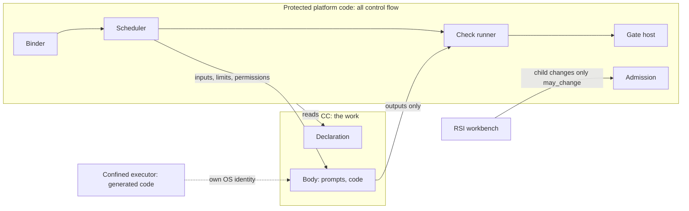
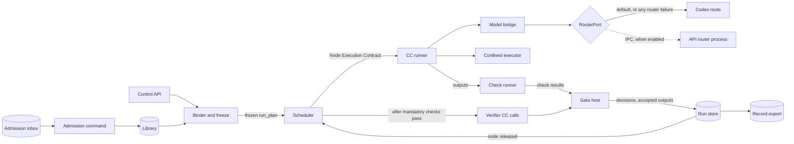
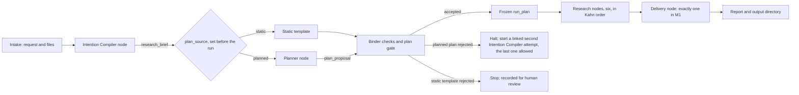
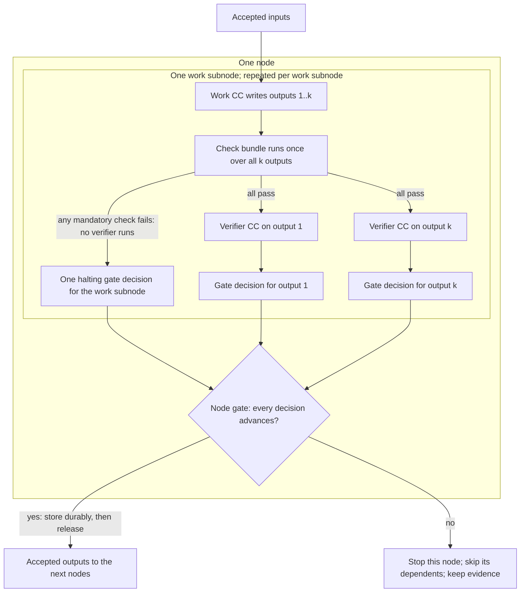
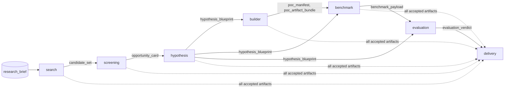

# 1. The system

`Tier 1 · Part of: README · Serves: Knowledge and Standard`

AI4Research builds on the existing JiuwenSwarm/OpenJiuwen runtime and adds governed research control. These views show the trust boundary, components, run flow and data ownership. See the [platform page](platform/README.md) for runtime reuse constraints and [native reuse evidence](reference/native-reuse-evidence.json) for source observations.

## Trust boundary: control flow outside, work inside

The system is built around one boundary ([D42](method/decisions.md#d42)). The components named here are defined in [Components](#components).

- **Inside a CC: the work only.** A CC is a reusable module, like a tool, a skill, an MCP (Model Context Protocol) server or an A2A (agent-to-agent) agent. It takes typed inputs and returns typed outputs. It does not know which workflow or node it serves. So an author can write a CC without knowing the pipeline.
- **Outside every CC: all control flow.** Protected platform code orders the work, checks it and decides whether it advances. "Protected" means no CC can call into it, change it or skip it. Everything that can halt a run or admit a CC is protected: binder, scheduler, check runner, gate host and admission. The RSI referee is protected too, in its own container.
- **The declaration is the only interface.** Protected code reads it to bind, limit and check the CC. It grants nothing by itself.
- **RSI changes only what the CC allows.** `evolution.may_change` lists the only parts an RSI child may change. Missing or empty means nothing ([D34](method/decisions.md#d34)). Checks, gates, the referee and fixtures are outside every CC, so improving a CC never weakens how it is judged.

**Diagram T.** Level: trust zones. Not shown: individual components (diagram B).

The verifier CC is also a CC, inside the boundary: it assesses, and only the gate host decides.

## Hot path and side systems

The **hot path** is the code a research run cannot work without. A **side system** is built in M1 but is **off the hot path**: a run works when it is absent, off or broken.

| Side system | How it stays off the hot path |
|---|---|
| Model router | Before each CC call, the model bridge asks `RouterPort`, the interface to the router, which model to use, and that model stays fixed for the call. With the router off or not installed, the bridge uses the fixed **Codex route**. If an enabled router fails, takes over 30 seconds to choose or names an unapproved model, the bridge uses the Codex route too: the **Codex fallback**, the only meaning of "fallback" here. `cc.router.enabled` is the one switch, allowed on only under an approved evaluation profile ([routing contract](reference/model-routing-contract.md)). |
| RSI workbench | Human-run, in its own container. Reads exported records; writes signed candidate versions to the admission inbox. A human admits and activates them. |
| Platform benchmark runner | An outside client in the sidecar container. Submits ordinary runs through the control API and scores their records. |

If a chosen model fails during a call, the node halts; nothing switches models mid-call. A Codex outage halts each node that calls a model, so runs cannot finish until Codex returns.

## Components

**Diagram B.** Level: components inside the app container, and who calls whom. Not shown: the steps of a run (diagram C), the side-system containers (diagram A).

| Component | Owns | Never |
|---|---|---|
| Control API | Authenticated submission, status, inspection, the record export | Starts work on inspection |
| Binder | Checks a plan, pins exact CC versions and their check bundles, freezes the `run_plan` | Lets a plan choose, drop or weaken a mandatory check |
| Scheduler | Starts each node once all its predecessors are done (Kahn order), builds each Node Execution Contract, creates verifier calls | Runs two nodes at once in M1 |
| CC runner | Runs one CC call within its limits and permissions; records what happened | Decides acceptance |
| Model bridge | The one path for every model call; asks `RouterPort` | Switches models during a call |
| Confined executor | Runs generated POC code under its own OS identity | Reaches credentials, run state or fixtures |
| Check runner | Runs the pinned check bundle | Lets the CC author change a check |
| Gate host | Writes every gate decision; releases outputs only after durable storage | Releases anything not stored |
| Run store | SQLite run state, immutable artifacts, append-only observations | Changes an accepted artifact |
| Library and admission | Admitted CC versions, their check bundles and standing | Admits without a human in M1 |

Detail: [platform](platform/README.md), [checking](checking/README.md).

## A run, node by node

A **node** is a unit of data flow. It takes accepted artifacts in and releases accepted artifacts out. An **artifact** is a typed record such as `intent_ir` or `research_brief`.

**Diagram C.** Level: nodes. Every box marked "node" holds the structure in diagram D. "Research nodes" stands for six nodes, drawn one by one in diagram F.

1. **Intake** qualifies the request and the files the user permits.
2. The **Intention Compiler** node (PRD 3.1 and 3.2) has two work CCs. The Intent CC states what the user means in the **Intent IR** (`intent_ir`), without choosing a solution. The Requirements CC turns accepted intent into the **Research Brief**: objectives, mandatory outcomes, scope, constraints, deliverables and evidence obligations.
3. The run setting `plan_source` picks the plan before the run ([D39](method/decisions.md#d39)). `static` (the default) uses the **static template**, a hand-written plan. With the Intention Compiler it is the PRD's Phase 1 Default DAG. `planned` uses the **Planner node**.
4. The **binder** checks the plan and binds it to exact CC versions and inputs. The **plan gate** is one decision: the binder's checks, plus the Planner node's gate in a planned run. The accepted plan is **frozen** into one `run_plan`. Nothing in it changes during the run.
5. **Research nodes** (PRD 3.3 to 3.8) and **Delivery** (PRD 3.9) run as in the [worked example](#worked-example).

### Inside a node

A node holds one or more **work subnodes**. A work subnode is one work CC call plus its check bundle. The node's objective, inputs, outputs, limits and exact CC versions are in its **Node Execution Contract** (PRD name), which the scheduler builds when it starts the node.

The PRD's **Evaluator Gate** is built in three parts ([D29](method/decisions.md#d29)):
1. **Check bundle** (PRD Tier 1): deterministic checks, run once over all of the work subnode's outputs.
2. **Verifier CC** (PRD Tier 2): one call per output, which assesses it against its CC's declaration. Each call is a **verifier subnode**.
3. **Gate decision**: written by the gate host, one per output, then one node gate decision.

**Diagram D.** Level: inside one node. It draws one work subnode and two of its k outputs. A node with several work subnodes repeats the inner box.

An output advances only when every mandatory check passed and the verifier's verdict is `PASS` or `PASS_WITH_KNOWN_LIMITATIONS`. Any other verdict stops the node and writes an escalation record for later human review. Nothing waits for a reply ([checking](checking/README.md)). A scientific negative is not a gate failure. If Scientific Evaluation correctly concludes that the hypothesis failed, its gate decision is `PASS`, and Delivery reports the negative result.

| Node | Work subnodes | Outputs, so verifier calls and output gate decisions |
|---|---|---|
| Intention Compiler | 2: Intent, then Requirements | 1 each |
| Planner | 1 | 1 |
| Search, Hypothesis, Scientific Evaluation | 1 each | 1 each |
| Screening, Builder, Delivery | 1 each | 2 each |
| Research Benchmark | 1 | 3 |

Each node also writes one node gate decision.

### The Planner

The Planner reads the accepted Brief, a library snapshot, the available resources and the **plan policy** (the operator's limits). In one model call it proposes the nodes, one CC each, the edges, inputs, limits and which Brief item each node covers. It is checked like any node. The binder then checks coverage, library membership, port types, producers, cycles, check bundles, policy limits and Delivery leaves. The Planner cannot choose or weaken a check. Detail: [Planner](reference/capsules/planner.md), [run plan](reference/run-plan.md).

**What the Planner adds in M1.** The M1 library has one CC per research step, and their ports chain only one way. So the Planner can hardly produce a graph other than the static one. In M1 it proves the mechanism and sets budgets, coverage and search topic hints. It chooses between real alternatives once the library holds CCs that can stand in for each other.

**Kahn order.** The binder orders the frozen graph with Kahn's algorithm; among ready nodes, the one listed first goes first. M1 runs one node at a time. A node is ready when every predecessor's node gate has advanced and been stored. Every leaf is a Delivery node. One Delivery node reports one selected opportunity. M1 selects one opportunity and tests one hypothesis, so it has exactly one Delivery leaf ([D28](method/decisions.md#d28)).

### Worked example

Request: "Can a learned sparse index cut retrieval latency on our local corpus without losing recall?"

**Diagram F.** Level: nodes, each holding diagram D. Edges are the real data dependencies. Solid arrows name the main artifact. The dotted arrow stands for all accepted artifacts Delivery reads.

| Node | What it does |
|---|---|
| Search | Finds cited candidate ideas |
| Screening | Scores them and selects one opportunity |
| Hypothesis | Registers metrics and pass and fail thresholds before any code exists |
| Builder | Packages a bounded POC without running the trial |
| Research Benchmark | A `tool` CC. Runs the POC in the confined executor; measures baseline, then treatment, on the same data |
| Scientific Evaluation | Applies the registered thresholds and states the scientific verdict |
| Delivery | Writes the report with its limitations |

[Artifacts on every edge](pipeline/worked-example.md).

## State

- **Run state.** SQLite in the app container is the source of truth for every run, node, attempt and gate decision.
- **Artifacts** are immutable files, identified by hash. A correction is new linked work, never an edit.
- **Records** under `records/` are append-only: every CC call, model call, effect and check result. UI views are built from them, never a second copy.
- **The record export** is the only way side systems see run data, read-only.

Detail: [data and state ownership](pipeline/README.md#data-and-state-ownership), [derived records](reference/derived-records.md).

## When something fails

- A failed node stops its dependents, marked `skipped`. Independent nodes continue in Kahn order. The run ends `partial`, with evidence kept ([D49](method/decisions.md#d49)).
- Nothing is retried. The only automatic follow-up is one linked Intention Compiler attempt after an infeasible planned plan ([D30](method/decisions.md#d30)).
- Missing model access, data or checks stops that node. Storage failures and protected plan, library, run-budget or security stops halt the run.
- No run waits for a human mid-run ([D50](method/decisions.md#d50)). Closing the browser does not cancel a run. A restart pauses the interrupted attempt for a human.

Detail: [failure and recovery](platform/failure-and-recovery.md).

## PRD phases

All three PRD phases are part of M1. **Phase 1**, the governed baseline, is the static template, every gate and the fixed Codex route. It alone is the PRD's core M1 gate. **Phase 2**, Local-Isolated RSI Implementation, is the RSI workbench: built in M1, validation is reported separately. **Phase 3**, dynamic integration, includes the Planner (the PRD's targeted full implementation, integration and verification item), API model routing and the other items in [phases](method/phases.md). Each reports implementation, integration and verification separately. Experimental paths preserve the Phase 1 baseline and can be switched off ([D33](method/decisions.md#d33), [D40](method/decisions.md#d40)).
