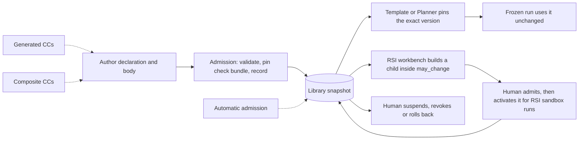

# 2. Capability Capsules

`Tier 1 · Part of: README · Serves: Knowledge and Standard`

What a Capability Capsule (CC) is, how it is checked, and where it is going.

## CC discovery and execution

The library exposes a captured snapshot of eligible, versioned CCs. A static template names its CCs; the Planner proposes from the snapshot. The binder checks and pins exact versions and check bundles. At dispatch, SwarmFlow receives contracts built from the frozen plan. The CC runner resolves each pin, binds accepted inputs and limits, and uses the native agent/model path or pinned tool path. It captures outputs and observations for independent checks and the protected gate. The runner does not authorize a result. See [planning and freeze](platform/planning-and-freeze.md) for the full flow.

## What a CC is

A CC is a reusable module with a declared contract, like a tool, a skill, an MCP server or an A2A agent. It has two parts:

- **Declaration.** A machine-readable contract: what the CC takes, what it produces, what it needs, what it may change, how it can be checked, and what RSI may change in it.
- **Body.** The pinned implementation: code, or bounded model instructions.

The hashes of the declaration and body identify the version. A changed body is a new version.

A CC knows nothing about the workflow ([D42](method/decisions.md#d42)). It is not a node, a task or a run. The node's objective, bindings and permissions live in its Node Execution Contract. Rules about where a CC runs in M1 live in the plan policy and the binder's checks. So the same CC can serve another workflow later.

M1 admits two kinds of CC:

| Kind | Meaning |
|---|---|
| `agent` | Bounded model calls through the model bridge |
| `tool` | Pinned code run by the CC runner |

Composite CCs, built from other CCs, are later work.

## Why CCs exist

`Knowledge`. **We cannot check something that claims nothing.** One wrong step early in a research run makes every later step wrong, while the run still looks green. Agent-built tools that pass their own tests often fail independent tests, and agents can weaken the checks they are judged by. So:

1. Every CC **declares first**. Every output of every call is checked against the declaration.
2. The **checks belong to someone else**. The CC author cannot choose, weaken or skip them.
3. **Versions are immutable**, so runs can be reproduced and compared.

## The declaration

`Standard`. A declaration has these groups. Exact fields, types and rules are in the [declaration reference](reference/declaration.md).

| Group | Says |
|---|---|
| Identity | Name, version label, kind, a short purpose, and the hashes of the body files |
| Ports | Typed inputs and outputs. Every port names an artifact type and its schema |
| Needs | Model needs (for example text only, or tool calling), pinned packages and external dependencies, secrets by name, network, resources |
| Changes (effects) | The effect class, and each effect: what it touches, whether it can be undone and how, and its risk |
| Guarantees | The author's claimed checks, self-tests and declared failure modes. Admission runs the self-tests, with at least one per declared failure mode. They never replace the check bundle |
| Budget | Wall time, invocations, tool calls, and how each limit is enforced |
| Evolution | `rsi`: whether RSI may submit a child (`none` or `propose` in M1). `may_change`: the only parts a child may change. Missing or empty means nothing ([D34](method/decisions.md#d34)) |
| Lineage | Parent version and how this version was built. Required for an RSI child |

A declaration grants no permission. The runner allows only what the declaration, the node's contract and the run policy all allow.

## Work CCs, verifier CCs and gates

| Part | Who writes it | What it does |
|---|---|---|
| Work CC | Its author | Does a job and writes artifacts |
| Verifier CC | The verifier owner | Assesses one output against the work CC's declaration, seeing nothing else ([D20](method/decisions.md#d20)). M1 has one, `research.verifier`. Returns a verdict with findings; cannot accept, halt or rewrite |
| Check bundle | The verifier owner, by hand in M1 | The deterministic checks for one CC version. A separate library record, pinned to the version at admission |
| Checking profile | The verifier owner | Which checks and verifier criteria are mandatory for the version |
| Gate host | Platform team | Protected code that writes every gate decision |

No CC author writes checks, profiles or gates. Later, admission will generate check bundles and profiles when a CC is admitted ([D21](method/decisions.md#d21)).

## Library and lifecycle

**Diagram G.** Level: one CC version over time. Solid steps exist in M1. Dashed steps are later work.

- **Admission**, run by a human in M1, checks the declaration, the body hashes, every pinned file and dependency, the CC's self-tests and its declared effects. It records trust level `provisional`, the only M1 level, and renders `make_capsule.md`, a readable view of the declaration (PRD 4.1). The bootstrap library, the CC versions the first build starts from, is admitted once by hand.
- **Standing.** A human activates, suspends or revokes a version. An activated RSI child serves RSI sandbox runs first. A human adopts it into live runs by promoting it to `live_plans` and pointing the operator config at a new static template that pins it ([D46](method/decisions.md#d46)). A **rollback** reactivates an earlier version. It builds nothing new ([D41](method/decisions.md#d41)).
- **The library is data**, never a hard-coded list. A plan reads the library snapshot pinned when it is made. A running plan never changes its pins.
- **RSI in M1.** Only Screening is `rsi: propose`. Its `may_change` allows its `rank_opportunities` helper (RSI Target 1) and its instruction and rubric files (Target 2, run when headless model calls work). Verifier CCs and CCs whose output is gate evidence must be `none`.

## The M1 CCs

| CC (PRD name) | Node | Kind | Model need | Outputs | RSI |
|---|---|---|---|---|---|
| `intent.compiler` | Intention Compiler | agent | text | `intent_ir` | none |
| `requirements.compiler` | Intention Compiler | agent | text | `research_brief` | none |
| `research.planner` | Planner | agent | text | `plan_proposal` | none |
| `research.search` (`search_capsule`) | Search | agent | text | `candidate_set` | none |
| `research.screening` (`screening_capsule`) | Screening | agent | text | `screening_result`, `opportunity_card` | propose |
| `research.hypothesis` (`hypothesis_capsule`) | Hypothesis | agent | text | `hypothesis_blueprint` | none |
| `research.builder` (`poc_capsule`) | Builder | agent | text with tool calls | `poc_manifest`, `poc_artifact_bundle` | none |
| `research.benchmark` (`benchmark_capsule`) | Research Benchmark | tool | none | `benchmark_payload`, `execution_receipt`, `provisioning_receipt` | none |
| `research.evaluation` (`scientific_evaluator_capsule`) | Scientific Evaluation | agent | text | `evaluation_verdict` | none |
| `research.delivery` (`report_capsule`) | Delivery | agent | text | `delivery_manifest`, `research_report` | none |
| `research.verifier` (`verifier_capsule`) | every node | agent | text | `verifier_assessment` | none |

Each CC's role, needs and limits are in the [pipeline](pipeline/README.md). Each CC's exact contract is on its [build page](reference/capsules/README.md).

## What today's code must not block

| Later work | Today's code must |
|---|---|
| Automatic admission (November, [D21](method/decisions.md#d21)) | Read eligibility from the library snapshot. Record every admission |
| Generated CCs (November) | Use one declaration, check bundle and admission path for every CC |
| Composition (December) | Allow several work subnodes per node, as the Intention Compiler has |
| More CCs per step | Name which CC serves a step only in the plan policy and the static template |
| API model routing | Send every model call through the bridge and `RouterPort`. Declare model needs, never a model |
| RSI improvement | Never change a CC in place. A child is a new version, inside `may_change` |
| Installable CCs from stores | Keep provenance and hashes on every version |
