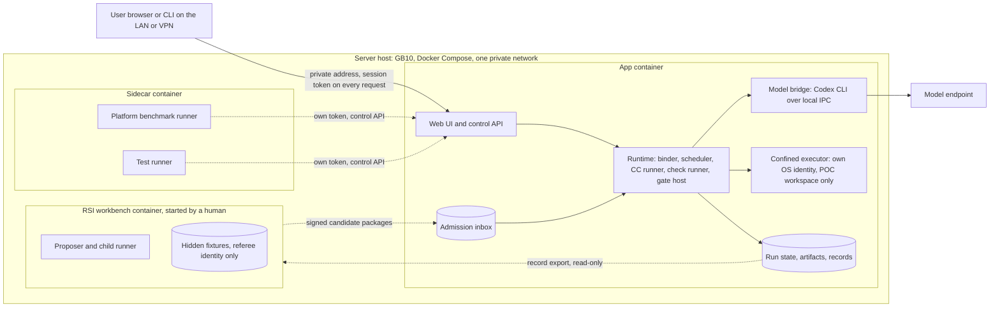

# AI4Research M1 design package

`Tier 1 · Start here · Serves: Knowledge and Standard`

This package is the design for milestone 1 (M1) of AI4Research. Coding agents build from it. Humans test the code against it. The PRD (product requirements document) says what the product must do. This package says how. The PRD is supplied separately, and its [receipt](reference/product-input.md) names the copy we use.

**Authority ([D38](method/decisions.md#d38)).**
- For M1 design, this package is the authority. For requirements, the PRD is.
- Build from this package and the separately supplied PRD. Product-obligation departures require a numbered authorized [decision](method/decisions.md).
- If the code does not do what the PRD or this package says, the code is wrong. If this package is wrong, fix the package first, record the decision, then fix the code.
- Each concept has one name, in the [glossary](glossary.md#canonical-terms).

## Architecture at a glance

AI4Research builds on JiuwenSwarm/OpenJiuwen. It reuses the existing workflow, agent, model, UI and diagnostic runtime where compatible, then adds research-specific CC governance, binding, checks, gates and evidence. A request becomes a checked Research Brief before planning. M1 uses Python services, a TypeScript UI, SQLite and files on Docker volumes. See [native reuse evidence](reference/native-reuse-evidence.json) and [system architecture](1-system.md).

## Deployment and access

**Diagram A.** Deployment and main processes. Dashed lines are off the hot path. Stores are mounted Docker volumes. The AI4Research control flow inside the app is detailed in [1. The system](1-system.md#components). The API router runs as a separate process inside the app container. The benchmark referee is a separate process under its own identity inside the sidecar.

- **One server host.** M1 runs only on the team's NVIDIA GB10 GPU server, never on a user's computer ([D35](method/decisions.md#d35)). The **Codex CLI** is the command-line model client that the PRD makes the default model route. The app reaches it over IPC (a local socket).
- **Access.** `jiuwenswarm-start`, inside the app container, prints a one-time URL with a session token. The browser and CLI send the token on every request. Nothing listens on a public address.
- **Confinement.** Generated proof-of-concept (POC) code reaches only its own workspace: no credentials, run state or fixtures. Credentials come from a protected environment file mounted into the app container.
- **Sidecar** ([D36](method/decisions.md#d36)) and **RSI workbench** never call the runtime directly. The sidecar uses the control API. The workbench reads the record export and writes to the admission inbox.

Detail: [platform](platform/README.md) and [Compose topology](development-tools/automation.md).

## Principles

AI4Research values accuracy over speed. The full table of what good and bad look like is in [principles](method/principles.md). Use it whenever this package does not settle a case.

- **Never pass garbage forward.** Every output is checked before anything uses it. If it is bad, that node stops.
- **Get intent right first, then keep rolling.** The run follows its frozen plan without waiting for a person ([D50](method/decisions.md#d50)).
- **A failure stops only what depends on it.** Independent branches continue in dependency order ([D49](method/decisions.md#d49)).
- **Keep everything.** Exact versions are pinned, and artifacts and records are retained for reproduction and debugging.
- **Side systems never block.** A run works without the model router, RSI workbench or sidecar.

## How to use this package

- Read tier 1, then the tier 2 area page and tier 3 component contract. Each page states the expected behavior and links to its owning contract.

Tier 1 is this page, [1. System](1-system.md), [2. Capability Capsules](2-capability-capsules.md) and [3. Build plan](3-build-plan.md). Tier 2 is the areas below. Tier 3 is the [reference](reference/README.md).

Each statement is **Knowledge** (what humans know better than an agent: research practice, the PRD, why the architecture has this shape) or a **Standard** (one agreed form, changed only by recorded decision).

## Page map

| Area | Covers |
|---|---|
| [Platform](platform/README.md) | App container, control API, state, runner, planning and freeze, failure, inspection |
| [Pipeline](pipeline/README.md) | Intention Compiler, research stages, ports and data ownership |
| [Checking](checking/README.md) | Check bundles, verifier CC, gates, per-CC check coverage |
| [Capability capsules](capability-capsules/library-and-checking.md) | Library, admission, authoring |
| [Side systems](side-systems/README.md) | [Model routing](side-systems/model-routing.md), [RSI workbench](side-systems/rsi-workbench.md), [platform benchmark runner](side-systems/benchmark-runner.md), [owner rulings](side-systems/owner-rulings.md) |
| [Development tools](development-tools/sidecar/README.md) | Sidecar container, test runner, automation |
| [Method](method/README.md) | [Decisions](method/decisions.md), [PRD clause coverage](method/clause-coverage.md), [phases](method/phases.md), [open items](method/open-items.md) |
| [Reference](reference/README.md) | [One build page per CC](reference/capsules/README.md), [run plan](reference/run-plan.md), [contract index](reference/README.md#contract-index), [glossary](glossary.md) |

Internal names are lowercase ([D23](method/decisions.md#d23)). Where the PRD names a component, this package uses the PRD name.
