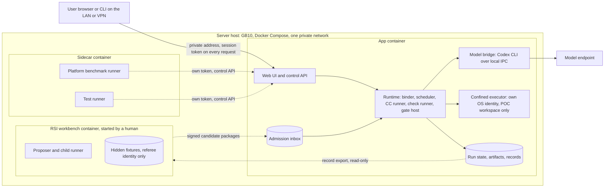

# AI4Research M1 design package

`Tier 1 · Start here · Serves: Knowledge and Standard`

This package is the design for milestone 1 (M1) of AI4Research. Coding agents build from it. Humans test the code against it. The PRD (product requirements document) says what the product must do. This package says how. The PRD is supplied separately, and its [receipt](sources/product/README.md) names the copy we use.

**Authority ([D38](method/decisions.md#d38)).**
- For M1 design, this package is the authority. For requirements, the PRD is.
- Designs received from other teams, kept in `sources/`, are inputs. Where this package differs from them or from the PRD, a numbered [decision](method/decisions.md) says why.
- If the code does not do what the PRD or this package says, the code is wrong. If this package is wrong, fix the package first, record the decision, then fix the code.
- Each concept has one name, in the [glossary](glossary.md#canonical-terms).

## What AI4Research is

AI4Research is one Dockerized application on a server. A user gives it a research goal and files in a browser. The application:

1. turns the goal into a checked Research Brief (`research_brief.json`);
2. plans the work as a graph of steps;
3. runs every step with a **Capability Capsule** (CC), a reusable module with a declared contract;
4. checks every output before the next step may use it;
5. lets humans improve CCs offline with **RSI** (recursive self-improvement), never during a run;
6. delivers a readable report with its evidence.

A correctly measured negative result is a valid, delivered result.

## Principles

AI4Research values accuracy over speed. The full table of what good and bad look like is in [principles](method/principles.md). Use it whenever this package does not settle a case.

- **Never pass garbage forward.** Every output is checked before anything uses it. If it is bad, that node stops.
- **Get intent right first, then keep rolling.** Runs are long and unattended, often overnight. The Intention Compiler makes the request clear up front. After that, the run follows its frozen plan without waiting for anyone. Slight uncertainty is handled by declared defaults and recorded, not by asking a person ([D50](method/decisions.md#d50)).
- **A failure stops only what depends on it.** A failed node and its dependents stop. Independent branches continue in dependency order ([D49](method/decisions.md#d49)).
- **Keep everything.** Exact versions are pinned, and every artifact and record is saved, so any run can be reproduced and debugged.
- **Side systems never block.** A run works without the model router, the RSI workbench or the sidecar.

## Deployment and access

**Diagram A.** Level: containers and their main processes. Not shown: the modules inside the runtime ([diagram B](1-system.md#components)) and the steps of a run ([diagram C](1-system.md#a-run-node-by-node)). Dashed lines are off the hot path: a run works without them. Stores are mounted Docker volumes. Also not drawn: the API router process inside the app container, and the platform benchmark referee, a separate process under its own identity inside the sidecar.

- **One server host.** M1 runs only on the team's NVIDIA GB10 GPU server, never on a user's computer ([D35](method/decisions.md#d35)). The **Codex CLI** is the command-line model client that the PRD makes the default model route. The app reaches it over IPC (a local socket).
- **Access.** `jiuwenswarm-start`, inside the app container, prints a one-time URL with a session token. The browser and CLI send the token on every request. Nothing listens on a public address.
- **Confinement.** Generated proof-of-concept (POC) code reaches only its own workspace: no credentials, run state or fixtures. Credentials come from a protected environment file mounted into the app container.
- **Sidecar** ([D36](method/decisions.md#d36)) and **RSI workbench** never call the runtime directly. The sidecar uses the control API. The workbench reads the record export and writes to the admission inbox.

Detail: [platform](platform/README.md) and [Compose topology](development-tools/automation.md).

## How to use this package

- **Build.** Read tier 1 (about 20 minutes), then the tier 2 pages for your area, then the tier 3 page for your component.
- **Test.** Each build criterion says what correct looks like, and each check states its exact condition.
- **Fix.** Find the rule the bug breaks. Fix the code, or fix the design first if the design is wrong.

Tier 1 is this page, [1. System](1-system.md), [2. Capability Capsules](2-capability-capsules.md) and [3. Build plan](3-build-plan.md). Tier 2 is the areas below. Tier 3 is the [reference](reference/README.md).

Each statement is **Knowledge** (what humans know better than an agent: research practice, the PRD, why the architecture has this shape) or a **Standard** (one agreed form, changed only by recorded decision).

## Page map

| Area | Covers |
|---|---|
| [Platform](platform/README.md) | App container, control API, state, runner, planning and freeze, failure, inspection |
| [Pipeline](pipeline/README.md) | Intention Compiler, research stages, ports and data ownership |
| [Checking](checking/README.md) | Check bundles, verifier CC, gates, per-CC check coverage |
| [Capability capsules](capability-capsules/library-and-checking.md) | Library, admission, authoring |
| [Side systems](side-systems/README.md) | [Model routing](side-systems/model-routing.md), [RSI workbench](side-systems/rsi-workbench.md), [platform benchmark runner](side-systems/benchmark-runner.md), [owner rulings](side-systems/owner-rulings.md) |
| [Development tools](development-tools/sidecar/README.md) | Sidecar container, test runner, automation |
| [Method](method/README.md) | [Decisions](method/decisions.md), [PRD clause coverage](method/clause-coverage.md), [phases](method/phases.md), [open items](method/open-items.md) |
| [Reference](reference/README.md) | [One build page per CC](reference/capsules/README.md), [run plan](reference/run-plan.md), [contract index](reference/README.md#contract-index), [glossary](glossary.md) |

Internal names are lowercase ([D23](method/decisions.md#d23)). Where the PRD names a component, this package uses the PRD name.