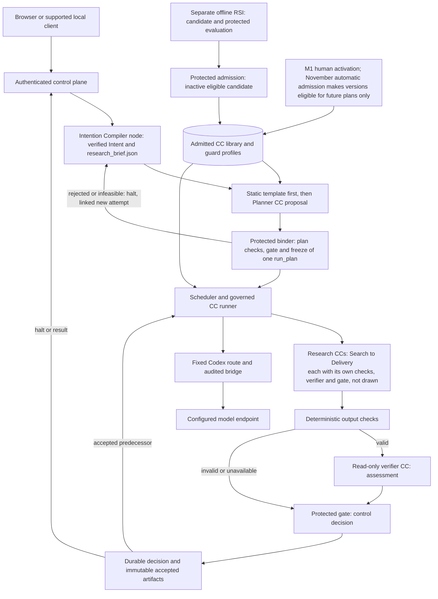

# AI4Research M1 design package

**Reading level: human immediate · October 14, 2026.** This folder is the sole maintained architecture. Start here. The PRD is supplied separately and owns product requirements. Its [receipt](sources/product/README.md) identifies the reviewed copy. This package owns the architecture and implementation-facing details that realize it. If implementation guidance conflicts with this design, follow the design. Changing a product obligation needs a recorded, authorized decision.

## Human read: the whole system

| Order | Read | Review outcome |
|---|---|---|
| 1 | This README | Responsibilities and the reading route |
| 2 | [System architecture](m1-design.md) | Connections, deployment, phases and what comes next |
| 3 | [Principles](principles.md) | Checking, permissions, evidence and failure rules |

## For design authors and reviewers

[Design method](design-method.md) sets depth, change handling and review. [Decision review](decision-review.md) keeps alternatives and reasons.

## Assigned build scope

The October 30 target is the bounded core: the Intention Compiler, a static fixed DAG, then the Planner producing a fixed DAG, protected freeze, one research path through Delivery, and a platform benchmark run. It uses the existing fixed Codex route. RSI and new Model Router work are not part of this target and do not block it. This is narrower than full PRD M1. See [core build](core-build.md), [delivery phases](delivery-phases.md) and decisions [D19 to D26](decision-review.md#decisions-and-source-amendments).

Later work: Generalist, automatic capsule generation, automatic admission and better planning or MCTS in November, composition in December, spatiotemporal lifecycle in 2027. The design keeps seams for them now.

## Build a specific component

| To build | Start at |
|---|---|
| The core journey and its order | [Core build](core-build.md) |
| One CC and its verifier assignment | [Capsule build references](reference/capsules/README.md) |
| Which component checks what, per CC (worker, host check bundle, verifier, gate) | [CC build coverage](cc-build-coverage.md), then [guard design](guard-design.md) |
| Static template, Planner proposal, frozen run plan and dispatch | [Run plan](reference/run-plan.md) |
| The Intention Compiler node (to accepted `research_brief.json`) | [Compiler entrypoint](builds/intention-compiler/README.md) and [context](builds/intention-compiler/context.md) |
| The platform benchmark runner (development tooling) | [Benchmark runner](development-tools/benchmark-runner/README.md) |

Internal names are lowercase ([D23](decision-review.md#d23)).

## Human should read: review the affected responsibility

Select the affected responsibility. These pages explain purpose, connections, behavior, authority, failures and rationale.

| Question | Detailed design |
|---|---|
| What makes Intent usable, and how does it become Requirements? | [Intent and Requirements](intent-design.md) |
| How do plans freeze, bind future inputs and execute? | [Workflow](workflow.md) |
| What does each research responsibility produce? | [Research design](research-design.md) |
| What is a CC, and how do checking and library changes work? | [Capsules](capsules.md), [authoring](capsule/authoring.md) |
| Who assigns checks and constructs verifier evidence? | [Guard design](guard-design.md) |
| Where do models, generated code, state and the browser live? | [Placement](placement.md), [model routing](model-routing.md) |
| What happens after a halt, cancellation or restart? | [Failure handling](failure-and-human.md) |
| How do people inspect results and technical evidence? | [Artifact inspection](artifact-inspection.md), [automation/client boundary](automation.md) |
| Where is RSI and what can it change? | [Offline RSI](offline-rsi.md) |
| What must a phase or the next build demonstrate? | [Delivery phases](delivery-phases.md), [phase details](phase-details.md), [Immediate Plan](immediate-plan.md) |

## AI read: human-readable reference, selective human review

Read [reference principles and index](reference/README.md) for field contracts, selected exact schemas and readable examples. [CC fields](capsule/declaration.md) preserve the reusable declaration inventory. [Vocabulary](glossary.md), [clause coverage](coverage-allocation.md), [source decisions](authority-index.md) and [design review](coverage.md) support tracing, not a second architecture.

Find a particular artifact or field through the [contract index](reference/contract-index.md). The reference defines shared fields. Implementers choose private algorithms, classes and adapters within those fields. No historical-schema search is required.

## System picture

AI4Research turns a supplied research purpose and local assets into a grounded opportunity, registered hypothesis, bounded POC, matched measurements and a readable report. Every work output is a candidate until protected checking and durable acceptance permit its use.

Preparation and planning use the same checking pattern shown for research. The runtime feedback edge represents dependency release, not a cyclic research graph. RSI runs outside live research. Its scores cannot release product work or activate a candidate.

## Responsibility and authority

| Component | Owns | Connects to |
|---|---|---|
| Compiler/work CC | Candidate artifact fulfilling its assigned responsibility | Runner supplies inputs. Checking consumes outputs. |
| Verifier CC | Read-only verdict, findings, reasons and uncertainty about the submitted artifact | Sees only the declaration and the exact output (D20, D24). Assessment goes to the host. |
| Protected binder | Concrete contracts, typed bindings and independent check assignments combining pinned per-CC bundles with run obligations | Accepted requirements, admitted CC/bundle pins, policy, evidence and durable state |
| Protected gate | Checked decision and durable acceptance. No release before commit. | Exact contract, subject, evidence and assessment |
| Protected library admission | Exact CC-version/check-bundle association, candidate eligibility and standing history | Declaration, body, bundle compatibility and independent evidence. M1 begins from an explicit bootstrap catalog with shared bundle pins; this is not capsule-specific admission evidence. New/changed versions require governed admission once implemented. Human standing controls activation; D21 M2 automatic admission may establish future-plan eligibility. |
| Scheduler/runner | Eligible dispatch, scoped execution, budgets and observed evidence | Frozen contracts, CCs, model bridge and restricted experiment executor |
| Control plane | Authenticated submission, inspection and visible results/blockers | Browser/CLI/TUI and server-owned run state |
| Offline RSI | Bounded implementation improvement and comparable evidence | Protected target profile, isolated runner/referee and inactive library candidates |

CC authors produce work or assessments. Protected infrastructure releases accepted results. Inspect IRs and decisions as readable records, with raw evidence separate.

## Deployment and scope

One application container holds the frontend, the control service and the runtime. The browser uses host loopback, by default `http://127.0.0.1:5173`. Model access goes through a protected bridge. Generated scientific code runs in a separate confined executor. The optional development sidecar is an ordinary authenticated client on the private container network and is never a product dependency.

Full M1 also includes the workstation, isolated offline RSI and bounded dynamic integrations. Composite CCs, remote workers and live self-modification are later directions, not current builds.

## Review and evidence

[Design review](coverage.md) traces source obligations, compatibility and limits. Documentation checks do not prove runtime acceptance. Authorized departures from the PRD are listed in [decisions](decision-review.md#decisions-and-source-amendments).

## Model-routing integration

[Routing overview](model-routing.md) connects the separate routing-owner component to the [shared Capsule export, profile and decision contract](reference/capsule-model-routing.md). Phase 1 remains fixed Codex; APIs are Phase 3.
