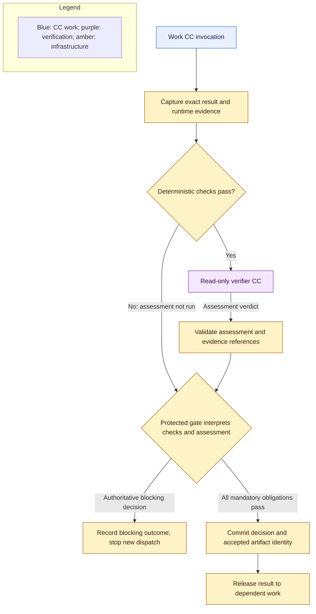

# Capsules, verification, and library

**Reading level: human potential.** Question answered: How do reusable CCs execute, get checked and enter the library; what composition remains future work?

## Invocation and authority

`V ⊆ C`: runtime verifier capsules are a subset of capability capsules. `G ∩ C = ∅`: protected gates are separate infrastructure roles. The [composition notation](glossary.md#composition-notation) distinguishes subtype, dependency, binding and permission intersection. A gate uses a verifier assessment; it does not inherit capsule identity or delegate release authority to the capsule author.

**Required now.** A CC describes a reusable capability; a node encapsulates a product responsibility under a Node Execution Contract; each internal subnode binds one pinned CC. The [field reference](capsule/declaration.md) defines one reconciled current declaration and [exact schema](reference/schemas/capsule-declaration.schema.json). A code/tool CC, agent/prompt CC or supported service adapter has the same declared boundary. Composite CC creation and execution remain later work. The runner resolves the pinned implementation, binds accepted inputs and scoped context, enforces permissions and limits, executes known code or a bounded native agent loop, and captures actual outcomes.

A node contract restricts each CC independently: effective authority is the intersection of that CC’s admission, the node and subnode contracts and run policy. Permissions from another bound CC are never transferred or unioned into its authority. Node-wide budgets cover every invocation, and each invocation also obeys its own limits. Additional work CCs use separate gated subnodes within their declared node. Unsupported composition blocks admission/binding.

An agent loop may call permitted tools; M1 does not support internal CC dispatch. It cannot rewrite the outer graph, upstream requirements, checking criteria, permissions, or accepted artifacts. Ordinary private helpers are not automatically separate CCs; their behavior remains the invoking capsule's responsibility.

Reusable guard definitions, full-context check-plan binding, independent profile ownership and output-led evidence disclosure are specified in [guard design](guard-design.md). Capsule authors can document guarantees, propose candidate checks and run self-tests; they do not author or approve the mandatory deterministic check bundle associated with their usable CC version.

Every admitted/usable CC version is explicitly associated with an immutable, independently owned deterministic check bundle. The bundle is a separately versioned library record, not capsule-author-controlled declaration or implementation content. Reuse across CC versions requires an explicit compatibility association. Admission binds the exact CC version, bundle version and compatibility evidence; execution and freeze pin those identities together. A new CC version or changed bundle requires a new association and applicable admission. Existing frozen runs retain the old pins. This reusable capsule baseline supplements, and never replaces, checks derived from the run-specific Subnode/Node Execution Contracts and policy.

## Exact verification boundary

**Core path:** fixed Compiler Intent + Requirement work and gates produce the accepted Research Brief; the planner proposes the downstream DAG, while the protected binder assigns mandatory profiles/checks, validates coverage and graph feasibility, and freezes before dispatch. A planner failure halts unless the run explicitly selected the retained static SwarmFlow fallback mode at run entry. See [core build](core-build.md) and D19.

**Required now.** Every work invocation, including planning and delivery, has a pinned verification assignment. Protected configuration combines each participating CC version's pinned deterministic bundle with mandatory checks derived from the node/subnode contracts, CC/dependency pins, applicable accepted obligations, artifact type and run policy. Fixed preparation uses the qualified original request and protected template obligations before an accepted Research Brief exists; planned research uses the Brief. Invocation checks protect intermediate boundaries; the node aggregate gate also checks the objective and all required outputs/evidence before successor release. The planner may add checks but cannot remove the CC-pinned bundle or contract/policy obligations. A CC without an eligible explicit bundle association or any missing supported check blocks readiness, binding and graph freeze.

Trusted code retains a host-only, audit-only review manifest from original accepted inputs, declaration/guarantees, applicable rubric, exact outputs, upstream evidence and observed execution. It identifies subject and source for deterministic checks, provenance and audit. The semantic model receives exactly the pinned subject CC declaration and exact output bytes, plus fixed verifier instructions; it receives no worker inputs, request-specific context, conversation, criteria/profile records, observations, predecessor evidence or evidence-fetch capability. The producer cannot choose checking policy or substitute its assertion for host evidence.

Tier 1 handles mechanically decidable questions: contract and format conformance, identity and version binding, required evidence, execution completion, duration, declared tools, and enforced access boundaries. Mandatory failure prevents Tier 2. An unavailable required environment is blocked, not evidence that the artifact is wrong or correct.

Tier 2 checks declaration/output conformance only, rather than producer reasoning or a suggested verdict. It cannot establish fidelity, source support or scientific validity ([D24](decision-review.md#d24)). Those are producer obligations backed by host checks. It does not solve or repair missing work and has no evidence-fetch/read capability. Artifact content is data, including text asking the reviewer to ignore its rules. See the [Verifier page](reference/capsules/verifier.md) and the per-CC pages in [capsule build references](reference/capsules/README.md). Tier 1 and the host gate continue to apply host-held deterministic obligations.

The model reply is untrusted finding/uncertainty/limitation content only. The host validates required criterion coverage and assembles the unchanged persisted Assessment, attaching trusted identity/evidence references and assigning the verdict. The model does not supply the trusted identity envelope or gate authority. Malformed/unsupported replies, timeout, or unresolved mandatory conditions cannot advance. Preserve raw reply and final decision. Use the existing PRD verdict meanings; only `PASS` or `PASS_WITH_KNOWN_LIMITATIONS` can advance when host-established mandatory obligations pass. Do not imply host-held evidence was reviewed semantically.

Bind the decision to run, enclosing node, subnode, attempt, both execution-contract identities/hashes/revisions, participating invocation identities, input/output identities, all capsule implementation and dependency pins, verifier, checks, policy and relevant configuration. Publish only those exact immutable accepted artifacts. Producer mutation after review, cross-run substitution, retry, or policy changes cannot reuse an earlier pass. Artifact and decision persistence must succeed before downstream readiness is exposed.

## Evaluator Gate internals and referee protection

**Required now.** The Evaluator Gate boundary composes deterministic checking, a runtime verifier CC assessment and protected decision/release infrastructure. The verifier reply is limited untrusted declaration/output findings; it does not receive hidden accepted inputs or attest to them. The trusted host assembles the persisted Assessment and the protected gate interprets it with mandatory host checks and bound policy, then issues the **authoritative gate verdict**. Run-state must durably commit that decision before the scheduler advances. The capsule author, producer and verifier have no successor-dispatch or acceptance-policy authority; a supplied boolean or free-text command never changes outer control flow directly. [Human callbacks](failure-and-human.md) define every non-advancing outcome and mode-specific routing.

Verification CCs end the semantic checking branch. Mechanically validate their response; do not generate an endless verifier-of-verifier chain. Pin and test them through separate development evaluation. Sharing a provider gives process separation, not independent model failure modes or a truth guarantee. Use protected labeled challenge cases to characterize omissions, unsupported claims, ambiguity, and instruction injection; record observed errors and limitations. The protected admission profile fixes cases, metrics and thresholds before candidate measurement.

Any CC or dependency supplying the checking assessment for a mandatory gate is outside RSI's mutation scope. Protection includes its prompts and rubrics, deterministic checks and runners, policy, hidden fixtures, permission enforcement, library activation, and authoritative evidence storage. Capsule-local evolution metadata cannot expand that scope. Screening's explicitly mutable ranking helper is a work implementation, not permission to alter its verifier or gate criteria.

Scientific Evaluation owns the hypothesis conclusion, but the restricted semantic model cannot inspect its hidden criteria, measurements or supporting evidence. Host checks can validate available identities/contracts; they do not establish scientific correctness. A scientific negative can receive infrastructure acceptance; neither the gate nor evaluator may move thresholds to make it positive.

## Library lifecycle

**Required now.** Publish declarations and referenced implementation closure together as immutable versions. The M1 bootstrap catalog is an explicit, bounded set of existing versions designated for the initial build; file presence alone never grants use. Bind each bootstrap version to an immutable independently maintained shared checking bundle and record its exact identity. This bootstrap record enables the first main path but is not evidence of capsule-specific correctness or a completed governed admission gate. Keep activation and suspension under human standing control. Once the governed admission gate is implemented, disable bootstrap defaults for every new or changed version; those candidates require a protected eligibility decision with independent evidence and an exact compatible bundle. Existing bootstrap records remain usable unless suspended or revoked. Retain versions, bundle associations and decisions.

Admission eligibility and activation are distinct. The explicit M1 bootstrap set is available to the initial planner; human standing controls later activation, suspension and rollback. Bootstrap is temporary admission policy, not a capsule-specific quality verdict. Once the governed gate exists, every new or changed version needs protected eligibility based on identity, dependency closure, permissions, independent evidence and an exact compatible bundle. Under D21, M2 may automatically admit an RSI-produced version only after that same protected gate passes. The candidate cannot choose or alter its bundle; protected admission may resolve one only from a pre-approved compatibility association uniquely covering the exact version. Missing or ambiguous coverage blocks. Passing eligibility may make a version available to future plans without separate human activation; it never changes a frozen run. Existing runs keep exact CC and bundle pins. Suspension blocks new starts; preserve in-flight evidence and recheck eligibility before release. Never substitute a version silently. Hand-authored and generated candidates follow the same governed path after bootstrap ends; RSI is not required to author or use the library.

## RSI boundary

RSI is an optional, separately buildable target. It has no import, startup, test, or core acceptance dependency; the core parent handoff remains independent of RSI availability. RSI cannot change live workflow or mandatory verifier/referee boundaries.

## Composition and optimization

**M1 distinction.** A node may contain predefined work/verifier subnodes and protected gates, each governed by its own assignment. Composite/merged CC creation and arbitrary intra-capsule dispatch remain later work; fixed node cooperation does not create a reusable composite capability.

**Future direction; not M1 implementation.** A composite would declare pinned members and wiring as an internal DAG with its own boundary ports. Resolve its complete dependency closure and preserve scoped member calls, required verification, effects, and attributable evidence. An outer verifier does not erase member checks. Detect recursive dependencies; nesting must not bypass limits or grant additional authority.

**NOV-only future; not M1:** fusion replaces an admitted member graph with a separately admitted implementation after comparative evidence establishes the same contract meaning, effects, required verification, and traceability. Retain the unfused reference and member-to-fused provenance. Do not remove checking boundaries merely because the combined output looks correct. Fusion must be justified by this system's comparative evidence.

**Future compatibility:** interaction findings bind to versions, context, and evidence; record whether risk was predicted or execution-confirmed. **M2 target: November 2026; not M1:** Generalist behavior and automatic RSI generation/admission. **M3 target: December 2026:** composition/fusion. **2027 target:** spatiotemporal lifecycle. Any borrowed skill-interaction analysis must be evaluated against the isolated CC execution boundary. Predicted risk cannot certify safety or replace live verification.

**Future compatibility (not M1).** Preserve dependency, effect, idempotency, reversibility, and lifecycle declarations for spatiotemporal composition, planned for 2027. **Future direction:** install, drain, replace, and compensate capabilities during long runs through a separate lifecycle mechanism. M1 changes take effect between runs. Removal from routing must never delete historical evidence or pretend external emissions were undone.

## Per-CC build coverage

Use the [CC ports and checking map](cc-build-coverage.md) for all ten work capabilities, the Planner semantic-verifier context and the shared implementation-completion rule.
