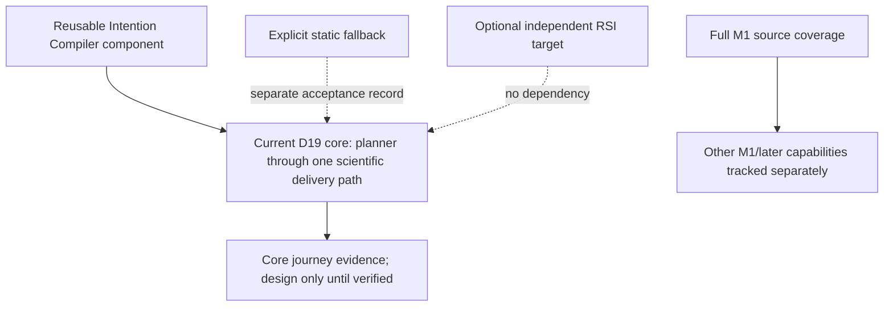

# Delivery phases and build direction

**Reading level: human potential.** Delivery phases, implementation stages and runtime research steps are different concepts. This page selects scope; [phase details](phase-details.md) retain exact stage exits and source dispositions. The [PRD](sources/product/README.md) owns acceptance requirements.

## Current core build

The current assignment is the bounded complete research journey described in [Core build](core-build.md): fixed compiler intent and requirements with independent verifier gates, accepted Brief, protected planner proposal and freeze, then one Search-to-Delivery scientific path. The [existing complete Intention Compiler build](builds/intention-compiler/README.md) is a reusable first component and historical calibration boundary; it is not the complete journey. [Immediate plan](immediate-plan.md) routes builders to the current core assignment.

## October 30 coordination gate

The October 30 presentation target is the bounded D19 journey using the existing fixed Codex route. RSI work and new Model Router integration are excluded from its acceptance criteria; they are not build, startup, test, benchmark or demo prerequisites. This date-specific target is narrower than the confirmed PRD’s full M1 completion gate. Keep the original PRD obligations visible in the stage and clause maps, and do not report the bounded demonstration as full PRD M1 completion. This schedule decision does not edit the received PRD. See [D22](decision-review.md#d22).

## Current assignment and independent product coverage

| Phase | Entry and build | Produced result / exit meaning |
|---|---|---|
| **Core assignment (D19)** | Accepted compiler Brief → protected planner chooses admitted downstream CCs with explicit pinned deterministic check bundles and emits assignment proposals → independent typed-port, required-check, resource, coverage and cycle validation → freeze → one sequential Search, Screening, Hypothesis, Builder, Benchmark, Evaluation and Delivery path | One bounded scientific journey with gate-controlled transitions, immutable hypothesis/protocol, reproducible evidence and delivery, including valid negative results. The static workflow remains a separate explicit fallback; it cannot stand in for the dynamic core acceptance record. This is a design scope, not runtime completion |
| **Separate optional RSI target** | When its own parent, fixtures, referee, target profile and local-isolation prerequisites are available, improve a sandbox copy of `rank_opportunities` | Independently buildable and accepted on its own evidence. RSI is not a startup, import, core coding, core test, platform benchmark or core release dependency. A parent-CC export/handoff is consumed when available; RSI has one CC improvement goal outside the core path. No live production change |
| **Other M1 product coverage / later extensions** | The full PRD remains mapped in [coverage allocation](coverage-allocation.md); additional dynamic integrations retain their source traceability. Generalist work is future November scope; MCTS is November; composition/fusion is December; spatiotemporal research is 2027. | These are separate from the bounded core assignment. Keep the fixed Codex route; an API-only seam may be optional if compatible. Alternate verifier integration is deferred. No design-only coverage statement establishes runtime acceptance |

The planner is part of the D19 core assignment, explicitly promoted from later dynamic-planning scope; this amendment does not claim the original PRD already required this exact assignment. RSI design and implementation may proceed independently and never gates core work. Detailed [stage and source mapping](phase-details.md) keeps full-M1 product coverage separate from current assignment scope.

## Boundaries that remain fixed

The explicit static workflow remains runnable without autonomous planning, but it has a separate acceptance record and cannot satisfy the D19 core assignment. A new route, compiler or candidate version affects new attributable runs; it never changes a started invocation, accepted Brief, frozen graph or historical decision. Advanced clarification is bounded pre-acceptance work in declared interactive mode. Headless paths never wait.

One active research run follows one opportunity/hypothesis and sequential baseline/treatment measurement. M1 adds no distributed workers, model training, external publication, live self-installation or recursive improver deployment. Composite creation/execution, merging, arbitrary capsule member graphs, multiple planning epochs and broader optimizers remain later work. M1 uses separate gated work CC nodes.

## How completion is judged

Stage and phase completion require reproducible evidence, not implementation existence or a diagram. The latest PRD adds user-story traceability, explicit stage validation, phase summaries and `m1_final_test_report.md`. Its required summaries reference underlying verification; they do not replace it. Change history explains revisions; current canonical PRD/design must describe selected behavior without replaying that history. This package contains design, not the development workflow or runtime test results.

Use [Core build](core-build.md) for the current bounded assignment, [Immediate Plan](immediate-plan.md) for the current route and compiler component, and [phase details](phase-details.md) for source coverage and stage boundaries. D19 is the explicit planner-scope amendment recorded in [Principles](principles.md#decisions-and-source-amendments); D5 and D6 retain their separately recorded decisions.

## Current semantic-review scope

[D20](principles.md#d20-declarationoutput-only-semantic-review) limits semantic input to declaration/output; earlier full-context descriptions remain source context. Host checks retain runtime evidence. [D21](decision-review.md#d21) governs November generation/admission and December composition.
