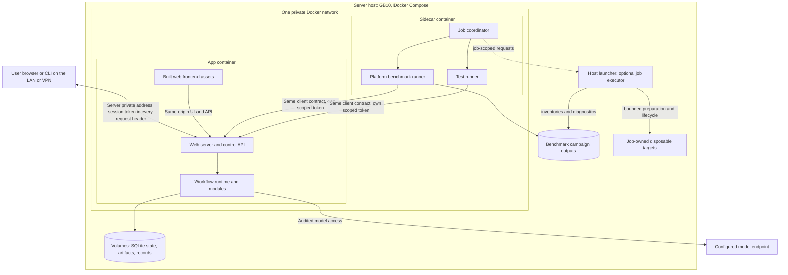

# Automated development and platform benchmarking

`Tier 2 · Part of: [README](../README.md)`

Question answered: How do authenticated clients connect, observe and recover without release authority?

**Required shape:** the platform benchmark runner and the test runner, both in the sidecar container ([D36](../method/decisions.md#d36)), drive the workflow exactly as an authenticated user client does. Each submits bounded work, observes status, retrieves permitted artifacts, and records terminal outcomes. Neither can write authoritative run state, insert accepted outputs, bypass the protected gate, or mount the hidden RSI fixture store. The test runner's commands and paths are fixed on its [page](test-runner/README.md#commands-and-results). Other commands and fixture mechanisms are worker-owned.

For experiments needing environment control, the sidecar coordinator may delegate bounded operations to the existing host launcher ([D51](../method/decisions.md#d51)). The [host-executor contract](sidecar/README.md#host-executor) defines the grant and ownership boundary. This optional path prepares targets and returns observations. It does not add privileged product API operations or give runner processes Docker credentials.

## Compose topology

*Level: client and job access. Disposable targets exist only for authorized jobs. Omits: the RSI workbench and referee, app internals and model IPC.*

The app remains one service. Its container includes the built browser frontend, web server/control API and workflow runtime; the browser assets are served by that application on the same origin as the control API. Do not require a separate frontend container or a host-side helper script to start the product or open its UI. The container's own entrypoint starts the app, and Docker Compose on the server host starts the containers. A host script may be a convenience wrapper, not a runtime dependency.

Users on the LAN or VPN open the app at the server's private address and container port `5173`, which the Compose file publishes on that address only ([D35](../method/decisions.md#d35)). Every request carries the session token in the `Authorization: Bearer` header ([control API](../reference/field-catalog.md#control-api)), and `jiuwenswarm-start` inside the app container prints the one-time token URL. UI and control API share that endpoint. A deliberate port override must keep the private-address binding and be documented. Internal module calls need no assigned TCP ports. The sidecar container is an external client, not another research worker or distributed compute host.

On the private Docker network the sidecar container addresses the app by service DNS and its **container** port; its own `localhost` is not the app. The sidecar needs no inbound port. Reaching the private network does not replace the token. Keep model IPC as a restricted socket with 600 permissions, never a public model-adapter TCP listener. Do not expose SQLite, artifact storage, fixture oracle, or Docker socket as client services.

The platform benchmark runner and the test runner each get their own scoped token, permitting submit/status/retrieval in the declared evaluation workspace. Neither has gate-policy, activation, referee or arbitrary configuration-write authority. The launcher selects approved profile definitions; the client supplies their identifiers and allowed per-run inputs. Normal M1 submission cannot disable mandatory controls. Declared ablations run only in the isolated evaluation profile and carry invalid-for-product/admission labels.

The app owns its state/artifact volumes; the platform benchmark runner owns campaign output. Supplied inputs are registered through the same controlled resource-import path as user inputs. A fixture mount, where needed, contains only the campaign's visible inputs and is read-only; it never grants the sidecar direct access to release state or grants POC code access to campaign expectations. Retrieve permitted bundle exports through the client boundary. Package/model/image preparation happens before the run; startup does not silently download datasets or change frozen dependencies.

The host launcher may inspect explicitly granted target logs and resource facts or stage visible fixtures into job-owned environments. Its grant does not authorize editing live application evidence. Cleanup preserves campaign reports and touches only job-owned resources. Standing-target lifecycle operations require a separate explicit grant. A failed launcher operation affects its job, while normal app startup and runs remain independent.

## Client contract and campaign behavior

The app exposes one versioned, authenticated client boundary for supported UI/CLI clients and for the sidecar container's platform benchmark runner and test runner. Inside the Docker network, clients reach it through the configured app service name and container port `5173` by default; browser users reach the same service at the server's private address. The product boundary provides a readiness/capability response containing the client-contract version, target instance/build identity, supported operations and prerequisite states. A client verifies target and compatibility before submission; mismatch or missing required capability blocks the operation. Readiness distinguishes HTTP/process liveness from storage, authentication, model and required-isolation readiness. The [control API table](../reference/field-catalog.md#control-api) lists every operation with its path and records. The [client field contract](../reference/field-catalog.md#client-and-model-boundaries) defines shared readiness/submission/status/evidence information. The run-level paths are fixed on the [test runner page](test-runner/README.md#commands-and-results). Transport encoding and internal adapters are worker-owned within that contract. The [sidecar connection contract](sidecar/README.md#application-connection-and-compatibility) relies on this product boundary and adds no privileged product endpoint.

| Operation | Meaning that must be stable |
|---|---|
| Readiness | Verify target instance/build and client-contract compatibility; distinguish service liveness from model/authentication, storage and required-security readiness. Declare an unavailable prerequisite rather than measuring a mock as a real model run. |
| Submit | After readiness and compatibility pass, submit the original objective, permitted resources, `plan_source`, approved profile identity and requested seed where supported. Return one run identity; ambiguous transport completion does not automatically resubmit. |
| Observe | Read correlated status and events, with reconnect/poll support. Transport disconnection never cancels or duplicates research work. |
| Finish/retrieve | Structured terminal status, detailed verdict/reason, accepted result references and allowed Run Bundle. No failure waits for a person ([D50](../method/decisions.md#d50)). |
| Cancel | Explicit authenticated control action; preserve work already performed and cancellation evidence. It cannot undo external effects. |

Hardware inventory reference. Benchmark clients run a host-side inventory collector before every test and repeat. Submit accepts an optional `evaluation` block `{campaign_id, run_id, inventory_id}`. The application does not read or judge the inventory. It echoes the three identities in the readiness-to-export manifest so the exported run bundle links to the pre-test hardware record. Readiness also reports `evaluation_profile` (the approved profile ID, or null), `fault_injection` (a boolean) and the run `pins`. Product profiles always report null and false. Submit may also carry `profile_id` and `fault_id`. Fields: [client-readiness](../reference/field-catalog.md#client-readiness), [client-submission](../reference/field-catalog.md#client-submission) and [evaluation-profile](../reference/field-catalog.md#evaluation-profile).

The submission contract must support client request identity and reconciliation after uncertain delivery, so automation can discover whether a run was created before retrying. The transport adapter selects the concrete reconciliation mechanism. Separate client transport recovery from forbidden automatic capsule retries. For complete Intention Compiler node, allow one active run and sequential campaign cases; no concurrent-run orchestration is needed.

Provide a simple documented launch/run/retrieve path and a smoke run using labeled mocks. A model-backed run exercises the actual bridge, compiler, verifier and durable release. Both use the same runner and client adapter. A Compose campaign command should return non-success when required cases or prerequisites fail, preserve per-case records, and allow cleanup of replaceable containers without deleting evidence. Compose service definitions are worker-owned. The test runner's CLI syntax is fixed on its page.

The four evaluation-profile entry points (node replay, single-CC invocation, fault injection, checkpoint observation) exist only under an approved evaluation profile. Their table is in the [benchmark runner design](../side-systems/benchmark-runner.md#entry-points).
