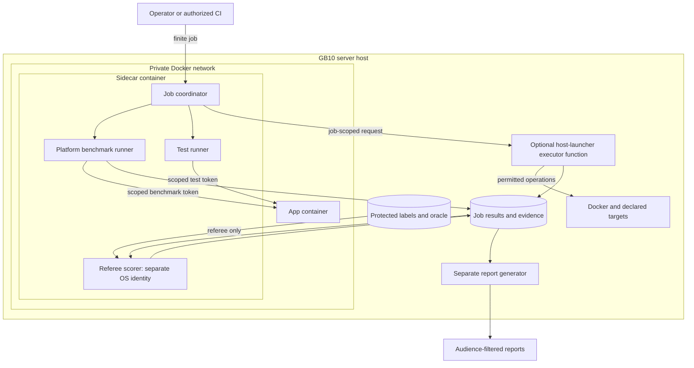

# AI4Research sidecar container

`Tier 2 · Part of: [README](../../README.md)`

The sidecar is an off-hot-path, finite-job development and benchmarking tool on the server host ([D35](../../method/decisions.md#d35), [D36](../../method/decisions.md#d36)). It contains the platform benchmark runner and test runner. Their entry points, credentials, data and authority remain separate. Product agents and capability capsules cannot use sidecar tools or credentials. Product startup and research runs do not depend on the sidecar; the benchmark pilot is separate from the PRD core gate ([D40](../../method/decisions.md#d40)).

Some benchmark experiments need target lifecycle, image preparation, fault injection or host observations. The existing host launcher may provide these through an optional privileged host-executor function and a narrow per-job contract. The launcher retains Docker credentials; the sidecar receives no Docker socket, daemon credentials or general host shell. Ordinary API campaigns need no privileged operation.

## Components and trust boundaries

The optional host executor is a finite function of the existing launcher, not a permanent service. The launcher owns privileged credentials. The runner never reads labels or scores results. A referee scorer reads protected labels and writes scores; a separate report generator creates audience-filtered reports.

| Part | Responsibility and limit |
|---|---|
| Job coordinator | Freeze jobs, invoke runners, resume observation and request cleanup; no product writes, labels or arbitrary commands. |
| Platform benchmark runner | Run frozen cases through E1 or approved evaluation-profile entry points; no labels or scoring. |
| Test runner | Perform bounded client validation; no host-executor or referee role. |
| Host launcher executor | Prepare/manage resources and return scoped observations; reject ungranted operations and foreign resources. |
| App | Own product state, gates and volumes; expose supported client operations. |
| Referee scorer / report generator | Separate processes: the scorer writes scores, and the generator creates reports. |

## Job lifecycle and recovery

A job freezes case versions, entry points, configuration, repeats, target policy, limits, retention and required evidence. Comparison eligibility follows the [benchmark contract](../../side-systems/benchmark-runner.md). Runs serialize where exclusive resources are required.

| Stage | Meaning |
|---|---|
| Freeze and prepare | Validate job scope and evidence needs. If needed, prepare a pinned image and disposable target, stage declared visible inputs, or request an approved custodian session. Record target identity/readiness. |
| Preflight and execute | Verify app identity/build, client contract, operations and pins. Run scheduled cases through E1 or an advertised evaluation operation; record request and run identities. Missing prerequisites block measurement. |
| Observe and retrieve | Follow the identified run and retrieve permitted evidence. Reconcile uncertain submissions; never submit blindly. |
| Score and report | The referee scorer reads labels and writes scores. The report generator builds public/referee reports. The runner sees no hidden labels or per-case oracle feedback. |
| Close | Clean up only job-owned resources. Preserve evidence per retention. Never remove standing resources or auto-delete app evidence. |

After interruption, the coordinator may resume **observation** by reloading the job and reconciling target/request/run identity. Recovery does not restart an app, replay a node or insert a replacement run. Repeats already authorized by the frozen schedule remain distinct planned runs. Additional attempts need campaign authorization. A disconnected run is not assumed stopped. Product failure follows [D49](../../method/decisions.md#d49) and [D50](../../method/decisions.md#d50). Sidecar/executor failure affects its job, while the app continues independently.

Supported work includes whole-workflow runs, node replay, single-CC invocation with supplied binding, declared faults, checkpoint observation, external configuration adapters and delegated RSI/custodian sessions. Fault definitions belong to the approved evaluation profile. The client may select an approved fault ID. Evaluation-profile outputs are `invalid_for_product` and cannot become product results or RSI material. RSI uses an approved operation through the existing workbench/custodian session. Sidecar requests contain no hidden fixture path or label location. The RSI custodian owns hidden fixtures and referee access. The launcher starts the preconfigured session without disclosing those paths or labels to the sidecar. E6 adapters are runner-side. The sidecar invents no benchmark cases or datasets.

## Host executor

The standing app is observe/API-only by default. Bounded lifecycle operations on it require a separate operator grant naming the target; this grant does not transfer ownership or permit deletion. Destructive lifecycle tests and fault injection use job-owned disposable targets. Cleanup removes only job-owned resources.

Fields below define authority and evidence meanings; wire schemas and commands belong in the implementation specification.

| Request field | Meaning |
|---|---|
| `contract_version` | Contract version; unsupported versions are rejected. |
| `job_id` | Identity that scopes requests, grants, resources and evidence. |
| `target` | Explicit target identity, mode (standing or disposable) and job-specific endpoint/network, including expected instance/build when known. |
| `grant` | Optional operator authorization for bounded operations on a named standing target. It is distinct from ownership and expires with the job. |
| `environment` | Pinned environment identity. Image build requests identify pinned source, build context and dependency lock; results record the produced image digest. Pull requests identify a pinned image reference/digest. |
| `operations` | Finite scope for build/pull, target lifecycle, approved process-fault actions on disposable targets, visible-fixture staging/export, read-only observations, or approved custodian-session invocation. Each request names its target/resource and permitted scope. |
| `fixture_refs` | Hash-identified visible job inputs only. No label/oracle paths or hidden fixture references. RSI fixture access uses custodian-owned session operations, not a path supplied by the sidecar. |
| `custodian_session_ref` | Optional identity of a pre-approved RSI session and its permitted operation. The custodian resolves its protected configuration. No fixture paths, labels or custodian credentials enter the request. |
| `budget` | Wall time, CPU, memory, process count, disk and applicable model limits for the job and owned targets. Preserve host capacity for core app work; GPU-exclusive cases name an exclusive window. |
| `retention` | Requested evidence retention and cleanup policy, bounded by operator policy. |
| `idempotency_key` | Identity for reconciling a host operation after uncertain delivery; it does not retry product work. |

| Result field | Meaning |
|---|---|
| `job_id`, `operation_id` | Correlate the result to its job and operation. |
| `status` | `completed`, `failed`, `blocked` or `interrupted`, with a reason when not completed. This is the operation result, not a product verdict. |
| `target`, `resources` | Resolved target/build identity and resource ownership/lifecycle state. Later cleanup is limited to job-owned resources. |
| `observations` | Timestamped requested inventory, scoped logs, metrics or volume-size readings and their source. |
| `fixture_receipts` | Hashes and destinations for visible inputs staged or exported. No hidden labels/oracles. |
| `evidence_refs`, `cleanup` | Durable evidence references, retention information and per-resource cleanup outcome. |

The launcher rejects arbitrary commands, unpinned images, foreign IDs, hidden-label paths, out-of-scope operations and exceeded enforceable limits. No job grant exposes referee or custodian private processes, logs or mounts to the runner or coordinator. RSI observations come through approved custodian exports. The launcher cannot grant its own permissions, submit app runs or decide gates. Enforce CPU, memory, process and disk ceilings while reserving core app capacity. Apply model call/token caps or reliable provider quotas. Unknown monetary cost remains unavailable. Block jobs needing an unenforceable cap. Disk observations alone cannot prevent shared disk exhaustion. Never auto-delete non-job-owned data. Launcher absence/failure does not affect app startup or release.

Preflight blocks a campaign before execution if its required capacity cannot be reserved. An exclusive GPU case needs an operator-reserved evaluation window without a conflicting active or committed core workload. The launcher never pauses or preempts a core run to obtain that window. Shared hardware still needs these limits and scheduling rules even though software dependencies are separate.

The host launcher retains the job's resource ledger and enforces its deadline independently of the sidecar connection. Expiry follows the pre-authorized containment and cleanup policy for job-owned targets, preserving evidence. It never automatically stops a standing app. Spec Kit defines how the finite launcher job supervises this lifecycle.

Benchmark-required hardware inventory and peak-resource sampling remain required, including inventory before each test/repeat. Other logs, metrics and volume-size readings are optional diagnostics. If essential evidence is missing, the case is blocked or inconclusive. No profiling integration, CC diagnostic API or new product telemetry is added.

## Application connection and compatibility

Benchmark and test processes use separate scoped app tokens. Evaluation-profile operations use a separate scope. Readiness verifies client-contract version, target identity/build and prerequisites ([client-readiness](../../reference/field-catalog.md#client-readiness)). The base app endpoint is `app:5173` on the private Compose network. Disposable jobs use their launcher-resolved endpoint and network, with identity checked before submission. The sidecar does not widen port publication, access app volumes or call private workflow modules. The client uses supported readiness, submit, observe, permitted retrieval and authorized cancellation operations ([automation](../automation.md)). A mismatch blocks measurement. Losing the sidecar does not cancel or pause an app run.

## Scope and phase boundaries

This is architecture, not runtime implementation. The PRD V.10 core gate is Phase 1 Stages 0–7, the end-to-end run, Section 1.5 items, Evaluator Gate tests and Phase 1 evidence. Phase 2/3 implementation coverage and the sidecar benchmark pilot are reported separately; none blocks this gate ([D40](../../method/decisions.md#d40)). The optional host-launcher boundary is [D51](../../method/decisions.md#d51) and grants no product authority.
