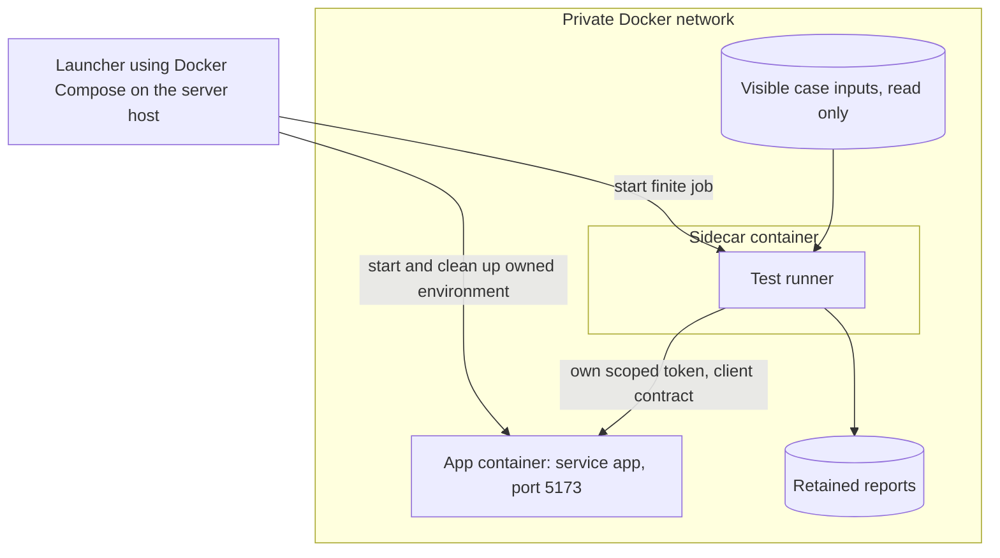

# Test runner (client validation in the sidecar container)

`Tier 2 · Part of: [README](../../README.md)`

The test runner is the client-validation role in the [sidecar container](../sidecar/README.md) ([D36](../../method/decisions.md#d36)). It is development tooling off the hot path. It submits bounded cases to the app through the product client contract, observes, assesses against declared expectations and exports a result record. Container lifecycle, router-process faults and evaluation-profile startup belong to the host launcher through the [job-scoped host contract](../sidecar/README.md#host-executor), not the test runner. The connection and compatibility rules are on the [sidecar page](../sidecar/README.md#application-connection-and-compatibility). The client contract is on the [automation page](../automation.md).

*Level: container. Omits: the platform benchmark runner, how users reach the app and the operators who trigger the launcher.*

## Lifecycle

A person, an authorized agent, CI or an external scheduler starts a finite job through the launcher. The runner submits cases one at a time, observes, writes the report and exits. Exit does not cancel research. An explicit timeout policy may cancel the runner's own submitted run. An external supervisor enforces a hard deadline, and an incomplete result stays `inconclusive`.

A fresh run starts a dedicated app container, and the launcher removes it afterwards. A standing run targets an existing app container and the launcher starts only the runner. A debugging option may retain an environment under a named owner. Cleanup touches only job-owned resources.

## Commands and results

`Standard`. From the server host, a person or an authorized agent runs the test runner inside the sidecar container with `docker compose run --rm sidecar test-runner <command>`. The **test matrix** is the set of case files in the runner's case folder. Each case file names its steps, its expected outcome and its `timeout_s`.

When it runs: on demand, and before each merge to main. The person merging, or the merging agent, runs `test-runner matrix` on the candidate build. The merge goes ahead only on exit code 0, and the result record is kept with the merge. No case may be skipped to get a pass.

| Command | What it does | Exit code |
|---|---|---|
| `test-runner readiness` | Calls readiness and checks target identity and client contract version | 0 ready, 2 blocked |
| `test-runner run-case <case_id>` | Runs one case | 0 expected outcome met, 1 mismatch, 2 blocked, 3 inconclusive |
| `test-runner matrix` | Runs every case in order | 0 only when every case met its expected outcome. Otherwise the highest code of any case |
| `test-runner cancel <run_id>` | Cancels a run this runner submitted | 0 acknowledged, 2 blocked |
| `test-runner report <job_id>` | Prints the retained result record of a job | 0 found, 1 not found |

**Control API operations the runner uses.** The readiness, submit, reconcile, status, retrieve and cancel operations of the [control API table](../../reference/field-catalog.md#control-api), each with its own scoped token. These are the only operations it calls. It never calls the evaluation-profile entry points. A `client-error` reply is a result, not an exception.

**Result record.** One record per job, written to the runner's report folder. It is a runner record, and the product never reads it.

| Field | Type | Meaning |
|---|---|---|
| `job_id` | `string` | Identity of the job |
| `trigger` | `string` | `manual`, `merge` or `agent` |
| `candidate_id` | `string` | Build identity reported by readiness |
| `client_contract_version` | `string` | Version the app reported |
| `started_at` | `string` | UTC timestamp |
| `ended_at` | `string` | UTC timestamp |
| `cases` | `object[]` | One entry per case: `case_id`, `run_id` (null if none), `client_request_id`, `expected`, `observed`, `outcome`, `evidence_refs` |
| `outcome` | `string` | `met`, `mismatch`, `blocked` or `inconclusive`. Per case and for the job |
| `mock_run` | `boolean` | True when any case ran on mocks. Mock runs stay distinct from model-backed validation |
| `limitations` | `string[]` | Evidence the runner could not capture |
| `exit_code` | `integer` | The process exit code above |

Submission failure, observation timeout and an application-reported stage failure are different observations. A lost connection does not establish workflow failure.

## Permissions

The runner submits, observes, retrieves evidence and cancels only its own runs, through its scoped credential in the declared evaluation workspace. It reads visible case inputs read only and writes only its report location. It has no Docker socket or daemon credential, no write access to state, gates, configuration or accepted outputs, no hidden RSI fixtures or secrets, and no right to modify source or deploy. It runs as a non-root user, unprivileged, with no inbound port. Compose connectivity does not grant authorization ([Docker Engine security](https://docs.docker.com/engine/security/)). The runner reports application verdicts. It cannot replace verification or insert accepted results.
