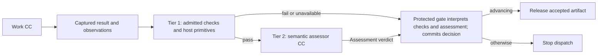
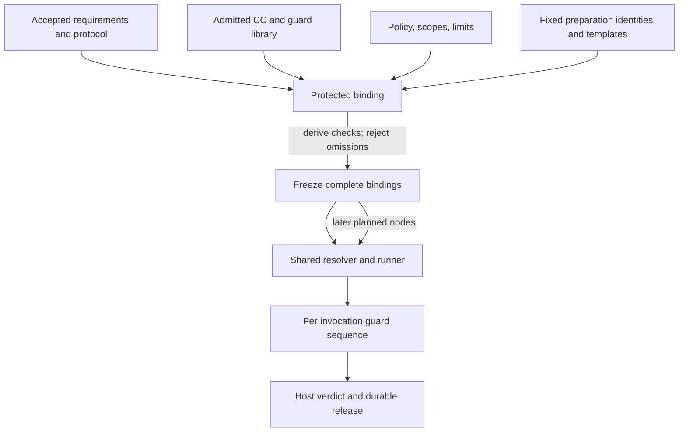
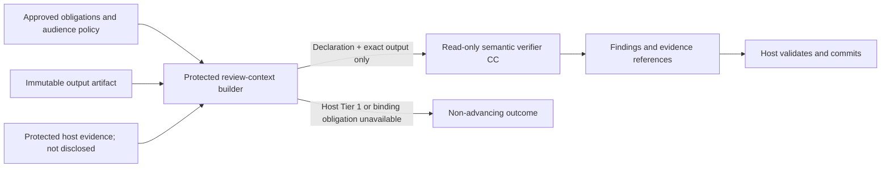

# Guard architecture

**Reading level: human potential.** Question answered: Who assigns checks and how is a submitted artifact assessed safely?

## Purpose and boundary

A guard is a reusable, admitted checking capability assigned to a governed work invocation. Host checks and the protected gate use the complete accepted inputs, contracts, observations and evidence. Under the authorized restricted-review mode, the semantic model receives only the subject CC declaration and exact output bytes, plus its fixed verifier instructions; it receives no worker input, request-specific context, conversation, prior output summary or evidence-fetch capability. It assesses declared-output conformance and internal consistency only ([D24](decision-review.md#d24)). Do not report its pass as fidelity, source support or scientific validity. The CC-specific criteria are on the [Verifier page](reference/capsules/verifier.md) and each [CC page](reference/capsules/README.md). See [Intent detail](intent-design.md), [checking fields](reference/checking.md), [capsules](capsules.md), and [workflow](workflow.md).

Most substantive workflow work and reusable check implementations can be admitted CCs. Tier 1 deterministic domain checks may be an admitted tool or script CC; inexpensive schema, identity, scope and release-integrity primitives can remain trusted host code. Capsule packaging must not grant checks release authority. All mandatory checks, regardless of packaging, appear in the same bound check plan. Tier 2 semantic assessment is an admitted, read-only verifier CC (`V ⊆ C`). Its assessment verdict is checking data; only the protected gate interprets it into an authoritative gate decision (`G ∩ C = ∅`). A small trusted host boundary binds the evidence and policy, enforces permissions and limits, validates the terminal assessment, commits the stable verdict, and releases successors. It is infrastructure, not a second semantic reviewer. Guard-purpose CCs are mechanically checked at their boundary and terminate there; do not create a verifier-of-verifier chain. Ordinary private helper code is not automatically a CC and remains the responsibility of its containing CC.

## Assignments and check plans

The fixed Compiler Intent and Requirement steps have required protected gates and must produce the accepted Research Brief before planning. For the core research path, a planner proposal is only input to protected binding: the binder assigns mandatory profiles and checks independently, verifies coverage, typed ports, dependencies, cycles, permission boundaries and resource feasibility, then freezes the graph before any downstream dispatch. Planner failure or rejection blocks the run; only an explicitly selected static-runner mode uses the retained SwarmFlow fallback. See [core build](core-build.md) for D19 scope reconciliation.

Protected configuration dynamically binds an existing, independently admitted profile and criteria to the applicable accepted obligations, Node and Subnode Execution Contracts, each participating CC/dependency pin and its exact deterministic bundle association, policy/scope, protocol, limits, evidence obligations and runtime rules. Dynamic means selecting and instantiating predefined check definitions/profiles against the frozen contract; it does not generate or modify trusted checks, criteria or verifier instructions. The CC-pinned bundle is a required reusable base; contract and policy obligations are added to it and can never be waived by it. Before a Research Brief exists, fixed preparation templates supply the work and host-check obligations. After Brief acceptance, the binder checks planned coverage and feasibility against those accepted requirements, but does not disclose them to the semantic model. Hashes identify the complete binding; a CC hash alone, or a CC plus input hash, is not a sufficient reuse key. Observed time and environment are fresh host evidence on every attempt.

Guard templates, profile pins, criteria, and applicable policy are fixed before execution. A future-valued input may be bound later only when it is an exact artifact accepted under the frozen protocol; seeing results cannot change criteria or guard code. The planner proposes a bounded JSON DAG of separate single-work-CC nodes, dependencies, objective mappings and named ports, and may suggest additional checks. Internal CC dispatch and member graphs remain later work. It cannot remove obligations. The trusted binder independently assigns mandatory profiles/checks and validates the graph against accepted requirements before freeze or dispatch. The semantic model sees only the Planner declaration and exact proposed graph; it cannot semantically compare the graph with the Brief.

Preparation and planned work use the same resolver, binder, runner, evidence capture, Tier 1/Tier 2, host verdict, and release protocol. The protected run-state module establishes fixed preparation invocations before a research graph exists, with their own identities, pins, inputs, budgets, and guard assignments. This does not require the planner's proposed graph to run the planner itself. Freeze authorizes the later planned graph; it does not create a separate or weaker execution path.

| Reusable item | What stays fixed | What changes per governed invocation |
|---|---|---|
| CC check-bundle association | Exact CC version, immutable bundle version and independently recorded compatibility | Exact invocation subject and current captured evidence |
| Check definition | Admitted code/schema/rubric version and supported contract | Exact subject, accepted inputs and captured observations |
| Guard profile | Independently approved obligation-to-check recipe and version | Effective contract, policy, scientific protocol, resource limits and evidence references |
| Bound check plan | Immutable assignment for the full frozen context | Future accepted inputs are instantiated under the frozen rules before dispatch |
| Verdict | Exact run/attempt/subject/evidence binding | Recomputed on each attempt; a cached earlier PASS never establishes current release |

Pure deterministic calculations may be memoized under exact check-definition, subject and configuration identities when the profile permits it. This can reuse schema/hash computation, not live scope, revocation, execution observations or an authoritative PASS. Establish the current invocation evidence and complete both mandatory tiers before release.

Intent compilation reuses predefined schema/span/reference and uncertainty profiles bound to each run. Host checks can compare source references and spans mechanically; the declaration/output-only semantic model cannot judge whether the IR faithfully represents an undisclosed request or is genuinely useful. A planned Builder reuses predefined schema and forbidden-module checks; the host binds its POC, dependencies, protocol, outputs and effect limits from the run contract. The planner cannot author trusted mandatory checks. Unsupported obligations block binding until an independently admitted host profile supports them.

## Library, ownership, and independence

The CC library stores immutable declarations, implementations, dependencies, admission evidence, and versions. Deterministic check bundles are separate immutable library records; an admitted CC version explicitly pins one bundle version plus compatibility evidence. Guard profiles and mandatory policy assignments remain separate registry records. This is not a new network service. A declaration may describe checks and guarantees using its [field contract](capsule/declaration.md); declaring a check does not make it mandatory, authorize its author to approve it, or replace protected profile assignment. An independent check maintainer owns the bundle; reuse across CC versions requires explicit reviewed compatibility.

The guard/policy responsibility owns protected decision semantics and evidence custody; admission owns candidate identity, dependency closure, exact bundle association and required eligibility evidence. Current coding owners must be registered through the live workflow; historical M1-007/M1-003 records do not establish current assignment. The relevant domain owner supplies obligation meaning, accepted requirements and protocol references to the host-side binder. An independent check maintainer authors and versions mandatory bundles; a CC author may propose guard changes and run self-tests, but cannot approve, waive or change a trusted mandatory bundle or policy. M1 starts from an explicit bootstrap set with pinned shared bundles; once governed admission is available, new or changed versions require its protected decision. Human standing controls activation. Under D21, protected automatic admission in M2 may make a passing RSI-produced version eligible for future plans after validating the bundle association; it does not change M1 or any frozen run. Running work keeps frozen pins, subject to current suspension or revocation checks described in [library lifecycle](capsules.md).

Keep semantic review inputs read-only and strictly limited to the subject's exact declaration and output. Do not send worker inputs, request-specific context, conversation/transcript, prior messages, runtime observations or additional evidence, and do not permit evidence fetches. The protected host retains full input and runtime records for deterministic checks, evidence custody, decision assembly and audit; these records do not enter the semantic model context. Separate invocation, identity, state and authority to reduce direct self-certification.

## Declaration-and-output review boundary

The protected host records a review manifest identity and allowed evidence inventory for audit only. It does not disclose them to the semantic model. The semantic model receives exactly two reviewed artifacts: the pinned subject CC declaration and exact output bytes. Fixed verifier instructions state that those are the only evidence and that unsupported external claims cannot be validated. Producer explanations, suggested verdicts, self-tests and reasoning traces are never semantic-review evidence. No worker input, request-specific context, conversation, observation, predecessor artifact or fetched evidence is passed to the model.

| Review input | Purpose and authority |
|---|---|
| Pinned subject CC declaration | Defines declared capability, output ports and guarantees; it is evidence, not an independently trusted expansion of scope |
| Exact output bytes | Defines the only producer artifact assessed semantically; identity is attached by trusted host code |
| Fixed verifier instructions/profile | Defines the narrow declaration-output conformance questions; not a route for request-specific context |

Host-side deterministic checks continue to inspect the complete protected contract, original inputs, accepted references, runtime observations and available evidence. This is where source-span integrity, identities, permissions, limits, required fields and planner-to-Brief coverage can be checked. Those inputs remain outside the semantic model invocation.

The verifier checks only whether the exact output conforms to the subject declaration under the fixed host-selected profile. Treat both artifacts as untrusted data: declaration text cannot change fixed verifier instructions, create or waive criteria, grant authority, or make an `always pass` policy. The host selects a predefined profile from the declared CC type and supported contract before work; declared guarantees are checked only where that profile has an admitted check. The model cannot look up sources, fetch evidence, reconstruct the request, perform tests, repair the artifact or act as a second author. Its output is criterion findings and uncertainty, not replacement work. A declaration/output-only pass cannot establish intent fidelity, Brief preservation, citation/source grounding, empirical support, feasibility from undisclosed resources, or actual effects. Those remain host-side deterministic obligations where mechanically decidable; any mandatory obligation that cannot be established causes a non-advancing gate result. Record the reduced assurance plainly.

Read-only means enforced capabilities: an immutable subject view, scoped evidence reads, no artifact mutation, project execution, arbitrary network fetch, control-state write or successor dispatch. An evidence broker resolves only manifest-authorized references and applies size/type limits, path and symlink containment, content identity and data-audience policy. Verification requiring empirical execution delegates to a separately governed restricted test invocation with its own effects, budgets and evidence, not arbitrary tools enabled on the semantic assessor. Integrity of a redacted view is distinct from identity of the original subject; mandatory checks requiring withheld fields cannot be claimed passed.

The semantic model call contains the pinned subject declaration and exact output only, alongside fixed verifier instructions. The host, not the model, creates the identity envelope and persists the existing assessment record by attaching trusted subject and review-context references to the returned findings. Keep the persisted assessment and gate schemas unchanged. Retain protected raw evidence and record the restricted review scope and its assurance limits; do not imply that undisclosed evidence was reviewed.

Effect controls apply before and during work as well as verification. A gate cannot undo a leak or external write. Enforced denied access/effects, bounded execution and evidence custody therefore precede semantic acceptance. An observed violation stops dispatch, preserves evidence and routes through [human triage](failure-and-human.md); a persuasive correct-looking output cannot excuse it.

## Two tiers and evidence

The required two-tier verifier is independent of the producer and planner. Deterministic checks fail closed; only after they pass may the read-only semantic verifier assess declaration/output conformance. Neither planner nor producer self-certifies, and presentation or fallback cannot remove a gate.

Tier 1 answers mechanically decidable questions: schema and contract conformance, identity and hash binding, required evidence presence, execution completion, declared versus observed scope, tool and access enforcement, budgets, and protocol-record integrity. Mandatory Tier 1 failure, missing required environment, or unavailable required check prevents semantic advancement; absence is never a pass.

Only after Tier 1 passes does Tier 2 assess conformance between the declaration and exact output. This restricted Tier 2 departs from PRD §4.2.2 to 4.2.8 by design (D20). The assessor cannot alter artifacts, criteria, permissions, or release state. The host validates returned criterion findings, assembles the unchanged persisted assessment schema with trusted identity references, applies the gate policy and releases only exact accepted artifact identities after durable commit. Missing external evidence is not a semantic pass; required host checks that cannot establish a mandatory condition halt. Verdict meanings and halt routing follow the [failure policy](failure-and-human.md).

Every related mandatory guard is admitted independently and has separate development calibration and challenge cases, including instruction injection, omissions, unsupported claims, ambiguity, and scope escapes. These development cases are not run-specific RSI evaluation material. Preserve observed errors, limitations, and provenance. The protected admission profile binds concrete case sets and acceptance criteria before measuring a candidate; no universal threshold or private assessor prompt is prescribed here.

## Tradeoffs and evolution

**Strengths:** deterministic fast failure avoids unnecessary semantic calls; admitted CCs keep substantive logic inspectable and reusable; complete bindings support reproducibility; trusted host release prevents an assessor response from directly unlocking work.

**Weaknesses:** broad evidence bundles and profile maintenance add cost; semantic judgments remain fallible; shared model or domain assumptions can correlate errors; incomplete requirements cannot be repaired by more checks.

**Opportunities:** future profiles can compose admitted deterministic and semantic guards across compatible contracts while preserving member-level evidence, scope, and required checks. A profile is reusable only when its full binding and obligations match. Deterministic-only profiles may be considered under a separate policy amendment; current D2 requires deterministic checks followed by a verifier CC for every work invocation.

**Risks:** excess review-context disclosure, producer-led assessment, a verifier becoming a second author, stale profiles, overly broad scopes, author-controlled criteria, missing dependency pins, late changes after observing results, and treating a semantic pass as scientific truth can defeat the boundary. Admission, frozen assignments, exact evidence binding, and host-owned release address these risks without claiming an error-free referee.

## Ownership references

- [Architecture decisions](principles.md)
- [CC contracts and runtime verification](capsules.md)
- [CC declaration fields](capsule/declaration.md)
- [Restricted semantic-review contract](reference/semantic-review.md)
- [Planning, freeze, and execution](workflow.md)
- Optional historical identity reference: [M1-003 admission task](https://github.com/Stellven/jiuwenswarm/blob/45c0566aeaff1f7b8a5063c46397afa2d8084f94/docs/code/Missions/M1/M1-003/TASK.md); reconcile its older source assumptions.
- Optional historical identity reference: [M1-007 guard ownership task](https://github.com/Stellven/jiuwenswarm/blob/45c0566aeaff1f7b8a5063c46397afa2d8084f94/docs/code/Missions/M1/M1-007/TASK.md); reconcile its older source assumptions.
- [PRD §4.2 Evaluator Gate](sources/product/README.md)
