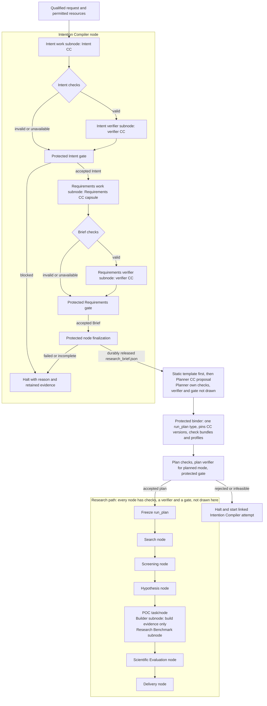
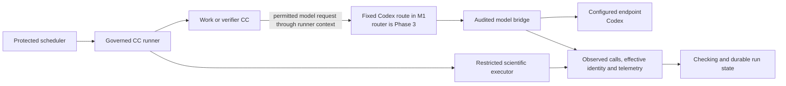
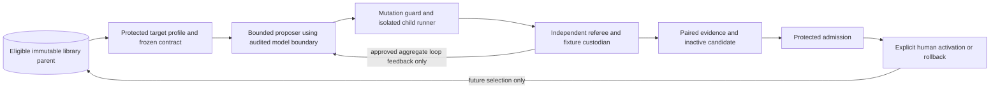

# System architecture

**Reading level: human immediate.** This page connects the whole M1 system. [Research design](research-design.md) expands each responsibility. [Reference](reference/README.md) defines the information crossing boundaries.

## From meaning to a governed research program

**Example flow:** accepted intent becomes a Research Brief, the Brief becomes a checked and frozen plan, and that plan releases research nodes in dependency order. The diagram draws the checks, verifiers and gates only inside the Intention Compiler node. The Planner and every research node have the same pattern: deterministic checks, a verifier and a protected gate. The diagram omits them to stay readable. The [research-node view](#research-nodes-and-subnodes) draws them. It orients the reader and does not promise that every plan has this exact graph.

The [expanded research-node view](#research-nodes-and-subnodes) shows each stage's work and verifier subnodes and gates. The [POC task/node view](#inside-the-poc-task) gives the Builder and Benchmark checks a larger view. A blocked check, verifier or gate halts the dependent path and retains evidence. If Intent has no workable purpose/result, Requirements is not invoked and no intent is invented.

The Brief fixes objectives, mandatory outcomes, preferences, scope, constraints, deliverables and evidence obligations. The assigned core Planner proposes compatible admitted CCs under D19. A static template runs first and yields the same [`run_plan`](reference/run-plan.md) type ([D26](decision-review.md#d26)). A failed planned run never falls back silently. An infeasible plan starts a linked Intention Compiler attempt. Protected binding assigns the check bundles and effective authority. Freeze captures the `run_plan` and pins before execution. Future values remain typed references until their producing gates accept them.

The research stages pass these artifacts forward:

- Search produces cited candidates.
- Screening selects one opportunity and records its reasons.
- Hypothesis registers measurements and success/falsification boundaries before code or results exist.
- Builder packages a bounded intervention without running the scientific trial.
- Benchmark collects matched empirical evidence.
- Evaluation applies the registered criteria.
- Delivery reports the result and its limitations.

A scientific `FAIL` can be a correctly completed result. It can proceed to Delivery after infrastructure acceptance.

## Execution and model routing

Each execution subnode binds one admitted CC version and its exact associated deterministic check-bundle version. The enclosing node contains its bounded work and verifier structure; protected binding adds applicable contract and policy checks. Additional work CCs use separate gated subnodes within their declared node. Verifier invocations remain separately governed checking assignments. Composite or merged CCs and arbitrary capsule member graphs remain later work.

The compiler, research, verifier and eligible RSI proposal calls share the model boundary. The runner binds the role/profile and effective limits. Routing selects only an approved endpoint within that binding. Phase 1 uses fixed selection. Independent later integration may introduce heterogeneous routes; an alternate-verifier study is outside the current core. No started invocation receives a hidden mid-call replacement. Missing required access blocks the run. Unavailable token/cost telemetry remains explicitly unavailable. [Routing detail](model-routing.md) explains those seams.

Runner admission, node authority and run policy intersect per CC. Deterministic/semantic checking cannot undo effects, so execution confinement and disclosure permissions are enforced before work. Generated POC code cannot access gate state, referee fixtures, credentials or unrelated host paths.

## Where RSI connects

Independently buildable Target 1 improves a sandbox copy of Screening's pure ranking helper. It is not a core startup, test or acceptance prerequisite. It preserves incoming scoring dimensions, contract and referee. The M1 deliverable is a child plus evaluation/security evidence. It does not change live production ranking. Target 2 implementation-text changes depend on bounded headless model support. RSI shares audited model/evidence capabilities, but uses its own session, budgets and callback policy outside the live research DAG. [Offline detail](offline-rsi.md) defines protected data partitions and limits.

## Inside the POC task

Builder and Research Benchmark are separately gated subnodes. The scientific Research Benchmark CC is not the platform benchmark. Builder creates the bounded intervention and build evidence only. Benchmark provisions the frozen environment and measures baseline and treatment. Node acceptance requires both results and durable evidence. [Expanded POC view](research-nodes.md#inside-the-poc-task) shows their internal boundaries.

## Research nodes and subnodes

Each selected research node contains bounded work, pinned capsule-bundle checks plus applicable contract/policy checks, an independent verifier assignment and protected gates. [Expanded node views](research-nodes.md#research-nodes-and-subnodes) show the repeated pattern without expanding the immediate reading route.

## Placement, state and human inspection

The application image contains the frontend, same-origin web/control API and workflow runtime. Its entrypoint starts the product. The browser reaches container port 5173 through host-loopback publication, normally `127.0.0.1:5173:5173`. No external UI script or separate frontend container is required. A separate sidecar/benchmarker uses configured private-network service DNS, the container port, scoped authentication and a compatibility handshake. Its own localhost is not the application.

SQLite owns durable lifecycle/release state. Immutable files retain artifacts and append-only observations; Run Bundles and derived scorecards cite them. Product account/profile state survives workspace/run deletion and is distinct from OS identity. Inspecting saved results never starts execution or changes accepted state.

Humans see readable Intent, Brief, major research artifacts, verification reasons, accepted/candidate status and limits. The UI or Markdown view is derived from the same versioned records. Raw traces remain available separately, with audience restrictions and redaction. Candidate files after a failed commit are not accepted outputs. Browser disconnection does not cancel server execution. Restart preserves evidence and pauses interrupted attempts without replay.

## Navigate from responsibility to fields

| Responsibility and purpose | Inputs → outputs / connections | Detail and field reference |
|---|---|---|
| Intention Compiler: establish usable research obligations | Qualified intake → verified Intent IR → verified Brief → binding/planning | [Build](builds/intention-compiler/README.md), [fields](reference/intent-and-requirements.md) |
| Planning/binding: authorize achievable work | Brief + admitted capabilities → frozen node/subnode contracts → runner | [Workflow](workflow.md), [contracts](reference/node-execution.md) |
| Research: investigate and measure | Brief → candidates → opportunity → protocol → POC → measurements → scientific verdict → report | [Ports/purpose](research-design.md#research-path-and-ports), [fields](reference/other-contracts.md#research-artifacts) |
| Checking/gates: decide admissibility | Submitted work + protected criteria/evidence → assessment → committed release or halt | [Guards](guard-design.md), [fields](reference/checking.md) |
| Routing/execution: run admitted capabilities safely | Bound role/context/limits → approved model or confined scientific executor → observations | [Placement](placement.md), [routing](model-routing.md), [fields](reference/other-contracts.md#client-and-model-boundaries) |
| Evidence/clients: make outcomes inspectable | Captured artifacts/state → readable inspection/export → authorized clients | [Inspection](artifact-inspection.md), [fields](reference/other-contracts.md#manifest-and-runtime-records) |
| Library/RSI: improve eligible implementations offline | Target profile → isolated evaluation → inactive candidate → admission → human activation | [RSI](offline-rsi.md), [fields](reference/other-contracts.md#offline-rsi-records) |

Each detail page explains purpose, owners, inputs/outputs and failures. [Contract index](reference/contract-index.md) leads from an artifact to its field chart, selected schema and examples. Read future context to preserve intended seams, not to expand the assigned build.

## Full product coverage and assigned core

| Scope | Build and acceptance meaning |
|---|---|
| Assigned core | Fixed Compiler → bounded Planner proposal → independent binding/checking/freeze → governed Search-to-Delivery journey, required resources, evidence and product control/inspection boundaries |
| Static template | Built first, selected before a run, same `run_plan` type. Not silent recovery or proof that planning works |
| Independent RSI | Separate offline target, pinned parent, unchanged referee and isolated candidate evidence; absence cannot block the core |
| Broader product continuation | Advanced compilation, heterogeneous routing, alternate-verifier studies and Code Mode remain separately scoped; Generalist/MCTS/composition refinement and later lifecycle work do not enter the core by implication |

The [Core build](core-build.md) owns the current assignment. The [complete Compiler route](builds/intention-compiler/README.md) remains reusable preflight/component context; its success alone does not establish a working Planner or research journey. [D19](decision-review.md#decisions-and-source-amendments) records the authorized difference from original Phase 1/2/3 allocations. Frozen source inputs and earlier evidence retain their identities. The [phase account](delivery-phases.md) keeps broader product obligations visible.
