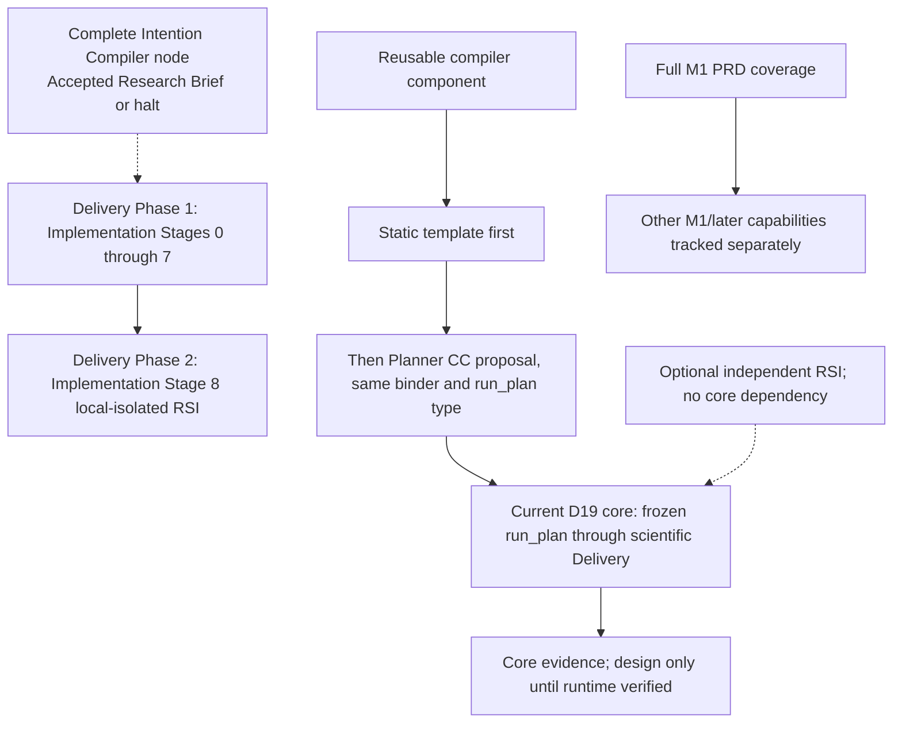

# M1 delivery phases, stage exits and complete Intention Compiler node

**Reading level: human potential.** Question answered: What prerequisites and exits distinguish the full M1 stages and delivery phases?

**Current core assignment:** the complete bounded compiler → accepted Brief → independently validated autonomous planner → frozen JSON DAG → one governed scientific journey through Delivery, as defined in [Core build](core-build.md). D19 explicitly promotes this planner from later dynamic scope; it is an authorized design amendment, not a claim about the original PRD text. The static workflow remains an explicit separate fallback with its own acceptance record. RSI Target 1 is independently buildable and optional to the core; it cannot gate core startup, coding, tests, platform benchmarks or release. Full M1 product obligations remain visible in the clause/story maps below. All entries are design allocations only, not runtime `PASS` claims. The October 30 coordination/demo target excludes RSI and new Model Router integration and is not the PRD’s full M1 completion gate.

Use the [latest received PRD](sources/product/README.md), especially §§1.3–1.9 and 6.1–6.14, for exact scope and acceptance. Read [research responsibilities](research-design.md) for every workflow responsibility and [Intention Compiler](immediate-plan.md) for the first connected build. A delivery phase, implementation stage, scientific workflow responsibility and native SwarmFlow runtime phase are different concepts.

## Every implementation stage

The predecessor exits govern integration/completion; independent preparation may proceed earlier. Each boundary uses admitted capabilities, a protected Node Execution Contract, captured evidence and the same protected gate. Concrete executable verification procedures belong to the implementation verification artifacts; this document defines architectural exits.

| Delivery / implementation stage | Inputs and responsibility | Runnable exit and retained evidence | Design connection |
|---|---|---|---|
| Delivery Phase 1, Implementation Stage 0 (§6.3): runtime unblocker | Protected local configuration/identity, model credentials, bounded Codex adapter and secured IPC | Real bounded model request returns through JiuwenSwarm with required security; distinguish authentication, storage, security and HTTP liveness | [Placement](placement.md), [automation](automation.md)|
| Delivery Phase 1, Implementation Stage 1 (§6.4): governed backbone | Declaration/admission → static route/reviewer → durable evidence → runner → gate | Node A accepted output releases an actual bounded work Node B; invalid A prevents B; equivalent headless failure exits without human wait. Exact contracts, versions, effective config and decisions persist | [Capsules](capsules.md), [callbacks](failure-and-human.md)|
| Delivery Phase 1, Implementation Stage 2 (§6.5): intake, Brief, fixed graph | Text/documents, supplied project/data resources, defaults → accepted Brief → planner proposal → independently checked/frozen JSON DAG | Core path accepts a usable Brief. The static template is built first and the Planner second. The same binder validates coverage, typed ports, mandatory checks, limits and acyclic closure for either, then freezes one `run_plan` before dispatch. A rejected or infeasible plan halts and starts a linked Intention Compiler attempt. There is no silent fallback to static. Intent alone cannot satisfy this exit | [Intent/Brief fields](reference/intent-and-requirements.md), [workflow](workflow.md)|
| Delivery Phase 1, Implementation Stage 3 (§6.6): evidence to hypothesis | Accepted Brief → bounded retrieval/candidates → fixed screening → hypothesis/protocol | `candidate_set.json`, `opportunity_card.json`, `hypothesis_blueprint.json` retain citations/constraints, and each gate controls advancement; freeze empirical criteria before build | [Research ports](research-design.md#research-path-and-ports)|
| Delivery Phase 1, Implementation Stage 4 (§6.7): Builder/POC | Accepted immutable Blueprint, scoped assets and declared environment | Bounded mechanically valid `poc_artifact_bundle.zip` accepted with construction/readiness evidence, without repair loop or scientific experiment during build | [Research ports](research-design.md#research-path-and-ports), [confinement](placement.md)|
| Delivery Phase 1, Implementation Stage 5 (§6.8): benchmark/science | Accepted POC, frozen baseline/data/protocol → empirical payload → evaluation | Demonstrate scientific positive and valid negative cases, with infrastructure acceptance permitting the appropriate downstream state. Raw observations and fixed criteria establish the conclusion | [Research ports](research-design.md#research-path-and-ports), [callbacks](failure-and-human.md)|
| Delivery Phase 1, Implementation Stage 6 (§6.9): Delivery/end-to-end | Accepted evaluation and complete cited artifacts → standardized report/package → local transfer | One request travels through all research responsibilities §3.1–3.9 with every governed transition recorded; user retrieves result and durable lifecycle closes | [M1 design](m1-design.md)|
| Delivery Phase 1, Implementation Stage 7 (§6.10): workstation shell | Stable research path → installer/init/doctor, visibility, CLI/web/TUI, local terminal, identity/security/config | Developer installs, initializes, executes, observes, inspects and retrieves complete workflow through supported local interfaces. Browser closure, interactive callbacks and headless behavior preserve runtime policy | [Operational shell](research-design.md#operational-shell), [automation](automation.md)|
| Delivery Phase 2, Implementation Stage 8 (§6.11): local-isolated RSI | Eligible parent CC export when available, fixed referee, protected fixtures, target allowlist and query limits | Optional independent bounded child evaluated outside core and live DAG; guardrail attacks are blocked/recorded; evidence/lineage reconcilable; production unchanged. RSI readiness does not gate core work | [Offline RSI](offline-rsi.md), [RSI callbacks](failure-and-human.md#offline-rsi-is-a-separate-callback-policy)|

Implementation Stage 1 foundation obligations also apply to every later node. Implementation Stages 3–6 preserve original requests, accepted Brief, source references and protocol where needed; they do not consume only the immediately preceding text summary. Implementation Stage 7 does not delay basic secure startup/headless evidence needed for earlier testing. Implementation Stage 8 independent fixture/target preparation may begin early; accepted integration requires meaningful baseline evidence.

## Complete Intention Compiler: current bounded build

The [current build entrypoint](core-build.md) is the bounded core journey including the D19 planner. The [existing Intention Compiler entrypoint](builds/intention-compiler/README.md) is a reusable first component and historical calibration boundary; it covers qualified local intake → verified Intent IR → verified Brief → protected release plus its supporting foundations, not the complete core journey. Past compiler trial/TASK/interface identities remain historical and unchanged.

The existing compiler component proves its boundary only when a real supported request reaches accepted Brief with required evidence. Halt scenarios need separate failure evidence. It contributes reusable foundations and compilation, but does not implement the protected planner or scientific path and does not satisfy the current core assignment by itself. A bounded test consumer checks Brief compatibility without implementing research stages. Existing task/interface identities are reconciled under native coding records, not renamed by this design.

## Other source-mapped integration scope

These efforts preserve visibility into the broader M1 PRD surface; they are not current core acceptance gates. The Planner itself is included in the D19 core assignment above. No real execution has been assessed by this documentation review.

| Full-M1 coverage item (§6.12) | Connection / useful reuse | Source traceability and boundary |
|---|---|---|
| Advanced intention compiler | Versioned adapter outputs the same accepted Brief semantics; preserves original-source attribution and unresolved items | Relevant bounded baseline operational; external compiler available enough to test. Isolated configuration; retain baseline compiler. Interactive modes need explicit bounded scope and the same callback policy |
| Broader Agent Team / Cluster integration | Additional team/cluster collaboration beyond the fixed core planner boundary | Separately scoped later M1 effort; core plan validation, per-CC authority and freeze remain mandatory. No uncontrolled post-start replan or remote worker infrastructure |
| Other dynamic binding integration | Compatible admitted CC selection for capabilities beyond the bounded core assignment | Core already requires planner-selected assignments to pass independent typed-port, coverage, check, resource and cycle validation before freeze. Broader discovery/catalogue integration remains separately tracked |
| Model-route extensions | Existing fixed Codex route and, only if compatible, an optional API-only seam | No alternate verifier/model integration in core. Approved alternate routes are separate later work; no silent fallback or mid-run switch |
| Alternate verifier | Existing read-only assessment interface with a pinned approved model profile | Defer alternate-verifier integration. Preserve checks, gate criteria, evidence custody and protected release on the fixed route; no alternate verifier is a core dependency |
| Applicable OpenJiuwen Code Mode | Existing Builder/runner adapter uses available bounded coding capabilities | Verify actual pinned dependency support and confinement first; generated code cannot bypass declarations, contracts, network restrictions or gate evidence. Unavailable capability is documented, not simulated as real integration |

Disable an experimental configuration to restore the operational baseline. Automatic fallback must not erase an attempted failure or change a frozen run's model/graph; a newly selected baseline run is separately attributable. Preparation can overlap earlier work once its relevant baseline boundary exists; completion/promotion follows declared entry conditions. Scientific scope stays the research lane; implementation/specification classifications in §4.7 are subtask types within that lane, not unrestricted autonomous software engineering.

## Completion reports and evidence

The PRD requires `phase_1_completion_report.md`, `phase_2_completion_report.md`, `phase_3_completion_report.md`, `m1_final_test_report.md` and `m1_implementation_report.md` as evidence summaries for the full M1 obligations. These summaries connect requirement coverage to exact candidates/configurations, underlying verification evidence, outcomes, failures, gaps and limitations. They remain separate from scientific Delivery reports. Reporting procedures and coding governance live outside this design.

Any implementation status uses `PASS` only for implemented and validated declared scope; `BLOCKED` identifies an unavailable required upstream/external dependency; `INCOMPLETE` identifies behavior not yet demonstrated. Mock evidence and unrun tests are labeled. Core assignment and full M1 accounting are separate conclusions. This package records `DESIGN` only; required failure injections, stage exits and Definition of Done remain decisive, and an architectural checklist or report file does not establish acceptance. The source's October 31 target does not permit inventing per-stage dates or bypassing an exit.

## Source corrections and boundaries

The latest attachment remains verbatim. These resolutions apply to architecture and task allocation, with their source clauses recorded:

| Source ambiguity | Adopted resolution |
|---|---|
| §3.1.3 local single-user profile versus §§2.3/5.4 durable product account | Local profile means execution configuration; stable product account is separate. One active local context does not require enterprise multi-tenant separation |
| §4.8.3 Leader self-review/replan versus independent gate and no silent replan | Bounded preliminary proposal refinement may precede freeze; self-review never releases a plan. Blocking accepted execution halts; corrected work starts a linked new run |
| Node-time version resolution versus run freeze | Instantiate contracts from captured eligible pins, then bind exact accepted artifacts before node start. No mid-run active-version substitution |
| §4.2.8 minimal result example omits contract and participating CC identities | It is a minimum illustration; authoritative decisions also bind exact node contract, all participating invocations/versions and reviewed subject evidence |
| §6.13 lists detailed schemas/API work under Architecture Design | This package owns meaning, trust boundaries, critical schemas and major artifact fields. Implementation owns internal realization and concrete verification without weakening product obligations |

D1's prior dynamic-baseline exception is superseded by the new phase design. D5 retains bounded compiler sequencing now aligned with PRD (4); D6 retains the Docker/SQLite packaging exception with separate account/profile authority. Their source status remains explicit in [decisions](principles.md#decisions-and-source-amendments). New account/phase/report requirements revise the earlier design baseline; do not claim they were already covered by older source captures.

## Current semantic-review scope

[D20](principles.md#d20-declarationoutput-only-semantic-review) limits semantic input to declaration/output; earlier full-context descriptions remain source context. Host checks retain runtime evidence. [D21](decision-review.md#d21) governs November generation/admission and December composition.
