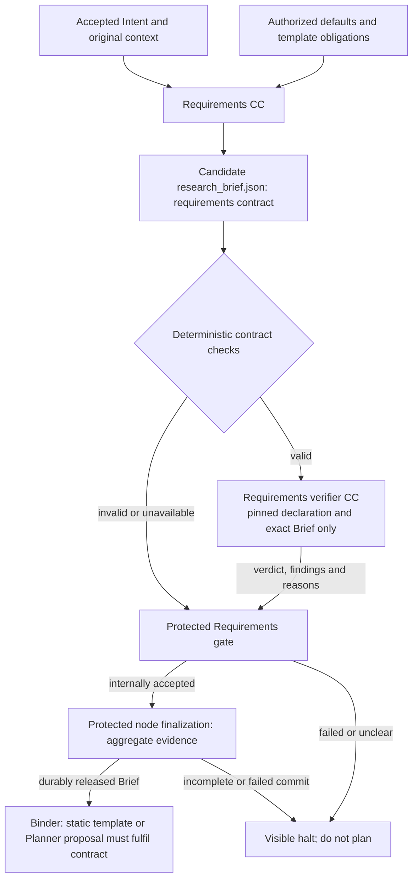

# Intention Compiler node: interpretation, requirements and release

`Tier 2 · Part of: [Pipeline](README.md)`

Question: what does the compiler need to understand, what must its verifier establish, and why does Requirements wait? The [build plan](../3-build-plan.md) selects the first build; [field contracts](../reference/intent-and-requirements.md) define its interoperable data.

## Intent CC responsibility

The Intention Compiler is the enclosing node. This section describes its first work subnode; accepted Intent IR is intermediate. The Requirements subnode and both verification/gate paths are also mandatory. The [completion boundary](#completion-boundary-and-build-scope) below ends at the released Research Brief.

The Intent CC takes the exact qualified original request and permitted context. In a bounded generative pass it extracts the problem/research purpose, desired change, requested result, affected entities, scope, exclusions, constraints, preferences and stated targets. It preserves source attribution and separates absent information from stated values. It produces **Intent IR**, not a Research Brief or proposed scientific solution.

The result is an interpretation usable by a downstream compiler. A topic label alone is insufficient when no purpose or requested result can be discerned. The Intent CC must represent that uncertainty, not invent a benchmark, report type, algorithm or desired change. Missing optional hardware/method/threshold fields are different from not knowing what work the user wants. Requirements may apply authorized parameter defaults; Hypothesis later registers empirical criteria. No browsing, host profiling, research or autonomous clarification is needed to fabricate missing intent.

## Deterministic boundary

The node follows the pattern in [1. System, diagram D](../1-system.md#inside-a-node): work subnode, check bundle, verifier subnode, protected gate. The Intent subnode produces `intent_ir.json`. The Requirements subnode produces `research_brief.json`.

The arrows through Context show host-side control and evidence custody; the protected review-context record is not sent to the semantic model. The semantic payload contains exactly the pinned Intent CC declaration and exact candidate IR bytes, plus fixed verifier instructions. The model receives no original request/source text, request-specific context, profile/criteria records, observations, conversation or evidence-fetch capability. The model's return is untrusted finding/uncertainty/limitation content; the host binds identity, evidence refs, verdict and persisted Assessment using the existing schema. The fixed slice has a predefined schema and checking profile. Runtime binding ties host records to the exact request, candidate and invocation. Deterministic checks validate required fields/types, schema version, span ranges and permitted source references, identity/pins, observed completion and supported limits/effects. Span bounds and reference checks back the Intent CC's own fidelity self-review. A pass authorizes semantic review of the output.

## Intent verifier responsibility

The verifier receives exactly the pinned Intent CC declaration and the exact candidate IR output. It answers four questions: `declared_output_conformance`, `internal_consistency`, `limitations_consistency` and `uncertainty_consistency`. All are answerable from those two artifacts. [Intent and Requirements](../reference/intent-and-requirements.md#verifier-criteria-intent) defines each.

Fidelity to the request and usefulness to Requirements belong to the Intent CC. It self-reviews its IR against the request before it returns. Deterministic host checks on source-span bounds and reference resolution back that review. See [producer obligations](../reference/intent-and-requirements.md#producer-obligations-intent-cc).

The verifier does not take the prompt and issue a competing answer, complete missing work, rewrite the candidate, choose a research solution or stop the scheduler. It reports criterion findings, evidence, uncertainty, limitations and a verdict. A candidate that says "I cannot determine the requested work" is valid candidate data. It carries `needs_clarification` and a blocking uncertainty, and the gate halts on that readiness. An unproven research hypothesis is not an impossible intent. The question for the producer is usable requested work, not advance proof of scientific success.

Malicious instructions in candidate text are data. Separate invocation/conversation and protected criteria reduce self-certification; the same provider can still make correlated mistakes. A verifier has no recursive semantic reviewer. Its output is mechanically checked for schema, subject identity and complete required criterion coverage.

## Gate responsibility and human outcome

Protected host code validates and interprets deterministic results plus the assessment, then writes the authoritative decision. It alone publishes accepted output after persistence succeeds. Missing references, contradictory findings, failed mandatory obligations, material unresolved uncertainty or unavailable evidence cannot advance. A compiler-generated readiness flag is advisory.

On a blocker, the control plane shows the retained IR and the actual deterministic or gate reason. The run halts at intake, because this node resolves ambiguity before planning ([D50](../method/decisions.md#d50)). A clearer user submission starts linked new work. An `interactive` run may ask bounded clarification questions inside the Intent subnode before the Brief is accepted. A `headless` run uses supplied answers only ([D48](../method/decisions.md#d48)). The halt writes an escalation record. [Failure policy](../platform/failure-and-recovery.md) covers infrastructure failures.

## Requirements CC and the second boundary

Requirements receives **accepted** Intent, original context, supplied resource references and protected defaults. A second bounded generative pass produces the Research Brief: objective, scope, mandatory outcomes, optional preferences, constraints, targets, deliverables, acceptance expectations, evidence obligations, attributed assumptions/defaults and remaining uncertainty. It cannot silently repair misunderstood intent or select the eventual experiment.

*Level: the Requirements subnode and its release. Omits: the Intent subnode, which follows the same pattern.*

The Requirements verifier receives exactly the Requirements CC declaration and the exact candidate Brief output. It answers four questions: `declared_output_conformance`, `internal_consistency`, `limitations_consistency` and `requirement_link_completeness`. All are answerable from those two artifacts.

The Requirements CC owns preservation of accepted Intent. It self-reviews its Brief against the Intent before it returns. The host backs that review with deterministic checks on reference resolution, requirement-link coverage and default authorization. See [producer obligations](../reference/intent-and-requirements.md#producer-obligations-requirements-cc).

The binder and planner consume the host-accepted Brief. Coverage maps required outcomes and deliverables to proposed work, and required checks are independently assigned. The Hypothesis Blueprint later fixes experiment-specific measurements and classifications without altering user requirements. [Checking](../checking/README.md) defines the shared mechanism. The [reference](../reference/intent-and-requirements.md) connects each required field to its checks.

## Source and build boundaries

D5 permits the selected fixed multi-pass sequence instead of the unchanged PRD's literal single bounded generation. Combined limits are frozen; each compilation remains bounded/non-interactive in the baseline. Verifier calls are separate checking work. The current [build plan](../3-build-plan.md) builds the whole compiler through accepted Research Brief. Complete Stage 2 includes qualified documents/resources, accepted Brief and initialized baseline graph; the Intent verifier is not downstream work Node B.

## Completion boundary and build scope

**Qualified intake, Intent CC, checked and verified Intent IR, Requirements CC, checked and verified Research Brief, protected node release.** Completion produces accepted `research_brief.json`, both subnode decisions, the node decision and readable evidence. Intent IR alone, unverified JSON, a mocked model response or a successful HTTP request is not completion. An unusable request ends in a visible halt. The D19 build consumes this Brief in the protected planner and continues through Delivery ([build plan](../3-build-plan.md)). The retained static workflow runs only when `plan_source` is `static` ([D39](../method/decisions.md#d39)).

| Component | Required work and output | Authority and boundary |
|---|---|---|
| Local intake adapter | Capture the request. Qualify `.txt`, `.md`, `.pdf` material. Register supplied project and data resources and the authorized user, profile and workspace | Protected qualification. No web retrieval, cloning, dataset downloads or host profiling |
| Intent subnode | Extract meaning, purpose, result, context, scope, constraints, preferences and uncertainty into Intent IR. Self-review fidelity | No scientific solution choice. Readiness is a candidate claim |
| Intent checks, verifier and gate | Host checks structure, identities and spans first. The verifier then checks the four Intent criteria. The gate persists the decision and accepted IR, or halts | Requirements never runs on candidate or blocked Intent |
| Requirements subnode | Build the Brief from accepted Intent, qualified context and protected defaults. Self-review that every Intent constraint, target and in-scope item is in the Brief or in `unresolved_items` | Record every applied default. No final experimental protocol |
| Requirements checks, verifier and gate | Host validates shared fields, references, default authorization and requirement-link coverage. The verifier checks the four Brief criteria. The node gate aggregates and releases the exact Brief | Protected infrastructure only. Aggregation adds no third semantic call |

Each subnode binds one CC. Fixed cooperation is not a composite CC. The build includes the governed runner, pinned declarations, the local admitted capability set, the model bridge, node and subnode binding, checking profiles, artifact capture, durable release state and the authenticated control surface. It uses the fixed Codex CLI route. Separate Intention and Requirements generations plus their verifier calls share one frozen total limit profile (PRD confirmation 4). Clarification loops, repair and retries are not part of it. Missing telemetry is unavailable, never zero.

Deployment, browser and restart behavior are in [platform](../platform/README.md). Field contracts are in [Intent and Requirements](../reference/intent-and-requirements.md), [node and subnode contracts](../reference/node-execution.md) and the [field catalog](../reference/field-catalog.md). Verification cases for the node are in [Intent and Requirements](../reference/intent-and-requirements.md#verification-cases).

Input directory qualification is deterministic, not semantic readiness. A configured empty default document directory is permitted. A specified required input that is unreadable halts. The compiler cannot claim that a default `single_gpu` profile proves GPU availability. The PRD owns product obligations. This package owns implementation architecture. D19 connects the fixed Phase 1 baseline to the targeted Phase 3 Planner path.
