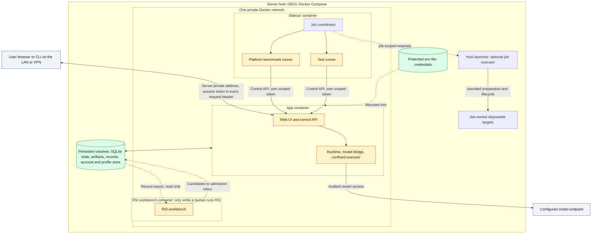
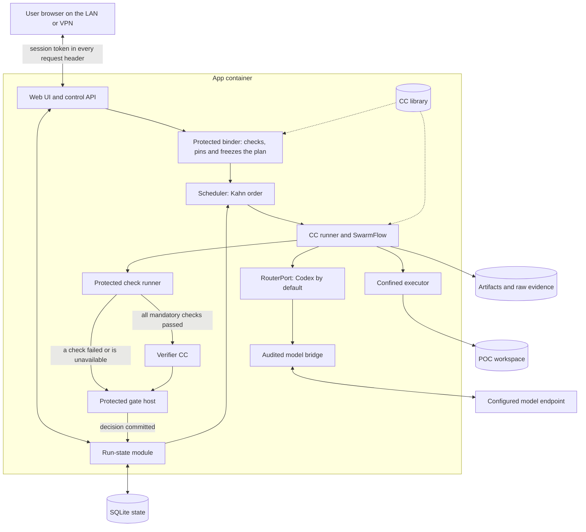

# Platform

`Tier 2 · Part of: [README](../README.md) · Serves: Knowledge and Standard`

**Hub.** The platform is the hot-path code every run needs: the container, control API, run state, binder, scheduler, CC runner, model bridge and confined executor. [1. System](../1-system.md) gives the overview. This page and its children give the detail.

| Children | Covers |
|---|---|
| [Planning and freeze](planning-and-freeze.md) | Plan source, binder, plan gate, freeze, dispatch, Kahn order |
| [Failure and recovery](failure-and-recovery.md) | Node failure and skipped nodes, escalation records, cancel, restart |
| [JiuwenSwarm foundation](native-reuse.md) | Inspected native components and research adaptations |
| [Inspection](inspection.md) | Readable views of artifacts and decisions |

**Feeders:** the user (through the browser), the CC library, the run configuration. **Users:** every node, the [checking](../checking/README.md) path, the [side systems](../side-systems/README.md) through the control API, the record export and the admission inbox. **Exact contracts:** [run plan](../reference/run-plan.md), [node execution](../reference/node-execution.md), [field catalog](../reference/field-catalog.md), [routing seam](../reference/model-routing-contract.md#routerport-the-hot-path-seam).

| ID | Build criterion |
|---|---|
| PLT-1 | The app container serves the UI and the control API on container port 5173, published on the server's private address only ([D35](../method/decisions.md#d35)). Users on the LAN or VPN and the sidecar container (by service name on the private Docker network) reach the same port. Every request carries a session token. No public binding and no other inbound port exists. |
| PLT-2 | Closing the browser does not cancel a run. A restart keeps all evidence and pauses the interrupted attempt without replay. |
| PLT-3 | Generated POC code runs as a separate process and identity. It cannot read credentials, run state, the library or hidden fixtures, and it has no Docker socket. |
| PLT-4 | Every model call goes through the model bridge and has a route record written before the call. |
| PLT-5 | The binder freezes exactly one `run_plan`. Nothing in it changes after freeze. The scheduler builds each node's contracts at dispatch from the frozen templates. |
| PLT-6 | The scheduler dispatches in Kahn order with the source-list tie rule, one node at a time. A node starts only after the node gate of every predecessor is stored. A failed node makes its dependents `skipped`, independent nodes continue and the run ends `partial` ([D49](../method/decisions.md#d49)). Nothing waits for a person ([D50](../method/decisions.md#d50)). |
| PLT-7 | Every invocation writes an invocation observation, and every run writes a run bundle, to the record export. |
| PLT-8 | An infeasible plan writes a plan outcome and starts at most one linked Intention Compiler attempt per outcome, with at most two plan attempts per request: the original and one linked new attempt (depth 1 and 2). A rejected static template halts with an escalation record and no linked attempt. |
| PLT-9 | Users upload files through the web UI or CLI into the app container volume (`workspace/input/{docs,repo,datasets}/<run_or_project>`). Intake qualifies only uploaded files, and users can delete their uploads ([control API](../reference/field-catalog.md#client-upload), PRD US03 and US20). |
| PLT-10 | `config.yaml`, mounted read-only into the app container, is the one operator file for the `cc.*` settings and the role aliases. Every role alias maps to the Codex route in M1. A bad file stops startup ([operator config](../reference/field-catalog.md#operator-config)). |
| PLT-11 | The Builder's Codex CLI call runs under the executor identity in the POC workspace, with the `workspace-write` sandbox, the network disabled for tool commands and approvals `never`. It uses a dedicated, budget-limited, revocable Builder credential that only the executor identity can read during the call. A tool command cannot read run state, the main credential, the library or the fixtures ([D45](../method/decisions.md#d45), [Builder sandbox](../reference/capsules/builder.md#tool-use-sandbox)). |
| PLT-12 | Admission runs every `guarantees.self_tests` entry of a CC in the confined executor and compares the end state with `expects`. A declared failure mode with no self-test that expects its reason code is rejected (`failure_modes_have_self_tests`, [declaration](../reference/declaration.md#guarantees)). |

Question answered: Where do frontend, runtime, evidence, models and isolated execution live?

## Deployment and boundaries

**Required now.** Docker Compose runs M1 on one server host, the GB10 GPU host ([D35](../method/decisions.md#d35)). M1 never runs on a user's computer. The app container holds the Python services, the existing TypeScript web UI, SQLite authoritative run state and filesystem artifacts. Product identity is user-scoped and distinct from any OS account; durable account/profile state survives run/workspace deletion. M1 keeps one active user context, without enterprise multi-tenant administration. Keep internal modules distinct without making them separate services. One container may contain several native processes.

The first diagram shows the deployment. The second shows the inside of the app container.

*Level: deployment. The base services are the app, sidecar and human-started RSI workbench on the private network. Authorized jobs may create disposable targets ([D51](../method/decisions.md#d51)). The benchmark referee has a separate identity inside the sidecar. Omits app internals, model IPC and executor workspace.*

*Level: modules inside the app container; the Planner CC runs through the runner like any CC. Omits: the sidecar and RSI workbench containers, the Codex IPC, the account and profile store and the network layout.*

The app container holds the built browser frontend, the web server and control API, and the workflow runtime. The same container serves the browser assets on the same origin as the control API, so M1 needs no frontend container and no host-side helper script. The container's own entrypoint starts the product. Users on the LAN or VPN open the app at the server's private address. The Compose file publishes container port `5173` on that address only, never on a public address. Every API request carries the session token in a header. `jiuwenswarm-start`, run inside the app container, prints a one-time token URL that gives the browser its token. Credentials come from a protected env file mounted into the app container, not from declarations or output artifacts. Persistent volumes hold SQLite state, artifacts, `records/` and the account/profile store, so they outlive the replaceable image. The [Compose topology](../development-tools/automation.md#compose-topology) shows the access path and the sidecar connection.

The core compatibility route is the existing fixed Codex CLI integration under schema 1.0.0. Preserve protected local IPC and owned execution context. Model routing is an M1 side system behind `RouterPort` ([routing seam](../reference/model-routing-contract.md#routerport-the-hot-path-seam)). The API router, when it is on, is a separate killable process inside the app container, reached only over local IPC, and it returns a model choice only ([D44](../method/decisions.md#d44)). The Codex route is the default and the Codex fallback. The alternate verifier is M1 Phase 3 work after the core ([D33](../method/decisions.md#d33)). It cannot alter verifier policy. The `plan_source` run setting ([D39](../method/decisions.md#d39)) is chosen before the run, never during it. No failed call automatically replays through another model or runner. Every supported model call crosses the audited bridge; local run/capsule correlation stays in local telemetry rather than being added to provider prompts solely for attribution. Record time/calls and reliably available native spend/budget telemetry. Capture reliably exposed account allowance/limits/credits/reset separately; these are not per-invocation token or cost measurements. Absent reliable telemetry remains unavailable.

Generated POC code is untrusted. The Builder's tool use is untrusted in the same way: its Codex CLI call runs under the executor identity with a dedicated, budget-limited, revocable credential and no network for tool commands ([D45](../method/decisions.md#d45), [Builder sandbox](../reference/capsules/builder.md#tool-use-sandbox)). Docker packaging and a Python virtual environment do not prove confinement. Enforce scoped filesystem access, restricted identity, denied undeclared network/tools, resource limits, and separation from credentials, control state, library activation, and hidden fixtures. Do not expose the Docker socket. The owning task selects and verifies the available mechanism; if a mandatory boundary cannot be enforced, block execution. PRD §3.6.2 additionally forbids generated POC code from importing or using OS/network modules, including `os`, `sys`, `subprocess`, `requests`, `urllib` and `shutil`. The Builder/Verifier must reject a violating package before empirical execution; an intentional bypass is a required negative case. This product compliance rule does not constrain trusted provisioning/capture infrastructure in the same way. Prompt instructions or import scanning complement enforced confinement but cannot replace it.

Use a protected persistent account/profile store logically separate from run/workspace state; SQLite is a suitable initial realization, outside workspace deletion scope. Resolve account defaults, then host-level and project overrides, into the frozen effective configuration. Never silently import prior unrelated research. A future cloud adapter may store approved profile/account fields; it cannot write gate state, access project or hidden-fixture data, or become a remote control/callback transport. No cloud vendor is required for the M1 baseline. The endpoint binds only the private address and every request needs a session token. The sidecar uses its own scoped tokens. Stable account attribution does not replace these controls.

The [Compose topology](../development-tools/automation.md#compose-topology) specifies network-port intent and the sidecar connection. [M1 data ownership](../pipeline/README.md#data-and-state-ownership) identifies each authoritative writer and consumer.

The sidecar may delegate job setup and diagnostics to a finite [host launcher function](../development-tools/sidecar/README.md#host-executor). It retains its host credentials and accepts only operator-granted operations against named targets. It can create disposable benchmark environments and collect bounded host observations, but does not write product decisions or accepted outputs. Resource limits preserve core capacity. This optional tooling path adds no app import, startup or release dependency ([D51](../method/decisions.md#d51)).

Verifier disclosure and read capabilities are deliberately smaller than work capabilities. The [review-context contract](../checking/README.md#declaration-and-output-review-boundary) specifies permitted evidence, model audience checks, immutable subject views, prohibited effects and non-advancing outcomes when necessary evidence cannot be disclosed. These are enforced boundaries, not prompt-only instructions.

## Data foundation

**Required now.** The run-state module owns durable lifecycle, the frozen `run_plan`, attempts, decisions, and accepted artifact references. The scheduler and control plane use that authority. Native queues, journals, caches, and UI traces are projections or dispatch aids.

Store exact inputs, implementation/configuration identities, produced artifacts, runtime evidence, raw verifier assessments, and gate decisions with run/node/attempt correlation. Keep declared behavior distinct from observed behavior. Tool-call logs alone do not prove absence of hidden filesystem or network effects; an unobserved mandatory condition cannot be treated as passed.

Release-essential artifacts and decisions must commit before advancing. Storage failure blocks release. Diagnostics the gate does not need may fail without changing execution, but their absence is explicit. This reconciles the supplementary data-source's best-effort capture hooks with the master PRD's durable gate boundary.

Preserve raw evidence before workspace cleanup or native retention deletes it. Derived run records, conformance views, scorecards, and exports can be rebuilt from that evidence. Separate agent working context from authoritative records. Keep credentials out of capture; raw prompts and supplied data remain locally protected. Any export must respect its permitted audience and hidden-fixture boundary.

Scientific benchmarking executes the user's baseline/treatment protocol. Platform benchmarking compares system variants on matched inputs and frozen effective configurations. Both use the same attribution foundation, but their measurements and conclusions are distinct. Exports record what actually ran, seeds where supported, component versions, gate evidence, and unavailable measurements. Gate-disabled ablations are evaluation runs, not valid product runs or admission evidence.

## RSI workbench

The [RSI escalation policy](failure-and-recovery.md#rsi-workbench) distinguishes ordinary candidate feedback, session faults and explicit activation. The runtime gate host, RSI referee and fixture oracle are different roles, defined in [the glossary](../glossary.md).

**Required now for full M1; outside the first build.** Prepare the independent interface early so RSI work need not wait for planner implementation. The initial required target is the pure `rank_opportunities` helper inside the Screening CC. Keep its input/output meaning, required dimensions, Top-1 behavior, and effect boundary fixed. Candidate mutations operate on a sandbox copy; production remains unchanged.

The [RSI connection design](../side-systems/rsi-workbench.md) defines target profiles, data partitions, replay and future improver seams. Target 1 delivers a sandbox child and its evidence; activation makes a child selectable in the RSI sandbox. Live runs keep the parent until a human promotes the child to `live_plans` and points `cc.static_template_ref` at a new static template that pins it ([D46](../method/decisions.md#d46)). Target 1 never changes production automatically.

Loop feedback returns only the approved bounded loop information. Hidden fixture content, expected outputs, per-case hidden results, and final-evaluation feedback remain outside the proposer and candidate. Separate development, hidden-loop, hidden-final, and milestone data. Reserve final evaluation for terminal assessment; freeze scoring and evaluation identities before the session. Compare parent and child under the same relevant configuration and enforce the declared query/resource limits.

RSI may change only explicitly eligible implementation parts. It cannot change contracts, gate/verifier/check assets, security or mutation permissions, evidence stores, fixture custody, model weights, or activation controls. Enforce restrictions outside the mutable target. Preserve attempts, lineage, scoring, and violation evidence. Admission and human activation are separate from a better score; retain rollback. Target 2 mutates the Screening work prompt and work rubric (the files its `evolution.may_change` lists) only when the headless model path exists, which in M1 is the Codex CLI (PRD 4.4.1); otherwise it is reported `BLOCKED`. Referee-owned rubrics are never mutable. RSI is an independently buildable target off the hot path, with its own session prerequisites; its availability or failure does not block core build completion.

## Native reuse

**Required now.** The scheduler runs the frozen run plan on SwarmFlow (PRD 1.3 Phase 1) and exposes the run tree through the native `/swarmflows` view. Start from native UI and transport, Symphony agent and harness components, existing model integration, storage and diagnostics. Follow the [JiuwenSwarm foundation](native-reuse.md) for concrete reuse and required adaptations. Native observations are in [native reuse evidence](../reference/native-reuse-evidence.json).

At the installed dependency version, verify adapter behavior for swallowed exceptions, hidden retries, journal/cache replay, duplicate effects, cancellation, and background lifecycle. In particular, a native cached result cannot establish a committed CC gate pass. Keep model-process ownership separate from unrelated interactive chats. Concrete module files and private APIs remain implementation choices.

## Container startup, IPC and storage obligations

The application image pins frontend assets, runtime dependencies and shipped CC versions. Its entrypoint reads the one operator file, `config.yaml`, mounted read-only ([operator config](../reference/field-catalog.md#operator-config)). It validates configuration, persistent-store access, session authentication and required security before accepting work; it serves inspection and explicit readiness failures when execution prerequisites are unavailable. Startup does not require a separate UI script or spawn a new experimental image for each POC.

For the Codex baseline, package the approved CLI/bridge inside the app container and provision its existing subscription credential through the protected env file mounted into that container. Authentication preparation may require an operator action; it is not a UI startup dependency. The runner reaches the Codex CLI over owned Unix-domain IPC inside the Linux container, with 600 permissions and an ephemeral credential. There is no model-adapter TCP listener and no broad host home-directory mount. Keep credentials and IPC inaccessible to the confined executor's identity. An inaccessible subscription, unsupported CLI runtime or missing required GPU/device capability is an explicit execution-readiness blocker, never a silent host proxy or mock substitute.

Persistent volumes hold run state (SQLite), immutable evidence (artifacts and `records/`) and account/profile state, independently of image lifetime. Account/profile data is outside workspace deletion. Hidden RSI fixture storage has separate custody and is not mounted in the app container. Provisioning produces a confined POC executor inside the app container, under a dropped OS identity with access only to its workspace. The deployment exposes no Docker socket and grants the Builder no container-orchestration access. Retain the PRD unprivileged venv and enforce filesystem/network restrictions outside generated code. Doctor must demonstrate denied secret/control/fixture access and unavailable isolation must block execution.

Trusted provisioning resolves only the frozen, fully pinned dependency set. Validate archive paths, links and declared files before extraction; reject traversal and undeclared members. Provision from the approved prepared lock catalog only. The Builder never installs or discovers packages ([R5](../method/decisions.md#r5-separate-dependency-selection-from-resolution-and-installation)); adding a framework needs protected preparation before the run. A fetch to fill the catalog is a protected preparation step, never POC network permission. Missing pins, incompatible dependencies or unavailable packages halt. Freeze transitive dependencies rather than letting a later installer choose new versions. The user baseline executes from a read-only captured copy; treatment writes never alter it.

Users reach the app only at the server's private LAN or VPN address, and nothing binds a public address ([D35](../method/decisions.md#d35)). This amends D6 and departs from the PRD's same-machine-only rule (§5.4.2). The PRD's intent, no exposure beyond authorized users, is kept by the private network, the token and the absence of any public binding. The sidecar container reaches the app by service name on the private Docker network with its own scoped tokens. The one-time token URL printed by `jiuwenswarm-start` stays out of agent prompts and exports. Revocation blocks future control actions and dispatch as policy requires, preserving historical attribution. Restarting the app container reopens saved records and pauses interrupted execution without automatic replay.

Required deployment verification includes app container start without an external UI helper; browser/API same origin; denied unauthenticated access and no public binding; persistent inspection after recreation; inaccessible secrets/control/hidden fixtures from POC; denied undeclared network; model IPC readiness; and failure without new dispatch when a mandatory boundary degrades. Exact container files and OS enforcement mechanism belong to implementation specifications and must prove these outcomes.

Startup also enables the native lossless trajectory store, configured trace-truncation limit sufficient for required evidence, and sandbox activity logging (PRD §5.2.1). Required evidence must survive native display truncation; raw logs remain outside agent memory. The hidden fixtures are not mounted in the app container. The app container boot check asserts that the fixture store path is absent or unreadable for the runner and executor identities, and halts startup if the path is present and readable. The RSI workbench boot check asserts that `rsi_worker` cannot read the fixture store ([custody](../side-systems/rsi-workbench.md#hidden-fixture-custody)). The browser bootstrap is the one-time token URL printed by `jiuwenswarm-start`; never persist its token in exported URLs or logs. The sidecar uses separately scoped tokens. This is ordinary initialization, not an external UI helper requirement.

## Dependency preparation and provisioning

| Owner / time | Input → required result | Failure |
|---|---|---|
| Protected environment preparation, before research | Approved frameworks/platform → reviewed environment catalog; exact direct/transitive package versions, hashes and offline package availability | Unsupported platform or incomplete closure makes that catalog entry unavailable |
| Resource qualification / Hypothesis | Supplied baseline/data and compatible catalog → captured resources and selected immutable environment lock | No compatible prepared entry blocks before Builder |
| Builder | Accepted Blueprint and selected lock → unchanged lock as `requirements.txt`, bounded scripts and readable POC manifest | Undeclared imports, changed lock or unpinned transitive package blocks packaging acceptance |
| Trusted Benchmark provisioner | Accepted bundle/lock → containment checks, exact package verification and installation in unprivileged isolated environment | Missing/hash-mismatched package or provisioning failure halts; no resolver upgrade or automatic repair |
| Restricted scientific executor | Provisioned environment/frozen protocol → baseline then treatment measurements and raw evidence | Generated code cannot install, discover dependencies, access secrets or alter the baseline |

Protected preparation is outside Builder and generated-code permissions. M1 uses prepared package bytes; supplying a new framework requires protected preparation and a new linked run, rather than dynamic installation during work. A Python virtual environment provides dependency separation; filesystem/process/network confinement remains separately enforced. Exact locks enable reconstruction but do not prove scientific validity or package safety.

## Execution and model routing

Each work subnode binds one admitted CC version and its exact associated deterministic check-bundle version. The enclosing node contains its bounded work and verifier structure; protected binding adds applicable contract and policy checks. Additional work CCs use separate gated subnodes within their declared node. Verifier invocations remain separately governed checking assignments. Composite or merged CCs and arbitrary capsule member graphs remain later work.

The compiler, research, verifier and eligible RSI proposal calls share the model boundary. The runner binds the role/profile and effective limits. Routing selects only an approved endpoint within that binding. Phase 1 uses fixed selection. The API router is an M1 side system off the hot path, and the alternate verifier is M1 Phase 3 work after the core ([D33](../method/decisions.md#d33)); neither is a core dependency. No started invocation receives a hidden mid-call replacement. Missing required access blocks the run. Unavailable token/cost telemetry remains explicitly unavailable. [Routing detail](../side-systems/model-routing.md) explains those seams.

Runner admission, node authority and run policy intersect per CC. Deterministic/semantic checking cannot undo effects, so execution confinement and disclosure permissions are enforced before work. Generated POC code cannot access gate state, referee fixtures, credentials or unrelated host paths.

## Responsibility and authority

| Component | Owns | Connects to |
|---|---|---|
| Compiler/work CC | Candidate artifact fulfilling its assigned responsibility | Runner supplies inputs. Checking consumes outputs. |
| Verifier CC | Read-only verdict, findings, reasons and uncertainty about the submitted artifact | Sees only the declaration and the exact output (D20, D24). Assessment goes to the host. |
| Protected binder | Checked, bound and frozen run plan: node and subnode contract templates, typed bindings and independent check assignments combining pinned per-CC bundles with run obligations | Accepted requirements, admitted CC/bundle pins, policy, evidence and durable state |
| Protected gate | Checked decision and durable acceptance. No release before commit. | Exact contract, subject, evidence and assessment |
| Protected library admission | Exact CC-version/check-bundle association, candidate eligibility and standing history | Declaration, body, bundle compatibility and independent evidence. M1 begins from an explicit bootstrap catalog with shared bundle pins; this is not capsule-specific admission evidence. New/changed versions require governed admission once implemented. Human standing controls activation; D21 M2 automatic admission may establish future-plan eligibility. |
| Scheduler/runner | Eligible dispatch, one node at a time. Concrete Node and Subnode Execution Contracts built at dispatch. Scoped execution, budgets and observed evidence | Frozen run plan and contract templates, CCs, model bridge and restricted experiment executor |
| Control plane | Authenticated submission, inspection and visible results/blockers | Browser/CLI/TUI and server-owned run state |
| RSI workbench | Bounded implementation improvement and comparable evidence | Protected target profile, isolated runner/referee and inactive library candidates |

CC authors produce work or assessments. Protected infrastructure releases accepted results. Inspect IRs and decisions as readable records, with raw evidence separate.
