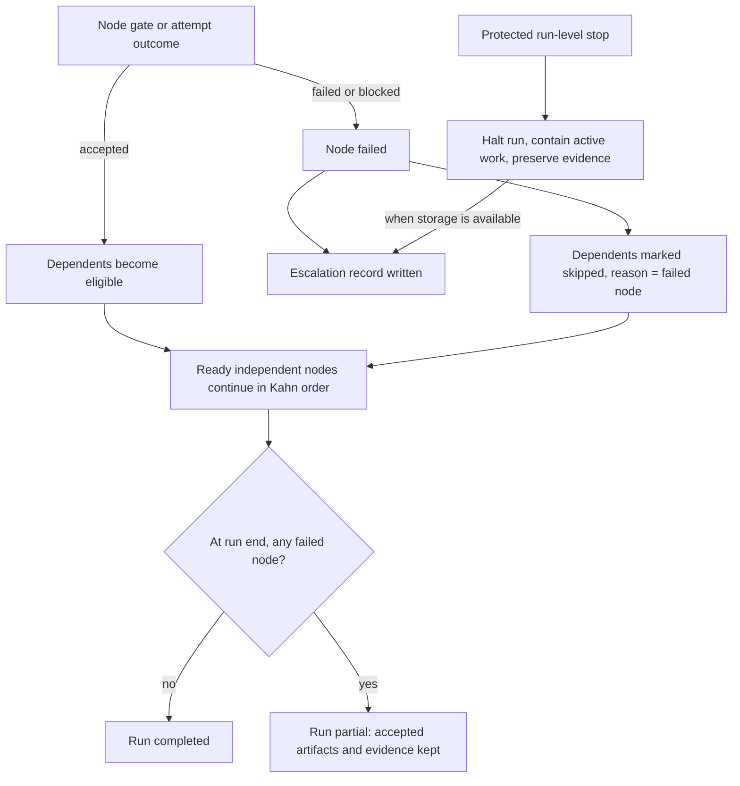

# Failure handling and escalation

`Tier 2 · Part of: [Platform](README.md)`

Question answered: What happens when work blocks, faults, restarts or is cancelled?

**Decision.** A node failure stops that node and its dependents ([D49](../method/decisions.md#d49)). A protected stop outside a node halts the run. A run is unattended after intake: nothing waits for a person, and each failure writes an escalation for later review when storage is available ([D50](../method/decisions.md#d50)). A person never turns a failed mandatory check into an advancing verdict.

The **protected gate boundary** composes deterministic checks, a verifier CC assessment and a protected host decision. The verifier reports an assessment verdict. The gate interprets it under policy and controls advancement through durable run state and scheduler readiness. A producer or a model-generated "pass" never controls scheduling. See [vocabulary](../glossary.md) and [verification](../capability-capsules/library-and-checking.md).

*Level: failure scope for one run. Node failures preserve independent work. Protected run-level stops override dispatch. Omits subnodes, check details and intake clarification.*

Delivery depends on every research node, so a partial run produces no report. In M1 the research path is one chain, so a failure there stops everything after it.

## What happens on each event

| Event | Behavior | Escalation record |
|---|---|---|
| Empty or unreadable intake; unsupported domain or mandatory input | Reject at intake, before any work, with the reason | No. The submitting surface shows the input correction |
| Material ambiguity or conflict at intake | The Intention Compiler halts at intake. An `interactive` run may ask bounded clarification questions first. A `headless` run uses supplied answers only ([D48](../method/decisions.md#d48)) | Yes, on halt |
| Work fault, invalid artifact, mandatory semantic failure (`FAIL`) | Node failed, dependents `skipped`, independent nodes continue | Yes |
| Model unauthenticated or unavailable, missing dataset or dependency, timeout (`ENVIRONMENT_BLOCKED`) | Same. A demonstrated implementation defect stays `FAIL` | Yes |
| Insufficient evidence or unresolved verifier judgment (`INCONCLUSIVE`) | Same | Yes |
| Denied node-local effect or access, invocation budget exhaustion | Contain the invocation, fail its node and skip dependents. Independent nodes continue while platform isolation remains intact | Yes |
| Protected stop outside a node: library, plan, run-budget or security failure | Halt the run and contain active work. An isolation breach or inability to enforce the boundary is a run-level stop | Yes, if storage is available |
| Infeasible or rejected plan | Halt with a `plan_infeasible` outcome. A planned run starts one linked new Intention Compiler attempt that carries the reasons. A rejected static template halts at once. At most two plan attempts per request ([D30](../method/decisions.md#d30)) | Yes, on the final halt |
| Persistence failure before release | Block readiness, keep what evidence can be saved, no pass | Yes, if it can be written |
| `PASS_WITH_KNOWN_LIMITATIONS` with all mandatory checks met | Advance; carry warnings to the report | No |
| Valid scientific rejection or scientific inconclusive result | The verifier may pass; Delivery runs and reports the result | No |
| User cancels | Stop new dispatch, contain active work, keep effects and evidence | No |
| Browser disconnect | Execution continues on the server | No |
| Engine restart interrupts work | Keep accepted artifacts, mark interrupted attempts `paused`, no replay. Recovery is inspection plus a fresh run in M1 | Yes |

The escalation record is the halting node-scope gate decision plus the [PRD minimum gate result](../reference/checking.md#prd-minimum-gate-result) view with `routing_action` `ESCALATE_TO_HUMAN`. Inspection lists unreviewed escalations. A record names the run, node and attempt, verdict, failed obligations, known effects, evidence references and the required correction. It holds no hidden fixtures or credentials. Faults in the same attempt attach to one record.

## What a person may do afterwards

Read the escalation, repair the environment, correct the objective, supply permitted resources, or start fresh attributable work. Record the actor and the changed inputs. The failed run and its verdict stay unchanged. A new run records its link to the previous one, re-resolves configuration and pins, re-freezes its plan and performs every check. Nothing edits an accepted artifact in place. This resolves PRD section 4.6.4 "manually correcting the run" as a new linked run, consistent with D4.

## RSI workbench

A candidate score decline or compatibility rejection records evidence and feeds the bounded offline search. Query or resource exhaustion ends the session with a summary. A security violation, degraded fixture boundary, referee fault or evidence tampering stops the session and writes an escalation for the operator. Hidden cases and per-case final feedback are withheld from escalation content. Successful evaluation puts a candidate package in the admission inbox. A human runs the admission command and a human activates the version. Better scores never promote automatically.
