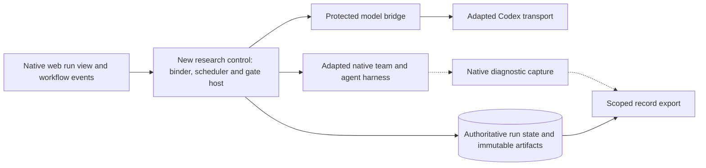

# JiuwenSwarm implementation foundation

`Tier 2 · Part of: [Platform](README.md) · Serves: Knowledge and Standard`

AI4Research extends the existing JiuwenSwarm application. The [source receipt](../reference/native-reuse-evidence.json) records exact JiuwenSwarm files at commit `7be8f531ede1faaa3978cbc950dfd69cfc78b775` and OpenJiuwen at the actual dependency pin. Paths in that receipt are code locators, not required reading dependencies of this standalone package. Source inspection establishes available components, not runtime compatibility or completed research behavior.

| Area | Reuse | Required research adaptation |
|---|---|---|
| workflow | Workflow progress and run/phase/agent state projection. | Project frozen plan and gate outcomes; native progress is not acceptance authority. |
| workflow transport | WorkflowMonitorHandler translates TeamMonitor progress into workflow.updated events. | Map exact run/node/subnode identities and committed gate states without releasing successors from UI events. |
| agent execution | Team lifecycle uses OpenJiuwen TeamAgent, runner and background-task controller. | Wrap CC execution with pins, scoped effects, budget enforcement, no hidden replay and explicit cancellation ownership. |
| agent registration | Catalog-based registration of harness providers, tools, rails and subagents. | Register only admitted research bindings; provider registration cannot bypass CC admission or checking. |
| codex transport | AppServerTransport owns a pinned Codex App Server child, isolated home and stdio transport. | Current chat slice rejects server requests and disables host tools; adapt protected Unix-domain bridge ownership, call records and Builder executor policy before research use. |
| codex session | SubscriptionService owns managed login and session-isolated text turns. | Keep operator authentication distinct from run identity; persist route/call-start before dispatch; do not borrow interactive chat state. |
| web ui | React graph view renders workflow phases, agents and status. | Reuse native run-tree presentation with read-only committed research state; headless runs cannot wait on interactive resume controls. |
| configuration | YAML configuration loading, environment resolution, models and sandbox settings. | Expose one read-only operator configuration; validate cc settings, protected credential refs and effective limits before readiness. |
| observability | SQLite trajectory storage/readers retain OTLP payloads and scoped queries. | Reuse diagnostics as observations; authoritative run state, immutable artifacts and gate-before-release transactions require research-specific storage contracts. |
| observability lifecycle | Trajectory sink lifecycle registers the core record consumer. | Capture raw evidence before cleanup, report missing telemetry and enforce audience-scoped export; diagnostic capture alone cannot grant a gate pass. |
| symphony adapter | Capability providers expose immutable scanner/fingerprint inventories via public OpenJiuwen Symphony interfaces. | Translate admitted declaration identities explicitly; fingerprints and cached graph state cannot substitute for exact CC pins and protected freeze. |
| dependency pin | OpenJiuwen agent-core is pinned to an exact Git revision. | Preserve the pin during this documentation change; verify runtime behavior before claiming compatible execution. |

## Planned integration

This is the intended integration, not implemented behavior. Solid arrows carry control or authoritative records; dashed arrows carry diagnostic observations. The [rendered view](native-reuse.svg) mirrors this block.

## New governed control

Implement the declaration loader/admission rules, frozen run-plan binder, deterministic scheduler, CC/check/verifier wrappers, protected gate host, authoritative run state and immutable artifact refs around the reused components. Preserve the existing UI, provider and diagnostic machinery where its behavior meets these contracts. Research state drives the native run view; neither cached framework output nor a model's success message authorizes release.

Keep the static and planned paths on the same frozen-plan execution adapter. Before integration, verify exception propagation, absence of hidden retry/cache replay, exact-once effect ownership, cancellation and background cleanup at the pinned runtime. The current Codex chat transport is a reuse starting point: it does not establish the Builder tool sandbox or the protected Linux IPC boundary. Both need implementation and runtime evidence.

## Verification boundary

The package validator checks receipt shape and source identities. Checkout verification compares bytes and symbols against the recorded commits and dependency pin. Integration must separately demonstrate node A → durable gate → node B, invalid-output blocking, no silent replay, cancellation, restart retention, and native UI projection of the same committed state. No application test or compatibility PASS is claimed by this document.

Optional checkout check, from the package root: `python reference/verify_checkout.py <jiuwenswarm-checkout> <openjiuwen-agent-core-checkout>`. This is separate from the portable validator and has no effect on the supplied design or code.
