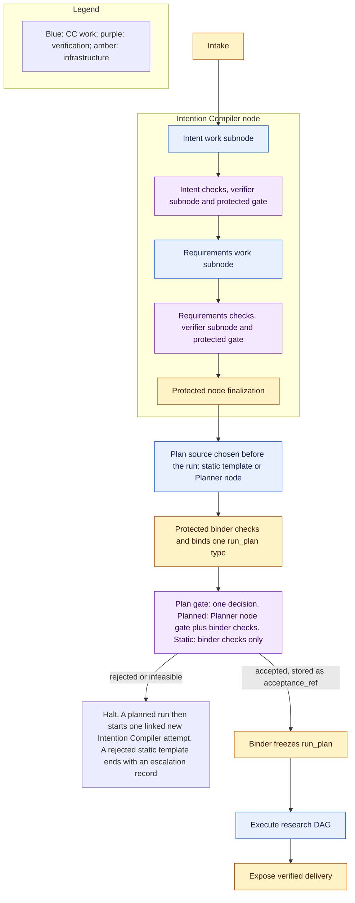

# Workflow: planning and execution

`Tier 2 · Part of: [Platform](README.md)`

Question answered: How are accepted requirements turned into governed work and dependencies?

## Establish intent before planning

**M1 planning scope:** the fixed Compiler Intent + Requirement sequence and their required independent gates produce an accepted `research_brief`. The static template is the Phase 1 baseline. The targeted Phase 3 Planner proposes a bounded JSON DAG of downstream CCs with objective coverage, typed ports, dependencies and any suggested extra checks. The protected binder independently selects mandatory profiles, validates coverage, ports, dependencies, cycles, permissions and resource feasibility, assigns required checks, and freezes the [`run_plan`](../reference/run-plan.md) before research dispatch. An infeasible or rejected proposal halts the run and starts one linked new Intention Compiler attempt that carries the reasons. A request gets at most two plan attempts, then halts and writes an escalation record ([D30](../method/decisions.md#d30)). There is no silent switch to the static template. Both plan sources yield the same run plan type ([D26](../method/decisions.md#d26)). The run request sets `plan_source` before execution. The governed research journey remains Search → Screen → Hypothesis → Builder → Benchmark → Scientific Evaluation → Delivery.

**Required now.** Ordinary intake binds the original request and permitted documents, project assets, and validation data to a run. Reject empty or unreadable required input. Do not fetch undeclared datasets, clone arbitrary repositories, or turn missing evidence into observed facts.

D5 separates Intent and Requirement compilation, with independent verification at each boundary. The Delivery Phase 1 product entry remains bounded and non-interactive: one orchestration request produces the complete Brief without autonomous solution design. The current PRD explicitly leaves internal bounded, non-interactive compiler steps to architecture; their combined time/call limits are frozen. The earlier complete Intention Compiler node exercised only the first; the current complete compiler build must reach accepted Brief. The accepted Research Brief states objectives, scope, constraints, deliverables, and evidence obligations. Preserve ambiguity; a material unresolved requirement blocks readiness. The [Intent/Requirements field contract](../reference/intent-and-requirements.md) fixes shared information; protected default policy supplies only authorized missing parameters. A topic with no workable purpose/result halts rather than receiving invented intent. These fixed verification assignments cannot be removed by the planner.

*Level: from intake to the frozen run plan. Omits: research nodes, check bundle detail and the failure branches in [failure and recovery](failure-and-recovery.md).*

Verification boxes include deterministic checks, a separate verifier invocation, and protected gate application, as specified in [capsules](../capability-capsules/library-and-checking.md). A clarification or blocking result is recorded through the control plane; headless evaluation returns a blocking status without waiting for interactive input.

Preparation is a protected fixed sequence established by the run-state module before the research graph exists. It gives each enclosing preparation node and its work/verifier subnodes distinct node/subnode/attempt identities, admitted pins, input references, policy and budgets. The same runner and release boundary apply; a pre-freeze invocation is not permission to execute a proposed graph. Freeze authorizes only the later research DAG. This prevents a circular dependency in which the planner would need its own finished graph before it could run.

The plan gate is one decision. For a planned run it combines the Planner node gate and the binder checks. For a static run it is the binder checks only, because the static template has no verifier ([plan gate](../reference/run-plan.md#plan-gate)). The [Checking](../checking/README.md) defines shared profile resolution for fixed preparation and planned work. The protected binder remains present in both phases; a planner supplies a proposal, never a replacement for binding or independent check assignment. Preparation templates are bound and checked before dispatch just as later contract templates are; research graph freeze is the later aggregate authorization.

## Planner choice and limits

The accepted Brief is produced first by fixed Compiler Intent and Requirement work with mandatory checks. The core planner then creates a bounded JSON DAG of admitted downstream CCs. Inputs include accepted requirements, a captured admitted-library snapshot, permitted resources, effective policy and limits. The proposal carries objective-to-result coverage, typed ports, dependencies, and optional additional checks. [Plan and node fields](../reference/field-catalog.md#planning-and-node-contracts) define the contract. The protected binder independently assigns mandatory profiles and checks, validates requirement coverage, typed-port compatibility, dependencies, cycles, permissions and resource feasibility, and freezes the accepted graph before dispatch. The planner cannot execute generated plan code, grant access, change active library versions, or waive required verification. Invalid or failed planning halts. The static template is the Phase 1 baseline, chosen before the run by the `plan_source` run setting ([D39](../method/decisions.md#d39)), not an automatic recovery path.

M1 Planner calls produce one `plan_proposal` each. The protected binder rejects missing or ineligible capabilities, selected CC versions without an explicit admitted check-bundle association and compatibility evidence, incompatible port meanings, cycles, unbound inputs, denied effects, conflicting shared writes, absent mandatory verification, and exceeded limits; it independently checks requirement coverage and known feasibility before freeze. Binding captures exact CC/bundle pins and adds contract/policy checks to each CC's required bundle; both sources are mandatory. The semantic model sees only the Planner declaration and exact plan output ([D24](../method/decisions.md#d24)). Coverage against the Brief is a binder check, not a semantic pass. See the [Planner page](../reference/capsules/planner.md). No available capability means infeasible planning, not an invitation to invent one.

Later work (November, [D21](../method/decisions.md#d21)): a search-based planner may generate several candidates and rank feasible ones by comparable evidence of successful outcomes, then time and cost. M1 has no candidate ranking.

This is the best candidate found within a declared search budget, not globally optimal planning. A separate logical-operator layer would add binding flexibility but also another representation to reconcile; direct CC bindings provide one inspectable execution boundary shared with the static template. Retain objective mappings so later logical planning can lower into that same boundary. Separating graph proposal, dependency dispatch and execution makes their evidence and authority independently inspectable.

## From available CC to invocation

The captured library snapshot is the planning-time view of eligible CC versions. A static template names versions from that view. The Planner sees the accepted Brief, the snapshot, permitted resources and plan policy, then proposes bindings. The protected binder checks the proposal independently and freezes exact CC and check-bundle pins into one `run_plan`. The library may change later, but the frozen pins do not.

At dispatch, the scheduler waits for predecessor gates, builds the node and subnode contracts from the frozen templates, and binds accepted input references. The CC runner resolves the exact pinned body and invokes it under those contracts. Agent CCs use the native agent/model path. Tool CCs run pinned code. Builder-generated POC code uses the separate confined executor. The runner records the invocation; checks, verifier assessment and the protected gate decide release.

```mermaid
flowchart LR
    LIB[(Eligible library snapshot)] --> STATIC[Static template]
    LIB --> PLAN[Planner proposal]
    BRIEF[Accepted Brief] --> PLAN
    STATIC --> BINDER[Protected binder]
    PLAN --> BINDER
    BINDER -->|validate and pin| FROZEN[Frozen run_plan]
    FROZEN --> SWARM[SwarmFlow scheduler]
    SWARM -->|after predecessor gates| CONTRACT[Dispatch contracts and accepted inputs]
    CONTRACT --> RUNNER[CC runner resolves exact pins]
    RUNNER -->|agent CC| AGENT[Native agent and model path]
    RUNNER -->|tool CC| TOOL[Pinned tool code]
    RUNNER -->|generated POC| EXEC[Confined executor]
    AGENT --> OBS[Outputs and invocation observation]
    TOOL --> OBS
    EXEC --> OBS
    OBS --> CHECKS[Independent checks and verifier]
    CHECKS --> GATE[Protected gate and durable decision]
    GATE -->|advance| NEXT[Release accepted outputs]
    GATE -->|halt| RETAIN[Keep failure evidence]
```

This is an ownership and data-flow view, not a prescribed class diagram or private API. Exact fields remain in the [run plan](../reference/run-plan.md) and [Node and Subnode Execution Contracts](../reference/node-execution.md). The CC runner and SwarmFlow adapter reuse the pinned JiuwenSwarm/OpenJiuwen runtime where compatible; [native reuse evidence](../reference/native-reuse-evidence.json) records inspected interfaces, not runtime acceptance.

## Freeze and unknown future values

**Required now.** Freeze the accepted topology, exact CC and dependency versions, each participating CC's check-bundle version and compatibility evidence, verification profiles, policy, limits, and input references before planned execution. Store node and subnode contract templates and their hashes at freeze. At dispatch the scheduler builds the concrete Node and Subnode Execution Contracts from those templates. It binds future-input references to the accepted predecessor outputs and records the bound check plan and the contract identities before the attempt starts. No active-library or bundle change can alter an existing run, and no post-start contract/check-plan edit is permitted. Future producer outputs are typed references, not already-known values. Freeze does not claim that a hypothesis or measurement exists before its producer runs.

Choose capabilities whose declared input range covers the supported M1 research domain. Use one opportunity and one hypothesis path. The Hypothesis CC establishes and freezes the baseline, validation resource, measurement definitions, success/falsification boundaries, and protocol before POC generation or empirical execution. Downstream work may apply that protocol but cannot edit it after seeing results.

Evaluate preconditions with the same semantics at planning and dispatch. Known false conditions reject a plan; value-dependent conditions remain explicit dispatch obligations. An unsupported hypothesis, missing resource, or false dispatch precondition blocks the run. Do not silently choose another capsule, alter the graph, or create a new protocol. Immutable pins prevent version substitution. A run keeps its pins to the end: a suspension or revocation after freeze changes later snapshots only. To stop a running version at once, a human cancels the run. Multiple planning epochs remain a future possibility, not M1 behavior.

## Tasks, nodes, and verification

**Required now.** A task groups objectives. A node is a governed objective instance, not a CC call. At dispatch the scheduler builds its Node Execution Contract from the node template stored at freeze, the accepted inputs, admission metadata and policy. It binds input and output meaning, acceptance and proof obligations, resource and effect limits and exact CC versions. A node holds one or more work subnodes. A **work subnode** is one work CC plus its checks. M1 run plan nodes hold one work subnode, and the Intention Compiler node holds two. Later extra work CCs use more work subnodes in the same node. Each output gets one verifier CC call, governed by its own verifier subnode contract. The PRD permits broader capability sets, but arbitrary capsule member graphs and composite/merged CCs remain later work. Required invocation checks remain, and node-level aggregate verification authorizes successor nodes.

Builder and Research Benchmark are two separate nodes, each with its own node gate. Their boxes show the check bundle, which runs once over all outputs, and one verifier CC call per output. Each output then gets its own gate decision, and the node gate aggregates them. A mandatory check failure gives one halting decision and no verifier call. The Scientific Evaluation and Delivery node boxes stand for the same pattern, which is not drawn here. [Research nodes](../pipeline/stages.md) draws every node. Dependency arrows mean runner-mediated transfer of accepted artifacts, not direct calls that bypass gates. A verifier assessment comes from a separately governed verifier subnode; neither is the downstream work Node B. All participating invocation evidence is aggregated against the node contract. Only committed node acceptance releases successor nodes. Verifiers do not recursively require semantic verifiers.

## Scheduling and failure

Use the [failure and escalation policy](failure-and-recovery.md) as the single routing authority. The [research port table](../pipeline/README.md#research-path-and-ports) supplies all stage inputs and outputs.

**Required now.** Dispatch dependency-ready nodes only after their required predecessor gates have durably advanced. Reuse an equivalent native topological scheduler. M1 uses one active research run and a sequential research path. Future independent-node execution requires declared effects/resources, an explicit execution profile and separate validation; it is not introduced by D1.

A node failure stops that node and the nodes that depend on it. The run ends `partial` and independent nodes still run ([D49](../method/decisions.md#d49), [failure and recovery](failure-and-recovery.md)). A security, budget or persistence fault stops the whole run. M1 runs one node at a time. Preserve the outcome and evidence of the attempt in progress. Cancellation does not undo effects already performed. Default to zero automatic repair or replay. A human correction creates attributable new work and must pass verification; a changed graph or objective needs a new plan and freeze. Never overwrite a failed attempt.

Browser disconnection does not cancel execution. Restart preserves accepted results and marks interrupted attempts paused for inspection. No native cache entry can replace an authoritative gate decision or justify repeating an uncertain effect. The first build starts a fresh run rather than resuming in place.

Scientific rejection or inconclusive measurement is different from infrastructure failure. Valid evidence and correctly applied criteria can advance to Delivery, which discloses the result and its limitations. All report preparation happens inside the application; the control plane transfers the accepted artifacts.

## Concrete execution boundary

The [M1 build scope](../3-build-plan.md) records the static baseline, targeted Planner path and their common protected binder (D19).

The binder checks, binds pins and freezes the plan with its contract templates. At dispatch the scheduler builds the enclosing Node Execution Contract and each exact [Subnode Execution Contract](../reference/node-execution.md) from those templates. Participating bindings name admitted declaration/body/dependency pins, role, effective authority and per-call limits; parent node limits bound their aggregate; subnode limits narrow each assignment. Inputs carry named typed ports and exact refs, outputs name catalog contracts/versions and evidence obligations. The checking profile is pinned in the contract; the bound check plan references that finalized contract without a hash cycle. Missing input or unsupported authority blocks dispatch, never becomes a placeholder observed artifact.
