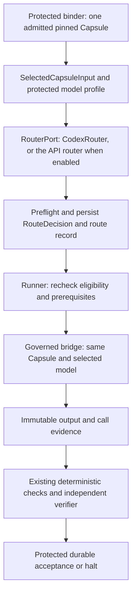

# Capsule–model-routing integration

`Tier 3 · Part of: [Reference](README.md)`

The binder/runner owns this export, dispatch and authority; the routing owner owns model selection and the provider binding. The [router design](../side-systems/router-design.md) explains algorithms. Existing [declaration](declaration.md) schema 1.0.0, [Subnode Contract](node-execution.md) 1.0.0 and enclosing Node field contract 2.0.0 remain unchanged. Machine field projections are in [field-contracts.json](field-contracts.json).

## Shared flow

*Level: one model call, from binding to gate. Omits: failure branches, the route record fields and the sidecar.*

Finalize node/subnode contracts before routing. The decision references those pins through the export; invocation evidence references the decision. Do not add the decision back into a finalized contract and create a hash cycle. The profile travels alongside the binding and is resolved under its protected configuration, never from Capsule extensions or producer preferences.

## RouterPort: the hot-path seam

`Standard`. This section is the only part of model routing that hot-path code depends on. Everything after it is the API router's own contract, used only when the router is enabled.

**Who calls whom.** A CC asks for a model call through the runner. The model bridge receives every call. Before the call starts, the bridge asks `RouterPort.select(request)` which model to use. The hot path imports only `RouterPort`, never the router package.

**Process boundary ([D44](../method/decisions.md#d44)).** The API router runs as a separate process inside the app container, which a person can kill. `RouterPort` reaches it only over local IPC (a Unix domain socket in the container). Because the router is another process, no router code is imported into the hot path at all. The router returns a model choice only, the frozen [model-route](#model-route) decision. It never calls a provider, holds no provider credential and writes no route record. Provider dispatch, credentials and call records stay in the model bridge. `RouterPort` enforces `cc.router.deadline_s` with its own timer. When the timer expires it drops the connection and returns the Codex route.

**Two implementations.**
- `CodexRouter` always returns the fixed Codex route. It is the default, and it needs no catalog, profile or network.
- The API router (the routing owner's component, a separate process) returns a frozen [model-route](#model-route) decision for one approved API model, over local IPC.

**Run settings.** These are part of the frozen run configuration, so they never change a declaration hash or a run plan.

| Setting | Type | Default | Meaning |
|---|---|---|---|
| `cc.router.enabled` | `boolean` | `false` | When false, the bridge uses `CodexRouter` for every call. It may be true only under an approved [evaluation profile](field-catalog.md#evaluation-profile), so a router-enabled run is a Phase 3 development or evaluation run, never a Phase 1 product run (PRD 4.3, 5.6.5). Before model access is approved, the router runs against mocked or simulated endpoints. |
| `cc.router.deadline_s` | `number` | `30` | Time `RouterPort` waits for the router process before it returns the Codex route. Fixed at 30 s in this package. Only a recorded decision changes it ([owner rulings](../side-systems/owner-rulings.md#routing-v21), deadline row). |
| `cc.router.profile_ref` | `nullable-Ref` | `null` | The [model-selection-profile](#model-selection-profile). Its `approved_model_ids` is the approved list. Null while the router is off. With the router on, a null or unauthorized profile is a router halt (`PROFILE_UNAVAILABLE`) and the Codex fallback is used. |

The profile field `policy_mode` does not switch the router. `cc.router.enabled` is the only platform switch. `policy_mode: fixed_baseline` behaves as `cc.router.enabled` false.

**Fallback rule.** The Codex route is the default whenever the router is off or not installed. That is not a fallback. With the router enabled, the bridge uses the Codex route as the Codex fallback and records why when any of these happen before the call starts:
- the router process is not installed, not started or unreachable (`missing`);
- it crashes, resets the connection or replies with an error (`error`);
- it does not answer within `cc.router.deadline_s`, which includes a hang (`timeout`);
- it names a model outside the approved list (`unapproved_model`);
- its reply or decision fails validation (`invalid_decision`).
- it halts or blocks and returns `no_route` with a `router_halt_code` (for example no compatible model, audit write failure, stale required service, host incompatibility or an exhausted routing deadline).

An invalid Capsule pin or invalid bound context that reaches the bridge is not a router failure. The protected binder should have rejected it, so it is a platform integrity fault: the node halts with a recorded reason and the Codex route is not used. A router failure never fails a run. A failure of a model the router chose halts the node like any other model failure, because the model is fixed once the call starts.

After the call starts, the model is fixed for that whole CC call. A model or provider failure during the call halts the node. Nothing switches models mid-call and nothing resends automatically. If the Codex route itself is unavailable, the node halts with `ENVIRONMENT_BLOCKED`.

**Every call gets a route record.** The bridge writes one [route-record](#route-record) before the call, whether the router is on or off. It joins the call to its decision through `route_id`.

### route-record

`route-record:field-contract:1`. Producer: model bridge. Consumers: model-call records, observations, run bundle, platform benchmark runner.

| Field | Type | Required | Constraint | Meaning |
|---|---|---|---|---|
| `schema_version` | `string` | yes | exactly `1.0.0` | Format version |
| `route_id` | `string` | yes | pattern `^[a-z0-9][a-z0-9_.-]{0,63}$`, unique in the run | Identity of this routing choice. The model bridge sets it. Every model call of the invocation carries it, and it joins calls and observations to this record. |
| `invocation_id` | `string` | yes | the governed CC invocation | The CC call this route serves |
| `run_id` | `string` | yes | protected run ID | Protected run ID, copied by the bridge from the runtime identities. Attribution only. |
| `node_id` | `string` | yes | protected node ID | Protected node ID, copied by the bridge from the runtime identities. Attribution only. |
| `subnode_id` | `string` | yes | protected subnode ID | Protected subnode ID, copied by the bridge from the runtime identities. Attribution only. |
| `router_enabled` | `boolean` | yes | copied from `cc.router.enabled`. False for a verifier call, which never consults the router | Whether the API router was switched on and consulted for this call |
| `decision_source` | `string` | yes | enum `router`, `codex_router_disabled`, `codex_router_failed` | Who chose the model. `router`: the API router returned a valid decision. `codex_router_disabled`: the router is off or not consulted (always so for a verifier call), so the Codex route is the default. `codex_router_failed`: the router is on but failed before the call, so the Codex fallback was used. |
| `router_failure` | `nullable-string` | yes | enum `missing`, `error`, `timeout`, `unapproved_model`, `invalid_decision`, `no_route`. Null unless `decision_source` is `codex_router_failed` | Why the Codex fallback was used. The values are the cases of the fallback rule above. Null in every other case. |
| `router_halt_code` | `nullable-string` | yes | enum `PROFILE_UNAVAILABLE`, `NO_COMPATIBLE_MODEL`, `MODEL_ACCESS_UNAVAILABLE`, `TASK_MISMATCH`, `MODEL_SCOPE_DENIED`, `CAPABILITY_UNVERIFIED`, `CONTEXT_EXCEEDED`, `POLICY_DENIED`, `ENVIRONMENT_BLOCKED`, `BUDGET_EXCEEDED`, `BUDGET_UNVERIFIABLE`, `LIMIT_UNSUPPORTED`, `DEPLOYMENT_BLOCKED`, `SERVICE_STALE`, `PROFILE_COVERAGE_MISSING`, `ALTERNATE_UNAVAILABLE`, `AUDIT_UNAVAILABLE`, `ROUTING_IN_PROGRESS`, `ROUTING_DEADLINE_EXCEEDED`, `ROUTING_OUTCOME_UNKNOWN`. Non-null exactly when `router_failure` is `no_route` | The router's halt or block code, so the cause of the Codex route is visible |
| `model_id` | `string` | yes | the Codex route ID, or an ID in the approved list | The one model fixed for this whole call. It never changes after the call starts. |
| `route_decision_ref` | `nullable-Ref` | yes | non-null exactly when `decision_source` is `router` | The API router's frozen decision |
| `recorded_at` | `string` | yes | UTC timestamp | UTC time `YYYY-MM-DDTHH:MM:SSZ` at which the bridge fixed the model, before the call starts. Written by the bridge. |

**Invalid/missing behavior:** a call without a route record does not start. A route record never changes after the call starts.

**Host checks**

| Check ID | Rule | Outcome |
|---|---|---|
| `route_record_structure` | The record matches `route-record:field-contract:1` | the call does not start |
| `route_record_consistent` | `decision_source` is `codex_router_disabled` exactly when `router_enabled` is false. `router_failure` is set exactly when `decision_source` is `codex_router_failed`. `router_halt_code` is set exactly when `router_failure` is `no_route`. `route_decision_ref` is set exactly when `decision_source` is `router`. A Codex route record names the Codex route model | the call does not start |

[router decision](examples/route_record_router_decision.json) · [router source without a decision](examples/route_record_invalid_router_without_decision.json)

### Provider errors

`Standard`. A provider adapter maps every provider failure to one code. It never retries. In M1 every code halts the node.

| Code | Provider signal |
|---|---|
| `auth_failed` | HTTP 401 or 403, or a credential that does not resolve |
| `rate_limited` | HTTP 429 |
| `timeout` | No complete answer within the call's time limit |
| `provider_error` | HTTP 5xx |
| `invalid_request` | Other HTTP 4xx |
| `network_error` | Connection failure |
| `invalid_output` | A reply that does not parse as the expected format |

The code goes into the `provider_error_code` field of the [model-call](#model-call) record. Unknown usage stays unavailable, never zero.

## Pinning, trust and readiness

Hash original captured artifact bytes, not reserialized JSON. The parsed declaration must equal the parsed pinned bytes; all implementation, overlay and dependency refs resolve to original artifacts. Keep exact-byte identity distinct from any separately pinned semantic hash profile. Overlay refs come from `identity.overlays`; implementation/dependency refs come from the selected binding and validated declaration closure. Upstream resolves floating dependencies before governed use.

Project the assigned subnode objective, concrete accepted inputs/required outputs, selected binding and runtime identities. Effective permissions are the existing intersection of admission, node, subnode and run policy. Routing cannot grant effects. Admission is immutable evidence. Standing is read once, when the library snapshot is captured: a run keeps its pins even if a version is suspended or revoked later. Preserve predicate timing: mandatory unknown/unavailable planning prerequisites block; explicitly deferred dispatch predicates must pass against the actual chosen deployment before execution.

`needs.model` already supplies tool calling, context, modalities, families and excludes. Authors populate actual requirements, without fabricated family restrictions or minimums. Supported loading modes/overlays, real context and declared ports contribute requirements. JSON serialization alone does not demand native provider JSON mode. Code-only/tool-only CCs needing no executor model bypass routing while retaining the governed runner. A CC with tool calling, such as Builder, runs as one synchronous CLI invocation that does its own tool use ([D43](../method/decisions.md#d43)). The router may route it only to an API model that supports the same single-call tool loop. Otherwise the route is the Codex route. Scientific service pins remain tool dependencies.

## Identities, budgets and execution

Each `execution_id` maps explicitly to one governed CC invocation and its run/node/subnode/attempt. `workflow_id/task_id` are recorded correlation labels, not authorization or assumed aliases. Provider call IDs are separate. Router decision identity is not `ModelSelection.route_id`, which already means a model-group member.

Invocation and subnode model-call ceilings govern CC execution. A routing selection call (later router work, none in M1) would consume a separate protected routing allowance, included in node/run totals. Protect independent verifier execution and routing reservations, plus other required sibling work, before spending on the selected invocation. Apply stricter comparable execution caps (including declaration `wall_s` mapped to runtime `time_s`); do not mix invocation counts with model calls, currencies, or declared enforcement modes. Memory is a resource ceiling, not additive money. The pinned derived routing context retains the original Capsule budget/enforcement and effective limits, including applicable token/cost/tool/iteration obligations rather than dropping dimensions absent from the three-field runtime ceiling. Original request snapshots remain immutable; dispatch checks the live protected ledger. Unknown optional balances stay unavailable; a required unsupported hard cap blocks. Routing cannot borrow a verifier reservation.

M1 builds the `development_profile` and `fixed_baseline` modes only. `bounded_llm_ablation` is later router work: in M1 the router refuses it at start, so no routing selection call happens. For that later work: under `development_profile` the route makes zero selection calls. Under `bounded_llm_ablation`, one candidate skips the selection call, zero candidates halts (`NO_COMPATIBLE_MODEL`), and multiple candidates permit at most one profile-authorized routing selection call. The router alternate model is used at most once before freeze. Selection calls use a pinned deployment and `purpose` `routing_selection` through the governed bridge, without needing their subject's final task decision. Persist their attempt and call evidence first, then append the final decision link. The selection call is not the semantic verifier.

The runner consumes a persisted decision, rechecks the same Capsule/model and executes that pinned Capsule. Once frozen, nothing rewrites the decision. Expiry, changed authorization or failed prerequisites terminate it. An explicit upstream retry creates a linked new attempt/invocation/execution. Repeated immutable requests are idempotent; changed bindings/inputs/profiles under the same key conflict. Disable implicit defaults, group failover and automatic provider replay. Record partial/uncertain effects rather than claiming exactly-once execution.

## Phase and review compatibility

`CodexRouter` needs no export, profile, routing selection call or catalog. It writes only the [route-record](#route-record). The API router uses the full contract below and needs approved endpoint access and qualification. Disabling the router makes later calls use the Codex route. It never replays a failed API call.

**Verifier calls always use the Codex route.** `RouterPort` returns the Codex route for every verifier subnode call, whatever `cc.router.enabled` says. The router is not consulted, so the route record for a verifier call has `router_enabled` false and `decision_source` `codex_router_disabled`. The alternate-verifier study is a separate Phase 3 evaluation profile. Only that profile may override this rule ([D44](../method/decisions.md#d44)).

Verifier assignment, read-only context, checking profile and reserved spend remain independent. Its typed output is [Verifier Assessment](checking.md#verifier-assessment). The routing draft's separate engineering-review example does not replace that contract or the protected gate. Routing settings never become checking criteria.

## Contract versions

SelectedCapsuleInput, RouteRequest, ModelSelectionProfile and CallRecord start at 1.0.0. The existing `model-route` becomes 2.0.0 and is named RouteDecision at the component boundary. The v2.1 renames replace the v1.8 names in place. No implementation exists yet, so these versions do not change. Version 1's generic role/profile record remains historical; migrate consumers explicitly instead of accepting old objects as new. Existing declaration and Node/Subnode versions remain pinned. The `invocation-observation` 3.0.0 field contract carries `route_id`, which joins each observation to its [route record](#route-record). Its `trace_refs` still name the exact call records.

### selected-capsule-input

| Field | Type | Meaning / why needed |
|---|---|---|
| `schema_version` | `string` | Format version 1.0.0 |
| `declaration` | `object` | Complete parsed declaration; validate existing exact schema against original bytes |
| `declaration_ref` | `Ref` | Original-byte declaration identity |
| `node_contract_ref` | `Ref` | Finalized parent |
| `subnode_contract_ref` | `Ref` | Finalized single-CC child |
| `bound_context` | `BoundRoutingContext` | Protected projection, not client claims |

**Invalid/missing behavior:** Missing, swapped, forged, changed, unsupported or ineligible input is a platform integrity fault: the node halts with a recorded reason, the Codex route is not used, and no other CC is chosen.

### model-selection-profile

| Field | Type | Meaning / why needed |
|---|---|---|
| `schema_version` | `string` | Format version 1.0.0 |
| `id` | `string` | Immutable profile identity |
| `policy_mode` | `string` | Enum `development_profile` (default), `fixed_baseline` (behaves as `cc.router.enabled` false) or `bounded_llm_ablation`. Router-internal mode, not a platform switch. `bounded_llm_ablation` is not built in M1, and the router refuses it at start |
| `approved_model_ids` | `string[]` | Approved scope; empty denies all |
| `extra_requirements` | `RoutingRequirements` | Requirements only; no grant of tools or effects |
| `selection_allowance` | `SelectionAllowance` | Distinct protected overhead reservation for the routing selection call. Zero calls unless `policy_mode` is `bounded_llm_ablation` |
| `alternate_model_id` | `nullable-string` | The router alternate model: at most one predetermined compatible API model, used at most once before freeze. Null means the profile names no alternate. |
| `policy_ref` | `Ref` | Protected governing authorization |

**Invalid/missing behavior:** With the router enabled, a missing or unauthorized profile is a router halt (`PROFILE_UNAVAILABLE`): the bridge uses the Codex route and records `no_route`. Selection-call inability uses only the router alternate model. Checking profiles remain independent.

### route-request

| Field | Type | Meaning / why needed |
|---|---|---|
| `schema_version` | `string` | Format version 1.0.0 |
| `request_id` | `string` | Immutable request identity |
| `workflow_id` | `string` | Explicit local correlation, not assumed equal to run_id |
| `task_id` | `string` | Upstream task attribution |
| `execution_id` | `string` | One governed invocation routing idempotency key |
| `user_id` | `string` | Authenticated session identity |
| `domain` | `string` | Trusted domain label. Exactly `cs_ml`. Any other value is rejected |
| `task_category` | `string` | Trusted task category. Enum `ml_methods_and_inference`, `retrieval_and_knowledge_systems`, `algorithms_optimization_and_formal`, `software_systems_and_performance`, `databases_and_data_processing`, `networking_and_distributed_algorithms`, `security_and_reliability`, `experimental_evaluation_and_technical_data` (traceability IDs C01 to C08 in the package catalog) |
| `workflow_stage` | `string` | Fixed research stage name, or the verifier assignment. Envelope metadata, not a declaration field |
| `call_function` | `string` | Enum `worker`, `verifier`, `planner`. Attribution only; it creates no executor type |
| `task_summary` | `string` | Bound objective-derived summary |
| `input_refs` | `Ref[]` | Same accepted inventory as the selected binding |
| `selected_capsule` | `SelectedCapsuleInput` | Exactly one upstream selected CC |
| `model_selection_profile_ref` | `Ref` | Protected immutable profile alongside the binding |
| `requirements` | `RoutingRequirements` | Narrowing hard constraints |
| `policy_ref` | `Ref` | Same protected policy |
| `preferences` | `RoutingPreferences` | Soft preferences only |

**Invalid/missing behavior:** An out-of-scope domain, an unknown task category, workflow stage or call function, a top-level role, a changed idempotency input or an inconsistent trusted binding rejects before any model call.

### model-route

| Field | Type | Meaning / why needed |
|---|---|---|
| `schema_version` | `string` | Format version 2.0.0 |
| `id` | `string` | Persisted immutable routing decision identity; not group route_id |
| `request_ref` | `Ref` | Exact request identity |
| `selected_capsule_ref` | `Ref` | Exact exported CC and protected context |
| `runtime` | `RuntimeIdentities` | Governed invocation attribution |
| `execution_id` | `string` | Routing execution key |
| `binding_id` | `string` | Same upstream binding |
| `role` | `string` | Protected attribution only |
| `model_selection_profile_ref` | `Ref` | Selection policy, distinct from checking profile |
| `registry_snapshot_ref` | `nullable-Ref` | Pinned API candidate snapshot; null for static baseline |
| `eligible_endpoints` | `string[]` | Permitted candidates |
| `excluded_reasons` | `ModelExclusion[]` | Deployment exclusions |
| `selected_endpoint` | `string` | The one model ID the router chose. It must be in `approved_model_ids`, otherwise the bridge treats the reply as `unapproved_model` and uses the Codex fallback. |
| `deployment_ref` | `Ref` | Frozen model/adapter/endpoint/configuration pins |
| `identity` | `ModelIdentity` | Requested/observed identity with basis |
| `limits` | `Limits` | CC execution ceilings; separate routing overhead |
| `selection_method` | `string` | Enum `fixed_profile`, `single_candidate`, `development_profile_policy`, `bounded_llm_selection` (only under `bounded_llm_ablation`), `compatible_baseline` or `router_alternate_model` |
| `alternate_used` | `boolean` | True when the router alternate model was chosen, not merely when it matches its ID |
| `ready_at` | `string` | UTC time `YYYY-MM-DDTHH:MM:SSZ` at which the route decision was persisted and became ready to execute. Written by the bridge. |
| `valid_until` | `string` | UTC time `YYYY-MM-DDTHH:MM:SSZ` after which a decision whose call has not started is expired. An expired decision cannot be executed and is not rewritten. |
| `routing_context_ref` | `Ref` | Pinned derived requirements/context with adapter revision |
| `adapter_revision` | `string` | Exact normalization adapter revision; not a model quality claim |

**Invalid/missing behavior:** A missing or invalid decision before the call is a router failure, and the bridge uses the Codex route. After the call starts, an invalidated decision halts the node. No CC substitution, rerouting or replay inside the invocation.

### model-call

`model-call:field-contract:1` (version 1.0.0). Producer: governed bridge and audit writer. Consumers: invocation observations, run bundle, authorized inspection, platform benchmark runner.

| Field | Type | Required | Constraint | Meaning |
|---|---|---|---|---|
| `schema_version` | `string` | yes | exactly `1.0.0` | Format version 1.0.0 |
| `id` | `string` | yes | pattern `^[a-z][a-z0-9_.:-]{0,63}$`, unique in the run | Unique ID of this call record within the run. The bridge and audit writer set it. |
| `route_attempt_id` | `string` | yes | pattern `^[a-z][a-z0-9_.:-]{0,63}$` | ID of the routing attempt, allocated before any routing selection call. It lets the selection call's attempt and evidence be stored before the final decision exists. |
| `route_decision_ref` | `nullable-Ref` | yes | null for `routing_selection`, and when the route record's `decision_source` is not `router`. Otherwise the frozen decision | Final frozen decision for task_execution; nullable during routing_selection |
| `execution_id` | `string` | yes | the routing execution of the invocation | Routing execution key of the governed CC invocation this call serves (the routing idempotency key). |
| `invocation_id` | `string` | yes | equals the route record `invocation_id` | Governed CC invocation attribution |
| `purpose` | `string` | yes | enum `routing_selection`, `task_execution` | Why the call was made (see Enum `purpose`). A `routing_selection` call never produces CC output. |
| `call_function` | `string` | yes | enum `worker`, `verifier`, `planner`, `routing_selection` | Attribution of the call (v2.1 §2.12.1). A `routing_selection` call has `purpose` `routing_selection`. `planner` exists only in a later profile |
| `deployment_ref` | `Ref` | yes | the deployment the bridge called. For `routing_selection` it differs from the selected task model | Actual called deployment; the selection deployment differs from the selected task model |
| `model_selection_profile_ref` | `Ref` | yes | the protected profile of the run | Protected call authorization |
| `provider_request_id` | `nullable-string` | yes | null when the provider gave none | Request ID that the provider returned, kept only for correlation. Null when the provider gave none. |
| `identity` | `ModelIdentity` | yes | `requested` equals the route record `model_id` | The requested model, the model actually observed and the basis for that. `requested` must equal the route record `model_id`. |
| `started_at` | `string` | yes | UTC `YYYY-MM-DDTHH:MM:SSZ` | When the call started, as observed by the bridge. UTC, to the second. |
| `ended_at` | `nullable-string` | yes | UTC `YYYY-MM-DDTHH:MM:SSZ`, not before `started_at`. Null only when `outcome` is `outcome_unknown` | Observed completion or uncertain |
| `outcome` | `string` | yes | enum `completed`, `failed`, `outcome_unknown` | How the call ended (see Enum `outcome`). Only `failed` carries a `provider_error_code`. |
| `provider_error_code` | `nullable-string` | yes | enum `auth_failed`, `rate_limited`, `timeout`, `provider_error`, `invalid_request`, `network_error`, `invalid_output` (the [provider error](#provider-errors) codes). Non-null exactly when `outcome` is `failed` | The one code the provider adapter mapped the failure to. Null for `completed` and `outcome_unknown` |
| `usage` | `Usage` | yes | null is never zero | Telemetry that the provider or bridge could observe. An unknown figure stays null and must never be read as zero or as complete cost. |
| `evidence_refs` | `Ref[]` | yes | at most 64 | Access-controlled immutable call evidence |
| `observed_runtime` | `boolean` | yes | false only in synthetic documentation examples | False for synthetic documentation examples; never acceptance evidence |

**Enum `purpose`**

| Value | Meaning |
|---|---|
| `routing_selection` | A routing selection call the router made to choose among candidates (`bounded_llm_ablation` only). It never produces CC output |
| `task_execution` | The CC's own call on the fixed model |

**Enum `outcome`**

| Value | Meaning |
|---|---|
| `completed` | The provider returned a complete answer |
| `failed` | The provider adapter mapped a failure to one [provider error](#provider-errors) code. The node halts |
| `outcome_unknown` | The bridge cannot tell whether the provider finished, for example after a lost connection. Nothing is resent |

**Invalid/missing behavior:** Missing mandatory provenance blocks acceptance; uncertain outcomes are retained without automatic resend. Unknown usage is explicit.

**Host checks**

| Check ID | Rule | Outcome |
|---|---|---|
| `model_call_structure` | The record matches `model-call:field-contract:1` | the record is refused and the node halts |
| `provider_error_code_consistent` | `provider_error_code` is non-null exactly when `outcome` is `failed` | the record is refused and the node halts |
| `model_call_outcome_consistent` | `ended_at` is null exactly for `outcome_unknown` and not before `started_at`. A `routing_selection` call has no route decision yet | the record is refused and the node halts |

**Examples:** valid: [outcome_unknown](examples/model_call_record.json) · rejected by `provider_error_code_consistent`: [model_call_record_invalid_failed_without_code](examples/model_call_record_invalid_failed_without_code.json)

## Shared supporting types

### RuntimeIdentities

| Field | Type | Meaning / why needed |
|---|---|---|
| `run_id` | `string` | Protected run_id |
| `node_id` | `string` | Protected node_id |
| `subnode_id` | `string` | Protected subnode_id |
| `attempt_id` | `string` | Protected attempt_id |
| `invocation_id` | `string` | Protected invocation_id |

### PrerequisiteReadiness

| Field | Type | Meaning / why needed |
|---|---|---|
| `id` | `string` | Declaration predicate |
| `status` | `string` | pass or deferred; unavailable/unknown mandatory checks block |
| `evaluable_at` | `string` | planning, dispatch or both |
| `evidence_refs` | `Ref[]` | Protected state/source evidence |

### RoutingBudgetSnapshot

| Field | Type | Meaning / why needed |
|---|---|---|
| `snapshot_ref` | `Ref` | Immutable initial protected ledger snapshot; live recheck is separate |
| `node_remaining` | `RoutingBudgetBalance` | Remaining node time/calls and effective memory ceiling |
| `subnode_remaining` | `RoutingBudgetBalance` | Remaining CC execution allowance |
| `verifier_reserved` | `RoutingBudgetBalance` | Reserved independent checking; no borrowing |
| `routing_reserved` | `RoutingBudgetBalance` | Routing overhead reservation, included in node totals |
| `tokens_remaining` | `nullable-integer` | Available attributable token balance or unavailable |
| `cost_remaining` | `nullable-number` | Available monetary balance or unavailable |
| `cost_currency` | `nullable-string` | Currency for comparable cost amounts |
| `unavailable_reasons` | `string[]` | Unsupported optional telemetry |
| `other_work_reserved` | `RoutingBudgetBalance` | Reserved other required work; not available to this invocation |

### BoundRoutingContext

| Field | Type | Meaning / why needed |
|---|---|---|
| `runtime` | `RuntimeIdentities` | Exact protected identities |
| `binding_id` | `string` | Selected single CC binding |
| `role` | `string` | Protected attribution label; not Router executor type |
| `objective` | `string` | Assigned subnode objective |
| `inputs` | `BoundNodeInput[]` | Named accepted concrete inputs |
| `outputs` | `BoundNodeOutput[]` | Required output contract |
| `implementation_refs` | `Ref[]` | Original-byte implementation pins |
| `overlay_refs` | `Ref[]` | Original-byte instruction/experience overlay pins |
| `dependency_refs` | `Ref[]` | Original-byte resolved dependency closure |
| `admission_ref` | `Ref` | Pinned admission decision; current standing rechecked |
| `eligibility` | `string` | Protected eligible standing at capture |
| `prerequisite_results` | `PrerequisiteReadiness[]` | Planning results and dispatch-deferred obligations |
| `effective_authority` | `AuthorityCeiling` | Existing binding authority intersection |
| `invocation_limits` | `Limits` | Existing chosen binding limits; CC execution scope |
| `subnode_limits` | `Limits` | Subnode execution ceilings |
| `node_limits` | `Limits` | Parent aggregate limits including routing and verification |
| `budget_snapshot` | `RoutingBudgetSnapshot` | Protected independent reservations and available balance |
| `policy_ref` | `Ref` | Governing protected policy |
| `configuration_ref` | `Ref` | Pinned configuration selecting the profile |

### RoutingRequirements

| Field | Type | Meaning / why needed |
|---|---|---|
| `tool_calling` | `boolean` | Additional positive capability requirement (optional) |
| `min_context` | `integer` | Minimum context window the model must offer, in tokens, in addition to the default floor. Optional. Absent means no extra requirement. |
| `modalities` | `string[]` | Additional required modalities (optional) |
| `families` | `string[]` | Additional model-family restriction (optional) |
| `excludes` | `string[]` | Excluded families/models under pinned interpretation (optional) |
| `native_structured_output` | `boolean` | Explicit native generation requirement, never inferred from JSON ports (optional) |
| `model_allowlist` | `string[]` | Optional narrowing; explicit empty list denies all (optional) |

### RoutingPreferences

| Field | Type | Meaning / why needed |
|---|---|---|
| `quality` | `string` | Soft quality preference with evidence basis (optional) |
| `cost` | `string` | Soft cost preference (optional) |
| `speed` | `string` | Soft speed preference (optional) |

### SelectionAllowance

| Field | Type | Meaning / why needed |
|---|---|---|
| `enabled` | `boolean` | Protected authorization for an internal selection call |
| `deployment_ref` | `nullable-Ref` | Pinned approved selection deployment; required when enabled |
| `model_calls` | `integer` | Zero when disabled; at most one when enabled |
| `time_s` | `number` | Protected routing deadline allowance |
| `output_tokens` | `integer` | Bounded billed output including reported reasoning |
| `disclosure_scope` | `string[]` | Permitted bounded selection material; no credentials |

### ModelExclusion

| Field | Type | Meaning / why needed |
|---|---|---|
| `model_id` | `string` | Excluded deployment |
| `reason_codes` | `string[]` | Retained concrete exclusion reasons |

### RoutingBudgetBalance

| Field | Type | Meaning / why needed |
|---|---|---|
| `time_s` | `number` | Nonnegative remaining/reserved elapsed allowance; zero is exhausted or inapplicable |
| `model_calls` | `integer` | Nonnegative available/reserved model calls |
| `memory_mb` | `integer` | Positive effective resource ceiling; not additive spend |

## Integration acceptance scenarios

| Scenario | Required behavior / responsible boundary |
|---|---|
| Changed declaration/body/overlay/dependency bytes or wrong run/child | Binder export and router reject the exact subject; no substitution |
| Forged authority or profile / declined disclosure | Protected construction/lookup rejects; no selection call or task effects |
| Zero, one, multiple compatible models | Router halts (`no_route`). Under `bounded_llm_ablation` it skips the selection call, or makes at most one, respectively. Under `development_profile` it makes no selection call |
| Selection call invalid/unavailable / alternate model invalid | One compatible router alternate model before freeze or attributable halt |
| Reserved verifier spend / exhausted or unsupported hard budget | No borrowing; block affected spend; optional unknown telemetry remains explicit |
| Deferred prerequisite, revocation, expiry | Dispatch blocks without mutating the frozen decision |
| Duplicate or changed-input execution key | Same immutable request reuses record; changed identity conflicts; concurrent requests do not duplicate selection calls or dispatch |
| Later call failure, partial effects or crash uncertainty | Same model and Capsule throughout; no failover/replay; preserve outcome_unknown |
| Routing selection call versus task call / missing usage | Actual deployment/purpose retained; null/partial telemetry is not zero or complete cost |
| Independent verifier / misleading producer instructions | Existing assessment contract, immutable subject and isolated read-only authority; gate retains release |
| Code-only CC / scientific-tool backend | Governed non-model dispatch; scientific tool is not an executor candidate |
| Phase 3 disabled or unready | Fixed Phase 1 configuration remains available; API work is not automatically replayed |

The [synthetic export/request/decision/call examples](examples/README.md) support offline contract checks. Runtime behaviors above must become native TASK/IF acceptance cases for the routing and runner owners. Model qualification, real calls, atomic storage and effect enforcement require runtime evidence; these documents do not claim that evidence. The owning TASK records one implementation agreement referencing this architecture, without a second card hierarchy.
