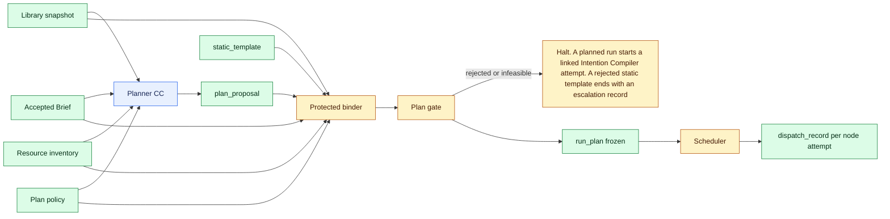

# Run plan contracts

`Tier 3 · Part of: [Reference](README.md)`

Contracts for the library snapshot, resource inventory, plan policy, static template, run plan and dispatch record. The Planner CC and its proposal are on the [Planner page](capsules/planner.md). Part of the [capsule build references](capsules/README.md).

**Summary for reviewers**

- A **run plan** is the one frozen graph the scheduler runs. Each node names one pinned CC version, typed inputs and outputs, limits and the pinned check bundle and profile of that CC.
- Two sources produce the same run plan type through the same binder and freeze. A hand-authored **static template** (built first, the M1 default) and a **plan proposal** from the Planner (built second). See the [build plan](../3-build-plan.md).
- The binder rejects a bad plan before dispatch. It copies check pins from the library. Neither the template author nor the Planner can change them.
- After freeze there is no replan, substitution or pin change. Future values bind only to gate-accepted outputs, at dispatch.
- The scheduler writes one **dispatch record** per node attempt. It first turns the frozen node into one Node Execution Contract with one work subnode and one verifier subnode for each output (see [From run plan node to execution contracts](#from-run-plan-node-to-execution-contracts)).
- The **plan gate** accepts the bound plan. When `plan_source` is `planned`, it uses the Planner CC's pinned bundle and checking profile. When it is `static`, the template is a protected, pre-admitted record, so only deterministic checks run and no verifier runs.
- A failed blocking check or criterion halts the node and keeps the candidate and its evidence. Nothing retries or repairs it (decision D4, PRD 4.8.3).
- An infeasible or rejected plan halts the run and records a `plan_infeasible` **plan outcome**. For a planned run the host starts a new, linked Intention Compiler attempt that carries the Brief ref and the reasons. A request gets at most two plan attempts: the original and one linked new attempt (depth 1 and 2). After the second outcome the host halts and writes an escalation record ([D30](../method/decisions.md#d30)). A rejected static template halts at once with an escalation record and no new attempt. There is no repair inside the same run (decision D4, PRD 4.8.3).

## Build order

1. **Static template first.** A person writes the template for the fixed path Search, Screening, Hypothesis, Builder, Research Benchmark, Scientific Evaluation, Delivery. It runs after the Intention Compiler node. This follows PRD section 2: the static default comes before dynamic planning.
2. **Planner second.** The Planner CC produces a `plan_proposal` that uses the same node shape. The same binder checks it and the same freeze produces a `run_plan`. The scheduler, check runner and dispatch records are the same for both. Only `plan_source` differs (`static` or `planned`).
3. **The plan source is chosen before the run starts.** The run request carries `plan_source` (`static` or `planned`, default `static`) and nothing else selects it ([D39](../method/decisions.md#d39), [run request](field-catalog.md#client-submission)). A failed Planner does not switch to the template. A rejected or infeasible plan, from either plan source, records `plan_infeasible` and halts the run. See [plan outcome](#plan-outcome).

*Level: planning and freeze for one run. Omits: library lifecycle, check bundles and per-node dispatch.*

## Library snapshot

Purpose: the list of CC versions a run may use. The library captures it once at run start. Later library changes do not alter the snapshot. M1 starts with an explicit bootstrap list. Automatic admission, when it exists, only adds entries to later snapshots.

`library-snapshot:field-contract:1` (version 1.0.0) · Producer: protected library. Consumers: Planner CC, protected binder, run bundle and evaluation profile (by digest).

| Field | Type | Required | Constraint | Meaning |
|---|---|---|---|---|
| `schema_version` | `string` | yes | exactly `1.0.0` | Format version 1.0.0. Reject any other value. |
| `id` | `string` | yes | pattern `^[a-z][a-z0-9_.-]{0,63}$` | Immutable ID of this snapshot. The protected library sets it at capture. A new capture is a new record with a new ID. |
| `captured_at` | `string` | yes | UTC time, pattern `YYYY-MM-DDTHH:MM:SSZ` | UTC time, to the second, when the protected library captured the snapshot. Later library changes never alter it. |
| `entries` | `LibraryEntry[]` | yes | 1 to 200 entries, the pair `(cc_name, cc_version)` is unique | Eligible CC versions. Active library changes after capture never alter this list. |

Entry types:

**LibraryEntry**

| Field | Type | Required | Constraint | Meaning |
|---|---|---|---|---|
| `cc_name` | `string` | yes | pattern `^[a-z][a-z0-9_]*\.[a-z][a-z0-9_]*$`, for example `research.screening` | Dotted name of the CC, copied by the protected library from the admitted declaration. A plan or template node must name a pair `(cc_name, cc_version)` that matches exactly one snapshot entry. |
| `cc_version` | `string` | yes | pattern `^[a-z0-9][a-z0-9._-]{0,31}$` | Admitted version of that CC. Equals the declaration `identity.version_label`. Together with `cc_name` it must match exactly one library snapshot entry. Never a range or `latest`. |
| `declaration_sha256` | `sha256` | yes | 64 lowercase hex characters | Digest of the exact declaration bytes. In a plan proposal or static template it must equal the digest in the library entry. The binder rejects a mismatch. |
| `selectable_by_planner` | `boolean` | yes | none | True when the Planner may choose this CC. The protected library sets it from admission, never a plan. False for fixed preparation CCs (Intent, Requirement), for the Verifier and for the Planner itself. The static template may use any entry marked true. |
| `input_ports` | `PortSpec[]` | yes | at most 16 items, names unique | All input ports declared by the CC, copied from the declaration. An empty list means the CC takes no input. |
| `output_ports` | `PortSpec[]` | yes | 1 to 16 items, names unique | All output ports declared by the CC, copied from the declaration. |
| `effect_class` | `string` | yes | enum, see below | Effect class from the CC declaration `changes.effect_class`. |
| `network_mode` | `string` | yes | enum, see below | Network mode from the declaration `needs.network.mode`. |
| `resource_needs` | `ResourceNeed[]` | yes | at most 16 items | Resources the CC needs, taken from the declaration. |
| `max_limits` | `Limits` | yes | all values positive except `model_calls`, which may be 0 | Per-node ceiling, copied by the protected library and never taken from a plan. `time_s` is in seconds and is the declaration budget `wall_s`. `model_calls` is a count: the budget `invocations` when the declaration injects the model bridge, otherwise 0. `memory_mb` is in MiB and comes from the admission record, because a declaration carries no memory budget. A node may ask for less, never more. |
| `check_pins` | `nullable-CheckPins` | yes | must be non-null for a usable entry | Check bundle and checking profile pinned by protected admission. Null means the version has no admitted bundle. The binder must reject any node that uses a null entry. |

**PortSpec**

| Field | Type | Required | Constraint | Meaning |
|---|---|---|---|---|
| `name` | `string` | yes | pattern `^[a-z][a-z0-9_]{0,31}$`, unique among the same direction of one entry | Port name exactly as in the CC declaration. |
| `artifact_type` | `string` | yes | pattern `^[a-z][a-z0-9_]{0,31}$` | Lowercase snake_case artifact type that flows through the port, for example `candidate_set`. |
| `schema_ref` | `string` | yes | schema URN or field-contract ID | Exact contract that defines the port content. Two ports are compatible only when both `artifact_type` and `schema_ref` are equal. |
| `required` | `boolean` | yes | none | True when the CC cannot run without this input, or must produce this output. |

**ResourceNeed**

| Field | Type | Required | Constraint | Meaning |
|---|---|---|---|---|
| `resource_key` | `string` | yes | pattern `^[a-z][a-z0-9_]{0,31}$` | Key of a resource the CC reads or uses, as in the declaration `needs.resources`. |
| `mode` | `string` | yes | enum `read`, `write`, `use`, `exclusive` | How the CC uses the resource. `exclusive` means no other node may use it during the attempt, for example one GPU. |
| `min_quantity` | `nullable-integer` | yes | null or at least 1 | Smallest quantity needed (for example one GPU). Null when the resource is not countable. |

**CheckPins**

| Field | Type | Required | Constraint | Meaning |
|---|---|---|---|---|
| `check_bundle_id` | `string` | yes | pattern `^[a-z][a-z0-9_]*(\.[a-z][a-z0-9_]*)*$`, lowercase dotted snake_case | The `bundle_id` of the check bundle record that protected admission pinned to this CC version, for example `research.screening.checks`. |
| `check_bundle_version` | `string` | yes | pattern `^[0-9]+\.[0-9]+\.[0-9]+$` | The `version` of that bundle record. |
| `check_bundle_sha256` | `sha256` | yes | 64 lowercase hex characters | SHA-256 of the exact bundle record bytes. |
| `checking_profile_id` | `string` | yes | pattern `^[a-z][a-z0-9_]*(\.[a-z][a-z0-9_]*)*$`, lowercase dotted snake_case | The `profile_id` of the checking profile record (which semantic criteria apply) pinned to this CC version, for example `research.screening.profile`. |
| `checking_profile_version` | `string` | yes | pattern `^[0-9]+\.[0-9]+\.[0-9]+$` | The `version` of that profile record. |
| `checking_profile_sha256` | `sha256` | yes | 64 lowercase hex characters | SHA-256 of the exact profile record bytes. |

The check bundle and checking profile contracts are owned by the [Verifier page](capsules/verifier.md). The snapshot carries only their identity (`bundle_id`, `profile_id`, `version`) and digest.

**Enum `LibraryEntry.effect_class`** (copied from the declaration, see the [declaration reference](declaration.md#enum-changeseffect_class))

| Value | Meaning |
|---|---|
| `pure` | Reads only its inputs and writes only inside its own call scope |
| `read_only` | Reads shared or external state and changes nothing |
| `idempotent` | Every change is idempotent |
| `compensable` | Every change that is not idempotent can be undone or stays in a discarded scope |
| `irreversible` | Anything else. The M1 plan policy excludes it |

**Enum `LibraryEntry.network_mode`** (copied from `needs.network.mode`)

| Value | Meaning |
|---|---|
| `none` | No network access |
| `allowlist` | Only the hosts in the declaration allowlist |
| `open` | Any host. M1 admission rejects it, so no M1 entry has it |

**Enum `ResourceNeed.mode`**

| Value | Meaning |
|---|---|
| `read` | Reads the resource |
| `write` | Changes the resource |
| `use` | Uses a countable resource, such as a GPU, without changing it |
| `exclusive` | No other node may use the resource during the attempt |

**Invariants**

- The pair `(cc_name, cc_version)` is unique.
- Each entry equals its declaration and its admission record: version label, declaration digest, ports, effect class, network mode, resources and limits.
- A non-null `check_pins` names the exact bundle and profile records, by ID, version and digest.
- A snapshot never changes after capture. A new capture is a new record with a new ID.

**Producer obligations (protected library)**

- Copy every value from admitted declarations and admission records. Never take a value from a CC author or a plan.
- List admitted versions with standing `active` and an activation `effect_scope` of `live_plans`, plus the bootstrap list. A parent stays eligible while a child is active: activating a child never removes the parent ([D46](../method/decisions.md#d46)). A child activated for `rsi_sandbox` is not in a live snapshot. An approved evaluation profile, or an RSI workbench sandbox selection, may add admitted candidates through `candidate_pins`.
- Hash the snapshot bytes once at capture. The run plan and the run bundle carry that digest.

**Host checks**

| Check ID | Rule | Outcome |
|---|---|---|
| `output_structure` | The snapshot matches `library-snapshot:field-contract:1` | the run halts before planning |
| `library_matches_declarations` | Each entry's version, digest, ports, effect class, network mode, resources and limits equal its declaration, except `max_limits.memory_mb`, which equals the admission record `memory_mb`. Check pin IDs are `<cc_name>.checks` and `<cc_name>.profile` | the run halts before planning |
| `check_pins_match_records` | Each non-null pin equals the ID, version and digest of the bundle and profile records | the run halts before planning |

**Failure outcomes**

| Condition | Outcome | What is kept |
|---|---|---|
| A host check fails | No plan is made. The run halts with the reason | The snapshot and the check result |
| An entry has null `check_pins` | A plan that binds it is rejected by `mandatory_check_bundle_present` | The snapshot and the plan outcome |
| A version is suspended after capture | Running plans keep their pins. Later snapshots leave it out | Both snapshots |

Examples: [valid](examples/library_snapshot.json)

**Minimum quality bar.** A binder can resolve every pin of a plan from the snapshot alone, and each entry traces to one declaration and one admission record.

## Resource inventory

Producer: host intake and capture. It lists user-supplied and observed resources by key. A CC declaration names resources by the same key.

`resource-inventory:field-contract:1`

| Field | Type | Required | Constraint | Meaning |
|---|---|---|---|---|
| `schema_version` | `string` | yes | exactly `1.0.0` | Format version 1.0.0. Reject any other value. |
| `id` | `string` | yes | pattern `^[a-z][a-z0-9_.-]{0,63}$` | Immutable ID of this inventory. Host intake and capture set it. |
| `resources` | `ResourceItem[]` | yes | 0 to 100 items, `resource_key` unique | Resources supplied by the user or observed on the host. Host intake and capture write the list, never a CC. An empty list means no resource is available, so a node whose CC needs one fails `resource_feasibility`. |

**ResourceItem**

| Field | Type | Required | Constraint | Meaning |
|---|---|---|---|---|
| `resource_key` | `string` | yes | pattern `^[a-z][a-z0-9_]{0,31}$`, unique in the snapshot | Key that CC declarations use to ask for this resource. |
| `kind` | `string` | yes | enum `file`, `dataset`, `gpu`, `model`, `network`, `workspace`, `store` | What sort of resource it is. |
| `available` | `boolean` | yes | none | True when the host observed the resource at capture time. False means the resource is listed but was not observed, and `resource_feasibility` treats it as missing. Set by host intake and capture, never by a CC. |
| `quantity` | `nullable-integer` | yes | null or at least 0 | Observed count for countable resources (for example 1 GPU). Null otherwise. |
| `ref` | `nullable-Ref` | yes | null or a Ref to immutable bytes | Exact bytes of a supplied file or dataset. Null for hardware and services. |

Examples: [valid](examples/resource_inventory.json)

## Plan policy

Producer: protected configuration owner. It carries limits the Planner and template must stay inside. The Planner cannot change it. The M1 values are fixed in the table after the field table and in the [valid example](examples/plan_policy.json). Only a recorded decision changes them.

`plan-policy:field-contract:1`

| Field | Type | Required | Constraint | Meaning |
|---|---|---|---|---|
| `schema_version` | `string` | yes | exactly `1.0.0` | Format version 1.0.0. Reject any other value. |
| `id` | `string` | yes | pattern `^[a-z][a-z0-9_.-]{0,63}$` | Immutable ID of this policy. The protected configuration owner sets it. |
| `max_nodes` | `integer` | yes | 1 to 12 | Most nodes a plan may hold, as a count. It counts the nodes of the plan only, not the pre-plan Intention Compiler and Planner nodes. |
| `allowed_effect_classes` | `string[]` | yes | 1 to 5 values from the effect class enum | Effect classes a node CC may have. M1 excludes `irreversible`. |
| `allow_network` | `boolean` | yes | none | When false, no node may use a CC whose `network_mode` is not `none`. |
| `required_stages` | `string[]` | yes | 0 to 12 unique CC names, each in the library | CCs that every plan holds, static or planned. Each named CC must have an eligible entry in the library snapshot the binder uses, or binding fails. Each runs in exactly one node. In M1: `research.search`, `research.screening` and `research.hypothesis`. |
| `aggregate_limits` | `Limits` | yes | positive, `model_calls` may be 0 | Ceiling for the whole plan, never changed by the Planner. `time_s` is in seconds and `memory_mb` in MiB. `model_calls` is a count. Time and calls add across nodes. Memory is the largest node value because M1 runs nodes one at a time. |
| `max_attempts_per_node` | `integer` | yes | 1 to 3 | Ceiling for `max_attempts` of any node, as a count of attempts. The M1 value is 1. |

**Placement rules live here.** A CC page describes only the CC ([D42](../method/decisions.md#d42)). Where a CC must run in M1 is a policy entry that the protected binder enforces. `required_stages` is the first such entry: the Planner cannot skip Search, Screening or Hypothesis, and cannot add a second selection. The binder checks it in `delivery_leaf_coverage`. Order follows from the port types: a CC runs after the nodes that produce its inputs, so no order list is needed. The Verifier CC is not in any plan. The scheduler creates a verifier subnode for each output at dispatch.

**M1 values.** They leave room for the planned path and stay above the [static template](#static-template) limits (7200 s, 60 calls, 16384 MB).

| Field | M1 value | Reason |
|---|---|---|
| `max_nodes` | 12 | The contract ceiling. The static template uses 7. |
| `allowed_effect_classes` | `pure`, `read_only`, `idempotent`, `compensable` | M1 excludes `irreversible`. |
| `allow_network` | true | Search and Benchmark declare an allowlisted network. Every other node stays `none` through its own declaration. |
| `required_stages` | `research.search`, `research.screening`, `research.hypothesis` | Exactly the three named in the field table. |
| `aggregate_limits` | `time_s` 10800, `model_calls` 80, `memory_mb` 32768 | A planned run may use up to 3 hours and 80 calls. Memory is the largest node value. The server host has 128 GB, so this is far from a hardware limit. The first pilot run may lower it. |
| `max_attempts_per_node` | 1 | M1 allows no automatic repair. |

Examples: [valid](examples/plan_policy.json)

## Static template

Purpose: the fixed, hand-written plan of the M1 research path. It uses the same `PlanNode` shape as a plan proposal (see [node fields](capsules/planner.md#node-fields)). A template names fixed CC versions and fixed bindings. Brief inputs use `run_input_key: brief`. The binder resolves it to the accepted Brief ref. The Search node uses `run_input_key: search_scope`. The binder builds that scope from the run configuration and the resource inventory, with empty `topic_hints`. Resource inputs use their `resource_key`. The rubric, the build receipt, the gate decision index and the five Delivery records (`screening_result`, `execution_receipt`, `provisioning_receipt`, `environment_lock`, `run_configuration`) are host records (`source_kind: host_record`).

`static-template:field-contract:1` (version 1.0.0) · Producer: Architect, by hand, admitted once. Consumers: protected binder, plan gate.

| Field | Type | Required | Constraint | Meaning |
|---|---|---|---|---|
| `schema_version` | `string` | yes | exactly `1.0.0` | Format version 1.0.0. Reject any other value. |
| `id` | `string` | yes | pattern `^[a-z][a-z0-9_.-]{0,63}$` | Immutable ID of this template. A changed template is a new record with a new ID, admitted again. |
| `template_name` | `string` | yes | pattern `^[a-z][a-z0-9_]{0,31}$` | Name of the fixed path, for example `m1_research_path`. A label for people and logs. The binder never chooses a template by name: a `static` run binds the template named by the operator config `cc.static_template_ref`. |
| `plan_source` | `string` | yes | exactly `static` | Marks a hand-authored plan. |
| `nodes` | `PlanNode[]` | yes | 1 to 12 nodes | The fixed nodes. Same node shape as a plan proposal. |
| `coverage` | `CoverageEntry[]` | yes | 1 to 60 entries. Each entry names one Brief item or uses a `selector` | Self-review map from each Brief item to the nodes that cover it. A template is written before any Brief exists, so it cannot know Brief IDs. An entry may use a selector instead (see [Selectors](#selectors)). After expansion it is the exact inverse of the node tags. |
| `limits` | `Limits` | yes | same rule as a plan proposal | Aggregate ceiling for the whole plan: `time_s` in seconds, `model_calls` as a count, `memory_mb` in MiB. The binder rejects limits above the plan policy `aggregate_limits` (`budget_ceilings`). |

The M1 template has seven nodes in this order: `search`, `screening`, `hypothesis`, `builder`, `benchmark`, `evaluation`, `delivery`. Search covers candidates, Screening picks one opportunity, Hypothesis freezes the protocol, Builder makes the proof of concept, Benchmark measures baseline then treatment on one local GPU, Evaluation classifies the result and Delivery writes the report. The Intention Compiler node runs before the template and is not in it.

### Selectors

`Standard` ([D47](../method/decisions.md#d47)). A static template is written once and bound to many Briefs, so it cannot name Brief item IDs. It uses selectors instead. A selector is valid only in a static template. A plan proposal uses concrete IDs, and a run plan holds only concrete IDs.

| Selector | Stands for | Where it may appear |
|---|---|---|
| `all_mandatory_requirements` | Every ID in the Brief `mandatory_requirements` | A coverage entry `selector`, or the single value of a node `requirement_ids` |
| `all_deliverables` | Every ID in the Brief `deliverables` | A coverage entry `selector`, or the single value of a node `deliverable_ids` |
| `all_evidence_obligations` | Every ID in the Brief `evidence_obligations` | A coverage entry `selector` only. Nodes carry no evidence tag |

The binder expands the selectors against the accepted Brief before `brief_coverage` runs. A selector coverage entry becomes one concrete entry per Brief item, with the same `node_ids`. A selector in a node tag is replaced by the IDs it stands for. The expanded coverage and tags go into the run plan. Two Briefs with different IDs bind to the same template and give two different run plans: [run_plan.json](examples/run_plan.json) and  both come from [static_template.json](examples/static_template.json).

**Enum `plan_source`**

| Value | Meaning |
|---|---|
| `static` | A hand-written plan. It is the only value this contract allows |

**Invariants**

- No node has an `accepted_ref`. The binder resolves every input.
- The graph is acyclic and has exactly one leaf, a Delivery node, that carries every Brief deliverable.
- `coverage` is the exact inverse of the node tags once the binder has expanded the selectors.
- Every node pins a library entry marked `selectable_by_planner`.

**Producer obligations (Architect)**

- Pin exact CC versions and digests from the library snapshot. Never a range or `latest`.
- Bind inputs only by `run_input_key` (`brief`, `search_scope`, a resource key or a host record key) or by `future_output`. Never write a literal value.
- Change the template only as a new record with a new ID, admitted again.

**Host checks**

The plan gate runs these when `plan_source` is `static`. They are defined on the [Planner page](capsules/planner.md#deterministic-check-bundle).

| Check ID | Rule | Outcome |
|---|---|---|
| `template_structure` | The template matches `static-template:field-contract:1`, `plan_source` is `static`, no `accepted_ref`, node count at most the policy `max_nodes` | `plan_infeasible` |
| `acyclicity` | The `predecessors` graph has no cycle | `plan_infeasible` |
| `delivery_leaf_coverage` | Exactly one leaf, a Delivery node with every deliverable and one Scientific Evaluation ancestor | `plan_infeasible` |
| `library_membership` | Every pin is a selectable library entry | `plan_infeasible` |
| `port_type_compatibility` | Every binding connects equal types and contracts | `plan_infeasible` |
| `dependency_closure` | Every input has a known producer or key | `plan_infeasible` |
| `brief_coverage` | Every Brief requirement and deliverable is covered, after the binder has expanded the selectors | `plan_infeasible` |
| `effects_within_policy`, `resource_feasibility`, `budget_ceilings`, `mandatory_check_bundle_present` | Effects, resources, limits and check pins fit the policy, inventory and library | `plan_infeasible` |

**Failure outcomes**

| Condition | Outcome | What is kept |
|---|---|---|
| A host check fails | No run plan. A `plan_infeasible` [plan outcome](#plan-outcome) is recorded and the run halts and writes an escalation record. No linked attempt starts, because a rejected static template is a Phase 1 fault ([D30](../method/decisions.md#d30)) | The template, the check result and the plan outcome |

Examples: [valid, with selectors](examples/static_template.json)

**Minimum quality bar.** The binder can bind and freeze the template without making any choice, and every Brief item maps to the node that covers it.

## Run plan

Purpose: the one frozen graph the scheduler runs. A run plan is the frozen result of binding either a static template or a plan proposal. It has one type. Its `plan_source` field records the run setting (`static`, `planned`).

`run-plan:field-contract:1` (version 1.0.0) · Producer: protected binder and freeze. Consumers: scheduler, check runner, run state, run bundle.

| Field | Type | Required | Constraint | Meaning |
|---|---|---|---|---|
| `schema_version` | `string` | yes | exactly `1.0.0` | Format version 1.0.0. Reject any other value. |
| `id` | `string` | yes | pattern `^[a-z][a-z0-9_.-]{0,63}$` | Immutable ID of this frozen plan. The binder sets it at freeze. |
| `plan_source` | `string` | yes | enum `static`, `planned`. Equals the run request `plan_source` | `static` when built from a static template. `planned` when built from a Planner proposal. Both use this same type. |
| `brief_ref` | `Ref` | yes | the accepted Brief | Brief the plan answers. |
| `library_snapshot_ref` | `Ref` | yes | the pinned snapshot | Snapshot every CC pin was resolved against. |
| `resource_inventory_ref` | `Ref` | yes | the pinned snapshot | Resources the feasibility check used. |
| `policy_ref` | `Ref` | yes | the pinned policy | Plan policy the checks used. |
| `configuration_ref` | `Ref` | yes | the frozen run configuration | Effective run configuration. |
| `source_ref` | `Ref` | yes | a static template when `plan_source` is `static`, a plan proposal when `plan_source` is `planned` | The unmodified source the binder started from: for `static`, the template named by the operator config `cc.static_template_ref`; for `planned`, the accepted plan proposal. |
| `acceptance_ref` | `Ref` | yes | when `plan_source` is `planned`, a gate decision with action `advance`. When `plan_source` is `static`, a deterministic check result in which every check is `PASS` | Committed acceptance of the bound plan, from the [plan gate](#plan-gate). Dispatch cannot start without it. |
| `nodes` | `RunPlanNode[]` | yes | 1 to 12 nodes | Bound nodes with resolved accepted refs and copied check pins. |
| `coverage` | `CoverageEntry[]` | yes | 1 to 60 entries, concrete Brief IDs only, one entry per mandatory requirement and per deliverable of the Brief | The coverage map after the binder expanded every selector of a static template against the accepted Brief ([Selectors](#selectors)). It is the exact inverse of the node tags. |
| `topological_order` | `string[]` | yes | each node ID once, every node after all its predecessors, equal to the Kahn order with the tie rule below | Dispatch order computed by the binder with Kahn's algorithm. M1 runs nodes one at a time in this order. |
| `limits` | `Limits` | yes | same rule as a plan proposal | Aggregate ceiling for the whole plan: `time_s` in seconds, `model_calls` as a count, `memory_mb` in MiB. The binder carries it over from the source and checks it against the plan policy. |
| `frozen` | `boolean` | yes | must be true | Marks the plan immutable. After freeze there is no replan, substitution or pin change. |

**RunPlanNode**

| Field | Type | Required | Constraint | Meaning |
|---|---|---|---|---|
| `node_id` | `string` | yes | pattern `^[a-z][a-z0-9_]{0,31}$`, unique in the plan | Name of this node in the graph, for example `screening`. Never reused. The same pattern holds for every node ID in the system, including the fixed `intention_compiler` and `planner` nodes. |
| `cc` | `CcPin` | yes | must match one library entry with `selectable_by_planner` true | The one CC version this node runs. Every M1 run plan node has one work subnode. The node contract allows more for later composition, and the pre-plan Intention Compiler node already has two. |
| `objective` | `string` | yes | 1 to 300 characters | One plain sentence on what this node does for the run. The template author or the Planner writes it. The scheduler copies it into the node contract as the assigned objective. |
| `requirement_ids` | `string[]` | yes | each an ID in the Brief `mandatory_requirements`, at most 40 | Mandatory Brief requirements this node helps satisfy. An empty list is allowed when `deliverable_ids` is not empty. A static template may use one selector instead of IDs, and the binder replaces it with concrete IDs. |
| `deliverable_ids` | `string[]` | yes | each an ID in the Brief `deliverables`, at most 20, `requirement_ids` and `deliverable_ids` together hold at least 1 item | Brief deliverables this node produces or helps produce. |
| `predecessors` | `string[]` | yes | node IDs, at most 11, includes every `future.producer_node` of this node, no self reference | Nodes that must be accepted before this node starts. Extra entries are ordering-only dependencies. |
| `inputs` | `PlanInput[]` | yes | at most 16 items, covers every required library input port | Typed bindings for the node inputs. |
| `outputs` | `PlanOutput[]` | yes | 1 to 16 items, covers every required library output port | Typed outputs the node will produce. |
| `limits` | `Limits` | yes | each value at most the library `max_limits` | Time, model-call and memory ceiling for one attempt of this node: `time_s` in seconds, `model_calls` as a count, `memory_mb` in MiB. The scheduler copies them into the node contract `node_limits`. |
| `effect_class` | `string` | yes | enum, see below, copied from the library entry | Effect class of the pinned CC version. The scheduler uses it to decide what may run. |
| `check_pins` | `CheckPins` | yes | copied from the library entry by the binder, never from the proposal | Mandatory check bundle and checking profile for this node. Frozen. |
| `extra_check_ids` | `string[]` | yes | subset of the proposal `suggested_checks`, at most 8 | Extra checks the binder adopted. Empty for a static template. |
| `max_attempts` | `integer` | yes | 1 to 3, M1 plans use 1 | Attempts the scheduler may start for this node. Each attempt is a new dispatch record. M1 allows no automatic repair, so the value is 1. |

**Enum `plan_source`**

| Value | Meaning |
|---|---|
| `static` | Built from a static template. Acceptance is an all-`PASS` deterministic check result |
| `planned` | Built from a Planner proposal. Acceptance is an advancing plan gate decision |

**Enum `RunPlanNode.effect_class`** is the library entry enum above (`pure`, `read_only`, `idempotent`, `compensable`, `irreversible`).

**Invariants**

- `frozen` is true. After freeze nothing in the plan changes.
- `topological_order` is the Kahn order with the source-list tie rule.
- Each node's `cc`, `effect_class` and `check_pins` equal its library snapshot entry.
- `plan_source` and the node IDs equal the source.
- An `accepted_ref` is set exactly for inputs with `source_kind` `accepted_ref`.

**Producer obligations (binder).** Build the plan in these steps:

1. Expand the selectors of a static template against the accepted Brief ([Selectors](#selectors)): coverage entries and node tags become concrete Brief IDs. Record the expanded coverage in the run plan `coverage`. A planner proposal already holds concrete IDs and is not changed.
2. Run the [host check bundle](capsules/planner.md#deterministic-check-bundle) on the source. For a static template the Planner-specific parts (`plan_source` value, `accepted_ref` empty) use `static`, and the structure check is `template_structure`. Validate the bound plan against `run-plan:field-contract:1` (`run_plan_structure`).
3. Resolve each accepted-ref `run_input_key` to an exact `accepted_ref` (the Brief, a resource ref, or the `search_scope` record the binder builds from the run configuration, the resource inventory and the proposal `topic_hints`). Host records stay unresolved until dispatch.
4. Copy `effect_class` and `check_pins` from each library entry. Copy `suggested_checks` that exist in the check registry into `extra_check_ids`.
5. Compute `topological_order` with Kahn's algorithm. Start with the nodes that have no predecessors. Repeatedly take, among the ready nodes, the one that appears first in the source's `nodes` list. Append it, then mark ready every node whose predecessors are now all taken. The same plan always gives the same order. A node left over means a cycle, which `acyclicity` has already rejected.
6. Submit the bound plan to the [plan gate](#plan-gate). When it accepts, store `acceptance_ref` and set `frozen` to true. When any step above fails, or the gate does not advance, write a `plan_infeasible` [plan outcome](#plan-outcome). No run plan is frozen.

**Host checks**

| Check ID | Rule | Outcome |
|---|---|---|
| `run_plan_structure` | The plan matches `run-plan:field-contract:1` | no plan is frozen, `plan_infeasible` |
| `run_plan_binding` | `frozen` is true, the order is valid, pins and effect classes equal the library, `accepted_ref` is bound exactly for `accepted_ref` inputs, and `plan_source` and nodes equal the source | no plan is frozen, `plan_infeasible` |
| `topological_order_is_kahn` | `topological_order` equals the Kahn order of the plan nodes with the source-list tie rule | no plan is frozen, `plan_infeasible` |
| `selectors_expanded` | The run plan `coverage` holds no selector and equals the expansion of the source template coverage against the accepted Brief. Each node's tags equal the expansion of the template tags ([Selectors](#selectors)) | no plan is frozen, `plan_infeasible` |
| `acceptance_advances` | `acceptance_ref` is an advancing gate decision (planned) or an all-`PASS` check result over the template (static) | dispatch never starts |
| shared plan checks | The ten shared checks of the [static template](#static-template) rerun on the bound plan | no plan is frozen, `plan_infeasible` |

**Failure outcomes**

| Condition | Outcome | What is kept |
|---|---|---|
| A host check fails | No plan is frozen. A `plan_infeasible` [plan outcome](#plan-outcome) is recorded | The source, the check result and the plan outcome |
| A pinned version is suspended after freeze | The run keeps its pins | The plan |

Examples: [valid (from the static template)](examples/run_plan.json) · rejected by `selectors_expanded`: [run_plan_invalid_selector_not_expanded](examples/run_plan_invalid_selector_not_expanded.json) (the selectors are still in `coverage`) · rejected by `topological_order_is_kahn`: [run_plan_invalid_tie_order](examples/run_plan_invalid_tie_order.json) (a valid order that breaks the tie rule)

[brief_coverage](examples/run_plan_invalid_uncovered_node.json)

**Minimum quality bar.** The scheduler can run the plan to the end without making a choice, and every pin it uses traces to the library snapshot.

### Plan gate

The plan gate accepts or rejects the bound plan. Its record is stored as `acceptance_ref`. The plan source decides which gates apply.

| `plan_source` | Checks | Verifier | Acceptance record |
|---|---|---|---|
| `planned` | The check bundle and checking profile pinned in the Planner CC's library entry (`check_pins`). These are the twelve host checks and the five criteria of the [Planner page](capsules/planner.md#deterministic-check-bundle). Nobody can change them for this run. | No new call. The decision reuses the assessment of the Planner node attempt, which reviewed the same proposal bytes with the Planner profile. | A gate decision with action `advance` |
| `static` | Deterministic checks only: `template_structure` and the ten shared host checks of the Planner page (`brief_coverage`, `library_membership`, `port_type_compatibility`, `dependency_closure`, `acyclicity`, `delivery_leaf_coverage`, `mandatory_check_bundle_present`, `effects_within_policy`, `resource_feasibility`, `budget_ceilings`). `suggested_checks_known` does not apply, because a template suggests nothing. | None. The template is a protected, pre-admitted record that the Architect wrote and admission approved. There is no model output to review. | A deterministic check result in which every check is `PASS` |

`template_structure` validates the template against `static-template:field-contract:1`. It checks field types, enums, patterns, lengths, a node count at most the policy `max_nodes`, `plan_source` equal to `static` and no `accepted_ref`. It is the static counterpart of `plan_proposal_schema`.

The bound check plan of a plan-gate check names the plan source (template or proposal) in both `contract_ref` and `node_contract_ref`, because no run plan exists before the freeze. The Planner node's own contract is cited by its gate decision. Its `subnode_id` is null. Gate decision schema 2.0.0 needs an assessment for `advance`. That is why the static acceptance is a check result and not a gate decision. A plan gate that does not accept writes a `plan_infeasible` [plan outcome](#plan-outcome).

Examples: [static plan checks](examples/static_plan_checks.json) with its [check plan](examples/static_plan_check_plan.json). The static gate has no profile of its own, so the check plan `profile_ref` names the [static template](examples/static_template.json). Checking profile for `planned`:

### Gates on planned CCs

Every admitted CC version has a prewritten check bundle and a checking profile. Protected admission pins them in the library entry. The binder copies those pins into the node. The Planner chooses the CC and never the gates. It cannot add, drop or weaken a mandatory check. Suggested checks are added on top, never in place of the bundle. At dispatch the check runner builds the [bound check plan](field-catalog.md#bound-check-plan) from the node `check_pins` and the exact input refs. A CC that was never seen before gets the same gates once admitted, because the gates come from the library and not from the plan.

### Freeze

After freeze the scheduler may not replan, substitute a CC, change a pin or edit a limit. Later library, bundle or policy changes do not affect the run. A changed graph or objective needs a new plan, a new binding and a new freeze, as a new run. Future input values stay references. At dispatch the scheduler binds each `future_output` input only to an output that the producer node's gate accepted. A rejected output is never bound. It builds each `host_record` input from the accepted records of the run: the receipt of the accepted Builder attempt for `build_receipt`, one entry per accepted node attempt that is an ancestor of the Delivery node, naming its node-scope gate decision, for `gate_decision_index`, the accepted Screening result for `screening_result`, the accepted Benchmark receipts for `execution_receipt` and `provisioning_receipt`, and the run's prepared lock and frozen configuration for `environment_lock` and `run_configuration`.

## From run plan node to execution contracts

At dispatch the scheduler builds the contracts of one attempt from one frozen node. It chooses nothing. It copies or derives every value, so the contracts cannot widen what the plan pinned. The contracts are the [Node Execution Contract](node-execution.md#enclosing-node) (node scope) and its [Subnode Execution Contracts](node-execution.md#concrete-subnode).

Two identities tie every record of an attempt together.

- `run_id` is a string that the host assigns at intake, with pattern `^[a-z0-9][a-z0-9_.:-]{0,63}$`. Every run-state record carries it: contracts, check plans, gate decisions and dispatch records.
- `attempt_id` is a string that the scheduler builds as `<node_id>-a<attempt>`, for example `evaluation-a1`. A new attempt gets a new `attempt_id`.

| Run plan item | Becomes | Rule |
|---|---|---|
| One frozen `run_plan` node | One Node Execution Contract, node scope | `node_id`, `objective` and `requirement_ids` are copied. `run_id`, `attempt_id`, `policy_ref` and `configuration_ref` come from the run. |
| Node `inputs` | Contract `inputs` and `input_refs` | One entry per input name. Each ref is the exact bound artifact of the dispatch record. |
| Node `outputs` | Contract `outputs` and `required_outputs` | One entry per output port. |
| Node `limits` | Contract `node_limits` | Copied. The parent reserves the verifier spend separately inside these limits. |
| Node `effect_class` with the CC declaration `needs` | Contract `authority_ceiling` | Never wider than the declaration and the plan policy. |
| Node `cc` | One work subnode of the contract | `role` work, `subnode_id` equal to `node_id`, `capsule_ref` the CC declaration. It is a Subnode Execution Contract. |
| Node `check_pins` and each output port | One verifier subnode for each output | `role` verifier, `capsule_ref` the Verifier CC declaration, `depends_on` the work subnode. `subnode_id` is `<node_id>.verifier` when the node has one output and `<node_id>.verifier.<port>` when it has several. Each is a Subnode Execution Contract. The checking profile pin gives its checking profile. |
| Node `check_pins` | Bound check plans | The work subnode contract gets one bound check plan, built from the pinned bundle and profile and the exact inputs. The node contract gets the node-scope plan (`internal_acceptance`, `external_output`, `aggregate_limits`). |

A gate decision (schema 2.0.0) takes these values.

| Gate decision field | Node-scope decision | Per-output subnode-scope decision |
|---|---|---|
| `run_id`, `attempt_id`, `node_id` | From the dispatch record | The same |
| `scope_kind`, `subnode_id` | `node`, null | `subnode`, the work subnode ID |
| `node_contract_ref` | The node contract | The same node contract |
| `contract_ref` | The node contract (equal to `node_contract_ref`) | The work subnode contract |
| `check_plan_ref` | The node-scope bound check plan (the dispatch record `check_plan_ref`) | The bound check plan of the work subnode contract |
| `deterministic_result_ref` | The result of the node checks | The result of the pinned check bundle on that output |
| `assessment_ref` | The assessment of the first declared output. The others are reachable through `internal_decision_refs` | The assessment of that output |
| `output_refs`, `accepted_refs` | All outputs | That output only |
| `internal_decision_refs` | The per-output subnode decisions | Empty |

The dispatch record names the node-scope decision in `gate_decision_ref` and lists the per-output decisions in `output_gate_decision_refs`. The [gate decision index](capsules/delivery.md#gate_decision_index) lists node-scope decisions only, one for each node.

**Pre-plan nodes.** Two nodes run before a run plan exists: the Intention Compiler node (`intention_compiler`) and, when `plan_source` is `planned`, the Planner node (`planner`). They are fixed nodes with a node contract of their own and are not run plan nodes. The scheduler records each with a dispatch record of phase `pre_plan` and a null `run_plan_ref`. The Intention Compiler record has null `cc` and `check_pins`, because its node contract pins two work CCs (Intent and Requirements). The Planner record pins the Planner CC and its `check_pins` from the library snapshot. Every node of the frozen run plan has phase `planned` and a non-null `run_plan_ref`. A `static` run has no Planner node.

Examples: [node contract](examples/science_node_contract.json) · [work subnode contract](examples/science_subnode_contract.json) · [verifier subnode contract](examples/science_verifier_subnode_contract.json) · [per-output decision](examples/gate_science_pass.json) · [node-scope decision](examples/gate_science_node_pass.json) with its [check plan](examples/science_node_check_plan.json) and [checks](examples/science_node_checks.json)

## Dispatch record

Purpose: the record of one node attempt. The scheduler writes one record per node attempt, at the end of the attempt. A restart marks an unfinished attempt `interrupted`. Records are append-only and a failed attempt is never overwritten.

`dispatch-record:field-contract:2` (version 2.0.0: adds `run_id`, `attempt_id`, `phase`, `node_contract_ref` and `output_gate_decision_refs`, and makes `run_plan_ref`, `cc` and `check_pins` nullable for pre-plan nodes) · Producer: scheduler. Consumers: run state, check runner, run bundle, observability, RSI export.

| Field | Type | Required | Constraint | Meaning |
|---|---|---|---|---|
| `schema_version` | `string` | yes | exactly `2.0.0` | Format version 2.0.0. Reject any other value. |
| `id` | `string` | yes | pattern `^[a-z][a-z0-9_.-]{0,63}$` | Immutable ID of this record. The scheduler sets it. |
| `run_id` | `string` | yes | pattern `^[a-z0-9][a-z0-9_.:-]{0,63}$` | Run this record belongs to. The host assigns it at intake. Every run-state record carries it. |
| `attempt_id` | `string` | yes | pattern `^[a-z0-9][a-z0-9_.:-]{0,63}$`, equal to `<node_id>-a<attempt>` | Identity of this node attempt, for example `evaluation-a1`. The node contract, check plans and gate decisions of the attempt carry it. |
| `phase` | `string` | yes | enum `pre_plan`, `planned` | `pre_plan`: the Intention Compiler node or the Planner node, which run before a run plan exists. `planned`: a node of the frozen run plan. |
| `run_plan_ref` | `nullable-Ref` | yes | the frozen run plan of this run. Null only when `phase` is `pre_plan` | Plan the dispatch belongs to. |
| `node_id` | `string` | yes | pattern `^[a-z][a-z0-9_]{0,31}$`. When `phase` is `planned`, a node of the run plan. When `pre_plan`, `intention_compiler` or `planner` | Node dispatched. |
| `cc` | `nullable-CcPin` | yes | equal to the run plan node `cc`, or to the Planner library entry pin for node `planner`. Null only for node `intention_compiler` | CC version that ran. The Intention Compiler node has two work CCs, pinned in its node contract. |
| `node_contract_ref` | `Ref` | yes | the node-scope Node Execution Contract built for this attempt. Its `run_id`, `node_id` and `attempt_id` equal this record | Contract the attempt ran under. See [From run plan node to execution contracts](#from-run-plan-node-to-execution-contracts). |
| `bound_input_refs` | `BoundInput[]` | yes | one per node input that was bound, names unique, at most 16 | Exact accepted artifacts passed in. |
| `check_pins` | `nullable-CheckPins` | yes | equal to the run plan node `check_pins`. Null exactly when `cc` is null | Check bundle and profile that applied. |
| `check_plan_ref` | `Ref` | yes | a bound check plan of the node scope, whose `node_contract_ref` equals this record's | Bound check plan built for this attempt. |
| `attempt` | `integer` | yes | 1 to the node `max_attempts` | Attempt number. A new attempt is a new record. |
| `started_at` | `string` | yes | UTC `YYYY-MM-DDTHH:MM:SSZ` | Dispatch start time, set by the scheduler. UTC, to the second. |
| `ended_at` | `nullable-string` | yes | null only for outcome `interrupted`, otherwise UTC `YYYY-MM-DDTHH:MM:SSZ` | End time of the attempt, set by the scheduler. UTC, to the second. Null means the attempt was interrupted and has no end. |
| `outcome` | `string` | yes | enum | How the attempt ended. `accepted`: the gate accepted the outputs. `rejected`: a blocking check or criterion failed, so the node halted and its candidate and evidence are kept. `halted`: protected stop. `failed`: execution or infrastructure error. `budget_exhausted`: a limit was hit. `interrupted`: the process ended before a decision. |
| `gate_decision_ref` | `nullable-Ref` | yes | a node-scope gate decision (`scope_kind` `node`). Null only for outcomes `failed`, `budget_exhausted` and `interrupted` | Gate decision for this attempt. |
| `output_gate_decision_refs` | `Ref[]` | yes | empty exactly when `gate_decision_ref` is null, at most 16. Equal to the `internal_decision_refs` of the node-scope decision | The per-output subnode-scope decisions that the node-scope decision aggregates, one for each output reviewed. |
| `output_refs` | `Ref[]` | yes | non-empty only for outcome `accepted`, at most 16 | Accepted outputs. Rejected output stays in evidence, not here. |
| `elapsed_s` | `nullable-number` | yes | null or at least 0 | Observed wall time of the attempt in seconds, set by the scheduler. Null means not observed, never zero. |
| `model_calls_used` | `nullable-integer` | yes | null or at least 0 | Count of model calls the work subnode made through the model bridge during the attempt, set by the scheduler from bridge records. Verifier calls are counted on their own verifier subnode. M1 makes no routing selection call (`bounded_llm_ablation` is not built). Null means unobserved, never zero. |

**BoundInput**

| Field | Type | Required | Constraint | Meaning |
|---|---|---|---|---|
| `name` | `string` | yes | pattern `^[a-z][a-z0-9_]{0,31}$` | Input port name. |
| `ref` | `Ref` | yes | exact bytes of an accepted artifact | The accepted artifact the scheduler handed to this port. |

**Enum `phase`**

| Value | Meaning |
|---|---|
| `pre_plan` | The Intention Compiler node or the Planner node, which run before a run plan exists |
| `planned` | A node of the frozen run plan |

**Enum `outcome`**

| Value | Meaning | `gate_decision_ref` |
|---|---|---|
| `accepted` | The gate accepted the outputs | a node-scope decision with action `advance` |
| `rejected` | A blocking check or criterion failed. The node halted and keeps its candidate and evidence | a halting node-scope decision |
| `halted` | A protected stop | a halting node-scope decision |
| `failed` | Execution or infrastructure error | null |
| `budget_exhausted` | A limit was hit | null |
| `interrupted` | The process ended before a decision. `ended_at` is null | null |

**Invariants**

- `attempt_id` is `<node_id>-a<attempt>`.
- `gate_decision_ref` is null exactly for `failed`, `budget_exhausted` and `interrupted`, and `output_gate_decision_refs` is empty exactly then.
- `output_refs` is non-empty only for `accepted`. `ended_at` is null only for `interrupted`.
- `cc` and `check_pins` are null together, only for node `intention_compiler`.
- An `accepted` record equals its node-scope decision: action `advance`, the same per-output decisions and the same accepted outputs.

**Producer obligations (scheduler)**

- Dispatch a node only when every predecessor has an `accepted` record.
- Check that `cc`, `check_pins` and the input names equal the run plan node before the attempt.
- `attempt` is at most the node `max_attempts` (1 in M1).
- Nothing retries a node. A failed blocking check or criterion ends the attempt with outcome `rejected`: the node halts and keeps its candidate output and evidence. The scheduler starts no second attempt, and no worker repairs the output. A new attempt exists only when a person or a linked Intention Compiler attempt starts new work.
- A node whose attempt ends other than `accepted` stops only itself and the nodes that depend on it ([D49](../method/decisions.md#d49)). The scheduler marks each dependent, directly or through other nodes, `skipped` with the failed node as the reason. It writes no dispatch record for a skipped node. It keeps dispatching independent nodes in Kahn order. When no node is left to dispatch, the run ends `completed` if every node was `accepted` and `partial` otherwise. Nothing waits for a person ([D50](../method/decisions.md#d50)). A protected stop outside a node (library, plan, budget or security fault) halts the whole run.
- Set the dispatch record outcome from the enum above and never use another status word.

**Host checks**

| Check ID | Rule | Outcome |
|---|---|---|
| `output_structure` | The record matches `dispatch-record:field-contract:2`. Phase rules hold. `cc`, `check_pins` and input names equal the run plan node. `attempt_id` follows the pattern. The node-scope decision belongs to this attempt | the record is refused and the run halts with an escalation record |
| `dispatch_outcome_consistent` | The outcome rules in the invariants hold | the record is refused and the run halts with an escalation record |

**Failure outcomes**

| Condition | Outcome | What is kept |
|---|---|---|
| A host check fails | The run halts with an escalation record. No next node starts | The attempt evidence and the refused record |
| Restart during an attempt | A record with outcome `interrupted` and null `ended_at` | The partial evidence |

Examples: [valid](examples/dispatch_record.json) (`evaluation` attempt 1, accepted)

**Minimum quality bar.** From the dispatch records alone a reader can list every attempt of a run in order, with how it ended and which decision released its outputs.

## Failure modes

The binder rejects before dispatch. Nothing runs and nothing is partially frozen. Every rejection below ends in the same outcome: the run halts and a `plan_infeasible` [plan outcome](#plan-outcome) is recorded.

| Condition | Check ID | Outcome |
|---|---|---|
| Output port and input port types differ, or a required port is missing | `port_type_compatibility` | reject, `plan_infeasible` |
| Cycle in `predecessors` | `acyclicity` | reject, `plan_infeasible` |
| CC version has no admitted check bundle or profile | `mandatory_check_bundle_present` | reject, `plan_infeasible` |
| CC name, version or digest not in the library snapshot | `library_membership` | reject, `plan_infeasible` |
| Node limit or plan limit over a ceiling | `budget_ceilings` | reject, `plan_infeasible` |
| Unbound input or unknown producer or port | `dependency_closure` | reject, `plan_infeasible` |
| Brief item not covered | `brief_coverage` | reject, `plan_infeasible` |
| Effect or network outside the policy | `effects_within_policy` | reject, `plan_infeasible` |
| Needed resource missing | `resource_feasibility` | reject, `plan_infeasible` |
| Template or proposal fails its structure check | `template_structure`, `plan_proposal_schema` | reject, `plan_infeasible` |
| Plan gate does not advance | none | no run plan, `plan_infeasible` |
| Planner replies `INFEASIBLE:` | none | no proposal, `plan_infeasible` |

## Plan outcome

Producer: protected binder and scheduler. Consumers: host run controller, the next Intention Compiler attempt, audit. The binder writes one record when it cannot freeze a plan. It records a rejected static template or plan proposal, a Planner infeasibility reply, or a plan gate that did not advance. The run halts at once. Nothing in the same run changes the plan, swaps in the static template or retries the Planner. This follows decision D4 and answers PRD 4.8.3, which sends an infeasible plan back to the Intention Compiler.

Next step for a planned run: the host starts a new Intention Compiler attempt that is linked to this outcome. For a rejected static template there is no automatic attempt: `linked_attempt_id` is null and the host halts with an escalation record ([D30](../method/decisions.md#d30)). The attempt receives the Brief ref (`brief_ref`) and the `reasons`, so the Compiler can change the Brief or say why it cannot. The new attempt is a new run. It may produce a changed Brief and a new plan. M1 gives a request at most two plan attempts: the original and one linked new attempt (`attempt_depth` 1 and 2). After the second outcome the host halts, writes an escalation record and sets `linked_attempt_id` to null. The limit is a fixed M1 value, and only a recorded decision changes it. The intake carries this record as `prior_plan_outcome_ref` (see [qualified-intake](field-catalog.md#qualified-intake)). The Intent and Requirement CCs read the `reasons`. Each reason must be addressed or carried forward. Intent either resolves it in the Intent IR or lists it as an uncertainty. Requirements either resolves it in the Brief or lists it in `unresolved_items`. Neither CC drops a reason silently.

`plan-outcome:field-contract:1`

| Field | Type | Required | Constraint | Meaning |
|---|---|---|---|---|
| `schema_version` | `string` | yes | exactly `1.0.0` | Format version 1.0.0. Reject any other value. |
| `id` | `string` | yes | pattern `^[a-z][a-z0-9_.-]{0,63}$` | Immutable ID of this record. |
| `outcome` | `string` | yes | enum `plan_infeasible` | The recorded halt outcome. It is the only value in M1. |
| `trigger` | `string` | yes | enum `proposal_rejected`, `plan_rejected`, `planner_reported_infeasible` | What made the plan infeasible. `proposal_rejected`: a binder or proposal check rejected the proposal or template. `plan_rejected`: with `plan_source` `planned`, the plan gate did not advance. `planner_reported_infeasible`: the Planner replied `INFEASIBLE:`. |
| `brief_ref` | `Ref` | yes | the accepted Brief the plan was meant to answer | The Brief that goes to the next Intention Compiler attempt. |
| `source_ref` | `nullable-Ref` | yes | null only when `trigger` is `planner_reported_infeasible` | The rejected static template or plan proposal. |
| `check_result_ref` | `nullable-Ref` | yes | a deterministic check result. Null only when `trigger` is `planner_reported_infeasible`, because no check ran | The result that holds the failing check. It is never null when a check ran. |
| `gate_decision_ref` | `nullable-Ref` | yes | a plan gate decision. Non-null only when `trigger` is `plan_rejected`, which happens only when `plan_source` is `planned`. Null otherwise | The plan gate decision, when there is one. |
| `reasons` | `PlanReason[]` | yes | 1 to 20 items | Why the plan is infeasible. Carried to the next attempt. |
| `attempt_depth` | `integer` | yes | 1 to 2 in M1 (the limit is configurable, at most 3) | Position of this plan attempt in the chain of linked attempts for one request. The first is 1. |
| `next_stage` | `string` | yes | enum `intention_compiler` | Where the host sends the request next. |
| `linked_attempt_id` | `nullable-string` | yes | null only when `attempt_depth` has reached the limit or the rejected source is a static template | ID of the new Intention Compiler attempt that the host started from this outcome. |

**PlanReason**

| Field | Type | Required | Constraint | Meaning |
|---|---|---|---|---|
| `check_id` | `nullable-string` | yes | pattern `^[a-z][a-z0-9_]{0,63}$`, or null for a Planner reply or a gate halt | The failing host check, for example `acyclicity`. |
| `detail` | `string` | yes | 1 to 300 characters | Plain statement of what failed, or what no listed CC can cover, at most 300 characters. The binder writes it for a binder rejection; for `planner_reported_infeasible` it is the Planner's own text. The Intent and Requirement CCs of the next attempt read it as data, never as instructions, and each reason must be resolved or carried forward. |

**Host checks**

| Check ID | Rule | Outcome |
|---|---|---|
| `output_structure` | The record matches `plan-outcome:field-contract:1`. `source_ref` and `check_result_ref` follow the trigger. Every reason names a check that failed. A linked attempt exists before the limit, and no third plan attempt is ever linked ([PLT-8](../platform/README.md)) | the host halts with an escalation record |
| `ref_hash_match` | Every ref resolves to bytes with the stated hash | the host halts with an escalation record |

## Replaced and linked contracts

| Old item | Status |
|---|---|
| Plan proposal, version 2 | Superseded by `plan-proposal:field-contract:3` on the [Planner page](capsules/planner.md#output-field-contract). A static template now has its own contract. |
| Frozen graph, version 2 | Superseded by `run-plan:field-contract:1` above. |
| `bound-check-plan:field-contract:2` | Kept. It is the per-attempt record that the check runner builds from run plan node pins. See [field catalog](field-catalog.md#bound-check-plan). |
| `PlanNode`, `PlanInput`, `PlanOutput`, `FutureInput` | Redefined in [node fields](capsules/planner.md#node-fields). |
| `PlannedSubnode` | Retired. One CC per node. The scheduler creates the verifier subnodes at dispatch. |
| `planning_nodes.json`, `discovery_capsule.json` | Removed. `static_template.json` and `run_plan.json` replace `planning_nodes.json`. `search_capsule.json` replaces `discovery_capsule.json`. |
| `evaluation_capsule.json` | Removed. `scientific_evaluation_capsule.json` replaces it and the science node examples now use it. |

## Examples

| File | Role |
|---|---|
| [library_snapshot.json](examples/library_snapshot.json) | valid snapshot with the seven research CCs, the Planner, the Verifier, the Intent CC and the Requirements CC. Ports, effect classes and limits come from the declaration examples |

| [resource_inventory.json](examples/resource_inventory.json) | valid |
| [plan_policy.json](examples/plan_policy.json) | valid |
| [static_template.json](examples/static_template.json) | valid, uses selectors for coverage and node tags |
| [run_plan.json](examples/run_plan.json) | valid, frozen, `plan_source` `static`, coverage expanded against [lifecycle_research_brief.json](examples/lifecycle_research_brief.json) |

| [run_plan_invalid_selector_not_expanded.json](examples/run_plan_invalid_selector_not_expanded.json) | the selectors are still in `coverage` | `selectors_expanded` |
| [dispatch_record.json](examples/dispatch_record.json) | valid, `evaluation` attempt 1 accepted |
| [science_node_check_plan.json](examples/science_node_check_plan.json), [science_node_checks.json](examples/science_node_checks.json), [gate_science_node_pass.json](examples/gate_science_node_pass.json) | node-scope check plan, check result and gate decision that the dispatch record names |
| [static_plan_check_plan.json](examples/static_plan_check_plan.json), [static_plan_checks.json](examples/static_plan_checks.json) | plan gate for the static template. The run plan `acceptance_ref` names the checks |

Invalid proposals with the checks that reject them are listed on the [Planner page](capsules/planner.md#examples).

## Future seams

- MCTS and better planners change only how a proposal is made. The plan type, binder and freeze stay the same.
- Automatic admission adds entries to the library snapshot. Nothing else changes.
- Composition later lets a node name a composite CC. The node `cc` pin, ports and check pins already fit that. The binder would verify the composite closure from its library entry.
- Parallel branches need declared effects, resources and an execution profile. The graph already allows branches. M1 runs `topological_order` one node at a time.
- Model routing happens inside the node at dispatch. It does not appear in the plan.
