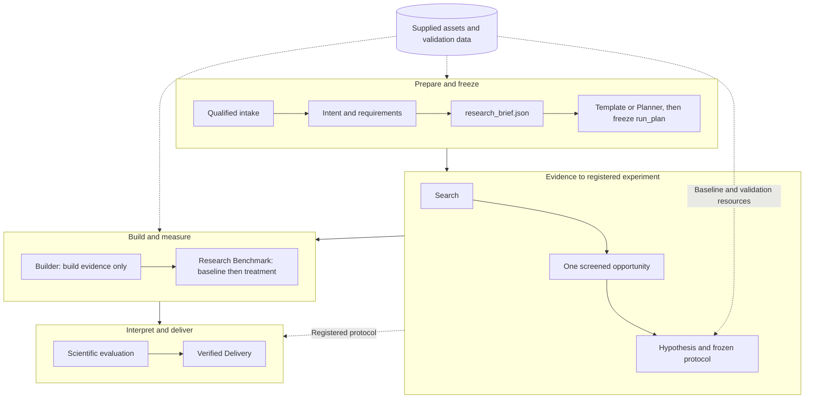
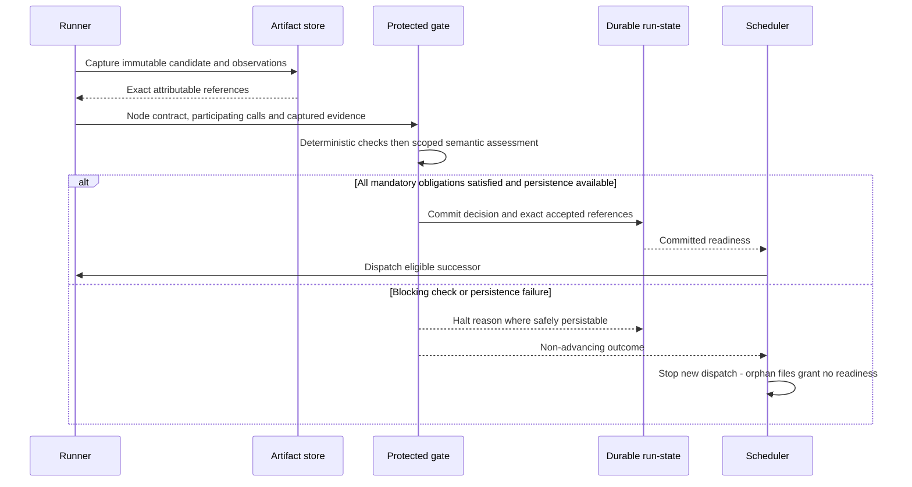

# Full M1: responsibilities and data connections

**Reading level: human potential.** Question answered: What does each M1 research responsibility produce and what makes it complete?

The current core assignment is the bounded complete journey and protected planner in [Core build](core-build.md), with a static template built first. Both modes produce the same [run plan](reference/run-plan.md) type ([D26](decision-review.md#d26)). Full M1 obligations remain mapped independently, and optional RSI Target 1 does not gate the core ([delivery mapping](delivery-phases.md)). The [Intention Compiler](builds/intention-compiler/README.md) is reusable first-boundary work, not the whole journey. This page states research obligations and data ownership. [Major fields](reference/other-contracts.md) define shared outputs, and [system architecture](m1-design.md) gives the whole-system view.

## Research path and ports

Each work output is a candidate until deterministic checks, its assigned verifier and the protected gate accept the exact artifact. Downstream nodes receive accepted references through the runner. The original request, resources and Research Brief stay available where a responsibility needs them. The pipeline is not a chain of lossy text summaries. Exact fields, checks and criteria live in each stage's page under [reference/capsules](reference/capsules/README.md).

| Responsibility / source | Must achieve | Must never |
|---|---|---|
| Intake / §3.1 | Qualified intake to Intent, plus separate resource bindings for requirements, Hypothesis, Builder and Benchmark. Extract `.txt`, `.md` and `.pdf` with origin metadata | Clone repositories, download datasets or search the web during ingestion. Confuse release identity binding with intake signing |
| Intent / §3.2.1–4, §4.7, D5 | Accepted intent that preserves omissions, conflicts, constraints and scope | Choose a solution. Merge supplied project or data assets into the text input |
| Requirements / §3.2, §4.7, D5 | `research_brief.json` for the Planner and every research responsibility. Separate mandatory outcomes from preferences. Mark defaults as defaults | Pass material uncertainty as ready. Attribute a default to the user |
| Fixed core Planner / §4.8, D19 ([Planner page](reference/capsules/planner.md), [contract](reference/run-plan.md)) | Propose a JSON DAG of admitted CCs. Independent protected validation then freezes the `run_plan` for the Scheduler. The static template runs first and yields the same type | Restructure a live run. Freeze without full responsibility coverage, typed-port closure, mandatory checks, limits and acyclicity. An infeasible plan halts and starts a linked Intention Compiler attempt |
| Search / §3.3 ([page](reference/capsules/search.md)) | `candidate_set.json` of 1–3 grounded ideas with exact cited excerpts, from bounded local and designated academic retrieval | Crawl the open web, run a search swarm or repair queries iteratively |
| Screening / §3.4 ([page](reference/capsules/screening.md)) | `opportunity_card.json` with one Top-1 selection, scores and rejection reasons. Pure `rank_opportunities` is the independent RSI target | Impute a missing score. Rewrite incoming dimensions or verifier criteria. Pick an idea with a forbidden dependency |
| Hypothesis / §3.5 ([page](reference/capsules/hypothesis.md)) | `hypothesis_blueprint.json` with one claim and a frozen protocol: baseline, measurement functions, success, falsification and inconclusive criteria | Invent validation data. Write build code. Leave a metric outcome unclassified |
| Builder / §3.6, §4.9 ([page](reference/capsules/builder.md)) | `poc_artifact_bundle.zip` that is bounded and mechanically valid, with construction and readiness evidence | Install dependencies, run a scientific trial, refactor broadly or repair in a loop. Skip the §3.6.2 forbidden-module checks. [Confinement](placement.md#deployment-and-boundaries) is a separate required boundary |
| Research Benchmark / §3.7 ([page](reference/capsules/research-benchmark.md)) | `benchmark_payload.json` and execution evidence. Baseline first, then treatment, on the same hardware, data, configuration and seed policy. The [platform benchmark](development-tools/benchmark-runner/README.md) is separate tooling | Change thresholds or the dependency set. Interpret results. Run without its environment (a missing one blocks) |
| Scientific Evaluation / §3.8 ([page](reference/capsules/scientific-evaluation.md)) | `evaluation_verdict.json` that applies the pre-registered criteria to measured evidence, with residual risks and follow-ups | Query a new leaderboard, rerun an experiment or change a threshold after results |
| Delivery / §3.9 ([page](reference/capsules/delivery.md)) | Standard Markdown report and evidence package preserving claims, measured delta, verdict, warnings, limits and follow-ups | Publish or write back to knowledge |

**Valid negative result.** A correctly obtained scientific negative or inconclusive outcome passes infrastructure verification. Evaluation records it and Delivery delivers it unchanged. Nothing may turn it into a pass or hide it.

Planning does not authorize removing research responsibilities, multiple competing hypotheses or parallel experimental arms. A stage may organize private helpers. A helper gains no workflow role or wider permission.

## Checking responsibilities

PRD §4.2 groups six evaluation facets. They are check obligations, not six services. Tier 1 handles decidable claims. D20 Tier 2 checks declaration and output conformance and internal consistency only. The protected host aggregates and releases. [Guard design](guard-design.md) owns how checking works.

- Conformance (§4.2.2): validate port meaning, completeness, scope, subject binding and required evidence.
- Engineering (§4.2.3): check the bounded build, tests and readiness. The verifier never repairs.
- Performance and cost (§4.2.4): check comparable protocol execution and declared limits. Missing cost data stays unavailable. Platform evaluation differs from scientific measurement.
- Security, privacy, IP (§4.2.5): enforce scoped effects and restricted execution. Check secrets, tools, dependencies, licensing and attribution. No legal certification.
- Evidence and science (§4.2.6): the host checks provenance and registered-rule relationships. Tier 2 establishes neither source grounding nor scientific validity. Interpretation stays with Scientific Evaluation.
- Lifecycle and human review (§4.2.7–8): verify real execution, complete transitions and durable decisions. A human edit is new attributable work and cannot override a failed mandatory check.

PRD §4.2.9 requires intentional failures: malformed artifacts, stale or swapped evidence, unavailable environment, timeout, effect violation, uncertainty, gate locking and valid scientific-negative delivery. Validation profiles pin the cases and thresholds before evaluation.

## Data and state ownership

| Information | Writer / authority | Obligation |
|---|---|---|
| Account and durable profile | Account/profile adapter | Stable user ID distinct from OS identity. Defaults outlive runs. A cloud store never owns local release state. |
| Node Execution Contract and bindings | Protected binder | Runner and gate read them. Export node authority, invocation IDs and artifact bindings with evidence. |
| Original request and resources | Intake under run-state authority | Preserve raw content and origin before normalization. Mutable local assets need a snapshot or validated identity. |
| Effective configuration and graph freeze | Configuration resolver and freeze path | Record requested and effective state. Changes affect future runs only. |
| Attempt evidence and artifacts | Runner captures. Artifact store retains | Failed and pre-gate attempts stay attributable. Candidates show as unaccepted, never as released. |
| Check results, assessment, gate decision | Check runner, verifier, gate host | Run-state commits release or halt. Files persist before accepted references appear. Orphan files grant no readiness. |
| Run Bundle and raw evidence | Capture infrastructure | Keep prompts, tool calls, logs, versions and static host facts. Redact credentials. |
| Capsule Run Record and scorecard | Derived record builders | Include schema version, sources, missing observations and sample counts. Regeneration never rewrites decisions. |
| Exports and RSI data | Export builder under audience policy | Keep protected evaluation data out of exports, prompts and general volumes. |
| Library version, lineage, admission, activation | Publishing and admission infrastructure | Plans use eligible snapshots. Frozen runs pin versions. Rollback changes future selection and keeps old evidence. |

Authoritative release state lives in SQLite, with PRD-compatible append-only records, per-run files, bundles, scorecards and exports. This is the D6 realization, not a database-only product. Native memory holds summaries and references and is never the gate's authority.

## Commit before successor release

Candidate files may survive a failed commit for diagnosis, but they are not accepted references. Transaction and write-order implementation and crash tests belong to the data and gate owners.

## Operational shell

**Required for full M1 (§5.1–5.6).** CLI, web and TUI share one control plane. Headless execution never waits on `human_session`. Browser closure leaves the engine running. Restart preserves accepted artifacts, marks interrupted work paused and does not replay uncertain effects. `pip install jiuwenswarm` and `jiuwenswarm-start` stay the native entry points, and the container image gives equivalent behavior (D6, [automation](automation.md)). Doctor distinguishes model, storage and isolation readiness from HTTP liveness.

Use stable account attribution, project-over-global precedence, a protected local token, a loopback endpoint and protected model IPC. Profile deletion needs explicit user action. Keep tokens and credentials out of logs and bundles. Terminal sessions are inspection surfaces, not agents. Add no desktop binaries, chat channels, remote workers or workflow editor. Optional cloud account storage does not synchronize research data.

## Extension boundaries beyond the first build

[Core build](core-build.md) owns the future seams. This page keeps the boundaries to preserve now:

- Advanced compiler: keep the fixed path and the accepted-Brief contract.
- Composite CCs and fusion: later design only. M1 connects CC subnodes through protected gates inside declared nodes.
- Planning beyond the core Planner: November and December work, not a core dependency.
- Model routes: keep the fixed Codex route. No silent model or context change.
- Optional RSI: Target 1 is independently buildable and adds no core startup, import, coding, test or benchmark dependency. The referee and activation boundary stay protected.
- Mid-run installation or remote workers: need a separate lifecycle and compensation design. Removal never erases history.
- Larger benchmark campaigns: respect domain and access gates and resource budgets.

These seams preserve meaning. They do not promise support for unimplemented features. Unsupported required behavior blocks binding explicitly.

## Architectural component obligations

These design-level obligations supplement the PRD and are not runtime pass claims. Native specifications derive the executable checks. Each row names a real connection to exercise. The [design method](design-method.md) explains review depth, and [CC build coverage](cc-build-coverage.md) shows which component checks what.

| Responsibility / phase | Connection | Required result and failure outcome |
|---|---|---|
| Intake and resources / 1 | Account and workspace → qualified request and separate resources → compilers and science | Unreadable required input rejects explicitly. Original text and resource scope survive normalization. No hidden cross-run reuse |
| Intent and Requirements / 1. Advanced adapter / 3 | Qualified input → Intent → accepted Brief → binder and planner | Mechanical failure spends no verifier call. The Brief keeps intent, marked defaults and mandatory obligations. No invented purpose |
| Search and screening / 1 | Brief → grounded candidates → one opportunity → Hypothesis | Exact citations. Frozen scoring, filtering and ranking rules. Missing scores or evidence, or no eligible idea, halt before design |
| Hypothesis / 1 | Opportunity and resources → one immutable claim and protocol | Measurable variables, available baseline and data, and complete outcome rules verified before code. An unmeasurable protocol blocks |
| Builder and provisioning / 1. Code Mode adapter / 3 | Blueprint → bounded package → protected provisioner → restricted Benchmark | Builder cannot edit analytical contracts, install packages or run science. Provisioner validates archive containment and pinned dependencies. Failure halts without repair |
| Benchmark / 1 | Package and protocol → baseline then treatment → raw evidence | Baseline unmodified. Same resources, configuration and seed policy. A missing baseline or metric cannot yield an invented delta or success |
| Evaluation and Delivery / 1 | Measurements and protocol → classification → report and package | Apply registered rules. Retain negative and inconclusive results. No rerun, new criteria, publication or contradictory report |
| Planner and freeze / D19 | Brief, catalogue and policy → proposal DAG → independently checked graph → scheduler | Full coverage, typed closure, pinned check bundles, limits, no cycles or denied effects. No compatible admitted CC means blocked. Planner self-review grants no release |
| Runner and scheduler / 1, 3 | Committed readiness → managed invocations → captured evidence | Per-CC authority intersection and node budgets. Timeout or cancel stops dispatch and contains work. No cache, retry or library switch substitutes for acceptance |
| Checks, verifier, gate / all | Exact outputs → deterministic results → read-only assessment → committed decision | Malformed, stale or inadmissible evidence blocks. The verifier cannot modify subjects or release. Persistence failure grants no readiness |
| Library and admission / 1, 2, 3 | Declaration, implementation and tests → admitted pins → binding and RSI | Hand-written and RSI versions meet the same integrity rules. A changed body gets a new identity. Activation controls future eligibility, not history |
| Model routing and bridge / 1, 3 | Runner-bound CC and profile → approved endpoint → response and observations | Router selects model, not CC. Fixed Codex baseline. Denied disclosure or missing mandatory capability blocks. No mid-call substitution |
| State, evidence, exports / all | Artifacts and decisions → durable readiness, Run Bundles, exports | Files persist before the release transaction. Reconstruct exact versions and inputs. Redacted exports disclose omissions |
| Account, configuration, clients / 1 | Account defaults and project config → frozen run. Clients → one control plane | Product identity differs from OS identity. Project config never widens policy. Reconcile uncertain submissions before retry |
| Inspection and lifecycle / 1 | Saved records → CLI, Web, TUI views | Inspection never starts execution. Disconnection leaves work intact. Restart preserves evidence without replay |
| Packaging and security / 1 | Packaged frontend and runtime → loopback browser, private clients, scoped worker | Image starts its services. Protected IPC, token and volumes. A POC cannot read control files, credentials or hidden fixtures or use a denied network |
| Optional offline RSI | Parent and target profile → isolated proposals → protected paired evaluation → inactive child | Independently buildable. Nothing in the core depends on RSI. Live ranking unchanged. Contract, referee and hidden splits frozen. No automatic promotion |

The full PRD coverage map is in [coverage allocation](coverage-allocation.md). The static template run stays separately attributable, and mocks do not establish real integration. Design status remains `DESIGN` until runtime evidence exists.

### Fixed research policies and feasibility

Screening sums novelty, feasibility and compute alignment. Equal sums use ascending `idea_id`. Missing or out-of-range scores block. Forbidden dependencies are filtered first, and an empty set halts. Hypothesis binds actual baseline, validation resources and measurement mechanisms before Builder. A readable path does not establish availability. Classification rules cover all metric outcomes, and success needs all registered mandatory conditions.

Scientific Evaluation performs no cryptographic provenance service. Trusted capture supplies content identities and the gate checks reference binding. Intake adds no document signing. The benchmark worker gets only scoped copies of baseline and data. A venv or import scan alone cannot prove that boundary.

### Shared contract clarification

Research artifacts use the [field contracts](reference/field-catalog.md#research-artifacts) and the [research example](reference/examples/README.md#linked-research-path). Hypothesis pins the environment before Builder, and provisioning installs Builder's approved lock without mutation ([sequence](placement.md#dependency-preparation-and-provisioning)). No artifact is accepted because its example is complete. [Node contracts](reference/node-execution.md) define the dispatch boundary.

## Current semantic-review scope

[D20](principles.md#d20-declarationoutput-only-semantic-review) limits semantic input to declaration/output; earlier full-context descriptions remain source context. Host checks retain runtime evidence. [D21](decision-review.md#d21) governs November generation/admission and December composition.
