# Research nodes, subnodes and gates

**Reading level: human potential.** The [system overview](m1-design.md) gives the whole journey. These expanded diagrams retain each work, checking, assessment and release boundary. The shared semantics are in [Workflow](workflow.md) and [Guard design](guard-design.md).

## Inside the POC task

**A CC does the assigned work. Checks, a separate verifier and protected gates decide whether its output can advance.** The example makes the two POC subnodes visible. The node gate releases the combined result only after the required subnode decisions and evidence are durable.

```mermaid
flowchart TB
    H[(Input: accepted Blueprint/protocol, Brief and scoped project assets)]
    O[(Output: released POC bundle and Benchmark_Payload.json with execution evidence)]
    subgraph Workflow[Governed CC workflow]
      subgraph POC[POC node: build a bounded intervention, then measure it]
        subgraph Builder[Builder subnode]
          B[Builder work · Builder CC<br/>Create bounded package<br/> no trial or dependency installation]
          BA[(Candidate POC_Artifact_Bundle.zip and build evidence)]
          BC{Build checks<br/>syntax, readiness and forbidden-module use/imports}
          BR[Semantic review input<br/>pinned declaration + exact worker output only]
          BV[Build verifier · verifier CC<br/>Assess declared output and internal consistency<br/> no input replay, edits or acceptance authority]
          BVA[/Typed build assessment/]
          BVAL[[Validate assessment schema and exact subject identity]]
          BG{{Protected Build gate<br/>apply checks + validated assessment<br/> commit or halt}}
          B --> BA --> BC
          BC -->|valid| BR --> BV --> BVA --> BVAL --> BG
          BC -->|invalid or unavailable| BG
        end
        subgraph Benchmark[Benchmark subnode]
          M[Benchmark work · Benchmark CC<br/>Provision frozen dependencies<br/> baseline first, then treatment<br/> no interpretation]
          MA[(Candidate Benchmark_Payload.json, empirical results and logs)]
          MC{Measurement checks<br/>protocol, resource, hardware, runs, metrics and execution evidence}
          MR[Semantic review input<br/>pinned declaration + exact worker output only]
          MV[Measurement verifier · verifier CC<br/>Assess declared output and internal consistency<br/> no input replay, edits or acceptance authority]
          MVA[/Typed measurement assessment/]
          MVAL[[Validate assessment schema and exact subject identity]]
          MG{{Protected Measurement gate<br/>apply checks + validated assessment<br/> commit or halt}}
          M --> MA --> MC
          MC -->|valid| MR --> MV --> MVA --> MVAL --> MG
          MC -->|invalid or unavailable| MG
        end
        NG{{POC node gate<br/>commit only when both required subnode results are accepted}}
        X[/Halt reason<br/> preserve candidate and evidence/]
        BG -->|accepted bundle| M
        BG -->|accepted build result| NG
        BG -->|reject or block| X
        MG -->|accepted measurement evidence| NG
        MG -->|reject or block| X
        NG -->|commit node evidence| O
        NG -->|incomplete or failed commit| X
      end
      H --> B
    end
    classDef artifact fill:#E2F0D9,stroke:#548235,color:#1f2937
    classDef work fill:#DDEBF7,stroke:#4472C4,color:#1f2937
    classDef verify fill:#E4DFEC,stroke:#7030A0,color:#1f2937
    classDef check fill:#FCE4D6,stroke:#C55A11,color:#1f2937
    classDef context fill:#E7E6E6,stroke:#7F7F7F,color:#1f2937
    classDef assessment fill:#CCFFFF,stroke:#008C95,color:#102A43
    classDef gate fill:#FFF2CC,stroke:#BF9000,color:#1f2937
    classDef halt fill:#F4CCCC,stroke:#A61C00,color:#1f2937
    class H,O,BA,MA artifact
    class B,M work
    class BV,MV verify
    class BC,MC,BVAL,MVAL check
    class BR,MR context
    class BVA,MVA assessment
    class BG,MG,NG gate
    class X halt
    style Workflow fill:#F8FAFC,stroke:#334155,stroke-width:2px,stroke-dasharray:6 4
    style POC fill:#EFF6FF,stroke:#4472C4,stroke-width:2px
    style Builder fill:#F8FAFC,stroke:#64748B,stroke-dasharray:4 3
    style Benchmark fill:#F8FAFC,stroke:#64748B,stroke-dasharray:4 3
```

The Builder capsule packages the intervention. It does not run the scientific trial. The Benchmark capsule measures the registered baseline and treatment. The verifier independently assesses the declaration/output pair only; host-attached references do not imply access to upstream evidence. Neither the verifier nor the artifact can accept itself. See [Tasks, nodes, and verification](workflow.md#tasks-nodes-and-verification) for the shared execution contract.

## Research nodes and subnodes

**Each diagram shows one node inside the governed CC workflow.** Inputs and outputs sit outside that node. Internal candidates, checks, verifier assessment and gate remain inside it. Green means an artifact, blue means work, purple means independent assessment, orange means deterministic checking, and amber means protected control. The gate alone releases the named accepted artifact. This repeated pattern explains the shared contract. Each node's contract defines its evidence and criteria.

```mermaid
flowchart TB
    I[(Input: accepted Brief, local extracted documents, permitted academic sources)]
    O[(Output: accepted Candidate_Set.json with cited sources and 1–3 grounded ideas)]
    subgraph Workflow[Governed CC workflow]
      subgraph Node[Search node: bounded retrieval and grounded ideation]
        W[Search work subnode · Search CC<br/>Run fixed query strategy<br/> group exact source excerpts<br/> preserve citations]
        C{Deterministic checks<br/>contract, source references, required fields and limits}
        R[Semantic review input<br/>pinned declaration + exact worker output only]
        V[Verifier subnode · verifier CC<br/>Assess declared output and internal consistency<br/> no input replay, edits or acceptance authority]
        A[/Typed verifier assessment<br/>verdict, reasons, evidence and uncertainty/]
        X[[Validate assessment schema and exact subject identity]]
        G{{Protected gate<br/>apply checks + validated assessment<br/> commit or halt}}
        Q[(Candidate_Set.json)]
        H[/Halt reason<br/> preserve candidate and evidence/]
        W --> Q --> C
        C -->|valid| R
        C -->|invalid or unavailable| G
        R --> V --> A --> X --> G
        G -->|reject or block| H
      end
      I --> W
      G -->|accept exact candidate| O
    end
    classDef artifact fill:#E2F0D9,stroke:#548235,color:#1f2937
    classDef work fill:#DDEBF7,stroke:#4472C4,color:#1f2937
    classDef verify fill:#E4DFEC,stroke:#7030A0,color:#1f2937
    classDef check fill:#FCE4D6,stroke:#C55A11,color:#1f2937
    classDef context fill:#E7E6E6,stroke:#7F7F7F,color:#1f2937
    classDef assessment fill:#CCFFFF,stroke:#008C95,color:#102A43
    classDef gate fill:#FFF2CC,stroke:#BF9000,color:#1f2937
    classDef halt fill:#F4CCCC,stroke:#A61C00,color:#1f2937
    class I,O,Q artifact
    class W work
    class V verify
    class C,X check
    class R context
    class A assessment
    class G gate
    class H halt
    style Workflow fill:#F8FAFC,stroke:#334155,stroke-width:2px,stroke-dasharray:6 4
    style Node fill:#EFF6FF,stroke:#4472C4,stroke-width:2px
```

```mermaid
flowchart TB
    I[(Input: accepted Candidate_Set.json and Brief constraints)]
    O[(Output: accepted Opportunity_Card.json with score reasons and disposition)]
    subgraph Workflow[Governed CC workflow]
      subgraph Node[Screening node: consolidate and rank one opportunity]
        W[Screening work subnode · Screening CC<br/>One-pass consolidation<br/> score novelty, feasibility and compute alignment<br/> filter forbidden dependencies]
        C{Deterministic checks<br/>contract, 1–5 score dimensions, reasons and fixed tie/missing-score policy}
        R[Semantic review input<br/>pinned declaration + exact worker output only]
        V[Verifier subnode · verifier CC<br/>Assess declared output and internal consistency<br/> no input replay, edits or acceptance authority]
        A[/Typed verifier assessment<br/>verdict, reasons, evidence and uncertainty/]
        X[[Validate assessment schema and exact subject identity]]
        G{{Protected gate<br/>apply checks + validated assessment<br/> commit or halt}}
        Q[(Candidate Opportunity_Card.json)]
        H[/Halt reason<br/> preserve candidate and evidence/]
        W --> Q --> C
        C -->|valid| R
        C -->|invalid or unavailable| G
        R --> V --> A --> X --> G
        G -->|reject or block| H
      end
      I --> W
      G -->|accept exact candidate| O
    end
    classDef artifact fill:#E2F0D9,stroke:#548235,color:#1f2937
    classDef work fill:#DDEBF7,stroke:#4472C4,color:#1f2937
    classDef verify fill:#E4DFEC,stroke:#7030A0,color:#1f2937
    classDef check fill:#FCE4D6,stroke:#C55A11,color:#1f2937
    classDef context fill:#E7E6E6,stroke:#7F7F7F,color:#1f2937
    classDef assessment fill:#CCFFFF,stroke:#008C95,color:#102A43
    classDef gate fill:#FFF2CC,stroke:#BF9000,color:#1f2937
    classDef halt fill:#F4CCCC,stroke:#A61C00,color:#1f2937
    class I,O,Q artifact
    class W work
    class V verify
    class C,X check
    class R context
    class A assessment
    class G gate
    class H halt
    style Workflow fill:#F8FAFC,stroke:#334155,stroke-width:2px,stroke-dasharray:6 4
    style Node fill:#EFF6FF,stroke:#4472C4,stroke-width:2px
```

```mermaid
flowchart TB
    I[(Input: accepted opportunity, Brief, supplied baseline and validation resource)]
    O[(Output: accepted Hypothesis_Blueprint.json with frozen protocol)]
    subgraph Workflow[Governed CC workflow]
      subgraph Node[Hypothesis node: register one testable claim and protocol]
        W[Hypothesis work subnode · Hypothesis CC<br/>Specify mechanism, variables, baseline, fixed measures, thresholds and middle-region rule]
        C{Deterministic checks<br/>contract, required protocol fields, resource bindings and consistency}
        R[Semantic review input<br/>pinned declaration + exact worker output only]
        V[Verifier subnode · verifier CC<br/>Assess declared output and internal consistency<br/> no input replay, edits or acceptance authority]
        A[/Typed verifier assessment<br/>verdict, reasons, evidence and uncertainty/]
        X[[Validate assessment schema and exact subject identity]]
        G{{Protected gate<br/>apply checks + validated assessment<br/> commit or halt}}
        Q[(Candidate Hypothesis_Blueprint.json)]
        H[/Halt reason<br/> preserve candidate and evidence/]
        W --> Q --> C
        C -->|valid| R
        C -->|invalid or unavailable| G
        R --> V --> A --> X --> G
        G -->|reject or block| H
      end
      I --> W
      G -->|accept exact Blueprint| O
    end
    classDef artifact fill:#E2F0D9,stroke:#548235,color:#1f2937
    classDef work fill:#DDEBF7,stroke:#4472C4,color:#1f2937
    classDef verify fill:#E4DFEC,stroke:#7030A0,color:#1f2937
    classDef check fill:#FCE4D6,stroke:#C55A11,color:#1f2937
    classDef context fill:#E7E6E6,stroke:#7F7F7F,color:#1f2937
    classDef assessment fill:#CCFFFF,stroke:#008C95,color:#102A43
    classDef gate fill:#FFF2CC,stroke:#BF9000,color:#1f2937
    classDef halt fill:#F4CCCC,stroke:#A61C00,color:#1f2937
    class I,O,Q artifact
    class W work
    class V verify
    class C,X check
    class R context
    class A assessment
    class G gate
    class H halt
    style Workflow fill:#F8FAFC,stroke:#334155,stroke-width:2px,stroke-dasharray:6 4
    style Node fill:#EFF6FF,stroke:#4472C4,stroke-width:2px
```

The [POC task/node diagram](#inside-the-poc-task) shows its Builder and Benchmark work subnodes and their separate gates. The POC node gate aggregates both accepted results.

```mermaid
flowchart TB
    I[(Input: accepted measurements, raw logs, frozen Blueprint and Brief)]
    O[(Output: accepted Evaluation_Verdict.json with conclusion, risks and follow-ups)]
    subgraph Workflow[Governed CC workflow]
      subgraph Node[Evaluation node: apply preregistered criteria to evidence]
        W[Evaluation work subnode · Evaluation CC<br/>Check empirical origin, metric completeness and validity<br/> classify against fixed criteria]
        C{Deterministic checks<br/>required measurements, provenance, schema and frozen thresholds}
        R[Semantic review input<br/>pinned declaration + exact worker output only]
        V[Verifier subnode · verifier CC<br/>Assess declared output and internal consistency<br/> no input replay, edits or acceptance authority]
        A[/Typed verifier assessment<br/>verdict, reasons, evidence and uncertainty/]
        X[[Validate assessment schema and exact subject identity]]
        G{{Scientific-output Evaluator Gate<br/>apply checks + validated assessment<br/> commit or halt}}
        Q[(Candidate Evaluation_Verdict.json)]
        H[/Halt reason<br/> preserve candidate and evidence/]
        W --> Q --> C
        C -->|valid| R
        C -->|invalid or unavailable| G
        R --> V --> A --> X --> G
        G -->|reject or block| H
      end
      I --> W
      G -->|accept exact verdict| O
    end
    classDef artifact fill:#E2F0D9,stroke:#548235,color:#1f2937
    classDef work fill:#DDEBF7,stroke:#4472C4,color:#1f2937
    classDef verify fill:#E4DFEC,stroke:#7030A0,color:#1f2937
    classDef check fill:#FCE4D6,stroke:#C55A11,color:#1f2937
    classDef context fill:#E7E6E6,stroke:#7F7F7F,color:#1f2937
    classDef assessment fill:#CCFFFF,stroke:#008C95,color:#102A43
    classDef gate fill:#FFF2CC,stroke:#BF9000,color:#1f2937
    classDef halt fill:#F4CCCC,stroke:#A61C00,color:#1f2937
    class I,O,Q artifact
    class W work
    class V verify
    class C,X check
    class R context
    class A assessment
    class G gate
    class H halt
    style Workflow fill:#F8FAFC,stroke:#334155,stroke-width:2px,stroke-dasharray:6 4
    style Node fill:#EFF6FF,stroke:#4472C4,stroke-width:2px
```

```mermaid
flowchart TB
    I[(Input: accepted verdict, Brief, citations, Blueprint, package and benchmark evidence)]
    O[(Output: released standard Markdown report and evidence package)]
    subgraph Workflow[Governed CC workflow]
      subgraph Node[Delivery node: report the accepted result and its limits]
        W[Delivery work subnode · Delivery CC<br/>Preserve claims, methods, measured delta, verdict, warnings, limits and follow-ups]
        C{Deterministic checks<br/>report structure, required evidence links and claim references}
        R[Semantic review input<br/>pinned declaration + exact worker output only]
        V[Verifier subnode · verifier CC<br/>Assess declared output and internal consistency<br/> no input replay, edits or acceptance authority]
        A[/Typed verifier assessment<br/>verdict, reasons, evidence and uncertainty/]
        X[[Validate assessment schema and exact subject identity]]
        G{{Delivery Evaluator Gate<br/>apply checks + validated assessment<br/> commit or halt}}
        Q[(Candidate report and evidence package)]
        H[/Halt reason<br/> preserve candidate and evidence/]
        W --> Q --> C
        C -->|valid| R
        C -->|invalid or unavailable| G
        R --> V --> A --> X --> G
        G -->|reject or block| H
      end
      I --> W
      G -->|accept exact report and package| O
    end
    classDef artifact fill:#E2F0D9,stroke:#548235,color:#1f2937
    classDef work fill:#DDEBF7,stroke:#4472C4,color:#1f2937
    classDef verify fill:#E4DFEC,stroke:#7030A0,color:#1f2937
    classDef check fill:#FCE4D6,stroke:#C55A11,color:#1f2937
    classDef context fill:#E7E6E6,stroke:#7F7F7F,color:#1f2937
    classDef assessment fill:#CCFFFF,stroke:#008C95,color:#102A43
    classDef gate fill:#FFF2CC,stroke:#BF9000,color:#1f2937
    classDef halt fill:#F4CCCC,stroke:#A61C00,color:#1f2937
    class I,O,Q artifact
    class W work
    class V verify
    class C,X check
    class R context
    class A assessment
    class G gate
    class H halt
    style Workflow fill:#F8FAFC,stroke:#334155,stroke-width:2px,stroke-dasharray:6 4
    style Node fill:#EFF6FF,stroke:#4472C4,stroke-width:2px
```

The Scientific-output and Delivery Evaluator Gates apply checks, verifier assessments and protected decisions. A blocking check, verifier or gate stops dependent work and retains evidence.

## Current semantic-review scope

[D20](principles.md#d20-declarationoutput-only-semantic-review) limits semantic input to declaration/output; earlier full-context descriptions remain source context. Host checks retain runtime evidence. [D21](decision-review.md#d21) governs November generation/admission and December composition.
