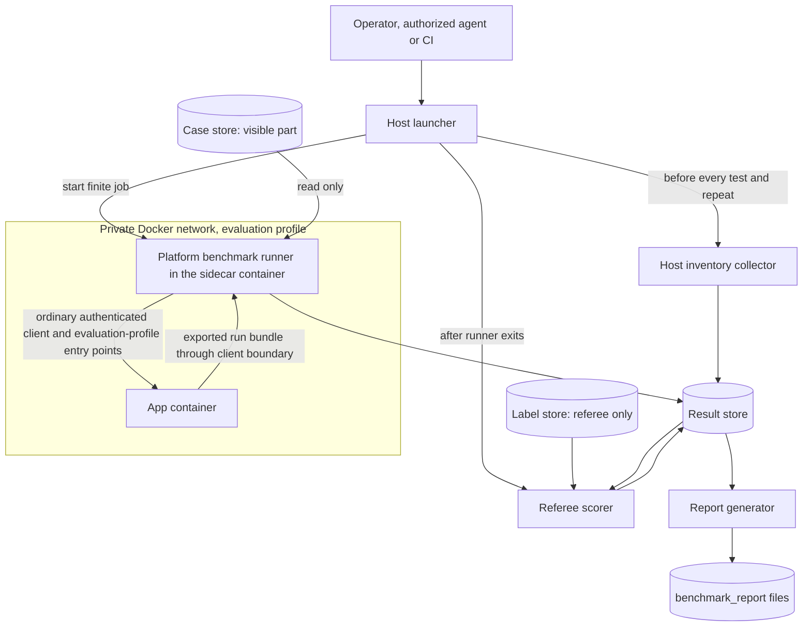

# Platform benchmark runner

`Tier 3 · Part of: [Side systems](README.md) · Serves: Standard`

This page is the runner's exact contract. Its records are listed in the [contract index](../reference/README.md#contract-index).

This page defines how the platform benchmark runs the whole AI4Research system, stores comparable results, and scores them against a protected oracle. The runner is an M1 side system. It runs in the sidecar container, with the test runner ([D31](../method/decisions.md#d31), [D36](../method/decisions.md#d36)). Its product connection uses the control API and record export. This page owns the adopted platform benchmark behavior, case contracts and evidence rules. It is not the scientific Research Benchmark CC, which measures one hypothesis inside a run.

- The runner drives the app as an ordinary authenticated client. A separate referee holds the labels. The runner never sees them.
- Every case, oracle, campaign and report format is versioned. M1 is the weakest version and the baseline. M2, M3, M4 and later runs compare against it with the same case keys.
- Goal at M1: run end to end and record comparable results. A low score is acceptable. A missing record is not.
- Six entry points are needed. E1 is the ordinary product client. Four are evaluation-profile only. The initial E1 feasibility pilot uses E1 only (see below). The full M1 pilot (S01 to S06) adds E2 to E4. E5 and E6 follow.
- Runner tools and credentials are unavailable to product agents and capability capsules. Product startup never depends on this page. The sidecar pilot is separate from the PRD core gate and runs after research jobs. A pilot failure is reported and never blocks the research workflow ([D40](../method/decisions.md#d40)).

## Initial E1 feasibility pilot

`Standard`. This bounded pilot checks that the sidecar can submit, observe and retrieve a run through the ordinary product client.

| Item | Value |
|---|---|
| Entry point | E1 only: submit, observe, retrieve through the ordinary client |
| Plan source | Static template, fixed Codex route, `cc.router.enabled` false |
| Host | The server host, the GB10 GPU host from the requirements (section 1.5) that runs the whole Compose project ([D35](../method/decisions.md#d35)). The Research Benchmark CC needs one exclusive GPU. Peak memory is measured at the first pilot run. |
| Cases | One positive run, one valid scientific negative, one expected stop (a missing check bundle rejected before dispatch) |
| Repeats | 3 per case, so 9 runs |
| Scoring | Deterministic oracle only. `judge_config_ref` is null |
| Done when | 9 run records with `pins_match` true, 9 score records, and a report whose aggregates rebuild byte-identically from the score files |

Router on and off comparisons and RSI child versus parent comparisons use the same contracts with a different evaluation profile. The requirements schedule their statistical benchmark comparisons for M2 and M3 (requirements 1.2). The functional Phase 3 exit tests are separate and stay in M1 (PRD 1.3): the router on and off, and planned against static, on the same Brief.

Related pages: [sidecar](../development-tools/sidecar/README.md) (the container, boundary and authority), [test runner](../development-tools/test-runner/README.md) (the other client in the sidecar container), [automation](../development-tools/automation.md) (client contract and evaluation-profile seams).

## Contents

1. [Components](#components)
2. [Authority and protection](#authority-and-protection)
3. [Storage layout](#storage-layout)
4. [Interface: benchmark_case](#benchmark_case)
5. [Interface: campaign](#campaign)
6. [Interface: hardware_inventory](#hardware_inventory)
7. [Interface: run_record](#run_record)
8. [Outcome vocabulary](#outcome-vocabulary)
9. [Interface: score_record](#score_record)
10. [Interface: benchmark_report](#benchmark_report)
11. [Entry points](#entry-points)
12. [Run procedure](#run-procedure)
13. [Milestone continuity](#milestone-continuity)
14. [Benchmark rulings](#benchmark-rulings)

## Components



*Level: components of one campaign. Omits: the app container internals and case contents.*

| Component | Where it runs | Job | Must not |
|---|---|---|---|
| Host launcher | Server host | Selects campaign, starts the Compose environment, calls the collector, starts runner, then referee, then report generator. Owns cleanup of job-owned resources | Hold labels in the runner's environment. Retry a run |
| Job coordinator | Sidecar container | Routes campaign-declared host operations through the [host executor](../development-tools/sidecar/README.md#host-executor), preserves ownership and resumes observation | Share its host-operation grant with runners, external adapters or CCs. Read protected labels |
| Host inventory collector | Host or launcher process, never in the sidecar container | Writes a `hardware_inventory` before every test and every repeat (B17). Samples peaks during the run | Infer hardware from the model name or requested profile |
| Platform benchmark runner | In the sidecar container on the private Docker network, non-root, no inbound port, no Docker socket | Loads visible cases, submits, observes, retrieves exports, calls entry points E1 to E6, writes `run_record` files | Read the label store. Write product state. Score. Call a model |
| Case store | Read-only mount into the runner | `benchmark_case` visible part, input fixtures, bundles for replay | Contain expected outputs or labels |
| Label store (protected) | Referee only | Referee part of each case: expected outputs, labels, reference reasons, rubric, oracle code. B12 | Be mounted into the app, the runner, any worker, capsule author or RSI context |
| Referee scorer | A separate process under its own OS identity inside the sidecar container. It holds no control API token and makes no call to the app | Reads `run_record`, exports and labels. Writes `score_record`. May call the pinned benchmark judge model | Reach the app. Use the platform verifier verdict as ground truth (B05) |
| Result store | Host volume, append-only | Holds inventories, run records, exports, scores, reports | Delete or overwrite. Failed, timed-out and blocked runs stay (B08) |
| Report generator | Host process, after scoring | Builds `benchmark_report` from score records only | Compute a score the check-level records cannot reproduce |

The runner, referee and report generator share one codebase layout but run with different mounts and credentials. A coding agent may build them as one Python package with three entry commands, or as three small programs.

## Authority and protection

| Capability | Runner | Referee | Collector | App (evaluation profile) |
|---|---|---|---|---|
| Visible cases and fixtures | read | read | none | none (registered as inputs by the runner through the import path) |
| Label store | none | read | none | none |
| Result store | write own run directory | write scores | write inventories | none |
| App client credential, `evaluation_workspace` scope | yes | none | none | n/a |
| App credential, `evaluation_profile` scope (E2, E3, E4, E5) | yes, only when the campaign declares it | none | none | enforces |
| Model credential | none | benchmark judge only, separate from product keys | none | product route only |
| Docker socket or host shell | none | none | host-native read only | none |

Rules:

1. Evaluation-profile entry points exist only when the launcher starts the app with an approved evaluation profile. Readiness reports `evaluation_profile` as null in every product profile ([client-readiness](../reference/field-catalog.md#client-readiness)). The runner refuses a campaign that needs an entry point the readiness response does not list.
2. Any run that used E2, E3 or E4 carries `evaluation_labels` including `invalid_for_product`. Its exported bundle cannot be admitted as product output or RSI material.
3. The runner treats the case `task_prompt` and visible fixtures as the only case material. The case file it loads has no label fields. The referee checks `visible_sha256` against the label store copy so a tampered case is detected.
4. A fixture disclosed to any agent, author or proposer becomes `development` split in the next case version (B12).
5. Held-out detail appears only in the `referee` report audience. The `public` audience shows aggregates and pass or fail per family.

## Storage layout

All paths are relative to the bench root `BENCH_ROOT`. File format: UTF-8 JSON, LF line endings, one record per file unless noted. IDs match `^[a-z][a-z0-9_]{2,79}$` unless noted.

```text
cases/<case_id>/<case_version>/case.json          visible benchmark_case
cases/<case_id>/<case_version>/fixtures/...       input fixtures and replay bundles
labels/<case_id>/<case_version>/referee.json      referee part (label store, referee mount only)
labels/<case_id>/<case_version>/oracle/...        oracle code and reference outputs
campaigns/<campaign_id>/campaign.json             frozen campaign
campaigns/<campaign_id>/schedule.json             frozen run order
results/<campaign_id>/inventories/<inventory_id>.json
results/<campaign_id>/runs/<run_id>/run_record.json
results/<campaign_id>/runs/<run_id>/export/...    run bundle copy retrieved through the client
results/<campaign_id>/runs/<run_id>/checkpoints/<checkpoint_id>.json
scores/<campaign_id>/<run_id>/<oracle_version>/score_record.json
reports/<report_id>/report.json  and  report.md   per audience
```

`results/` and `scores/` are append-only. A rescoring with a new oracle writes a new `<oracle_version>` directory.

Process interface: `benchmark-runner run --campaign <campaign_id>` exits 0 when every scheduled run produced a `run_record` (whatever its outcome). It exits non-zero when it could not record. A blocked or failed run is data, not a runner failure. `benchmark-referee score --campaign <campaign_id> --oracle-version <v>` and `benchmark-report build --campaign <id>... --audience <referee|public>` follow the same rule. The launcher composes the three.

## benchmark_case

Contract ID `benchmark-case:1`. Source: requirements section 2.2 and B01. One file `case.json` holds the visible part. The referee part lives in the label store and is described after the visible table.

### Visible part

| Field | Type | Required | Constraint | Meaning |
|---|---|---|---|---|
| `schema` | string | yes | `benchmark-case:1` | Contract ID. |
| `case_id` | string | yes | id pattern, unique across the store | Stable identity of the case across milestones. |
| `case_version` | integer | yes | >= 1 | Bumps on any change to a visible or referee field, fixture hash or oracle. Old versions are kept. |
| `supersedes` | integer or null | yes | < `case_version` | Previous version or null. |
| `scenario_id` | string | yes | enum `s01` to `s10` | Scenario family. |
| `variant_id` | string | yes | id pattern | Controlled variant inside the family. Unique per scenario. |
| `topic` | string | yes | 3 to 200 chars | Technology or computer science topic (B13). |
| `research_question` | string | yes | 10 to 500 chars | Research question, or the workflow obligation for an isolated module test. |
| `domain_codes` | array of string | yes | each `c01` to `c08`, min 1 | Domain taxonomy from requirements section 6.1. |
| `module_requirements` | array of string | yes | each matches `^(cc|pl|vf|rt|rs|lh|su)[0-9]{2}$`, min 1 | Requirement IDs covered (lowercase of CC01, VF05, and so on). |
| `delivery_profile` | string | yes | enum `core_m1_phase1_baseline`, `core_m1_phase1_verifier`, `phase3_conditional`, `m2_m3_routing`, `m2_m3_rsi`, `extended` | Profile from requirements section 1.2. |
| `milestone` | string | yes | enum `m1`, `m2`, `m3`, `m4`, `later` | Earliest milestone where the case is scored. |
| `classification` | string | yes | enum `core_m1_acceptance`, `phase3_progress`, `m2_m3_progress`, `extended_performance` | B15 class. |
| `split` | string | yes | enum `development`, `held_out`, `milestone_tracking` | B03 split. |
| `expected_behavior` | string | yes | enum `complete`, `halt` | Population: completion expected or stop expected (B02). |
| `entry_mode` | string | yes | enum `run`, `node_replay`, `single_cc`, `long_horizon` | Which entry point the runner uses. |
| `task_prompt` | string | yes | 1 to 20000 chars | The only text the agent under test sees. |
| `permitted_resources` | array of object | yes | each `{resource_id, kind: tool or source or dataset, ref}` | Tools, sources, datasets the case allows. |
| `input_fixtures` | array of object | yes | each `{fixture_id, path, sha256, provenance, role}`, `role` enum `input`, `replay_bundle`, `binding`, `source_snapshot`, `fault_asset` | Frozen inputs. `sha256` is 64 lowercase hex of the file bytes. |
| `seed` | integer or null | yes | >= 0 | Requested seed where the system supports one. |
| `budgets` | object | yes | see budgets table | Per-run limits. |
| `gpu_required` | boolean | yes |  | Whether the case needs a GPU. |
| `host_profile` | string | yes | enum `mrgf_x_default`, `gb10`, `other_declared` | Selected host profile. `gb10` is allowed only when `gpu_required` is true or the case says why. |
| `hardware_requirements` | object | yes | `{min_physical_mb, min_commit_mb, arch: any or x86_64 or aarch64, accelerator: none or required}` | Hardware the case needs. |
| `human_intervention` | string | yes | enum `none`, `escalation_record_only` | Allowed human action. M1 uses `none` or the record only. |
| `repair_policy` | string | yes | enum `none` | No autonomous repair is allowed in the M1 profile (requirements 1.3). Other values need a new contract version. |
| `fault_plan_ref` | string or null | yes | `fault_id` from the campaign fault list | Fault to inject, or null. Required when `expected_behavior` is `halt` and the halt is induced. |
| `checkpoints` | array of object | yes | each `{checkpoint_id, after_node}`, empty unless `entry_mode` is `long_horizon` | Observation points for LH05. |
| `node_bundle_ref` | string or null | yes | a `fixtures` `fixture_id` with role `replay_bundle` | Required when `entry_mode` is `node_replay`. |
| `capsule_binding` | object or null | yes | `{capsule_id, capsule_version, binding_fixture_id}` | Required when `entry_mode` is `single_cc`. |
| `model_configuration_ref` | string | yes | id of a campaign configuration slot | Which configuration slot supplies the model route. Values stay in the campaign. |
| `repeat_policy` | object | yes | `{repeats: int >= 1, stochastic: boolean}` | Default 3 repeats when `stochastic` (requirements 10.2). |
| `required_evidence` | array of string | yes | each an export artifact type or record name | Evidence the run must export for scoring. |
| `oracle_version` | string | yes | `oracle:<n>` | Referee oracle in use for this case version. |
| `referee_ref` | object | yes | `{label_id, referee_sha256, visible_sha256}` | Binds the visible file to the protected part. `visible_sha256` is the hash of this file with `referee_ref` removed. |

`budgets` object:

| Field | Type | Required | Constraint | Meaning |
|---|---|---|---|---|
| `wall_time_s` | integer | yes | >= 1 | Total elapsed limit. |
| `invocations` | integer | yes | >= 1 | Model and tool invocation count limit. |
| `compute` | object | yes | `{cpu_s, gpu_s}`, each >= 0 | Compute limit. |
| `memory_physical_mb` | integer | yes | >= 1 | Working-set budget (requirements 1.5). |
| `memory_committed_mb` | integer | yes | >= `memory_physical_mb` | Committed or virtual memory budget. |
| `storage_mb` | integer | yes | >= 1 | Evidence and workspace storage. |
| `concurrency` | integer | yes | >= 1 | Parallel work allowed. M1 uses 1. |
| `tools` | array of string | yes |  | Allowed tool IDs. |
| `effects` | array of string | yes |  | Allowed effect classes. |

### Referee part (label store only)

Contract ID `benchmark-referee:1`. The runner never loads it.

| Field | Type | Required | Constraint | Meaning |
|---|---|---|---|---|
| `label_id` | string | yes | id pattern | Matches `referee_ref.label_id`. |
| `case_id`, `case_version` | string, integer | yes | match the case | Binding. |
| `expected_outcome` | object | yes | `{population, expected_terminal: complete or halt, expected_halt_decision: string or null}` | For `halt` cases, the expected product decision, copied from product vocabulary (for example `ENVIRONMENT_BLOCKED`). |
| `expected_tier_verdicts` | object or null | yes | `{tier1, tier2, advance: boolean, downstream_action: advance or locked or halt}`, verdict strings in product vocabulary, `tier2` may be `NOT_RUN` | Required for `node_replay` and gate cases. |
| `prd_case_number` | integer or null | yes | 1 to 10 | PRD 4.2.9 acceptance case for S05 and S06. |
| `valid_capsule_choices` | array of object | yes | each `{capsule_id, capsule_version}` | Compatible choices. Empty for static binding cases. |
| `dependency_obligations` | array of string | yes |  | Obligations a successful run must show. |
| `mandatory_checks` | array of object | yes | min 1, see below | Checks with kind and weight. |
| `rubric` | object or null | yes | `{rubric_id, criteria: [{criterion_id, weight}]}`, weights sum to 1 | Optional quality rubric with frozen weights. |
| `primary_metric` | string | yes | metric ID from the report vocabulary | Primary metric. |
| `secondary_metrics` | array of string | yes |  | Others. |
| `failure_conditions` | array of string | yes |  | Explicit failure conditions. |
| `reference_reasons` | array of string | yes |  | Allowed reference reasons for reason accuracy. |
| `labels` | object | yes | free structure keyed by check ID | Ground-truth labels. Two-reviewer labels carry `{reviewer_a, reviewer_b, resolved: boolean}`. |
| `judge_audit_ref` | string or null | yes |  | Judge audit record for any `model_judged` check. |

`mandatory_checks[]` entry: `{check_id (id pattern), kind (deterministic, human_adjudicated, model_judged), check_family (string), weight (number >= 0), description}`.

## campaign

Contract ID `benchmark-campaign:1`. One file `campaign.json`. It is frozen before the first run. Any edit makes a new `campaign_id`.

| Field | Type | Required | Constraint | Meaning |
|---|---|---|---|---|
| `schema` | string | yes | `benchmark-campaign:1` | Contract ID. |
| `campaign_id` | string | yes | id pattern | Identity. |
| `frozen_at` | string | yes | RFC 3339 UTC | Freeze time. Must precede every `started_at` in the campaign. |
| `milestone` | string | yes | enum as in `benchmark_case.milestone` | Milestone under test. |
| `purpose` | string | yes | enum `baseline`, `milestone_progress`, `ablation`, `pilot`, `feasibility`, `judge_audit`, `calibration` | Why it runs. `baseline` is the first campaign of a milestone that later ones compare against. |
| `suite_version` | string | yes | `suite:<milestone>:<n>` | Version of the case set. |
| `cases` | array of object | yes | each `{case_id, case_version, case_sha256}`, min 1 | Frozen case set. The runner refuses a case whose hash differs. |
| `configurations` | array of object | yes | min 1, see below | Systems under test. |
| `pairs` | array of object | yes | each `{pair_id, config_ids: [a, b], difference: string}` | Paired comparisons and the one intentional difference (B04). Empty when none. |
| `pins` | object | yes | see below | Version pins for the whole campaign (B09). |
| `repeats` | integer | yes | >= 1 | Repeats per case and configuration. Cases may raise it, not lower it. |
| `seeds` | object | yes | `{base_seed: int, per_repeat: [int]}` | Requested seeds. Effective seeds are recorded in run records. |
| `order` | object | yes | `{randomized: boolean, order_seed: int}` | Configuration order inside a pair. The result is saved in `schedule.json`. |
| `host_profile` | string | yes | same enum as the case | One host profile per paired comparison. |
| `environment_profile` | object | yes | `{os, background_workload, power, pagefile_policy, concurrency}`, all strings | Preregistered OS and background profile (requirements 1.5). Never mixed inside a pair. |
| `evaluation_profile_id` | string or null | yes |  | Approved app evaluation profile. Required when any case uses E2 to E5. |
| `fault_plan` | array of object | yes | see fault table | Faults the campaign declares. Empty when none. |
| `analysis_policy` | object | yes | `{ci_methods: [wilson, paired_bootstrap_cluster], cluster_by: variant, alpha: 0.05, reporting_criteria_ref: string}` | Frozen before measurement. |
| `judge_config_ref` | string or null | yes |  | Pinned benchmark judge config. Null means no model-judged check may score. |
| `retry_policy` | string | yes | enum `none` | The runner never retries a run (B08). Repeats come only from `repeats`. |
| `unavailable_modules` | array of object | yes | each `{module, status: blocked or not_applicable or scheduled_later, reason}` | Rows that stay visible in the report (requirements 11.1). |

`configurations[]` entry:

| Field | Type | Required | Constraint | Meaning |
|---|---|---|---|---|
| `config_id` | string | yes | id pattern | Identity. |
| `kind` | string | yes | enum `ai4research_fixed_dag`, `ai4research_dynamic`, `ai4research_routed`, `ai4research_rsi_child`, `plain_model_agent`, `codex`, `claude_code` | Requirements 10.1 rows. |
| `adapter` | string | yes | enum `product_client`, `external_adapter` | `product_client` for the AI4Research kinds. |
| `model_identifier` | string | yes |  | Requested model identifier, for example `gpt-6.1-sol`. |
| `model_route` | string | yes |  | Adapter or route (for example the fixed Codex route). Kept apart from the model identifier. |
| `profile_id` | string or null | yes |  | Approved app profile for AI4Research kinds. |
| `adapter_pin` | object or null | yes | `{name, version, image_digest}` | Required for external agents. |
| `notes` | string | yes |  | Every intentional difference from the other configurations. |

`pins` object (all required, each a version string or digest):

| Field | Meaning |
|---|---|
| `benchmark_runner_version` | Runner and referee code version. |
| `oracle_versions` | Map of `case_id` to `oracle:<n>`. |
| `app_build` | Application build identity from readiness. |
| `client_contract_version` | From readiness. |
| `capsule_catalogue` | List of `{capsule_id, version, sha256}` actually in the library, plus count. |
| `planner`, `router`, `verifier` | Version or `none` or `static` (for example `planner: pass_through`). For `router`, `none` means `cc.router.enabled` false; otherwise the router version with `cc.router.enabled` true. |
| `model_settings` | Map of role to `{identifier, route, settings_sha256}`. |
| `runtime_config_sha256` | Hash of the effective execution manifest exported by the app. |
| `external_snapshots` | List of `{id, sha256}` for resource snapshots. |

`fault_plan[]` entry:

| Field | Type | Required | Constraint | Meaning |
|---|---|---|---|---|
| `fault_id` | string | yes | id pattern | Referenced by `benchmark_case.fault_plan_ref`. |
| `kind` | string | yes | enum `delay_gate_persistence`, `swap_artifact`, `stale_artifact`, `force_timeout`, `block_dependency` | M1 pilot needs the first two. |
| `target` | object | yes | `{node_id or null, artifact_type or null}` | Where it applies. |
| `parameters` | object | yes | kind specific, see E4 | Parameters. |
| `expected_observation_sha256` | string | yes | 64 hex | Hash of the expected observation text. The text lives only in the label store. |

## hardware_inventory

Contract ID `hardware-inventory:1`. One file per test and per repeat. B17.

Collector rules. Run on the host (or launcher), not in the sidecar container, because a container sees limited values. Write the file before the run starts. The runner reads only `inventory_id` and `readiness`. If `readiness` is `blocked` or the file is missing, the runner writes a `run_record` with outcome `blocked`, `launched` false, and does not submit. Static fields may reference an earlier immutable file through `static_ref`. Availability and readiness fields are refreshed each time. After the run, the collector appends `execution_peaks`.

| Field | Type | Required | Constraint | Meaning |
|---|---|---|---|---|
| `schema` | string | yes | `hardware-inventory:1` | Contract ID. |
| `inventory_id` | string | yes | id pattern | Identity. |
| `campaign_id`, `run_id` | string | yes | run ID of the run this precedes | Link to the manifest. |
| `repeat_index` | integer | yes | >= 0 | Which repeat. |
| `collected_at` | string | yes | RFC 3339 UTC | Collection time. Must be before the run's `started_at`. |
| `collector_version` | string | yes |  | Collector build. |
| `role` | string | yes | enum `orchestration`, `experiment` | One file per host used. Two files when hosts differ. |
| `host_id` | string | yes |  | Actual host identifier. |
| `host_profile` | string | yes | enum as the case | Profile claimed by the campaign. |
| `host_profile_confirmed` | boolean | yes |  | True only if measured values match the profile. |
| `cpu_model`, `cpu_arch` | string | yes |  | Measured. |
| `cpu_cores`, `cpu_threads` | integer | yes | >= 1 | Counts. |
| `memory_total_mb`, `memory_available_mb` | integer | yes | >= 0 | Physical memory. |
| `commit_limit_mb`, `commit_used_mb` | integer or null | yes |  | Committed memory where the OS exposes it. |
| `pagefile_mb`, `pagefile_used_mb` | integer or null | yes |  | Page file or swap capacity and use. |
| `memory_model` | string | yes | enum `dedicated`, `unified`, `unknown` | CPU and GPU memory relation. |
| `accelerators` | array of object | yes | each `{model, count, memory_mb or null, driver, runtime, usable_by_case: boolean}` | Detected devices. |
| `no_accelerator_confirmed` | boolean | yes | true only if `accelerators` is empty and detection ran | Explicit none. |
| `storage_total_mb`, `storage_free_mb` | integer | yes |  | Workspace volume. |
| `os_name`, `os_version` | string | yes |  | Operating system. |
| `runtime_versions` | object | yes | map of name to version | Container runtime, Python, drivers, dependencies. |
| `container_limits` | object | yes | `{cpu_limit, memory_limit_mb, pids_limit}`, each nullable | Limits set on the app and sidecar containers. |
| `declared_budgets` | object | yes | copy of the case `budgets` | Budgets the run will use. |
| `background_workload` | object | yes | `{status: known or unknown, items: [string]}` | Concurrent applications or explicit unknown. |
| `power_profile` | string | yes |  | Power plan name or `unknown`. |
| `static_ref` | string or null | yes | inventory_id | Earlier inventory reused for static fields. |
| `unavailable_fields` | array of object | yes | each `{field, reason}` | Every field that could not be measured. The field value is null. |
| `readiness` | string | yes | enum `ready`, `blocked` | Preflight result. |
| `readiness_reasons` | array of string | yes | non-empty when blocked | Why. |
| `execution_peaks` | object or null | yes | `{peak_working_set_mb, peak_commit_mb, paging_events, sampled_at}`, filled after the run | Peak measurements during execution. |

## run_record

Contract ID `run-record:1`. One file per run (one case, one configuration, one repeat). The runner writes it even when the run is blocked or interrupted. `run_id` is `<campaign_id>__<case_id>__<config_id>__r<nn>`.

| Field | Type | Required | Constraint | Meaning |
|---|---|---|---|---|
| `schema` | string | yes | `run-record:1` | Contract ID. |
| `run_id` | string | yes | pattern above | Identity. |
| `campaign_id` | string | yes |  | Owning campaign. |
| `case_id`, `case_version` | string, integer | yes | match the campaign | Case. |
| `config_id` | string | yes |  | Configuration. |
| `repeat_index` | integer | yes | >= 0 | Repeat. |
| `entry_mode` | string | yes | as the case | Entry point used. |
| `inventory_ids` | array of string | yes | min 1 | Inventories linked (B17). |
| `app_pins` | object | yes | `{app_build, client_contract_version, capsule_catalogue_sha256, planner, router, verifier, runtime_config_sha256}` | Observed versions, read from readiness and the export. Compared with campaign `pins`. |
| `pins_match` | boolean | yes |  | False if any observed pin differs from the campaign pin. A false value keeps the run but marks it `invalid_for_comparison`. |
| `requested_seed`, `effective_seed` | integer or null | yes |  | Seeds. Effective is null when the system does not report one. |
| `request_id` | string | yes | unique per submission attempt | Client request identity for reconciliation. |
| `app_run_id` | string or null | yes |  | Application run, replay, invocation or checkpoint identity. Null when never created. |
| `launched` | boolean | yes |  | True once the submission was acknowledged or its delivery is ambiguous. Launched runs count in denominators. |
| `submitted_at`, `started_at`, `ended_at` | string or null | yes | RFC 3339 UTC | Times. `started_at` is when the app acknowledged the run. |
| `elapsed_s`, `active_s`, `external_wait_s` | number or null | yes | >= 0 | Wall time, active processing time, external waits (LH01). |
| `outcome` | string | yes | enum in outcome vocabulary | Runner outcome. |
| `outcome_detail` | object | yes | `{terminal_status, stage, reason, product_decision}`, strings or null | Raw product terminal status and reason copied verbatim. |
| `population` | string | yes | enum `completion_expected`, `expected_stop`, `isolated_module` | Copied from the case. Fixed at freeze. |
| `exports` | array of object | yes | each `{artifact_type, path, sha256}` | Exported artifacts retrieved through the client. |
| `gate_decisions` | array of object | yes | each `{node_id, output_port: string or null, tier1_verdict, tier2_verdict, gate_decision, advanced: boolean, persisted_at: string or null, ref}` | One entry per output gate decision and one per node gate decision (`output_port` null). Product verdict strings verbatim, for example `PASS`, `NOT_RUN`. Observations, not ground truth. |
| `downstream_actions` | array of object | yes | each `{node_id, action: started or locked or halted, at}` | What the scheduler did after each gate decision. |
| `model_calls` | array of object | yes | each `{call_ref, role, requested_model, effective_model, identity_basis, duration_s, outcome, input_tokens, output_tokens, cost}`, last three nullable | Calls by role. `role` enum `compiler`, `planner`, `worker`, `verifier`, `router`, `delivery`, `other`. |
| `cost` | object | yes | `{usage_available: boolean, total_calls: int, by_role: map, monetary: number or null, price_schedule_ref: string or null, note: string}` | Exact money only with per-call usage and a price schedule. Else null with a note. |
| `evaluation_labels` | array of string | yes | each enum `invalid_for_product`, `fault_injected`, `binding_supplied`, `replay` | Set when E2 to E4 were used. |
| `fault_ids` | array of string | yes |  | Faults injected. |
| `checkpoints` | array of string | yes | refs to `checkpoints/<id>.json` | LH05 observation snapshots. |
| `execution_peaks_ref` | string or null | yes |  | Inventory holding `execution_peaks`. |
| `limitations` | array of string | yes |  | Observation failures, missing evidence, ambiguous delivery. |
| `intervention` | string | yes | enum `none`, `escalation_recorded` | Human involvement. |

## Outcome vocabulary

The sidecar's four tool outcomes map onto the requirements' populations. The runner sets `outcome`. The referee turns it into a `result` in the score record. The runner never decides success.

| `outcome` | Runner meaning | `launched` | Completion-expected case | Expected-stop case |
|---|---|---|---|---|
| `completed` | The run reached a product terminal status of completed, with accepted result references. | true | Referee checks all mandatory checks. All pass gives `success`. Otherwise `fail`. Both stay in the completion denominator. | The system did not stop. Result is `expected_behavior_missed`. A false advance if the case needed a block. |
| `failed` | The product reported a terminal failure or a gate halt (scientific or infrastructure `FAIL`, budget, prohibited effect). | true | `fail`. In the denominator. | If the stop and reason match the label, `expected_behavior_met`. Else `expected_behavior_missed`. |
| `blocked` with `launched` true | Environment or dependency block reported during the run (`ENVIRONMENT_BLOCKED`, model access lost). | true | `fail` with category `environment_block`. In the denominator (requirements 11.1). A readiness-qualified subset may be shown separately. | Same as `failed` rule above. |
| `blocked` with `launched` false | Preflight block: inventory not ready, readiness or contract mismatch, missing entry point, missing capability. | false | Result `unavailable`. Not in the denominator. Counted as `readiness_blocked`. On a mandatory M1 case this is unresolved acceptance evidence, not a pass. | Same. |
| `interrupted` | Timeout, lost connection, cancellation, supervisor stop, or ambiguous delivery that reconciliation did not resolve. | true if the submission may have landed | `fail` with category `timeout` or `inconclusive`. In the denominator. | `expected_behavior_missed` unless the evidence shows the right halt. |

Mapping rules:

1. `population` is fixed in the case. The runner copies it. Expected-stop success is reported as expected-behavior accuracy and is never added to completion rates (requirements 11.1).
2. `isolated_module` cases (node replay, single capsule, fault injection) have their own populations and metrics. They do not enter fixed-workflow full success.
3. The referee uses the case `expected_outcome` and the product decision string. The platform verifier verdict is an observation (B05).
4. Failure taxonomy for score and report rows (requirements 11.2). The referee sets one `primary_category` and any `contributing_categories`: `intent_constraint_loss`, `planning_infeasibility`, `wrong_capsule_binding`, `capsule_implementation_defect`, `composition_mismatch`, `routing_incompatibility`, `verifier_false_advance`, `verifier_false_block`, `harness_ordering_fault`, `evidence_research_error`, `environment_block`, `timeout`, `long_horizon_drift`, `rsi_integrity_violation`, `uncertain`.
5. No outcome triggers a retry. A runner crash leaves a record with `outcome` `interrupted` written by the launcher on recovery.

The product `client-status`/export uses run statuses `completed`, `partial`, `halted`, `paused` and in-progress (see [client status](../reference/field-catalog.md#client-status) and [run bundle](../reference/field-catalog.md#client-retrieval)). `completed` maps to runner outcome `completed`; `partial` maps to `failed` for completion scoring, while `outcome_detail.terminal_status` preserves the exact value `partial` and the runner retrieves all available artifacts and evidence. A `partial` run is never completion success: under D49, failed-node dependents are skipped, unrelated branches may continue, and Delivery has no report when a prerequisite fails. A halted expected-stop run maps to `failed` or `blocked` according to the observed product reason and is scored against its frozen expected decision. `paused` is unresolved/incomplete evidence under the client deadline/cancellation policy; the sidecar does not wait for a human answer after intake (D50).

D49's skipped dependent state is a product node status, not a gate action. Record actual gate decisions and the actions supported by `downstream_actions`; use returned product status/export evidence, including each node's `skipped_because` where available, to assess dependents. Do not rewrite a skipped node as a second gate halt. The current `downstream_actions` contract has no per-node `skipped` action or cause field. If product status/export does not expose the skipped-state evidence, mark the affected check inconclusive or record the limitation instead of inferring it. Exact status-snapshot serialization is left to the later Spec Kit contract.

Host peak samples in `hardware_inventory`/`execution_peaks` are benchmark-scoped per-test/per-repeat environment evidence required by B17. They are not per-CC measurements and do not add continuous app-container or Docker-volume profiling to the product, sidecar, or the PRD core M1 gate.

## score_record

Contract ID `score-record:1`. One file per run per oracle version. It explains every score (B06, B11, B16).

| Field | Type | Required | Constraint | Meaning |
|---|---|---|---|---|
| `schema` | string | yes | `score-record:1` | Contract ID. |
| `run_id`, `campaign_id`, `case_id`, `case_version` | string, string, string, integer | yes |  | Link. |
| `oracle_version` | string | yes | `oracle:<n>`, equals the case oracle | Oracle used. |
| `scored_at` | string | yes | RFC 3339 UTC | Time. |
| `referee_version` | string | yes |  | Referee code version. |
| `population` | string | yes | as run record | Population. |
| `result` | string | yes | enum `success`, `fail`, `expected_behavior_met`, `expected_behavior_missed`, `unavailable` | Final result. |
| `result_reason` | string | yes | 1 to 500 chars | Plain reason. |
| `checks` | array of object | yes | min 1, see below | Check-level results. All aggregates reproduce from these. |
| `integrity_violations` | array of object | yes | each `{kind: evaluation_tampering or unauthorized_effect or invalid_gate_advancement or hidden_disclosure, evidence_ref, attempted_only: boolean}` | Critical violations stay visible apart from the aggregate (B07). Any non-attempted violation blocks `success`. |
| `earliest_failure` | object or null | yes | `{node_id or null, stage, primary_category, contributing_categories: [string], attribution: certain or uncertain, responsible_module: string or null}` | Earliest demonstrated cause (B11). |
| `affected_obligations` | array of string | yes |  | Downstream obligations hit. |
| `judge` | object | yes | `{used: boolean, judge_config_sha256: string or null, audit_ref: string or null, eligible: boolean or null, judge_model_calls: int, judge_cost: number or null}` | Judge allowance. When `used` is true and `eligible` is not true, every judged check has `status: unavailable`. |
| `component_shares` | object | yes | `{deterministic, human_adjudicated, model_judged}`, each `{count, weight, awarded}` | Counts, weights and awards per kind. |
| `judged_weight_share` | number | yes | 0 to 1 | Max weight on judged checks over total weight. |
| `outcome_depends_on_judged` | boolean | yes |  | True when a binary or gated result needs a judged check. |
| `withheld` | boolean | yes |  | True when a mandatory judged check is unavailable. The full score is withheld. No renormalizing. |
| `verifier_confusion` | object or null | yes | `{expected_advance, observed_advance, expected_tier1, observed_tier1, expected_tier2, observed_tier2, action_expected, action_observed, reason_match: boolean}` | For gate and replay cases. Fields keep product vocabulary. |
| `metrics` | array of object | yes | each `{metric_id, numerator, denominator, value, status}` | Per-run contributions to report metrics. |
| `hardware_diff` | string or null | yes |  | Hardware difference from the paired run. |
| `improvement_direction` | string | yes | no protected material | Concrete direction tied to the failed obligation. |
| `supersedes` | string or null | yes | prior oracle version | Previous score this replaces for reports. The old file stays. |

`checks[]` entry:

| Field | Type | Required | Constraint | Meaning |
|---|---|---|---|---|
| `check_id` | string | yes | from the referee part | Check. |
| `kind` | string | yes | enum `deterministic`, `human_adjudicated`, `model_judged` | Authority of the check. |
| `check_family` | string | yes |  | Family for judge eligibility. |
| `status` | string | yes | enum `pass`, `fail`, `unavailable` | Result. |
| `weight` | number | yes | >= 0 | Frozen weight. |
| `awarded` | number | yes | 0 to `weight` | Points given. |
| `observed_evidence` | array of object | yes | each `{ref, locator}` | Evidence location in the run export. |
| `explanation` | string | yes | 1 to 500 chars | Why this result. For a judged check, states that it is a judged check. |

## benchmark_report

Contract ID `benchmark-report:1`. Two audiences. `referee` shows full case rows and explanations. `public` hides held-out case identities, labels and detailed diagnosis and shows aggregates by family (B12). Both are built from score records only. Output: `report.json` (machine) and `report.md` (readable requirements-coverage view).

| Field | Type | Required | Constraint | Meaning |
|---|---|---|---|---|
| `schema` | string | yes | `benchmark-report:1` | Contract ID. |
| `report_id` | string | yes | id pattern | Identity. |
| `report_format_version` | string | yes | `report-format:<n>` | Report layout version. |
| `audience` | string | yes | enum `referee`, `public` | Audience. |
| `generated_at` | string | yes | RFC 3339 UTC | Time. |
| `campaign_ids` | array of string | yes | min 1 | Campaigns included. |
| `milestone` | string | yes | enum as case | Milestone. |
| `baseline_campaign_id` | string or null | yes |  | Baseline this report compares against. Null for the baseline itself. |
| `comparability` | object | yes | `{comparable_case_keys: [string], excluded: [{case_key, reason}]}` | See milestone continuity. `case_key` is `<case_id>@<case_version>@<oracle_version>`. |
| `pins` | object | yes | as campaign `pins` | Effective pins (B09). |
| `hardware_summary` | object | yes | `{inventory_count, hosts: [string], profiles: [string], blocked_count, differences: [string]}` | From inventories. |
| `populations` | object | yes | `{completion_expected: {launched, success, readiness_blocked}, expected_stop: {launched, met}, isolated_module: {launched}}` | Kept apart. |
| `family_rows` | array of object | yes | each `{scenario_id, milestone, classification, status, case_count, repeats, metrics: [metric_row]}` | Rows per family. Macro-average within a family before summarizing across families. Rows stay visible when `status` is `blocked`, `scheduled_later`, `not_applicable` or `incomplete`. |
| `metric_row` | object | yes | `{metric_id, scope, numerator, denominator, value, ci_low, ci_high, ci_method, n_clusters, status, reason}` | `status` enum `measured`, `unavailable`, `not_applicable`, `blocked`, `inconclusive`. `ci_method` enum `wilson`, `paired_bootstrap_cluster`, `none`. A rate without a denominator is invalid. |
| `m1_checklist` | array of object | yes for M1 | exactly 10 rows `{prd_case_number, case_key, expected, observed, result, action_observed}` | PRD 4.2.9 cases. A missing row is `unresolved`. |
| `verifier_confusion` | object or null | yes | five-class matrix, advance and block rates | Phase 1 verifier results. |
| `judged_share` | object | yes | `{overall_weight_share, per_score: [...]}` | Reported separately (B16). |
| `integrity_gates` | array of object | yes | each `{gate, violations, attempted, status}` | Integrity gates stay apart from quality. |
| `comparisons` | array of object | yes | each `{pair_id, metric_id, delta, ci_low, ci_high, n, status}` | Paired deltas. |
| `failures` | array of object | yes | each `{category, count, case_keys}` | By taxonomy. |
| `known_gaps` | array of string | yes |  | Unmeasured modules and coverage gaps. |
| `source_scores` | array of string | yes | paths of every score file used | Reproducibility. |

The report format has no single overall score (requirements 10.3). Add one only with weights and eligibility published first.

## Entry points

Requirements need six entry points. E1 is the ordinary client. E2 to E5 are evaluation-profile operations. E6 is an adapter inside the runner. Operation names are fixed. E1 uses the run-level paths in the [test runner page](../development-tools/test-runner/README.md#commands-and-results). Route names for E2 to E5 are the app owner's choice under the evaluation profile.

The four evaluation-profile operations exist only when the launcher starts the application with an approved evaluation profile. They use a separate `evaluation_profile` credential scope. Product profiles do not list them in readiness, and a request for one is refused. Anything they produce is labeled `invalid_for_product` and cannot be admitted, activated or used as RSI material. A client that finds one missing reports a dependency block and uses no other path.

| Operation | What the application does | Never |
|---|---|---|
| Node replay | Accepts a frozen node bundle (pinned declaration and exact output, plus host-only records) and runs the verifier path on it. Returns tier verdicts, gate decision, downstream action | Pass host-only records to the semantic verifier, or run the producing capsule |
| Single-CC invocation | Runs one admitted capsule and its pinned check bundle with an externally supplied binding. Returns output and check results | Release a gate, start another node, or let the capsule choose its model route |
| Fault injection | Applies faults declared in the evaluation profile definition (delayed gate persistence, swapped artifact). The client supplies only a fault identity | Accept a fault definition from a client, or exist in a product profile |
| Checkpoint observation | Writes read-only checkpoint records at declared node boundaries into the export | Reveal checkpoints to the agent or return corrective feedback |


| ID | Entry point | Requirements | Needed for M1 pilot (S01 to S06) | Product change needed |
|---|---|---|---|---|
| E1 | Run-level submit, observe, retrieve, cancel | S03, S04, full pipeline, B08 | Yes | None. Reuse the [client contract](../development-tools/automation.md#client-contract-and-campaign-behavior) |
| E2 | Node replay | VF01, S05, S06 | Yes | Evaluation profile |
| E3 | Single-CC invocation with supplied binding | CC01, S01 | Yes | Evaluation profile |
| E4 | Fault injection hook | VF05, S05 case 10, LH04 | Yes (`delay_gate_persistence`, `swap_artifact`). Other kinds follow | Evaluation profile |
| E5 | Checkpoint observation | LH05, S10 | No. Follows with S10 | Evaluation profile |
| E6 | External configuration adapters | Requirements 10.1 rows 1 and 7 | No. Needed before any comparison claim. First adapter `plain_model_agent` | None. Runner only |

Failure behavior for all: if readiness does not list the operation, the runner records a preflight `blocked` run with reason `entry_point_unavailable` and a named dependency. It never uses a different path.

### Family coverage and execution ownership

This map describes the family coverage the runner must be able to orchestrate over time. It does not make later families part of M1 acceptance. Case inputs visible to a worker are separate from referee labels and oracle; the referee scores exported evidence independently and never treats the product Verifier's verdict as ground truth (B05, B12).

| Family | Runner path | Data and access boundary | Referee focus | Phase / acceptance |
|---|---|---|---|---|
| S01 Capsule transfer | E3 for isolated capsule execution with a supplied valid binding; E1 for complete assignment outcomes | Visible fresh research inputs and binding; labels stay in referee store | Contract correctness, assignment success and transfer diagnostics | Phase 1; applicable frozen-capsule variants, without a new statistical generalization threshold |
| S02 Static binding and later selection | E1 fixed-DAG run | Visible research fixture and admitted catalogue; M1 tests static binding | Binding/version conformance and assignment success | Phase 1 static-binding variant; dynamic selection is conditional Phase 3 progress |
| S03 Fixed workflow and later planning | E1 fixed-DAG run | Visible preregistered workflow fixture; whole run export | Full success, obligations, handoffs and binding integrity | Phase 1 fixed workflow; generated-plan comparisons are separate conditional Phase 3 progress |
| S04 Composition and research closure | E1 complete run | Visible CPU-only workload and frozen protocol/data; raw experiment evidence exported | Composition, reproducibility, evidence quality, and correct positive or negative conclusion | Phase 1 complete research path |
| S05 Mechanical verification and gate control | E2 replay; E4 for declared supported faults; E1 when full workflow/downstream action is required | Visible replay bundle and fault identity; protected expected decisions and action labels | Tier-1 behavior, no inappropriate Tier-2 call, durable gate ordering and downstream lock | Phase 1; with S06 covers all ten PRD §4.2.9 cases |
| S06 Semantic verification | E2 replay; E1 for full scientific-result delivery | Visible structurally valid artifact and source material; hidden defect labels and rubric | Verdict, reason, evidence quality, limitations and valid negative-result handling | Phase 1; with S05 covers all ten PRD §4.2.9 cases |
| S07 Model routing quality and cost | E1 matched fixed/routed runs; E2 matched node replays; E6 for external-agent comparisons | Same cases, plans, capsules and eligible grader across configurations; endpoint-failure variants need a campaign-controlled endpoint condition; mocks establish interface behavior only | Quality retention, cost, regret, compatibility, endpoint behavior and C01–C08 coverage | M2/M3; not M1 benchmark acceptance |
| S08 RSI improvement and generalization | RSI workbench path delegated by host launcher through the sidecar's scoped host-executor interface; not an E1–E6 product operation | Candidate sees permitted development inputs and capped feedback; custodian keeps hidden final fixtures and labels | Independent parent/child final gains, regressions, lineage and target transfer | M2/M3; not M1 benchmark acceptance |
| S09 RSI isolation and security | RSI workbench security path delegated by host launcher through the same scoped host-executor interface; not an E4 fault or generic app endpoint | Disposable, job-owned target with only campaign-authorized visible assets; candidate cannot access referee, hidden fixtures, host credentials or unrelated jobs | Attempted/actual violations, containment, evidence preservation and provenance | M2/M3; not M1 benchmark acceptance |
| S10 Long-horizon reliability | E1 `long_horizon`, with E5 read-only checkpoint observation | Visible long-task data, protocol and checkpoint schedule; checkpoint list hidden from agent | Obligations and evidence over time, drift, time to failure, and correct halt | Extended Performance; not M1 pilot/acceptance prerequisite |

Dynamic Agent Planning is assessed separately from S01–S10: use matched E1 runs on the same Brief for `plan_source: static` and `plan_source: planned`, with positive and negative plan/binder evidence. Report implementation, integration and verification separately. Dynamic Agent Planning is the Phase 3 item targeted for full implementation, integration and verification in M1. The PRD Phase 1 core gate excludes Phase 3. Model Routing implementation is required; its integration/verification and full RSI validation are outside that core gate. Keep these statuses aligned with PRD V.10 §§1.3, 1.5, 6.11 and 6.12.

The initial E1 feasibility pilot is a three-case, nine-run subset. It does not stand in for the S01–S06 M1 benchmark pilot or the complete Phase 1 research-workflow and ten-case Evaluator/Verifier acceptance in requirements §12.1 and PRD V.10 §1.5. Statistical held-out campaigns, routing/RSI comparisons and long-horizon campaigns remain at their specified later phases.

The platform benchmark runner is an experiment client and record writer; its separate referee scores evidence using protected labels. The Research Benchmark CC is a product capability inside a research run that produces `Benchmark_Payload.json` for that run's scientific evaluation. The test runner is generic client-validation tooling and has no E2–E5 authority, evaluation-profile startup authority, or app lifecycle ownership. The sidecar/host launcher owns campaign execution and job-owned resources, not product state or referee labels.

### E1 run-level

Use the client operations unchanged. Add to Submit the `evaluation` block `{campaign_id, run_id, inventory_id}` and the configuration `profile_id`. The app echoes them in the export manifest. See automation page.

### E2 node replay

Submits a frozen node bundle to the verifier path in the isolated evaluation profile. No downstream node runs unless the case asks for gate behavior, in which case the replay runs a one-node reference chain with a recording scheduler stub inside the evaluation profile.

Request `node_replay_request:1`:

| Field | Type | Required | Constraint | Meaning |
|---|---|---|---|---|
| `request_id` | string | yes | unique | Reconciliation identity. |
| `campaign_id`, `case_id` | string | yes |  | Link. |
| `evaluation_profile_id` | string | yes | equals campaign | Profile. |
| `verifier_cc_id` | string | yes |  | Verifier CC version under test. |
| `declaration` | object | yes | `{path, sha256}` | The pinned CC declaration. |
| `output` | object | yes | `{path, sha256}` | The exact worker output. |
| `host_records` | array of object | no | each `{record_type, path, sha256}`. Allowed types: `runtime_observation`, `identity_record`, `budget_record`, `tool_observation` | Records that only the deterministic host checks read. The semantic verifier never receives them (decision D20). |
| `node_id` | string | yes |  | Node position for gate records. |

Response `node_replay_result:1`: `{replay_id, tier1_verdict, tier2_verdict (may be NOT_RUN), gate_decision, advanced (boolean), persisted_at (string or null), downstream_action (started, locked, halted), reason, evidence_refs, model_calls [as in run_record], duration_s}`. Verdict strings use the product vocabulary. Every response carries `invalid_for_product: true`.

### E3 single-CC invocation

Runs one admitted capsule on fixed valid inputs with an externally supplied binding, so a binding error cannot be mistaken for an implementation defect (CC01). Runs the worker and the capsule's pinned host check bundle. It does not release a gate or start another node.

Request `single_cc_request:1`:

| Field | Type | Required | Constraint | Meaning |
|---|---|---|---|---|
| `request_id` | string | yes | unique | Identity. |
| `campaign_id`, `case_id` | string | yes |  | Link. |
| `evaluation_profile_id` | string | yes |  | Profile. |
| `capsule_id`, `capsule_version` | string | yes | must be admitted | Pinned capsule. |
| `capsule_declaration_sha256` | string | yes | 64 hex | Must match the admitted declaration. |
| `binding` | object | yes | `{path, sha256}` in the product binding format, opaque to the runner | Externally supplied correct binding. |
| `inputs` | array of object | yes | each `{port, path, sha256}` | Input artifacts. |
| `model_route` | string | yes | equals the configuration route | Route. The capsule cannot choose its own (CC05). |

Response `single_cc_result:1`: `{invocation_id, status (completed, failed, blocked), output_refs, check_results [{check_id, status}], tool_effects_observed, model_calls, duration_s, reason}`.

### E4 fault injection

The campaign declares each fault in `fault_plan`. The launcher passes the plan to the app at start through the evaluation profile definition, never through the client. The client supplies only `fault_id` in Submit. A product profile has no such hook. Readiness shows `fault_injection` as false. An app asked for a fault outside its profile blocks the run.

| Kind | `parameters` | Effect | M1 pilot |
|---|---|---|---|
| `delay_gate_persistence` | `{node_id, delay_s: 1 to 600}` | Holds durable recording of the advancing verdict for `delay_s`. The scheduler must not start the next node before the record is durable. | Yes |
| `swap_artifact` | `{node_id, swap_fixture_id}` | Replaces the candidate artifact after the worker returned and before the gate reads it, with a fixture of the wrong run or capsule identity. | Yes |
| `stale_artifact` | `{node_id, stale_fixture_id}` | Presents an earlier valid artifact of the same type. | Follows |
| `force_timeout` | `{node_id, budget_s}` | Lowers the node time budget so it expires. | Follows (a natural budget case can cover PRD case 5) |
| `block_dependency` | `{node_id, dependency_id}` | Makes a declared dependency unavailable. | Follows (PRD case 7) |

The app records each injection in the export manifest as `{fault_id, kind, injected_at}`. The runner copies it into `fault_ids` and `evaluation_labels`. Scoring checks that the scheduler action followed the durable record, using `gate_decisions[].persisted_at` and `downstream_actions[].at`.

### E5 checkpoint observation

For long-horizon runs. Read-only. The app writes a `checkpoint_record` at each declared `after_node` boundary into the export. The runner reads it through the retrieve path, stores it as `checkpoints/<checkpoint_id>.json`, and never writes back or messages the agent. The referee reads the checkpoint files for LH02 to LH05. Fields of a `checkpoint_record:1`: `{checkpoint_id, run_id, captured_at, after_node, obligations_snapshot_ref, artifact_refs, gate_decision_refs, cumulative_usage}`. The runner measures checkpoint overhead as the time spent reading, reported in `run_record.limitations` or a metric row. The app must not expose the checkpoint list to the agent context.

### E6 external configuration adapters

A runner-side plug-in for configurations that are not AI4Research. Each adapter runs as a separate process under its own OS identity inside the sidecar container, never as a fourth container (M1 has exactly three), with its own network policy, the same budgets, tools and resource snapshots as the AI4Research run, and no label access.

| Operation | Input | Output |
|---|---|---|
| `prepare` | Visible case, budgets, workspace path | Prepared workspace, adapter version, image digest |
| `run` | Prepared workspace, requested seed | Terminal artifacts and exit status |
| `collect` | Terminal artifacts | `exports` in the run record, usage if the tool exposes it |

Adapters write the same `run_record`. `gate_decisions`, `downstream_actions` and internal model-call roles are empty with `limitations` stating that internals are not observable. The referee scores terminal artifacts against the same oracle and does not score absent internals as failures. Adapter kinds: `plain_model_agent`, `codex`, `claude_code`. Pin agent version and model. Do not treat the product name as a model identity.

### Sidecar host-executor delegation

Some later benchmark work (notably S08/S09) targets the isolated RSI workbench or a disposable hostile candidate, rather than the running app's control API. The sidecar coordinator routes campaign-declared operations through the [host executor](../development-tools/sidecar/README.md#host-executor). The host launcher validates scope and owns creation, retention and cleanup of disposable targets. The coordinator returns bounded status and evidence references for the runner's records. The runner itself holds no host-operation credential. This delegation adds no privileged product endpoint or E1–E6 entry point.

Each session and disposable target has a job owner and is isolated from other campaigns. Use an approved custodian-session reference. Standing workbench custody does not transfer to the job. The candidate receives only its authorized development inputs and feedback. Hidden final fixtures, oracle code, labels and custodian credentials stay with the independent RSI custodian/referee. The platform benchmark referee scores exported results against its own campaign labels. Neither uses the product Verifier as ground truth.

The base deployment remains its three standing services. E6 adapters continue to run as separate processes inside the sidecar, as specified above. A capability-authorized benchmark may additionally create disposable target resources owned by that job. Cleanup touches only job-owned resources. The runner has no Docker socket, unrestricted host shell or private app-volume access. This path never becomes a dependency of product startup, research execution or the PRD core M1 gate.

## Run procedure

For each scheduled run, in order from `schedule.json`. One run at a time (requirements 10.2: serialize resource-intensive cases).

1. Launcher starts or selects the app target. Launcher calls the collector. The collector writes `hardware_inventory` and `readiness`.
2. Runner calls readiness. It verifies target identity, `client_contract_version`, listed operations, `evaluation_profile`, and compares observed pins with campaign pins. It writes `app_pins` and `pins_match`.
3. On any block, the runner writes the blocked `run_record` and moves on.
4. Runner loads the visible case, checks `case_sha256`, registers fixtures through the import path, submits through the entry point for `entry_mode`, and records `request_id`. An ambiguous submit is reconciled by `request_id`. It is never resubmitted blindly.
5. Runner observes until a terminal state, the `wall_time_s` budget, or cancel by policy. The collector samples peaks.
6. Runner retrieves exports, gate records, model calls and cost through the client boundary. It writes `run_record`.
7. After the campaign, the referee scores each run with the label store and writes `score_record` files. The report generator builds both audiences.
8. Launcher cleans up job-owned resources and keeps all stores.

Repeats and configuration order follow the frozen schedule. Paired runs share host, OS and background profile. A mid-campaign change of host or profile ends the pair as `invalid_for_comparison`.

## Milestone continuity

Goal: M1 results stay comparable with M2, M3, M4 and later results. M1 is the baseline, even though it is weak.

1. **Case key.** `case_id@case_version@oracle_version`. Two results compare only when all three match. Any change to a visible field, referee field, fixture hash or oracle makes a new `case_version`. The old file stays.
2. **Suites grow by addition.** A later suite contains the M1 case keys it carries forward plus new cases with a later `milestone`. `suite_version` names the set. The report lists `comparable_case_keys` and the exclusions with reasons.
3. **Baseline campaign.** The first `purpose: baseline` campaign for each milestone is the reference. A later report names it in `baseline_campaign_id`. The M1 baseline is never rewritten.
4. **Schemas.** Each contract ID carries a major version. Within a major, changes only add optional fields. A required field or enum change makes a new major and a converter or an `incomparable` note in the report. The report format has its own version `report-format:<n>`.
5. **Oracles.** An oracle fix gives a new `oracle_version`. The referee may rescore old runs under the new oracle, writing a new score directory. Reports then show both and mark which comparisons use which.
6. **Frozen pins.** Every run records the effective pins. Improvement over time is shown only for cases whose key matches and whose pins differ in the intended module.
7. **Splits.** Disclosure moves a case to `development` in a new version. Later milestones add fresh held-out cases rather than reuse a disclosed one.
8. **Unmeasured modules.** The router and the RSI workbench are built in M1, but the requirements schedule their benchmark comparisons for M2 and M3. Campaign `unavailable_modules` keeps routing, RSI, dynamic planning and long-horizon rows visible as `scheduled_later` at M1. They become measured rows at M2 and M3 with no change to the contracts.
9. **Environment.** Different host, OS or background profile is an environment comparison, not a module comparison. The report separates them.

## Benchmark rulings

`Standard`. These items were open in the received requirements. The architect ruled on each. None stays open: the server host has 128 GB of memory, far above the M1 ceilings.

| # | Item | Ruling |
|---|---|---|
| 1 | Scenarios for full M1 acceptance (requirements 12.1) | S01 to S06 with entry points E1 to E4. S05 and S06 together cover all ten PRD 4.2.9 cases (the table in requirements 12.1). S01 covers CC transfer, S02 static binding, S03 the fixed workflow, S04 composition and closure. S07 to S09 are scheduled at M2 and M3; S10 is Extended Performance. None are M1 acceptance. The initial E1 feasibility pilot is the subset above. |
| 2 | Model identity | `model_route` is the `route_id` of the [route record](../reference/model-routing-contract.md#route-record). `model_identifier` is its `model_id`. A `gpt-6.1-sol` configuration is a separate configuration for later comparisons. |
| 3 | Peak memory | The pilot run (`purpose: feasibility`) measures peaks on the GB10 server host before budgets freeze. Until then the plan policy memory ceiling is 32768 MB ([plan policy](../reference/run-plan.md#plan-policy)). |
| 4 | `host_records` in node replay | Accepted. The replay passes them only to the deterministic host checks, never to the semantic verifier. The host profile comes from the case `host_profile` and the hardware inventory record. No new record type is added. |
| 5 | Plain model agent baseline | Later work. It is the first `plain_model_agent` adapter (E6) and is needed before the first comparison claim, not before the M1 pilot report. |
| 6 | Held-out case sampler and repeats | The benchmark owner samples held-out cases and records the sampling in the frozen campaign schedule. M1 has no judge audit and no calibration campaign (`judge_config_ref` is null), so no repeat count is needed in M1. The benchmark owner sets the counts when the first such campaign is scheduled. |
