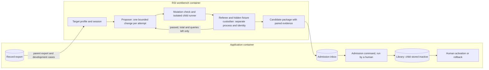

# RSI workbench

`Tier 2 · Part of: [Side systems](README.md) · Serves: Knowledge and Standard`

## What it is

RSI (recursive self-improvement) improves the implementation of one CC and produces a better child version, with evidence.

In M1, RSI is a **workbench**:
- It runs in its own container on the private network ([diagram A](../README.md#deployment-and-access)).
- A human starts each session. It is not automatic and does not run all the time.
- It never touches a live research run.
- A human admits every candidate it produces and activates it by hand.

This is PRD Phase 2, "Local-Isolated RSI Implementation", which is part of M1. PRD V.10 makes it an implementation commitment. The code and interfaces are built and their real status is recorded. Validation, running the adversarial suite and activation are deferred from the PRD core gate, and the Phase 2 completion report separates implementation from validation. The work never blocks a run ([D40](../method/decisions.md#d40)).

## Why

`Knowledge`. CCs are versioned and checked, so they can be improved safely. A child is a new version, compared with its parent on tests the improver never sees. Agents can game their own tests or weaken their own checks. So the referee, the hidden fixtures and the checks stay outside anything RSI may change (PRD 4.4).

## How it works

**Diagram level:** components and containers. Activation affects future runs only. Runs that are already frozen keep their pins.

1. **Pick a target.** A human picks one admitted parent CC version and a frozen target profile. The profile states the mutable files, the fixed contract, the visible tests, the fixture splits and the scoring adapter.
2. **Propose.** The proposer makes one bounded change per attempt. It reaches models through the workbench's own bridge instance, with its own allowlisted credentials, never the app's.
3. **Mutation check and test.** The mutation check rejects any change outside the mutable paths. The child runner runs the parent's required tests on the child.
4. **Score.** The referee scores the child on hidden fixtures. The proposer sees only passed, total and queries left.
5. **Compare once.** At the end of the session, the referee makes one final comparison against the original parent. If the child qualifies, the workbench writes a candidate package to the admission inbox.
6. **Admit and activate.** A human runs the admission command. It checks the package again and stores the child as an inactive library version. A human then activates it, or rolls it back.

## Now and later

| Now (M1) | Later |
|---|---|
| Target 1: code changes to the pure `rank_opportunities` helper in a sandbox copy of Screening (PRD 4.4, required) Target 2: Screening prompt and work rubric, conditional on the headless model path (the Codex CLI in M1) | Automatic generation of further targets (November, [D21](../method/decisions.md#d21)) |
| Human-run sessions, manual admission and activation | Automatic admission into future plans (November, the M2 increment, [D21](../method/decisions.md#d21)) |
| One child per session | Population search, cross-capsule credit, learned judges (PRD blacklist for M1) |

## Do not block

- CC versions are immutable. A child is a new version with lineage.
- Check bundles, profiles, referee rubrics and hidden fixtures live outside every CC.
- Every invocation record carries run, attempt, CC name, version and declaration hash.
- The library is data. Admission writes a record.

## Feeders and users

**Feeders**
- The record export: invocation records, gate decisions, verifier assessments and run bundles
- The admitted library snapshot
- The target profile
- Approved public reference snapshots

**Users**
- The admission command, which stores the inactive library version
- The human who activates or rolls back
- The platform benchmark runner, which can compare a candidate with its parent under an evaluation profile

## Build criteria

| ID | Criterion |
|---|---|
| RSI-1 | With the workbench absent, the hot path builds, starts and passes its tests. No hot-path module imports RSI code. |
| RSI-2 | A planted good child of `rank_opportunities` qualifies. A planted bad child is rejected before any hidden query. |
| RSI-3 | A change outside the mutable paths is refused and ends the session with a security halt. |
| RSI-4 | The proposer never receives case IDs, expected answers or hidden fixture contents. |
| RSI-5 | The admission command re-checks the package and the custodian signatures, stores the child inactive, and needs a separate human activation. Activation first makes the child selectable in the RSI workbench sandbox. The parent stays active. A human adopts the child into live runs by a promotion to `live_plans` and a new static template ([D46](../method/decisions.md#d46)). A rollback is a standing move and builds no version. |
| RSI-6 | The hash chain of attempts verifies before admission. |

Rulings against the received RSI v0.2 design are in [owner rulings](owner-rulings.md#rsi-v02).

## Interfaces and owners

| v0.2 label | Interface | Owner |
|---|---|---|
| A | Library snapshot and compatibility | Architecture (library snapshot contract) |
| B | Invoke a child under a development scope | RSI owner, using the shared runner library inside the workbench |
| C | Observation records | Platform writes the record export. The RSI owner builds its envelope from it. |
| D | Development export and cases | Platform writes the export. The RSI owner builds cases. |
| E | Target profile | RSI owner writes it. The architect approves it. |
| F | Oracle operations (reserve, seal, final) | RSI owner implements them. The [custodian](#hidden-fixture-custody) is the RSI owner team. |
| G | Admission and activation | Platform admission command, run by a human |
| H | Model generation | The workbench's own model bridge instance |

## Hidden-fixture custody

`Standard`. The **custodian** is the RSI owner team. Until the team names a person, the architect holds the role. The role may be held by one person at a time, and a module author cannot be the custodian of a target they wrote.

The workbench container enforces custody with a filesystem identity:
- The hidden fixture store and the scoring logic belong to the OS user `rsi_custodian` with mode `0700`. The referee process runs as that user.
- The proposer and the child runner run as a different user, `rsi_worker`. That user has no read access to the store, to the referee's memory or to its working directory.
- Only the custodian registers, changes or retires a fixture. The custodian does this by running the registration command as `rsi_custodian`. Every registration writes a lineage record.
- The store is never mounted into the app container or the sidecar container. The app container boot check asserts the store path is absent or unreadable for the runner and executor identities, and halts startup if it is present and readable ([platform](../platform/README.md#container-startup-ipc-and-storage-obligations)).
- The workbench boot check asserts that `rsi_worker` cannot read the fixture store, and the workbench refuses to start a session if it can.
- `rsi_custodian` signs the referee evidence and the session result with a key that `rsi_worker` cannot read. Only `rsi_custodian` can write to the admission inbox mount. The admission command verifies the signatures against the custodian public key that the operator pinned in the operator config (`rsi.custodian_public_key`). A package without valid signatures is blocked (`referee_signature_valid`, [D46](../method/decisions.md#d46)).

The custodian also owns split registration, the lifetime query count and the contamination decisions. Disclosed material moves to development only through a recorded reclassification ([data needed from day one](#data-needed-from-day-one)).

## Responsibilities and semantic connections

| Responsibility | Inputs / outputs | Boundary |
|---|---|---|
| Target profile | Eligible immutable parent, explicit mutable files/paths, fixed contract, visible tests, fixture split identities, scoring adapter and improver settings | Target-specific content stays here. Shared engine does not branch on a capsule name. |
| Session controller | Profile, frozen policy/evaluator/configuration, resource budget / session and ordered attempts | One bounded candidate change per iteration; no production DAG participation. Parent/child use comparable effective settings. |
| Proposer | Authorized implementation copy, visible failures and approved aggregate feedback / candidate change and rationale | No hidden cases, oracle secrets, gate/check edits or activation permission. |
| Write check and isolated child runner | Candidate diff and parent contract / allowed candidate plus visible/parent-test results, or refusal | Trusted enforcement outside mutable code; validate full affected dependency closure. A declaration cannot grant more authority. |
| Fixture oracle and independent referee | Exact parent/child and sealed split identity / permitted counts and protected scoring evidence | Custodian owns hidden data, scoring and lifetime query count. Child runs cannot read expected outputs or the fixture store. |
| Evidence/export builder | Session, attempts, parent/child identities, scoring, limits and violations / reconciled report and allowed paired records | Raw evidence is protected; proposer receives only its permitted view. General export never copies hidden content. |
| Admission inbox, admission command and human activation | Candidate package in the inbox: lineage, compatibility and protected evaluation evidence / admitted inactive version or refusal | Explicit human selection makes the child selectable in the RSI sandbox; adoption into live runs is a separate human promotion plus a new static template ([D46](../method/decisions.md#d46)); preserve rollback. Target 1's deliverable remains sandbox child/evidence, not a changed live sum/ranking policy. |

[RSI contracts](../reference/rsi-contracts.md) define these connections. The proposer uses the workbench's own instance of the audited model bridge, with its own session, limits and credentials, and no control over the referee. The parent export and the isolated target never gate core work. The pure helper, fixed parent contract and meaningful fixtures are runtime prerequisites for actual optimization. Native headless calls and existing RSI components are reuse leads; they must cross the shared audited model/evidence boundary rather than create another unaudited model client.

Target 2 is conditional M1 work. It is available when the headless model path exists, which in M1 is the Codex CLI (PRD 4.4.1). It may mutate the Screening work prompt and work rubric, which the Screening declaration lists in `evolution.may_change`, while the required dimensions and the downstream interface remain fixed. A **work scoring rubric** is distinct from a **runtime verifier CC / RSI referee rubric**. The latter is always frozen (PRD 4.4.9). If the headless model path is not available, Target 2 is reported `BLOCKED`; this does not block the core or the separately buildable Target 1.

## Data needed from day one

Keep parent/candidate declaration and implementation identities, interface/frozen-contract identity, target profile, diff/rationale, improver version/policy, evaluator/scoring/split identities, model/configuration identity, call/time observations, visible and protected comparison outcomes, query counters, stop reason, violations, admission and activation history. Associate all evidence with session/attempt and applicable run/export provenance. Record unsupported fields as unavailable, not invented measurements.

Development data, hidden-loop, hidden-final and milestone/platform data are distinct partitions with overlap checks and explicit permitted consumers. An exported failure case can become development material only through its allowed audience; it does not become a hidden expected answer in the proposer context. Keep hidden-final results out of future proposal feedback.

The adopted RSI protocol includes **30 hidden-loop queries per session and 90 per loop-set lifetime**, loop feedback restricted to passed/total/queries-left, and final evaluation once per session by the custodian. Preserve its fixture-size/headroom and planted-child calibration requirements (including at least 20 cases per hidden split, 10 known-bad and 3 known-good planted children), paired comparison rules and model-backed repeated-fixture aggregation. These numeric limits are retained architecture policy; the current PRD specifies bounded use, headroom and calibration qualitatively. They are standardization choices, not claims of optimal thresholds or verbatim PRD values. The owning specification must define concrete scoring/repetition procedures consistent with the frozen protocol and these boundaries; no majority-vote shortcut or success-rate claim may replace paired comparison evidence.

Admission follows allowed change, parent-test preservation, contract compatibility and evidence integrity. A stronger score alone is insufficient. Execute and reconcile the required security/violation suite: hidden reads/leaks, referee tampering, forbidden mutation, permission escalation, evidence tampering, resource abuse and promotion bypass. [Callback rules](../platform/failure-and-recovery.md#rsi-workbench) distinguish expected candidate rejection from session/security failure and human activation.

## Future recursion without weakening the referee

Version the improver's proposal policy, target selection, context recipe and decision evidence now, even though M1 keeps them fixed. A future eligible improver change is itself a candidate evaluated on held-out **improvement tasks**, with improver-quality measures separate from capsule score. The improved component must actually drive later rounds to justify a recursive claim. Keep referee, hidden-suite author, oracle, hard limits, security, contracts and evidence authority outside both mutation levels.

A shared loop plus target profiles should allow a new deterministic development target without rewriting oracle, mutation check or record logic. Richer optimizers, multiple candidates, learned judges, new hidden-suite generation, cross-capsule credit, fusion and live installation remain separate future decisions. Preserve the interfaces and observations now; do not implement speculative optimization machinery to fill out a field list.

## Approved reference retrieval

“Offline” means outside the live research DAG, with controlled isolated evaluation; it is not an absolute ban on approved reference access. Latest §§1.3/4.4.9 permit allowlisted read-only public benchmark/repository retrieval. Protected preparation records origin, license/provenance, immutable revision/content hash and local snapshot before session use. Public references remain separate from hidden-loop/final data; no uncontrolled network, external write or hidden-data transmission is authorized. A missing approved reference blocks only the dependent profile; locally prepared Target 1 fixtures need not wait for network access.

## Integrity and session clearance

Trusted RSI capture maintains ordered hash-chained attempt records: session/attempt sequence, previous-record hash, exact candidate/parent identity and evidence/outcome references. Define a pinned serialization/hash profile; the first record identifies the chain root. Before admission, verify chain continuity, lineage resolution and that reported scores reconcile with custodian evidence. The proposer cannot author protected observations or replace a prior record. Missing/tampered history blocks admission.

A security halt requires explicit authorized human clearance before a new autonomous session; record actor, violation, corrected boundary and verified guardrail evidence. Clearance cannot waive restrictions or erase the halted session. Calibration must show measurable headroom under the frozen target scoring profile before optimization. The profile states improvement measure, minimum meaningful delta and eligibility rule; demonstrate an attainable stronger planted child, not an assumption that every target can improve. Missing headroom blocks the target rather than prompting hidden-suite rewriting.

## Qualification rule

`Standard`. This rule follows PRD 4.4 and the RSI owners' v0.2 rule ([rulings](owner-rulings.md#rsi-v02)). Before any hidden evaluation, the child must pass three things:
- the parent's mandatory tests;
- port and effect compatibility;
- the mutation limits.

Then the final comparison against the original parent decides.

| Hidden-fixture result | Rule |
|---|---|
| Child passes more fixtures | The child qualifies only when all three of these hold:  1. The absolute pass-rate gain is at least 0.05.  2. The child fails no fixture that the parent passed (zero protected regressions).  3. A one-sided exact paired binomial test at the 0.05 level supports the gain over independent fixture units.  Without a defensible independent-unit design, the result is `INCONCLUSIVE`. |
| Equal passes | Time breaks the tie (PRD 4.4.2). The child qualifies only with zero protected regressions and a calibrated timing gain, measured like this:  1. Protected preparation fixes the host, the runtime, the workload sizes and identical batches.  2. The referee runs 5 warm-up batches, then 7 paired rounds in alternating order.  3. It compares the medians of the paired batch durations.  4. The child must be at least 10% faster, and the gain must be more than three times the calibrated timing noise. |
| Child passes fewer fixtures | The child never qualifies. Timing cannot make up for fewer passes. |

**Target 1 rules.** Target 1 keeps:
- the sum-of-three scores;
- stable ascending-ID tie order;
- the Top-1 output.

**Policy values.** The values above are calibrated choices, not measured truths. The profile pins them before any code is proposed.

**Calibration.** Calibrate with planted good and bad children, using the unchanged interface and the same hidden-fixture custody. A parent with no measurable correctness or timing headroom is `BLOCKED`. Never do any of these to get an improvement:
- weaken a production parent;
- invent passing cases;
- adapt the hidden tests;
- move the thresholds.

If small workloads cannot be timed reliably, either use a predeclared larger batched workload within the helper's interface and budget, or block.

**What the proposer can see.** Hidden-loop scoring shows the proposer only passed, total and queries left, plus its visible development observations.

**The final comparison** runs once per session. An authorized terminal export may show paired aggregate counts and times. It never shows case IDs, expected answers or hidden contents. Exported final evidence never returns to the proposer's context.

Live production ranking stays unchanged in M1.

**Custody representation:** attempts pin `hash_profile_ref` and `chain_root_ref` to a protected genesis record fixed before attempt 1. Genesis pins session, target and hash profile; it contains no attempt hash. Attempt 1 has null previous_ref; later attempts link the immediately preceding exact record in the same session and retain the same root/profile. The [security-clearance fields](../reference/rsi-contracts.md#security-clearance) record incident, actor, remediation and validated guardrail evidence; denied or incomplete clearance cannot start a new session. Clearance is separate from child activation and never restarts the violated session.

## Continuation admission boundary

D21 adds November automatic candidate generation and protected admission. M1 human activation remains the original policy; the November admission controller may make a passing immutable version selectable for a future plan automatically. RSI supplies candidates and paired evidence, never eligibility authority or policy changes. A missing RSI service does not block independent Generalist generation, the working core or platform benchmarks. Composition/fusion is deferred to December.

## Residual risks

`Standard`. PRD 4.4.10 asks the design to document what it does not remove. These risks remain in M1. Each has a bound.

| Risk | Why it remains | Bound |
|---|---|---|
| Hidden-fixture information leaks through repeated aggregate counts | Pass counts and query totals reveal a little each time | Counts only, a lifetime query limit per fixture, and retirement of a fixture that a recorded contamination decision marks |
| The custodian key is stolen or misused | The key lives on the workbench host under `rsi_custodian` | The operator pins the public key and rotates it. Admission re-checks every package. A human still activates, and only for the sandbox in M1 |
| Candidate code escapes its OS identity | The proposer, the child and the referee share one container under different OS users. Container isolation is not a proof | The boot checks, fixture custody and the security violation suite (RSIV-1 to RSIV-13). An escape ends the session as `SECURITY_HALTED` and needs a human clearance |
| A prompt injection steers the proposer | The proposer reads visible failures and feedback | The proposer sees counts only. Any change outside `may_change` is refused and halts the session |
| Overfitting to the hidden loop split | Many sessions on one target teach the proposer about the split | The final split is read once per session. Reclassification moves disclosed material to development |
| A human activates a weak child | Activation is a human choice | The child is `active` in the sandbox only. Live runs need a second human step (promotion and a new static template), and a rollback is a standing move |
| Timing noise at the tie-break | The helper is small and fast | Calibration, 7 paired rounds and the noise multiplier. No headroom means `BLOCKED`, never a relaxed rule |
| Examples are synthetic | The package holds no measured RSI run | Examples teach shape only. Acceptance needs real runs |
