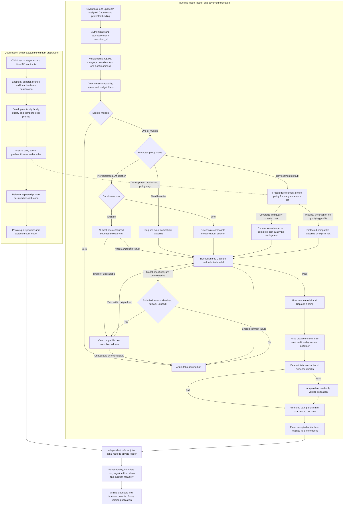

# CS/ML Model Router: M1 Design and Benchmark Workflow

Version: v2.1 · Date: 2026-10-13 · Status: technical design; not yet implemented

Requirements authority: the user's latest domain restriction (`domain=cs_ml`), [BENCHMARK_REQUIREMENTS.md](BENCHMARK_REQUIREMENTS.md), and the supplied Capsule architecture. The benchmark is Draft v0.10, dated 2026-10-08; its owner approvals remain separate and unchanged. This design adopts its requirements for evaluation and identifies proposed targets as proposals. Historical PRD family/API assumptions do not override the benchmark's explicit M1 fixed-DAG, pass-through binding, and Codex CLI adapter boundary.

English design revision v2.1 organizes Section 2.5 by the eight CS/ML task categories, with shared candidates counted once. The v2.0 redesign replaces the broad scientific arsenal with a bounded CS/ML qualification pool and redesigns the complete qualification → development-profile → protected calibration → routing → execution → scoring process. The prior upstream-selected Capsule boundary remains intact. No endpoint deployment, paid inference, benchmark campaign, or measured savings is claimed by this document.

## 1. Target

### 1.1 CS/ML Domain and Routing Objective

The domain is **CS/ML**. Huawei-interest technology research is the business context; the user's explicit CS/ML restriction governs inclusion. A case must investigate a computer-science or machine-learning research question through evidence, a method comparison, bounded implementation, or reproducible evaluation. Routine coding, generic chat, and unrelated scientific applications do not constitute a research case by themselves.

The Router makes one decision: **choose one model for exactly one Capsule already assigned upstream**. In current M1, a fixed sequential DAG names the Capsule and a pass-through binder supplies its immutable declaration and protected execution context. The Router does not choose Capsules, generate plans, change the graph, or add repair loops. The actual admitted library is expected to contain roughly 6–10 Capsules; record its real size and pins rather than manufacturing more Capsules to match model categories.

The benchmark objective is **retain independently verified task and verifier quality while reducing complete execution cost against fixed `gpt-6.1-sol` with the same Capsules, plans, inputs, tools, budgets, and hardware** (RT01–RT07). The proposed 20% cost reduction and 2-percentage-point non-inferiority margin require preregistration and sufficient paired evidence; they are not achieved results or unconditional release commitments.

The runtime has one Executor type. `workflow_stage` and `call_function` describe work and attribution, including an independent verifier invocation, rather than separate Planner/Coder/Reviewer executor types. One execution retains one Capsule, implementation/dependency closure, and model binding. Each verifier has its own protected assignment, context, limits and route; the producer cannot select its verifier's instructions or profile.

### 1.2 Task Categories Within CS/ML

`task_category` is independent of `workflow_stage`. The snake_case values in the table are the interface enum; C01–C08 are traceability IDs, not alternative enum values. A database experiment can include requirement compilation, search, screening, hypothesis, implementation, benchmarking, evaluation and delivery. These categories label the given task and measured model fit; they do not select or multiply Capsules.

| ID / task_category | Research questions and bounded work | Independent evidence/checks |
|---|---|---|
| C01 / `ml_methods_and_inference` | Compare inference batching, quantization, KV-cache/context strategies, representation methods or bounded ML pipelines | Frozen datasets/configurations; accuracy/calibration versus memory, throughput and latency; no full-model training requirement in initial M1 |
| C02 / `retrieval_and_knowledge_systems` | Retrieval/RAG, embeddings/reranking, corpus/index updates, evidence deduplication and grounded synthesis | Relevance/answer labels, citation identity, retrieval correctness, update/query cost; extraction/relevance is not factual truth |
| C03 / `algorithms_optimization_and_formal` | Scheduling/search/graph/optimization algorithms, complexity claims and bounded CS/ML theorem obligations | Reference results, adversarial tests, numerical tolerances; pinned Lean/kernel checks for formal outputs |
| C04 / `software_systems_and_performance` | OS/runtime/compiler/concurrency/cache/kernel and research software performance | Reproducible workloads, regression tests, profiling provenance and fair baselines; coding serves a research objective |
| C05 / `databases_and_data_processing` | Query/index strategies, transactional or streaming behavior, data pipeline efficiency | Exact query/invariant results, controlled data distributions, update/query measurements and leakage checks |
| C06 / `networking_and_distributed_algorithms` | Routing/scheduling/congestion protocols, topology/workload effects and network-performance prediction | Single-host bounded simulation or captured measurements; surrogate versus independent reference; no distributed DAG deployment requirement |
| C07 / `security_and_reliability` | Program analysis, robustness/fuzzing, isolation/integrity, prompt-injection and failure behavior in CS/ML systems | Independently planted faults, safe expected halt, boundary evidence and false-advance/block measurements |
| C08 / `experimental_evaluation_and_technical_data` | Statistical evaluation, technical telemetry, technical tables/figures and bounded vision/representation studies | Preregistered metrics/splits/uncertainty, chronological holdout, exact arithmetic, fitted-head provenance and claim support |

All eight categories remain within CS/ML. Biomedical/omics, drug discovery, molecular chemistry, atomistic materials, PDE/physical-science research, astronomy and weather/geospatial applications leave the pool. A vision or forecasting model is retained only for a declared ML or technical-system case, never to restore those removed application domains.

### 1.3 Delivery and Evaluation Profiles

| Profile | Active behavior | What can be claimed |
|---|---|---|
| `m1_fixed_native` | Fixed DAG, pass-through Capsule bindings, required static Codex CLI adapter, independent gates | Static binding, fixed-workflow execution, call attribution and fault-interface conformance |
| `fixed_requested_baseline` | Exact requested `gpt-6.1-sol` deployment/settings through a qualified adapter; same given Capsules | Benchmark baseline when callable; record any incompatibility with the required native adapter |
| `bounded_csml_routing` | Qualified alternate deployments; frozen development-derived selection profiles; one model per execution | Real S07 quality/cost comparisons only after RT06 calibration and oracle qualification |
| `later_dynamic` | Dynamic planning/discovery or broader resumability only when separately delivered and tested | Explicitly later; no dynamic selection/planning score inferred from current M1 |

API-served alternate models do not silently replace the static Codex CLI product requirement. If `gpt-6.1-sol` cannot run through that required adapter, retain distinct manifest/configuration records and report the limitation. When alternate routes are unavailable, M1 remains fixed-route; mocks establish interfaces, not model quality or savings.

### 1.4 Execution Hosts and Model Services

CPU-compatible experiments default to Huawei MRGF-X, nominally 16 GB RAM; use its **actual available** memory after OS/runtime/evidence overhead. GPU-required cases may use the available local GB10, with 128 GB **shared unified** memory and nominal 2 TB SSD; architecture, drivers, available memory and free storage must be measured. No cloud GPU, undeclared host switch, or assumed Arm compatibility is allowed.

The experiment host and the model-service route are separate fields. Authorized vendor inference APIs can be called through the governed bridge; this does not authorize renting cloud GPUs for experimental execution or local-model serving. Self-hosted executor/tool candidates require a measured compatible service on the permitted local hardware. The Router does not download, train, or start model servers.

Before **every test and repeat**, persist a timestamped hardware/readiness inventory with host identity, CPU/architecture, cores, total/available memory, accelerators and accessible memory, OS/runtime/drivers/dependencies, storage/free space, process limits, concurrency and case budgets (B14/B17). Refresh dynamic availability. Record unavailable fields/reasons and both orchestration and experiment hosts if they differ; M1 remains a single-host DAG. Pair comparisons on the same host/accelerator configuration and serialize resource-intensive runs by default.

## 2. Implementation Breakdown

### 2.1 Complete Workflow and Component Responsibilities

The offline qualification/evaluation lane and the runtime lane have separate authority and data. The benchmark referee's held-out labels, per-item calibration outputs and qualifying tiers are never Router inputs.



The diagram summarizes the process; every failure, audit-write failure and exhausted routing deadline ends attributable work. The default development policy applies its quality/coverage rule even to a singleton; only selector invocation is skipped. The fallback can run at most once, inside the original candidate set, before freezing, and a fixed-baseline comparison halts unless a separately declared fault profile explicitly permits substitution. A shared Capsule/contract failure or any post-freeze failure never triggers model switching. The optional selector cannot choose another Capsule, inspect the private ledger, or act as the scoring oracle.

| Component | Required responsibility |
|---|---|
| Upstream fixed DAG / binder | Pass through exactly the declared admitted Capsule and concrete protected assignment; no generated M1 planning call |
| Host launch/preflight | Capture hardware before each test/repeat, enforce selected local host budgets and block incompatible resources |
| Capsule Input Adapter / Normalizer | Preserve current declaration schema; derive/check trusted task/category/input/policy aliases and runtime requirements |
| Model Registry / Qualification | Separate published identity, actual callability, verified capabilities, task evidence, costs and current availability |
| Development Profile Builder | Use development data and independently valid checks to estimate per-contract quality/complete cost; freeze version before held-out tests |
| Compatibility Filter | Deterministic capability, disclosure, contract, scope, host/dependency and remaining-budget checks |
| Route Policy / Optional Selector | Default deterministic measured-profile choice; optional separately measured bounded LLM ablation |
| Route Finalizer / Executor | Atomic ownership, same Capsule/pins, one frozen model, final dispatch checks, no hidden retry/failover |
| Protected verification/gate | Mechanical checks then independent semantic assessment; persist authoritative decision before downstream release |
| Independent benchmark referee | Private RT06 calibration, eligible oracle, matched comparisons, RT07 cost/quality joins and explanatory reports |
| Audit / offline improvement | Record all calls/effects/outcomes and diagnose changes; later versions require offline qualification and human-controlled activation |

### 2.2 Model Capability Registry and Development Profiles

A registry entry identifies an exact deployment configuration: `model_id + provider + provider_model_name/checkpoint + endpoint_ref + adapter_id + revision`. Local and hosted copies, quantizations, tool parsers, reasoning settings and different served versions are distinct configurations when they change behavior/cost; avoid duplicate entries with no measured purpose. Keys remain in the credential system.

| Record / fields | Required meaning |
|---|---|
| Identity and access | Stable `model_id`, exact API/checkpoint, provider, endpoint/adapter/configuration revision, credential reference, license status, `access_mode` and enabled/current availability |
| Declared versus verified capability | Modalities, context/output limits, tool/action grammar, structured-output mode, tokenizer and supported parameter settings; endpoint-specific dated verification and effective limits |
| CS/ML scope | Nonexclusive `task_categories`, method/contract compatibility, permitted producer/verifier profile scopes; category labels do not certify performance |
| Runtime state | Actual enable/disable/access outcome, credential-scoped limits when available, sourced provider observations with endpoint/time scope; unknown quota/status is not invented |
| `DevelopmentQualityCostProfile` | Task category, exact Capsule/method contract, deployment/settings, language/input/context/tool stratum, development split/version, oracle eligibility, sample/repeat counts, pass/quality estimate and uncertainty, complete expected call/latency/cost basis |
| Profile validity | Pin measured scope, quality floor, uncertainty rule, freshness/version and supported resource envelope; requalify changed model/adapter/contract/prompt/tool configuration |
| Audit provenance | Requested/effective identity and its basis; provider/local/unavailable usage; actual tariff/pricing revision versus explicitly modeled estimates |

`resource_tier` (model/deployment size), monetary class, and measured task quality remain distinct. A small model may qualify for a difficult bounded contract; a frontier brand cannot automatically qualify. Public model-card/paper results are `advisory_evidence`, confined to the actual checkpoint, dataset and attempt budget. They are not this benchmark's pass rates, item difficulty or cost tiers.

Three readiness levels prevent confusion:
1. **Source-qualified**: official identity/artifact/license/method has been inspected; actual account/service access and capability fit may still be unknown.
2. **Runtime-qualified**: the exact endpoint/adapter passes required callability/capability, permissions and host checks; provisional compatibility/fault tests may use it.
3. **Benchmark-ready**: fixtures/oracles and selector are frozen, real repeated RT06 calibration is complete for the scored items, and quality/cost measurements have adequate provenance. Unresolved items remain in outcomes; their difficulty/regret are unavailable.

Unknown internal quality does not require invented scores or block a basic integration probe. It **does** prevent claiming measured cheap-tier qualification, routing savings, difficulty or regret without the required real calibration. The runtime receives frozen **development aggregate** profiles only; a held-out per-item tier/cost ledger is protected referee data.

For the API branch, a metadata listing/HTTP 200 is not inference verification. Verify tools, native structured output when required, modality and context limits independently. For the native Codex branch, qualify its adapter/configuration and telemetry separately. Account subscription/credit observations are not per-model remaining quota or per-call price.

### 2.3 Given Capsule Declaration and Bound Execution Context

The Capsule format is taken from the supplied [current declaration field reference](../../tests_whether_we_need_spec_kit/test_with_spec_kit/docs/code/Missions/M0/source/Architecture_context/design-package/capsule/declaration.md) and [exact declaration schema](../../tests_whether_we_need_spec_kit/test_with_spec_kit/docs/code/Missions/M0/source/Architecture_context/design-package/reference/schemas/capsule-declaration.schema.json). The current architecture-owned `schema_version` is `1.0.0`, with required root groups `identity`, `ports`, `needs`, `changes`, `guarantees`, `budget`, `evolution`, and `coverage`. Historical `sources/capsule.schema.json` and v2.10b semantics are provenance, not interchangeable current JSON.

The [model-routing boundary](../../tests_whether_we_need_spec_kit/test_with_spec_kit/docs/code/Missions/M0/source/Architecture_context/design-package/model-routing.md#registry-and-two-stage-selection) assigns capability binding upstream and prohibits Router capability substitution. In current M1 the DAG already names the admitted Capsule, and the binder passes that assignment through. It introduces no Router-owned Capsule registry or discovery algorithm. A read-only resolver may load an exact supplied reference/hash; it must not resolve an unversioned name to a newer/default Capsule.

#### 2.3.1 Information Available from the Existing Capsule Format

| Existing Capsule field | Information supplied to model routing | Use and boundary |
|---|---|---|
| `identity.name`, `version_label`, `kind`, `summary` | Capsule identity/version, execution style, and task-independent purpose | Pin the method and give the selector a bounded method summary; these are not measured model-quality labels |
| `identity.carrier.{ref,sha256}`, `body[].{path,sha256}` or `remote.{endpoint,version,interface_version_range,fingerprint}` | Exact local implementation closure or supported remote interface | Executor loads the pinned method; reference sizes and supported load mode inform context estimation. A remote Capsule endpoint is not automatically an executor model endpoint |
| Optional `identity.load_mode`, `overlays[]` | Explicit loading mode and pinned instruction/experience layers | Include supported layers in execution and context estimates; unsupported modes block readiness |
| `ports.inputs[]`, `ports.outputs[]` with `name`, `artifact_type`, `schema_ref`, `required`, `description`, `check_ids` | Typed input/output contracts and declared checks | Derive modality and serialization requirements from the bound artifacts and supported adapter. A JSON output schema alone does not require provider-native JSON-schema generation |
| Optional `needs.model.{tool_calling,min_context,modalities,families,excludes}` | Direct model capability and family restrictions | Required tool calling, minimum context, and modalities are hard filters; present family restrictions/exclusions narrow eligibility. `tool_calling=false` imposes no positive tool requirement and does not prohibit a tool-capable model |
| `needs.when[]`, `external[]` | Prerequisite predicates with native `evaluable_at=planning/dispatch/both`, and pinned packages/data/models/services/secrets; explicit floating dependencies | Upstream resolves dependency pins and planning readiness; the runner evaluates dispatch/both predicates before governed use. Required unknown prerequisites cannot silently pass. A pinned typed model/tool dependency is not an alternative executor candidate |
| `needs.network.{mode,direction,allowlist}`, `resources[]`, `injects[]` | Declared disclosure, resource, and injected-service needs | Check against effective runtime authority. `network.mode=none` can coexist with a specifically authorized injected model bridge; it grants no direct socket/network access |
| `changes.effect_class`, `effects[]`, `provides[]`, `invariants[]` | Effect scope, repeat safety, reversibility, and invariants | Respect read/write and side-effect boundaries supplied by the runner; a declaration grants no authority and cannot justify a model switch/replay |
| `guarantees.checks[]`, `acceptance`, `evals`, `unanchored`, optional `quality`/`exempt` | Output checks, evaluation scope, and unsupported claims | Summarize the required result and validation method; declared checks or quality claims are not verified model quality or runtime acceptance |
| `budget.per_call.{wall_s,invocations,tokens,cost,tool_calls,iterations}`, `enforcement`, `on_exhaust` | Required wall-time/invocation bounds and optional token/cost/tool/iteration bounds with enforcement modes | Combine comparable dimensions with runtime ceilings and remaining budgets. Preserve `hard/between_calls/post_hoc`; unavailable telemetry cannot be described as a hard-enforced bound |
| `evolution`, `coverage`, optional `ext` | Frozen-contract promises and advisory/diagnostic notes | Retain provenance where needed; advisory notes and extensions cannot change model eligibility, permissions, or acceptance |

For a concrete existing example, [Capsule_Declaration.json](../../tests_whether_we_need_spec_kit/test_with_spec_kit/docs/code/Missions/M0/source/Architecture_context/design-package/reference/examples/Capsule_Declaration.json) declares `identity.name=intent.compiler`, `version_label=example-1`, `kind=agent`, `needs.model={tool_calling:false, modalities:["text"]}`, and `budget.per_call={wall_s:60, invocations:1, tool_calls:0}`. It also declares the injected `audited_model_bridge` with direct network access disabled. These fields support a text-model route without assuming native tool calling; the output remains checked against the declared Intent schema. The example's fixture pins demonstrate the format, not production admission or a preselected model.

#### 2.3.2 Given Input and Router-Derived Projection

The upstream protected binder passes one `SelectedCapsuleInput` directly in `RouteRequest`. The current declaration remains intact; routing-specific fields are carried in the envelope or derived context, not added to the closed Capsule schema.

| Given input | Required contents and source |
|---|---|
| `declaration`, `declaration_ref` | Complete current-schema declaration plus its immutable `{id,sha256}` identity, backed by supplied or exactly resolvable original artifact bytes; verify the hash against captured bytes, not a newly serialized JSON object |
| `node_contract_ref`, `subnode_contract_ref` | Exact finalized protected contract identities/hashes; the subnode binds one CC and belongs to the supplied node/run/attempt |
| `bound_context` | Protected runtime `run_id`, `node_id`, `subnode_id`, `attempt_id`, and `invocation_id`; projection of the chosen `binding.id`, `declaration_ref`, `implementation_refs`, `dependency_refs`, `admission_ref`, `effective_authority`, and `limits`; also named concrete inputs/outputs, objective, `subnode_limits`, parent limits/remaining budget, policy/configuration refs and any requested seed |

The existing [Subnode Execution Contract](../../tests_whether_we_need_spec_kit/test_with_spec_kit/docs/code/Missions/M0/source/Architecture_context/design-package/reference/node-execution.md#concrete-subnode) provides these binding fields; the governed runner supplies the invocation identity. Record the trusted mapping between these architecture identities and `workflow_id/task_id/execution_id` rather than assuming the strings are interchangeable. `effective_authority` names `network`, `network_allowlist`, `resource_reads`, `write_roots`, and `tools`. It is the intersection of admission, parent node, subnode, and run policy. The supplied projection is constructed or verified by trusted server code; client- or Capsule-authored permissions are not sufficient. The [Intention_Subnode_Contract.json example](../../tests_whether_we_need_spec_kit/test_with_spec_kit/docs/code/Missions/M0/source/Architecture_context/design-package/reference/examples/Intention_Subnode_Contract.json) illustrates actual input hashes, implementation/dependency/admission pins, the allowed bridge, and `limits.model_calls`.

The Capsule Input Adapter derives `CapsuleRoutingContext`: normalized `capsule_id=identity.name`, `capsule_version=identity.version_label`, declaration/contract/implementation/dependency hashes, bound objective/accepted-input summary, method summary, typed ports, required capabilities, effective tool/disclosure scope, budget/enforcement dimensions, and context-estimation references. The declaration hash is its exact-byte identity; any semantic contract hash is separately computed under a pinned hashing profile. The derived projection is recorded with its adapter revision so that its requirements remain explainable.

`domain`, `task_category`, `workflow_stage`, `call_function`, host/development-profile refs, user preferences, native structured-output requirements, `model_allowlist`, selection priority, and `fallback_model_id` are runtime/envelope fields, not fields of the current Capsule declaration. Task labels come from the upstream task/contract; additional model requirements and allowed endpoint/family scopes come from the protected routing profile and explicit request constraints. The profile supplies at most one predefined executor fallback for the given Capsule/contract. An omitted optional allowlist adds no restriction; an explicit empty effective scope means no model is authorized. Guard/checking profiles retain their independent owner and are not repurposed as model-selection preferences.

The trusted request domain is `cs_ml` and `task_category` is a snake_case enum value from Section 1.2, whose traceability IDs are C01–C08. `workflow_stage` identifies the fixed research stage or independent verifier assignment. These are runtime/envelope metadata, not new Capsule declaration fields. Current M1 preserves its actual roughly 6–10 admitted Capsules; category tags do not authorize new Capsule classes or dynamic selection. Code/tool-only work without a model call remains governed runner work and needs no model RouteDecision.

### 2.4 Routing, Profile and Evidence Contracts

| Object | Required information and authority |
|---|---|
| `RouteRequest` | Correlation IDs and trusted user; `domain=cs_ml`, `task_category`, `workflow_stage`, `call_function`; bound-task summary/input/policy aliases; required `selected_capsule: SelectedCapsuleInput`; exact protected model-selection/host/profile refs; hard requirements and authorized preferences |
| `SelectedCapsuleInput` | Complete current-schema declaration, original-byte `declaration_ref`, node/subnode contract refs and trusted `bound_context` from Section 2.3; exactly the assigned Capsule |
| `ExecutionEnvironmentContext` | Given host/launch profile, timestamped hardware inventory/readiness ref, actual remaining memory/storage/time/concurrency budgets, dependencies and accelerator requirement; no host inferred from a model name |
| `CapsuleRoutingContext` | Capsule/contract/binding/implementation/overlay/dependency/admission pins, bound objective/inputs/ports, merged requirements, effective authority, limits/enforcement and context references; task/host/profile projection with adapter revision |
| `DevelopmentQualityCostProfile` | Development-only measured scope, exact deployment/settings, oracle/check provenance, repeated results/uncertainty, full expected cost/latency basis, validity and frozen version |
| `CandidateSet` | Original eligible IDs plus exclusions/reasons, development-profile applicability/coverage, context/limit/cost evidence and available exact-endpoint observations |
| `RouteDecision` | All runtime IDs and given pins; policy/profile/config versions; initial choice and reason; final frozen model; selection method, fallback state/reason, compatible candidate snapshot, deadline and input/context hashes |
| `CallRecord` | Call/route/invocation IDs; `purpose=routing_selection/task_execution` and `call_function=selector/worker/verifier/planner` as applicable; requested/effective model identity and basis, seed/support status, timestamps, outcome, usage/cost provenance and error |
| `ToolCallRecord` | Typed tool/checkpoint/head/configuration, units/time basis/sampling frequency/feature order/normalization, host, input/output refs and checks, limits, job/call IDs, time/usage/cost or unavailable basis; linked to the same Capsule execution |
| `CalibrationLedger` — referee only | Private item/tier/deployment runs, eligible oracle/results, repeats/uncertainty, preregistered pass criterion, cheapest qualifying tier and expected-cost table. Never delivered to Router/worker |
| `BenchmarkRunManifest` — harness | Versioned case/split, fixed DAG/Capsules, router/pool/profile/selector/verifier/oracle pins, hardware inventory, launch/resources, repeat/seed, expected completion/halt, evidence refs and score applicability |

Protected task objective, accepted typed inputs, policy/configuration and assigned metadata are authoritative. Derive or verify top-level aliases; divergence returns `BOUND_CONTEXT_MISMATCH` before any call. Additional hard requirements narrow scope; preferences never replace the objective or widen permission. No top-level client-controlled `role` exists. Protected CC binding labels remain for ownership/authorization and do not create additional Executor types.

`selection_method` is `fixed_profile / single_candidate / development_profile_policy / bounded_llm_selector / compatible_baseline / predefined_fallback`. `fallback_used` records entry into the protected pre-execution fallback path, including recovery after a skipped/invalid selector with no valid initial choice. An ordinary compatible-baseline or policy selection matching the fallback ID does not set it. A static pass-through binder has no planning inference call; `call_function=planner` is recorded only in a separately implemented later profile. Verifier costs are independent execution calls, not free metadata.

The Router receives ordinary task/Capsule data and development aggregate profiles, never correctness labels, held-out calibration outputs, private difficulty, per-item qualifying-tier lookup or referee cost tables. Opaque case/run correlation for post-run joining is not permission to retrieve those protected records.

### 2.5 Bounded CS/ML Candidate Pool by Task Category

**Qualification inventory: 12 Executor deployments/families (`E`) and 12 typed learned-tool methods (`T`), 24 candidate entries in total.** This is a source-informed shortlist, not 24 enabled services, 24 Capsules, or a measured quality ranking. Default pilot prioritization is five executor routes plus the document/IR methods actually required by admitted cases. All new/local access, observed cost/latency, peak memory and benchmark quality remain `unknown` until tested.

`E` selects one frozen model to execute a given model-backed Capsule. `T` is an explicitly permitted typed operation used by that Capsule; it never enters `eligible_model_ids` or serves as executor fallback. A runtime LLM selector (`J`), if used, is a separate pinned configuration reusing the baseline service and is outside the candidate pool. Deterministic simulators, compilers, DB engines and reference checkers are experiment/oracle tools, not extra model entries.

Candidates are organized by the eight CS/ML task categories from Section 1.2. Each complete catalog definition appears once under its closest method/task category; shared-candidate references preserve cross-category coverage without creating duplicate deployments. Catalog placement is a presentation choice, not an exclusive category-to-model mapping. Runtime eligibility continues to depend on the given Capsule, hard requirements, independently owned scope and measured development profile.

`E` and `T` remain invocation-kind labels within each category. All source/qualification boundaries below are retained; moving a row does not enable it or establish new task-quality evidence.

#### 2.5.1 C01: ML Methods and Inference

`task_category=ml_methods_and_inference`. Compare bounded ML/inference methods, representation quality and resource trade-offs. Image/segmentation tools apply only to an admitted ML method study.

| Kind | Internal ID / change | Exact API/checkpoint/artifact and primary source | Task contract and qualification boundary |
|---|---|---|---|
| `E` | `qwen.multimodal4b` / **add** | [`Qwen/Qwen3.5-4B`](https://huggingface.co/Qwen/Qwen3.5-4B) | Compact text/image technical node work and bounded code, Apache-2.0. Requires qualified locally served API/parser; 4B does not prove a full pipeline fits available MRGF-X memory |
| `T` | `vision.dinov2small` / **add; conditional** | [`facebook/dinov2-small`](https://huggingface.co/facebook/dinov2-small), Apache-2.0 | Bounded ML representation/inference experiments; outputs features, not automatically classification/detection labels. Any fitted head and evaluation split are separate pins |
| `T` | `vision.sam21tiny` / **add; conditional** | [`facebook/sam2.1-hiera-tiny`](https://huggingface.co/facebook/sam2.1-hiera-tiny), Apache-2.0 | Prompted image/video segmentation as an ML method study; qualify resolution/frame/batch/CPU versus GPU paths separately |

Shared executors: `openai.economy` and `openai.general` for bounded/general node work, `gemini.research` for technical multimodal inputs, and code routes from C04 for experimental kernels. The telemetry methods in C08 may support a declared inference-system study.


#### 2.5.2 C02: Retrieval and Knowledge Systems

`task_category=retrieval_and_knowledge_systems`. Technical evidence extraction, retrieval/RAG, corpus/index updates, relevance ranking and grounded synthesis.

| Kind | Internal ID / change | Exact API/checkpoint/artifact and primary source | Task contract and qualification boundary |
|---|---|---|---|
| `E` | `openai.economy` / **add** | [`gpt-6-luna`](https://developers.openai.com/api/docs/models/gpt-6-luna) | Low-cost API comparison for bounded technical extraction, structured node work and local reasoning/code. Published lower tariffs do not establish lower complete-task cost or sufficient quality |
| `E` | `glm.general` / retain | [`glm-5`](https://docs.z.ai/guides/llm/glm-5) | Chinese/English CS/ML evidence and tool-assisted implementation comparator; region, endpoint, revision and tool/schema capability require verification; not a compact tier merely by label |
| `T` | `evidence.docling258m` / retain | [`ibm-granite/granite-docling-258M`](https://huggingface.co/ibm-granite/granite-docling-258M), Apache-2.0 | Technical document structure/DocTags, formulas/tables/code; page/bbox/source provenance and independent numeric checks; qualify full CPU pipeline |
| `T` | `evidence.paddleocr09b` / **repin** | [`PaddlePaddle/PaddleOCR-VL-1.6`](https://huggingface.co/PaddlePaddle/PaddleOCR-VL-1.6), Apache-2.0 | Multilingual technical-document parsing; separately pin layout/element/full-page pipeline. Named parameter scale is not a measured memory guarantee |
| `T` | `evidence.bgem3` / retain | [`BAAI/bge-m3`](https://huggingface.co/BAAI/bge-m3), MIT | Dense/sparse/multivector retrieval; pin corpus, chunks, tokenizer/index and scoring settings. Relevance never certifies a claim's truth |
| `T` | `evidence.qwenrerank06b` / retain | [`Qwen/Qwen3-Reranker-0.6B`](https://huggingface.co/Qwen/Qwen3-Reranker-0.6B), Apache-2.0 | Typed query/passage relevance scores; exact prompt and score extraction; not a general executor or factual oracle |
| `T` | `evidence.qwenembed06b` / **add** | [`Qwen/Qwen3-Embedding-0.6B`](https://huggingface.co/Qwen/Qwen3-Embedding-0.6B), Apache-2.0 | Technical literature/code retrieval comparison; freeze instruction/pooling/dimension. Compare against BGE on held-out IR cases before choosing a pilot default |

Shared executors: `qwen.multimodal4b` and `openai.general` for matching extraction/synthesis contracts; C04 code routes for retrieval/index implementation. Embedding/reranking scores do not replace independent factual/citation checks.


#### 2.5.3 C03: Algorithms, Optimization and Formal Methods

`task_category=algorithms_optimization_and_formal`. Algorithm/optimization reasoning and controlled formal proof obligations in CS/ML research.

| Kind | Internal ID / change | Exact API/checkpoint/artifact and primary source | Task contract and qualification boundary |
|---|---|---|---|
| `E` | `deepseek.reasoning` / retain | [`deepseek-v4-pro`](https://api-docs.deepseek.com/quick_start/pricing-details-cny/) | Algorithms/optimization and difficult CS/ML interpretation; qualify the documented adapter and exact served version, not an assumed old Responses contract or retired alias |
| `E` | `math.kimina17b` / **repin; conditional** | [`AI-MO/Kimina-Prover-RL-1.7B`](https://huggingface.co/AI-MO/Kimina-Prover-RL-1.7B) | Fixed CS/ML Lean theorem obligations, Apache-2.0; exact statement equivalence, Lean/Mathlib pins, kernel acceptance and no admitted obligations. Only activate if an admitted case needs this method |
| `E` | `math.goedel8b` / retain; reserve | [`Goedel-LM/Goedel-Prover-V2-8B`](https://huggingface.co/Goedel-LM/Goedel-Prover-V2-8B) | Harder CS/ML formal obligations, Apache-2.0; same controlled proof contract as the compact formal route, with version-compatible Lean/reference environment |

Shared executors: `qwen.code30b`, `code.opencodereasoning7b` and `openai.general` for algorithm implementations/reasoning. Formal rows require an actually admitted proof method and pinned independent Lean/kernel checks.


#### 2.5.4 C04: Software Systems and Performance

`task_category=software_systems_and_performance`. Research POC, multi-file experimental software, systems/runtime/compiler kernels and reproducible performance comparisons.

| Kind | Internal ID / change | Exact API/checkpoint/artifact and primary source | Task contract and qualification boundary |
|---|---|---|---|
| `E` | `qwen.code30b` / retain | [`Qwen/Qwen3-Coder-30B-A3B-Instruct`](https://huggingface.co/Qwen/Qwen3-Coder-30B-A3B-Instruct) | Research POC, repositories and multi-file experiments, Apache-2.0. About 30.5B total/3.3B active is not a 3.3B weight-memory footprint; qualify GB10/local API or an approved exact hosted deployment |
| `E` | `code.devstral24b` / **repin; local reserve** | [`mistralai/Devstral-Small-2-24B-Instruct-2512`](https://huggingface.co/mistralai/Devstral-Small-2-24B-Instruct-2512) | Multi-file research software, Apache-2.0. The managed [Small 2 API ID is deprecated](https://docs.mistral.ai/models/devstral-small-2-25-12); only the open checkpoint is a conditional local-service candidate, with runtime/precision/architecture checked |
| `E` | `code.opencodereasoning7b` / **repin; reserve** | [`nvidia/OpenCodeReasoning-Nemotron-1.1-7B`](https://huggingface.co/nvidia/OpenCodeReasoning-Nemotron-1.1-7B) | Algorithm kernels for scheduling/indexing/ML experiments; NVIDIA Open Model License must be approved for the intended use. Competition results do not qualify agentic repository work or native tools |

Shared executors: `openai.general` and `anthropic.fable5` for demanding research implementation/synthesis; `openai.economy` and `qwen.multimodal4b` for bounded subtasks when qualified. These models also support implementation obligations in C01/C02/C05/C06/C07/C08.


#### 2.5.5 C05: Databases and Data Processing

`task_category=databases_and_data_processing`. Query/index strategy, transactional/streaming behavior and data-pipeline experiments reuse the catalog definitions already listed above; no extra database-specialist model is introduced.

This category has no additional unique catalog entry. The shared candidates below are part of the same 24-entry pool.

Shared executors: `qwen.code30b`, `code.opencodereasoning7b` and qualified `code.devstral24b` for experimental code; `openai.economy` and `qwen.multimodal4b` for bounded technical extraction; `openai.general` for reasoning/evaluation. Use pinned reference DB/query results, controlled workloads, integrity/arithmetic and budget checks.


#### 2.5.6 C06: Networking and Distributed Algorithms

`task_category=networking_and_distributed_algorithms`. Research network protocols/workloads and typed performance-prediction surrogates under bounded single-host simulation or captured measurements.

| Kind | Internal ID / change | Exact API/checkpoint/artifact and primary source | Task contract and qualification boundary |
|---|---|---|---|
| `T` | `network.routenet_fermi` / **add; conditional** | [RouteNet-Fermi released experiment checkpoints](https://github.com/BNN-UPC/RouteNet-Fermi/blob/main/scheduling/README.md), Apache-2.0 | Topology/routing/traffic/scheduling to delay/jitter/loss; pin metric-specific checkpoint/data conventions. Legacy dependency stack must pass actual-host readiness |
| `T` | `network.routenet_gauss` / **add; conditional** | [RouteNet-Gauss](https://github.com/BNN-UPC/RouteNet-Gauss), Apache-2.0 | Network-performance GNN surrogate; pin released weights plus normalization and graph limits; validate against independent simulation/measurements |

Shared executors: C04 code routes, `deepseek.reasoning` and `openai.general` for protocol/algorithm implementation and analysis. C08 forecasting methods may apply to technical-network telemetry only. Learned surrogates remain distinct from independent reference simulation/measurements.


#### 2.5.7 C07: Security and Reliability

`task_category=security_and_reliability`. Research program analysis, robustness/fuzzing, isolation/integrity and safe failure behavior through qualified shared code/general models.

This category has no additional unique catalog entry. The shared candidates below are part of the same 24-entry pool.

Shared executors: `qwen.code30b`, `code.opencodereasoning7b`, qualified `code.devstral24b` and `openai.general`. Their independently owned producer/verifier scopes and planted-defect/boundary tests determine qualification; no unmeasured dedicated security model is added to fill the category.


#### 2.5.8 C08: Experimental Evaluation and Technical Data

`task_category=experimental_evaluation_and_technical_data`. Research synthesis/evaluation, technical figures/tables, uncertainty and technical-system telemetry. Cross-category general executors are defined here once; the fixed baseline remains available across categories only when compatible.

| Kind | Internal ID / change | Exact API/checkpoint/artifact and primary source | Task contract and qualification boundary |
|---|---|---|---|
| `E` | `openai.general` / retain | [`gpt-6.1-sol`](https://developers.openai.com/api/docs/models/gpt-6.1-sol) | Exact requested fixed benchmark baseline, complex technical reasoning/code/synthesis and compatible baseline fallback. Qualify Responses tool contract; preserve native Codex CLI boundary separately |
| `E` | `anthropic.fable5` / retain | [`claude-fable-5`](https://platform.claude.com/docs/en/models/fable-5/overview) | Long technical synthesis and demanding research implementation; exact legacy identity/settings, tool/thinking rules and access are pinned; no silent upgrade to another Fable version |
| `E` | `gemini.research` / retain | [`gemini-3.8-flash`](https://ai.google.dev/gemini-api/docs/models/gemini-3.8-flash) | Technical figures/documents/multimodal evidence and synthesis; qualify actual modalities, serialization and tools on bounded CS/ML inputs |
| `T` | `statistics.chronos2` / retain | [`amazon/chronos-2`](https://huggingface.co/amazon/chronos-2), Apache-2.0 | Technical-system/network/inference telemetry forecasting; CPU/GPU paths need actual qualification; chronological split and covariate/target availability enforced |
| `T` | `statistics.timesfm` / **repin** | [`google/timesfm-2.5-200m-pytorch`](https://huggingface.co/google/timesfm-2.5-200m-pytorch), Apache-2.0 | Technical telemetry forecasting comparator; use this exact 2.5 checkpoint, not an unapproved later noncommercial variant; normalization/horizons/quantiles pinned |
| `T` | `statistics.moment` / reserve; repin small | [`AutonLab/MOMENT-1-small`](https://huggingface.co/AutonLab/MOMENT-1-small), MIT | Telemetry reconstruction/imputation/embeddings; task heads may need fitting and separate qualification. No blanket zero-shot anomaly-detection claim |

Shared candidates: `openai.economy` and `qwen.multimodal4b` for qualified bounded evaluation/extraction; C02 evidence tools for technical documents; C01 vision methods for bounded ML studies; C04 code routes for experimental aggregation. Telemetry methods retain their technical-system, network and inference scope.


#### 2.5.9 Shared Qualification and Pilot Order

Official sources establish identity/method and documented access, not live account access or project benchmark performance. Effective capabilities and served revisions require endpoint verification.

Published pass@32 proof results do not become one-attempt quality; public code benchmarks do not become this project's held-out tier. A proof/repair/search method with multiple attempts needs a separately allowed bounded contract and complete accounting; initial M1 does not gain automatic repair from a paper's evaluation method.

First qualification order: baseline `openai.general`, lower-cost `openai.economy`, compact `qwen.multimodal4b`, coding `qwen.code30b`, multimodal `gemini.research`. Add the formal route only when an actual admitted case requires it; other entries are controlled alternatives/reserves. Endpoint/hardware failure remains visible, and the pilot must not fabricate five successful integrations.

Initial active tool demand is document/IR processing. Telemetry, network and vision methods remain conditional on actual admitted CS/ML cases; no tool is called merely because it exists in the inventory. Learned network/vision/forecasting outputs must be checked by independent evidence, not used as their own benchmark oracle.

[ns-3](https://www.nsnam.org/about/what-is-ns-3/), [Sionna](https://github.com/nvlabs/sionna), Lean/compiler checks and pinned reference DB/test engines belong to the reference simulation/compiler/check layer. Pin seeds/configuration and distinguish stochastic simulation or learned components from deterministic checks; independently validate measurements/repeats rather than assuming a simulator is intrinsic ground truth. They are not executor models or additions to the 24-model count. A simulation of distributed protocols can remain a bounded single-host experiment. No training-heavy specialist or unclear-license RTL model is activated solely to fill a category.

#### 2.5.10 Removal and Retention Audit

The previous 87 inventory rows resolve to **17 retained/repinned candidate IDs + 56 out-of-domain removals + 13 other retired/consolidated rows + 1 selector configuration moved outside the pool**. Seven new candidate IDs produce the new 24-entry pool. Historical files, if retained elsewhere, are archival evidence only; their old numeric quality/cost/latency scenarios do not populate current profiles.

| Old group / count | Decision and reason |
|---|---|
| Biology/medical 16; chemistry 9; materials 10; physics/PDE 5; astronomy 6; Earth/weather 10 = **56** | Remove all `biology.*`, `medical.medgemma4b`, `chemistry.*`, `materials.*`, `physics.*`, `astronomy.*` and `earth.*` candidates: application contracts lie outside current CS/ML |
| `qwen.general`, `qwen.code` = 2 | Exit this bounded pool as overlapping hosted aliases; compact general and exact research-code candidates provide testable alternatives |
| `code.sweagent7b`, `code.mellum4b`, `code.olympiccoder7b` = 3 | Exit pilot inventory for overlapping agent/action grammars, FIM integration cost or unproven distinct CS/ML research advantage |
| `math.deepseekprover7b`, `math.autoformalizer7b`, `math.reprover03b`, `math.openmath7b` = 4 | Exit bounded inventory for duplicate formal/native-adapter methods or competition-math fit not yet demonstrated on current research cases; this is priority consolidation, not a claim of domain irrelevance |
| `statistics.moirai2`, `statistics.tabpfn35`, `statistics.toto2` = 3 | Exit current pool for unapproved noncommercial/enterprise-use conditions or redundant forecasting coverage |
| `openai.codex` = 1 | Deprecated historical API reference leaves new pool/fallback scopes; this does **not** remove the required native Codex CLI adapter |
| `openai.judge` = 1 configuration | Reclassify as optional runtime selection configuration (`J`), `routing_eligible=false`; never an executor candidate or scoring oracle by default |

New IDs: `openai.economy`, `qwen.multimodal4b`, `evidence.qwenembed06b`, `network.routenet_fermi`, `network.routenet_gauss`, `vision.dinov2small`, `vision.sam21tiny`.

Retained/repinned IDs: `openai.general`, `deepseek.reasoning`, `anthropic.fable5`, `glm.general`, `gemini.research`, `qwen.code30b`, `code.devstral24b`, `code.opencodereasoning7b`, `math.kimina17b`, `math.goedel8b`, `evidence.docling258m`, `evidence.paddleocr09b`, `evidence.bgem3`, `evidence.qwenrerank06b`, `statistics.chronos2`, `statistics.timesfm`, `statistics.moment`. Repinning invalidates old verification and calibration.

#### 2.5.11 Inventory Lifecycle

Use `source_reviewed → access_verified → contract_qualified → development_profiled → benchmark_profile_frozen`, with explicit disabled/blocked/retired states. Enabling requires the exact account/service, adapter, checkpoint/settings, supported data range, license, resource and mandatory verification dependencies. A changed model/precision/parser/head/tool/schema invalidates affected evidence and requires requalification.

The platform owns serving/provisioning. Bound tools preserve input/output schema, numeric units, timestamps/time unit, sampling frequency, feature order, checkpoint/head/normalization/configuration, source/data/split references, job/call identity, limits, actual usage/cost or unavailable reasons and independent checks. Local model serving and experiments share available host resources when colocated; total weights/KV cache/batches/tools/Lean/runtime/evidence must fit the same budget. Stale or unavailable required services block; there is no automatic move to cloud compute.

### 2.6 Task-to-Candidate Coverage

This matrix describes qualification demand for an already given Capsule. Its categories are not Capsule-selection rules, new mandatory Capsule classes, or enabled configuration. Multiple categories may reuse the same admitted Capsule and model.

| Category | Executor candidates to compare | Typed tools / reference checks when required |
|---|---|---|
| C01 ML methods/inference | `openai.general`, `openai.economy`, `qwen.multimodal4b`, `gemini.research`; code routes for experimental kernels | Bounded datasets/profiling; DINO/SAM only for the declared ML method; memory/latency/accuracy checks |
| C02 IR/RAG | Economy/compact/general routes; code routes for index/retrieval implementation | Docling/PaddleOCR, BGE or Qwen embeddings, Qwen reranker; held-out relevance/citation and S04 index-update correctness |
| C03 Algorithms/optimization/formal | Code routes, DeepSeek/general; Kimina/Goedel only for fixed formal contracts | Reference algorithms, numerical checks, pinned Lean/kernel; no competition score as project qualification |
| C04 Systems/performance | QwenCoder/OpenCode/Devstral plus general comparators | Pinned build/runtime/workload/profiling tools; correct implementation and fair reproducible comparison |
| C05 Databases/data processing | Economy/compact routes for bounded extraction; code/general for experiments | Reference DB/query results, controlled workloads, integrity/arithmetic and budget checks |
| C06 Networking/distributed algorithms | Code/general/DeepSeek routes | Single-host simulations/reference measurements; RouteNet surrogates only for matching graph/traffic contracts |
| C07 Security/reliability | Qualified code/general routes under independently owned testing/verifier scopes | Planted defects/fuzz fixtures, isolation/gate/event evidence; no dedicated security model required without distinct measured advantage |
| C08 Evaluation/technical data | Economy/compact/Gemini/general according to exact modalities and reasoning contract | Technical telemetry trio, bounded vision/evidence tools; frozen temporal/data splits, arithmetic and independently judged conclusions |

The protected profile names one compatible baseline/fallback if allowed. `openai.general` is the fixed requested comparison baseline, not permission to bypass a specialized method, missing tool, denied disclosure or failed input contract. No fixed category→brand map or public `high/medium/low` label replaces development evidence or private RT06 calibration.

### 2.7 Validation of the Upstream-Assigned Capsule and Task

1. Authenticate the request and verify `domain=cs_ml`, a declared `task_category` enum value from the C01–C08 taxonomy and fixed-stage metadata against the protected bound context. Reject out-of-scope domain, invalid category, contradictory task/input/policy aliases or protected-profile references. No LLM classification, default Capsule or category-to-Capsule search is added.
2. Validate the unchanged current Capsule declaration schema and exact original-byte/implementation/overlay/dependency pins. Missing input returns `CAPSULE_INPUT_MISSING`; invalid version/shape `CAPSULE_SCHEMA_INVALID`; changed pins `CAPSULE_PIN_MISMATCH`.
3. Verify the one binding belongs to the correct run/node/subnode/attempt and exact declaration, with current admission/eligibility. Native `needs.when[].evaluable_at` remains `planning/dispatch/both`: verify upstream planning evidence/freshness at intake; evaluate dispatch/both predicates on concrete inputs/model at final dispatch. Early compatibility checks cannot replace final readiness.
4. Validate accepted typed ports, required result/evidence and permitted bridge/tool/dependency availability. The exact given method establishes native tool/structured-output/modality requirements; a JSON output port alone does not imply provider-native JSON-schema generation.
5. Intersect admission/node/subnode/run/model-service scopes and disclosure permissions; union positive model requirements; use stricter comparable limits. Preserve distinct Capsule invocation, model-call, tool/iteration and parent aggregate counters. Reserve protected verifier allowance separately.
6. Validate given host profile and current readiness/resource evidence. For every benchmark test/repeat, require its fresh inventory before launching; actual total and available local memory/storage/concurrency include colocated model serving. Unsupported architecture/GPU/dependency or absent mandatory inventory yields an attributable block.
7. Derive a versioned `CapsuleRoutingContext`. The exact request/pins/profile/host launch identity becomes part of the routing idempotency fingerprint. Private calibration data is excluded by contract and access control.

A C04 systems experiment may receive an existing admitted implementation Capsule plus repository/workload/limit pins. The Router selects a compatible model for that assignment; it never changes the Capsule, reduces the benchmark obligation, switches host or turns a missing experimental result into prose.

### 2.8 Runtime Model Selection

#### 2.8.1 Deterministic Compatibility and Resource Filters

Scan only runtime-qualified `E` deployments authorized by the protected profile; `T` methods and `J` selection configurations cannot enter executor candidates. Preserve exclusions and the original eligible set.

| Filter | Required condition | Typical code |
|---|---|---|
| Access/adapter | Exact enabled native/API deployment, authentication and supported adapter/configuration | `MODEL_ACCESS_UNAVAILABLE` |
| Given contract/category | Supported actual task/method; declared family/model scope and independently owned producer/verifier profile | `TASK_MISMATCH` / `MODEL_SCOPE_DENIED` |
| Required capabilities | Verified modalities, action/tool grammar and native structured output when explicitly required | `CAPABILITY_UNVERIFIED` |
| Context/output | Entire prompt/instructions/overlays/tools/material/history and reserved output fit effective limits and `needs.model.min_context` | `CONTEXT_EXCEEDED` |
| Disclosure/effects | Required model/tool/data disclosure and authority allowed for this exact endpoint/host | `POLICY_DENIED` |
| Host/dependencies | Given host, typed tools, runtime/checkpoint/head and available resources fit; no undeclared/cloud GPU substitution | `ENVIRONMENT_BLOCKED` |
| Limits/cost | Remaining time/model/tool/iteration/token/memory/storage/cost ceilings and declared enforcement supported | `BUDGET_EXCEEDED` / `BUDGET_UNVERIFIABLE` / `LIMIT_UNSUPPORTED` |
| Observed state | No current disablement, actual access failure or scoped blocking endpoint condition | `DEPLOYMENT_BLOCKED` |

Use a model tokenizer or conservative sourced estimate; record method and safety margin. Recheck before every call. Unknown optional quality or telemetry is not invented. A hard monetary limit requires reliable tariff/usage bounds or a credible conservative permitted-call budget; subscription credits, parameter count and speculative GPU-hour allocations cannot satisfy it.

Reserve selector expense only for an enabled selector path. Default deterministic/single/baseline selection makes zero selector calls. After any attempted selector, its observed or unresolved conservative cost counts against the remaining total before fallback. Same-host model weights, KV cache, experiments, tools and evidence share available resources; local self-hosting is not automatically financially free.

#### 2.8.2 Default Policy: Development-Measured Quality at Minimum Complete Cost

Default `policy_mode=development_profile`:
1. Match frozen development profiles to the given category, Capsule/method contract, exact deployment, language/context/tool and resource stratum.
2. Retain models meeting the profile's preregistered quality/uncertainty criterion for that scope. A public benchmark/advisory grade or model size cannot substitute.
3. Among qualifying compatible deployments, choose lowest **expected complete execution cost** for the given permitted-call plan, then a supported latency preference and deterministic configured-priority/ID tie-break. Record estimate scope, uncertainty and policy revision.
4. If development coverage is missing or uncertain, use the profile's explicitly allowed **compatible baseline** or return `PROFILE_COVERAGE_MISSING`. Record unprofiled selection; do not assert a cheapest qualifying tier from brand or prompt appearance.
5. `fixed_baseline` pins exact `gpt-6.1-sol` for the paired comparator. Do not silently replace its identity or change verifier/Capsules/tools/hardware. Failed access remains a visible baseline limitation.
6. Explicit model selection narrows the same flow to that ID and still obeys all hard filters and the applicable protected profile quality/coverage rule. A singleton under the default policy is not automatically a qualified tier.

This policy uses development aggregates, not the protected RT06 item ledger. Runtime selection can be wrong; independent scored testing measures insufficient-tier choices and regret afterward. Native M1 fixed routing remains active until alternate routes and their benchmark profile are qualified.

#### 2.8.3 Optional Bounded LLM Selector Ablation

`policy_mode=bounded_llm_ablation` is a separately preregistered comparison against the deterministic policy, not a mandatory frontier call for every multi-candidate request. Use at most one pinned `gpt-6.1-sol` selector configuration, `routing_eligible=false`. It may choose only among the filtered candidate IDs using bound-task/method summaries and development profile evidence. No private item labels/costs, raw credentials, unrelated full files, execution instructions or Capsule changes are permitted.

Check selector-specific current access, disclosure, available allowance, call-start audit and remaining deadline. If unauthorized/unavailable, make zero selector calls and validate the one allowed fallback within the original candidate set, or halt. A valid structured result contains selected ID, bounded reason code/summary and supplied development-evidence refs. Reject invented IDs/evidence and extra instructions. There is no recursive selection, retry, escalation or second opinion.

`runtime_selector_eligible` concerns routing access/budget/capability. It is **not** the scoring-judge eligibility audit. A model supplying authoritative calibration or scoring checks must separately satisfy B16/VF07 with independent labels; the runtime selector cannot certify its own routes.

Selector benefit must exceed its complete overhead while retaining quality on paired tasks. Timeout/token/deadline settings are pinned and clipped to permitted budgets; they are engineering configuration, not measured latency/SLA. Invalid/timeout results permit only the declared compatible pre-execution fallback, never repair of the task.

#### 2.8.4 Routing Pseudocode and Ownership

```python
def route(req):
    req = authenticate_and_normalize_given_csml_request(req)
    claim = claim_route_atomically(
        req.execution_id, req.user_id, immutable_request_fingerprint(req)
    )
    if not claim.is_owner:
        return existing_outcome_or_in_progress(claim, req)
    snapshot = load_model_profile_and_runtime_state(req)
    ctx = validate_given_capsule_task_and_host(req, snapshot)
    candidates = filter_compatible_executors(req, ctx, snapshot)
    if not candidates:
        return fail_and_audit("NO_COMPATIBLE_MODEL")
    require_shared_context_ready(req, ctx, phase="routing")
    fallback_used = False
    initial = None
    initial_reason = "NO_VALID_INITIAL_CHOICE"
    if snapshot.policy.mode == "fixed_baseline":
        selected = require_eligible_fixed_baseline(candidates, snapshot.policy)
        method = "fixed_profile"
    elif snapshot.policy.mode == "development_profile":
        # Profile quality/coverage applies even when only one model is compatible.
        selected, method = choose_from_development_profiles_or_baseline(
            req, ctx, candidates, snapshot.development_profiles, snapshot.policy
        )
    else:
        require_policy_mode(snapshot.policy, "bounded_llm_ablation")
        if len(candidates) == 1:
            selected, method = candidates[0], "single_candidate"
        elif not runtime_selector_eligible(req, ctx, snapshot):
            initial_reason = "SELECTOR_SKIPPED"
            persist_initial_choice_atomically(claim, initial, initial_reason)
            selected = validate_one_predefined_fallback(req, ctx, candidates)
            fallback_used, method = True, "predefined_fallback"
        else:
            call = persist_call_started(claim.route_id, purpose="routing_selection")
            try:
                selected = validate_selector_result(
                    selector_once(req, ctx, candidates, call), candidates
                )
                method = "bounded_llm_selector"
            except SelectorUnavailableOrInvalid as error:
                initial_reason = error.code
                persist_initial_choice_atomically(claim, initial, initial_reason)
                selected = validate_one_predefined_fallback(req, ctx, candidates)
                fallback_used, method = True, "predefined_fallback"
    if not fallback_used:
        initial = initial_choice_snapshot(selected, method, req, snapshot)
        initial_reason = initial.reason_code
    persist_initial_choice_atomically(claim, initial, initial_reason)
    require_shared_context_ready(req, ctx, phase="preflight")
    model_check = preflight_selected_model(selected, req, ctx)
    if not model_check.ok:
        if not substitution_permitted(snapshot.policy):
            return fail_and_audit(model_check.code)
        if fallback_used or selected.id == snapshot.policy.fallback_model_id:
            return fail_and_audit(model_check.code)
        selected = validate_one_predefined_fallback(req, ctx, candidates)
        fallback_used, method = True, "predefined_fallback"
        require_shared_and_model_preflight_pass(selected, req, ctx)
    return persist_ready_route_atomically(
        claim, req, ctx, initial, initial_reason,
        selected, method, fallback_used, snapshot
    )
```

The shared error boundary/call-completion writes are omitted. Shared Capsule/input/policy/host failure propagates with its specific code and never initiates model fallback. Audit failure is terminal and outside the selector-error class. The selector wrapper records its actual usage/error/result even if JSON is invalid. `substitution_permitted` is false for the fixed-baseline comparator, unless a separately pinned fault-test profile expressly authorizes it; the fallback helper enforces the same rule. Persist the initial selected ID/configuration/tier reference when defined, method and evidence reason before model preflight, then preserve it when fallback changes the final model. If no valid initial choice exists, keep it null with the selector failure/skipped reason; no manufactured initial tier is supplied to RT07.

The initial unique claim precedes any selection API side effect. Fingerprint the domain/category/stage, Capsule/contract/implementation/overlay/dependency/input pins, protected policy/selection/development-profile/host configuration, hard requirements, preferences and requested seed. Matching duplicates return persisted outcome or `ROUTING_IN_PROGRESS`; changed input conflicts; cross-user access is rejected. Do not hold a DB transaction during a network call. An interrupted owner with uncertain selector state becomes `routing_outcome_unknown` and cannot issue a second call under the same key.

The fallback helper rechecks shared context and the one pinned fallback against original eligibility and current state. Native predicate enum remains `planning/dispatch/both`; private helper phases do not replace mandatory final dispatch predicates. No in-flight model change, autonomous task repair or provider/SDK hidden failover is introduced.

### 2.9 Interfaces and Execution Binding

M1 should integrate as an in-process module rather than a separate routing microservice. The following boundaries can later be wrapped in HTTP/RPC if remote calls are needed:

| Interface | Input | Output and constraints |
|---|---|---|
| `route(request)` | `RouteRequest` | `RouteDecision`, `RoutingError`, or `ROUTING_IN_PROGRESS` for a same-input duplicate; does not execute the task model |
| `execute(execution_id, route_id, input_refs)` | Persisted route and matching input | Task output; validate versions, contract hash, and permissions before calling |
| `record_call(event)` | Unique call event | Persist usage and status; deduplicate by event ID |
| `get_route(route_id)` | Route ID and session identity | Redacted selection rationale, results, and associated usage |

`RoutingError` contains at least `route_id`, `execution_id`, `phase`, `code`, `retryable`, redacted details, and candidate rejection reasons. If no model was selected, `selected_model_id=null`, but the failure record is still retained.

The execution binding includes the upstream `capsule_id/version/declaration_hash`, protected node/subnode contract and CC binding refs, implementation/overlay/dependency/admission pins, routing-context hash/adapter revision, `model_id/revision`, `adapter_id`, `endpoint_ref`, a request-parameter snapshot including any requested seed, input-contract hash, exact model-selection profile, and model registry version. For typed-tool Capsules, the given dependency snapshot also pins its authorized tool/service/checkpoint/configuration manifest. The executor accepts only this binding and the same upstream Capsule; it must not independently read the session's last-used model or a library default as a substitute. Requested configuration and provider-reported effective identity are separate evidence: record their basis and any unavailable served-model/seed information rather than asserting verification from a configured name.

A suggested validity period for the `ready` state is 30 seconds. Mark expired, unexecuted decisions as `expired`; the upstream caller may explicitly create a new `execution_id` for a separate attributable run, retaining the original failure/expiry and its benchmark denominator. An executing binding does not become invalid when this period elapses. Registry updates affect only new tasks. Emergency permission revocation stops subsequent calls rather than continuing with a different model.

### 2.10 Fallback and Execution State Machine

This design adopts a conservative interpretation of the PRD's simple fallback: **the fallback model addresses routing failures only before execution starts; once the first governed task-model invocation is about to dispatch through the native or API adapter, model switching is no longer allowed.** Selector calls are routing overhead, not task execution. This boundary satisfies both simple fallback and the prohibition on mid-execution model switching.

```text
received → routing_claimed → given_capsule_validated → candidates_filtered
candidates_filtered → model_selected / fallback_selected (at most once)
selection → shared-context and model preflight → ready → dispatch_claimed
dispatch_claimed → final recheck and persisted call_started → executing
executing → succeeded / failed / outcome_unknown
Failure before the first task call-start record → routing_failed
Interrupted routing with uncertain selector status → routing_outcome_unknown
Ready-state expiry → expired
```

Persist `ready → dispatch_claimed` atomically to give one executor ownership; this state does not mean a model invocation has been dispatched. Recheck the given Capsule's exact pins/current eligibility, shared contract/authority and frozen model access. A failed recheck records `routing_failed` with its specific error and makes no task-execution call. If it passes, persist the first task `call_started` and the `executing` transition atomically before dispatching the governed native or API task-model invocation. A crash after that write leaves an uncertain adapter/provider outcome; neither state alone proves the invocation completed or the provider received a request, and automatic replay remains prohibited.

If Capsule suspension, final permissions, model enabled state, or an actually observed blocking deployment condition invalidates an already frozen binding, terminate that route without fallback or changing its RouteDecision. Ordinary uptime/TTFT fluctuations or missing optional metrics do not themselves invalidate it. The upstream workflow may create a new execution task for rerouting, but the Router does not trigger it automatically. This prevents concurrent executors from executing the same task with different decision versions.

| Scenario | M1 behavior |
|---|---|
| Optional selector timeout, API failure, invalid JSON, or an ID outside the candidate set | Validate the single predefined fallback; use it if valid, otherwise fail |
| Given Capsule/declaration/binding is missing, invalid, changed or suspended; an intake-evaluable prerequisite fails | Return the specific shared-context error at intake or the next recheck; no model fallback or Capsule substitution |
| Model compatibility fails, or a native dispatch/both prerequisite fails | Filter/preflight model capabilities against the given contract; evaluate dispatch/both predicates at final dispatch; stop on any shared failure and never let required unknown predicates pass |
| Optional selector endpoint violates disclosure policy, cannot authenticate, lacks its routing allowance, or is unavailable | Make zero selector calls; validate the predefined fallback within the original candidates and remaining task budget |
| Mandatory audit persistence fails before selector or task dispatch | Stop with `AUDIT_UNAVAILABLE`; issue no new model/tool request and do not continue through fallback |
| Initial deployment becomes disabled, unauthorized or subject to a sourced blocking status before freezing | Try the predefined fallback at most once only if the pinned policy permits substitution; the fixed-baseline comparator otherwise halts |
| No model is compatible with the Capsule | Return `NO_COMPATIBLE_MODEL`; do not bypass capability requirements or change Capsules |
| Fallback is missing, disabled, incompatible, or unauthorized | Return `FALLBACK_UNAVAILABLE` and retain the specific reason |
| Another failure occurs after fallback has been used | Stop; do not try a second fallback or call the selector again |
| Task-execution API returns 429, 5xx, timeout, or authentication error | Record execution failure; do not change models. M1 does not automatically retry task-execution calls by default |
| Partial output exists, tools have executed, or the call outcome is uncertain | Mark failure or `outcome_unknown`; preserve partial results and evidence of side effects; do not automatically replay |
| Task output violates its schema, is low quality, or is rejected by a review task | Record the result; do not trigger fallback or an automatic repair loop |

Transport retries, provider SDK automatic retries, and internal model-group failover must be explicitly checked and disabled as required by these boundaries, preventing hidden model switching outside the Router. If retries on the same model are allowed later, idempotency, side effects, and usage require a separate design. M1 acceptance does not depend on that functionality.

### 2.11 Independent Verification, Gates and Research Closure

Every work assignment retains its protected verification profile. The producer, runtime selector and Capsule author cannot choose favorable checking criteria or treat their own self-report as acceptance. A verifier is a separate read-only invocation using the same Executor type, with a distinct bound Capsule/context/route and independently owned model profile.

Mechanical checks cover schemas, exact subjects/pins, required inputs/outputs/evidence, tools/effects, completion and limits. Failure or unavailable mandatory environment prevents semantic checking and downstream advancement. When mechanical checks pass, the verifier assesses actual accepted inputs and produced artifacts against the pinned obligations; source-embedded instructions remain untrusted data.

The governed assessment/gate meanings are `PASS`, `PASS_WITH_KNOWN_LIMITATIONS`, `FAIL`, `ENVIRONMENT_BLOCKED` and `INCONCLUSIVE`. Only the first two can advance when every mandatory obligation passes and exact artifacts/decision persist. A correct negative research result can pass the task; an unsupported positive claim cannot. The host validates the assessment's shape, subject and evidence, then the protected gate owns release. The Router neither releases successors nor repairs failed artifacts.

A correct sequence is qualification of original request → requirements → evidence search/ideation → screening → frozen hypothesis/protocol → bounded POC → controlled experiment → research evaluation → delivery. The M1 DAG and bindings are fixed; no planner-generated graph is inserted. Node replay fixtures may be smaller (minimum four nodes for workflow tasks), but complete product closure retains all required stages.

Benchmark truth is **independent** of the platform verifier. S05/S06 replay known-good, known-bad and boundary artifacts, including all ten required PRD acceptance cases. Independently labeled semantic defects, arithmetic/reference checks and eligible benchmark oracles assess the verifier's false advances/blocks and reasons. A model-judged score requires the separate scoring audit in Section 6.

### 2.12 Complete Usage, Cost and Evidence Auditing

#### 2.12.1 Records and Call Functions

| Persistent record | Required evidence |
|---|---|
| `route_decisions` / `route_events` | Given Capsule/context/host pins, original candidates/exclusions, development-profile coverage, policy, initial choice, pre-execution fallback and final frozen choice, claim/state and failure reasons |
| `model_calls` | Every selector/worker/verifier and permitted later-planner call, route/invocation/host correlation, requested/effective identity/basis, settings, start/end, result/error, usage and cost provenance |
| `tool_calls` | Every typed model/experiment/check operation, exact implementation/checkpoint/head/config/data/host, input/output/evidence, observed resources, limits, result and cost basis |
| `hardware_inventories` | Before every test/repeat: actual host/readiness, timestamp, available resources, runtime/dependencies/concurrency and associated case/launch manifest |
| `benchmark_results` / referee ledger | Expected behavior versus actual task/oracle/gate outcomes, exact denominators, paired configuration/split, private calibration joins, uncertainty, scores and evidence explanation |

Call function distinguishes `worker`, `verifier`, `selector` and actual later `planner`; it does not create multiple runtime Executor types. Current M1's pass-through binder has no invented planning LLM cost. Separate authoring, offline calibration and RSI measurement from scored runtime execution; retain an explicit amortization assumption if one is reported.

`call_started` must persist before **every** model call or tool/job dispatch. Audit-write failure stops new calls and cannot become fallback permission. Record completion/error/usage even for failed calls; after a crash preserve unresolved outcomes without automatic replay. Atomic routing and dispatch ownership prevents duplicate calls. Cross-user/case/evaluation audiences remain access-controlled; private calibration outputs are not ordinary route-query content.

#### 2.12.2 Reliable Cost and Resource Accounting

Token provenance is `provider_reported / locally_estimated / unavailable`. Unknown usage/cost is `null`, never zero. Pin actual tariff/currency/pricing revision and requested/effective deployment; distinguish cached input and billable output/reasoning rules without double counting. Model-service access allowance/subscription credit is not per-call price.

Complete runtime expense includes worker, verifier, route selection, actual later planning if present, permitted fallback-related calls, typed tools and experimental/checking operations. Include failed/time-out/blocked launched runs in comparison expense. Hardware experiment allocations and local inference time are separate from vendor token bills; do not present assumed GPU-hour scenarios as observed monetary savings or treat locally hosted computation as free by default.

Track cumulative per-execution/node/run ceilings and protected verifier reservations with truthful hard/between-call/post-hoc enforcement. GB10 unified memory is one shared capacity; nominal SSD size is not free space. Measured hardware resource limits and any reliable monetary basis determine admissibility. If monetary observations are incomplete, report partial/unavailable totals and separate labeled time/call proxies; exact cost acceptance/regret is unavailable.

Offline RT06 calibration is preparation overhead; authoring and RSI have their own ledgers. Freeze expected comparison costs before scored routing, report actual realized expense separately, and retain initial route choice distinctly from final fallback and its full expense.

#### 2.12.3 Diagnosis and Improvement Boundaries

Reports link every score/check to exact inputs, output/decision identity, source/reference evidence, hardware, route/calls and earliest demonstrated failure. Distinguish transport/capability success, contract correctness, independent task quality and gate behavior.

Offline diagnosis can identify weak evidence extraction, a bad method/tool contract, an insufficient model tier, a verifier error, resource pressure or an unattributable call. It is not automatic proof of model weakness. Publish a changed development profile, model/pool configuration, Capsule or selector only after its scope-specific offline checks; existing runs retain pins.

RSI remains isolated: the required M1 code target is `rank_opportunities` in `screening_capsule`, with protected evaluation, bounded feedback/query budget, lineage and human activation. A Router experiment holds parent/child/improver versions constant. Conversely, an RSI comparison holds router/model/runtime conditions constant. Do not feed held-out route labels, oracle fixtures or detailed final-test feedback into the worker, selector or improver.

### 2.13 Implementation Boundaries

Reuse stable platform model IDs, single-model resolver/adapter DTOs, credential storage, protected native/model bridge and persistent audit storage. The historical OpenJiuwen locations (`common/model_catalog.py`, `common/model_selection.py`, runtime `ModelSelectionResolver` and Executor adapter) are integration leads to recheck during implementation, not evidence that the new workflow already exists.

```text
server/runtime/task_model_router/
  contracts.py           # Given Capsule/task/host, route and audit contracts
  capability_registry.py # Endpoint/adapter capability and qualification state
  capsule_input.py       # Current declaration and trusted bound-context projection
  development_profiles.py# Frozen development-only quality/cost evidence
  compatibility.py       # Hard model/contract/host filters and exclusion reasons
  policy.py              # Deterministic measured-profile or fixed-baseline choice
  bounded_selector.py    # Optional preregistered selector ablation only
  service.py             # Atomic ownership, one fallback, freeze and errors
  audit.py               # Complete model/tool/resource provenance
benchmark/
  manifests.py           # Frozen cases, profiles, hardware and repetitions
  referee_calibration.py # Private RT06 ledger; inaccessible to runtime agents
  oracle_eligibility.py  # Independent checks and B16/VF07 scoring audit
  paired_replay.py       # Node and end-to-end matched comparisons
  reports.py             # RT07 joins, quality/cost/drift and explanations
```

These filenames describe boundaries, not implementation code delivered here. Do not create a Router-owned Capsule library or a private model client. A trusted frozen `route_id` governs task execution; a new model-backed task requires its given Capsule/context. Invalid/missing bindings never fall through to chat/session defaults. Ordinary chat remains a distinct request path.

The M1 binder passes its fixed assignment through without model inference. Later dynamic planning/discovery/resumption are separate delivered features with separate applicability/benchmarks. Preserve native/API adapter distinction, request-scoped model instances and configuration/endpoint/credential-scoped connection caches.

## 3. Milestones and Expected Deliverables

End-of-October delivery remains a planning target, contingent on real adapters/accounts/local hardware and benchmark duration budgets. Passing a document/mock check does not enable an unqualified model or satisfy an empirical benchmark gate.

| Milestone | Deliverable and evidence |
|---|---|
| P0 — Scope/contracts | Freeze CS/ML taxonomy, actual M1 DAG/Capsule pins, 24-entry shortlist, native versus requested-baseline profiles, host budgets and declared pool-removal audit |
| P1 — Runtime/fixtures | Verify feasible endpoints/typed methods and actual hosts; implement supplied-Capsule projection, hard filters, atomic ownership/audit and S05/S06/S07 fault fixtures |
| P2 — Development/calibration | Independent oracle qualification, preregistered criteria and repeats, frozen development profiles/policy, real protected per-item tier calibration and expected-cost ledger |
| P3 — Routing comparison | Frozen-node replay and paired end-to-end fixed `gpt-6.1-sol` versus deterministic routed execution; optional selector ablation only if its overhead is budgeted |
| P4 — Closure/reliability | Ten-family applicability report, evidence-linked diagnostic metrics, matched RSI controls and actual feasible 2-/4-/10-hour campaigns; mark unavailable later features and inconclusive claims |

## 4. Dependencies and Source Authority

### 4.1 Requirements and Primary Model Sources

The [benchmark requirements](BENCHMARK_REQUIREMENTS.md) and the user's `domain=CS/ML` clarification govern current scope. Section 2.5 links every retained/new candidate to its official provider/model card or project repository. Model identities and documented method/licensing are source-informed; account access, local deployment, project quality, latency and monetary savings remain unmeasured.

The supplied [Architecture Context](../../tests_whether_we_need_spec_kit/test_with_spec_kit/docs/code/Missions/M0/source/Architecture_context/Architecture_context.md) and [Architecture Main Body](../../tests_whether_we_need_spec_kit/test_with_spec_kit/docs/code/Missions/M0/source/Architecture_main_body/Architecture_main_body.md) support the protected binding/runner/model bridge. Reuse the [current Capsule declaration](../../tests_whether_we_need_spec_kit/test_with_spec_kit/docs/code/Missions/M0/source/Architecture_context/design-package/capsule/declaration.md), [current schema](../../tests_whether_we_need_spec_kit/test_with_spec_kit/docs/code/Missions/M0/source/Architecture_context/design-package/reference/schemas/capsule-declaration.schema.json), [node/subnode contracts](../../tests_whether_we_need_spec_kit/test_with_spec_kit/docs/code/Missions/M0/source/Architecture_context/design-package/reference/node-execution.md), [model boundary](../../tests_whether_we_need_spec_kit/test_with_spec_kit/docs/code/Missions/M0/source/Architecture_context/design-package/model-routing.md) and [Capsule lifecycle](../../tests_whether_we_need_spec_kit/test_with_spec_kit/docs/code/Missions/M0/source/Architecture_context/design-package/capsules.md).

Historical PRD/API inventory assumptions and old dossiers are not current deployment/calibration authority. The benchmark's explicit fixed M1 scope governs applicability even where earlier architecture described later dynamic planning or heterogeneous routing.

### 4.2 Capsule/Host/Model Integration Inputs

Required inputs are the already assigned immutable Capsule, finalized protected execution contracts, accepted artifact refs, effective permissions, native readiness evidence, independently owned verification profile, actual host inventory/limits and an exact authorized model-selection configuration. Export these through an adapter; no closed-core Capsule schema rewrite or Router Capsule selector is required.

Qualify each endpoint and local method before enabling. Optional catalog entries are not mandatory platform integrations. Network/vision/formal/telemetry candidates activate only for an admitted CS/ML method/case with a complete supported contract. Local architecture or resource incompatibility yields a visible block; no cloud GPU substitution.

### 4.3 Evaluation Assets and Evidence Custody

Before scored routing, the harness needs development/protected/milestone splits; preregistered case objectives/expected behavior, fixtures/protocols/source snapshots, baseline and policy pins, valid independent oracles, scoring-judge audits where applicable, repetition/uncertainty plan and private calibration storage.

Separate audiences for agent-visible input, ordinary runtime evidence, protected oracle fixtures, calibration outcomes and final-score review. Freeze selector/profile/pool before private calibration and scored runs; learning from disclosed final fixtures contaminates them and requires reclassification/rotation for future held-out claims. Human owner review/approval belongs to the benchmark's own logs; this design does not fill them.

### 4.4 Cost and Measurement Inputs

Exact monetary comparison requires reliable per-call usage and pinned tariffs for every relevant service/call category. Include failures, selector, verifier, worker, fallback and permitted planning, plus defined tool/experiment expense. Retain any unavailable components and label totals partial/unavailable. Local compute proxies/scenario allocations cannot substantiate exact savings.

`DevelopmentQualityCostProfile` and private `CalibrationLedger` are new measured outputs to produce, not facts copied from old price/TPS/public-quality estimates. Public endpoint TTFT/TPS, if used, retain exact provider/quantization/time scope and do not establish whole-task latency. Shared credential credits are not per-model quota. Hardware preflight is mandatory even when the model is a remote API.

## 5. Risks and Boundaries

- **Transfer beyond development profiles:** same category names can hide changed method/input/tool requirements. Match measured scope, preserve uncertainty and use a compatible baseline or attributable block for missing coverage. Do not infer item difficulty from prompt length or vendor size.
- **Low-cost but insufficient routes:** a negative cost gap can accompany incorrect work. Independent quality, verifier integrity, insufficient-tier rate and critical slices remain explicit release dimensions.
- **Selector overhead:** a frontier selection call can erase savings on small nodes. Default deterministic selection and a separately scored optional ablation make that overhead attributable.
- **Calibration leakage/circular scoring:** runtime profiles must not contain held-out item answers/tiers/cost tables, and runtime selectors/platform verifiers cannot certify their own benchmark success.
- **Resource/adapter mismatch:** locally served checkpoint availability, native/API compatibility, GB10 architecture/runtime and shared memory cannot be inferred from marketing names or parameter counts.
- **Unknown financial or model identity evidence:** unsupported usage/served-version telemetry stays unavailable. Exact savings/regret or served-model verification cannot be claimed from a requested alias alone.
- **Crash/duplicate effects:** atomic routing/dispatch claims and call-start records prevent ordinary duplication; uncertain external outcomes remain attributable and are not automatically replayed.
- **M1 scope inflation:** fixed bindings are not dynamic selection; fixed workflows are not generated planning; offline RSI or a good benchmark score is not production activation or automatic repair.

## 6. Benchmark-Driven Qualification and Release Process

### 6.1 Full Process and Traceability

| Step | Required activity | Requirement / evidence |
|---|---|---|
| 1 — Define case/profile | CS/ML research question or workflow obligation; feasible completion versus expected halt, fixed DAG/pins, applicability, budgets, GPU/host, outputs and checks | B01–B04, B13–B15; M1 fixed scope; case manifest |
| 2 — Qualify routes/hosts | Real adapter/capability access, supported typed methods and license, actual host/architecture/resource readiness | RT03/RT05, B14/B17; per-test/repeat inventory and admission |
| 3 — Freeze fixtures/oracles | Separate development/protected/milestone material by structure/data/evidence; good/bad/boundary oracle tests and two-reviewer semantic labels | B03/B05/B12/B16, VF07; independent oracle provenance |
| 4 — Develop and freeze policy | Development-only family quality/cost profiles, pool/tier definitions, thresholds, selector/rules and all configuration versions | B09, RT01/RT02; immutable policy/profile snapshot |
| 5 — Private RT06 calibration | Repeated real executions of every item across compatible exact tiers with the same task/Capsule/input/tools/budgets/verifier/oracle; freeze qualification/expected costs privately | RT06; referee-only calibration ledger; overhead separate |
| 6 — Scored routing | Ordinary task + assigned Capsule only; hard filters and frozen development policy; one frozen execution model; recorded initial choice/fallback | RT01–RT03; no private tier/answer lookup |
| 7 — Execute and gate | Same bounded tools/host; mandatory mechanical checks, independent verifier and durably persisted gate before release | B07/B08, VF01–VF06; exact accepted or failed artifacts |
| 8 — Matched comparisons | Frozen-node replay and full lifecycle pairs; baseline versus routed; randomized order and matched hosts/inputs/tools/budgets; retain failures | RT01/RT04/RT05, B04/B06/B09; uncertainty and module attribution |
| 9 — Actual duration trials | Real 2-/4-/10-hour CS/ML campaigns with meaningful work, frozen obligations/checkpoints, budgets and observational drift checks | B10, LH01–LH05; duration-specific full success and earliest failure |
| 10 — Explain/report/review | Independent score evidence, private RT07 joins, family/critical slices, all role cost, expected-halt population and unavailable measurements; offline version review | B06/B11/B12, RT07; no weighted universal leaderboard or automatic activation |

The current M1 binder is pass-through and has no generated planning call. A replay workflow fixture has at least four nodes without invented fixed node-count tiers; complete product runs retain all required research stages. Unsupported dynamic metrics are explicitly unmeasured.

### 6.2 Calibration, Difficulty and Leakage Resistance

A tier is a frozen exact deployment/settings or a preregistered mapping with explicitly tested representatives. Qualification of one checkpoint/settings does not transfer to an untested member. Cheap/mid/frontier names or parameter counts do not define ability.

The independent referee repeatedly tests each node item across its compatible tiers **before scored routing**, using frozen inputs, Capsule/method, tools, budgets, verifier and eligible oracle. Preregister success-rate/uncertainty criteria and repeat/sample requirements before observing results; one lucky pass is insufficient. Freeze the cheapest qualifying tier and comparable expected-cost table. No qualifying tier, uncertain evidence or missing monetary basis stays unresolved, with all outcomes retained.

Development aggregate profiles are the runtime policy's evidence. Held-out per-item calibration outputs, answers, qualifying-tier/difficulty mappings and item-specific expected costs remain referee-only. Freeze policy before calibration, then join chosen tier/initial route to the private ledger after the scored run. Runtime selection can use the ordinary technical task and requirements, but cannot look up calibration labels.

```text
t_i* = cheapest compatible tier meeting the frozen pass/uncertainty criterion
C_i(t) = frozen calibrated expected complete execution cost of tier t on item i
regret_i = C_i(chosen initial tier) - C_i(t_i*)
```

Report positive excess cost and **insufficient-tier choices separately**. A cheaper tier that did not qualify may have a negative numerical gap; that is not improvement. Report actual scored correctness/failure and quality delta by calibrated difficulty, plus gap distributions and coverage. Keep no-qualifying/uncertain items in task-quality outcomes while marking difficulty/regret unresolved.

Missing or invalid initial selections remain routing failures and have no fabricated initial tier/regret. Report initial-selection coverage separately and show exact valid-gap denominators; do not silently remove failed selections from quality/cost populations. Calibration cost is preparation overhead, not hidden runtime savings. Use common full-call cost assumptions and freeze expected costs before scored tests; actual realized expense is a separate measurement. Initial route regret is distinct from final permitted fallback and complete end-to-end expense. Missing reliable monetary data makes monetary regret unavailable; a labeled time/call proxy is a separate metric.

### 6.3 Independent Oracle and Scoring-Judge Eligibility

Deterministic checks and independently labeled reference evidence own benchmark truth. Validate known-good/bad/boundary cases and use two reviewers for semantic pilot labels, resolving ambiguity before freezing. Platform verifier verdicts and worker self-reports are observations to evaluate, not ground truth.

Any model supplying an authoritative scored/calibration check must pass B16/VF07's planted-defect audit. Pin model, prompt, rubric, threshold, evidence/runtime settings and scored check families. **Both estimated false-pass rate and its one-sided 95% upper bound must be strictly below 0.45 overall and in each preregistered scored family**, accounting for correlated checks from the same artifact. A changed configuration needs a fresh audit.

Retain the planted-defect audit counts/uncertainty, false-block rate and clean-case accuracy. For additive scores, report the fraction of maximum score weight assigned to model judgments and the fraction of awarded score contributed by them. For binary pass/fail scores, report the fraction of mandatory checks judged by a model and whether the final outcome depends on a model judgment. Preserve mandatory model-veto dependence separately. If an ineligible model judge supplies a mandatory check, mark the affected full score unavailable; do not drop the check or renormalize. This ceiling is a scoring eligibility policy, not a production verifier guarantee; critical integrity fixtures retain stricter requirements. A runtime routing selector is not automatically a scoring judge, and its access/budget check does not satisfy this audit.

### 6.4 Paired Configurations, Metrics and Acceptance

| Configuration | Controlled comparison |
|---|---|
| No-Capsule reference control | Independently authorized benchmark control for estimating Capsule gain, with baseline model/output obligations/tools/budgets pinned; not an accepted missing-Capsule production Router request |
| Fixed `gpt-6.1-sol` + fixed Capsules/DAG | Exact requested comparator, independently owned verifier and unchanged case/host profile |
| Same Capsules/DAG + deterministic routed pool | Router-only change; same verifier, protocol/tools/data/budget/hardware and admitted catalogue |
| Optional bounded-selector ablation | Same conditions plus one authorized selector policy; all overhead counted |
| Parent versus RSI child / earlier versus later improver | Separate frozen comparison with identical routing/model/runtime; no simultaneous Router change to obscure attribution |

Use required node replay and matched full runs, not only isolated QA scores. Start with at least three independently designed variants per applicable fast family and three repeats per stochastic configuration; S05/S06/S09 require all mandatory defect/threat categories. Choose sample sizes to resolve preregistered quality/cost criteria, randomize configuration order and account for clustering by task/family. Many nodes/repeats from one workflow are not independent research families.

| Metric | Required definition / interpretation |
|---|---|
| Quality delta | Routed full-success rate minus fixed `gpt-6.1-sol` rate on the matched launched completion-expected population, retaining failures/timeouts/environment blocks; readiness-qualified subsets are diagnostic only; also report artifact/verifier quality and critical slices |
| Capsule gain retention | `(routed success - no-Capsule success)/(fixed-model Capsule success - no-Capsule success)`; only defined for positive denominator; retain raw rates/uncertainty |
| Cost reduction | `1 - routed total observed cost/fixed-model total observed cost` across matched launched workloads including failures |
| Cost per successful task | Total cost of all launched tasks divided by fully successful tasks; undefined if zero successes |
| Route compatibility / permitted fallback-halt | Correct compatible choices/all choices; correct expected fallback/halt outcomes/declared injected route faults |
| Attribution coverage | Calls with complete required local/route evidence divided by all observed model calls |
| Calibrated difficulty / regret / coverage | Private RT06/RT07 initial-route gap and positive excess; insufficient-tier rate = initially assigned tiers failing the frozen criterion / items with defined cheapest qualifying tier; coverage = items with defined cheapest qualifying tier and comparable costs / all calibrated items; unresolved/missing initial choices remain explicit |
| Latency/resources | End-to-end and per-function time, supported medians/tails, actual host/memory/storage/budget evidence; no provider TTFT as whole-task latency |
| Long-horizon reliability | Full success, obligation/evidence/constraint drift, terminal quality, earliest failure and budget adherence by actual duration |
| Expected-halt accuracy | Correct behavior on invalid/infeasible/injected-fault cases; reported separately from productive completion |

Required integrity gates: no successful protected-fixture disclosure/referee tampering, unauthorized effects/activation, accepted mandatory RSI regression or successor advance before a persisted advancing gate. A violation fails its integrity gate independently of other scores.

The benchmark proposes at least **20% lower total observed cost** and quality non-inferiority within **2 percentage points**, with the paired quality-delta interval lower bound exceeding −2 points; artifact quality, verifier integrity and frozen critical-slice criteria must also pass. These remain proposals to calibrate/freeze before scored release. Missing exact cost or insufficient samples make monetary acceptance or quality comparison inconclusive; do not loosen thresholds afterward. Zero observed critical false advances is not a population guarantee, and the proposed 5% false-block target remains separately qualified.

Do not collapse quality, integrity, routing cost, verifier error, RSI gain and duration reliability into a single weighted leaderboard.

### 6.5 Ten Scenario Families and CS/ML Coverage

Preserve the benchmark's ten families; the task taxonomy is a domain label underneath them, not a replacement scenario suite.

| Family | Router/workflow application in CS/ML |
|---|---|
| S01 Capsule transfer | Fresh algorithm/ML/system evidence, correct binding, unknown formats/contradictions and independent claim/opportunity labels |
| S02 Binding/later selection | Current actual library and pass-through pins, missing/unadmitted/incompatible refs; later dynamic selection explicitly separate |
| S03 Workflow/later planning | Fixed minimum-four-node fixtures, dependencies/budgets/handoffs; full lifecycle preserves required stages; no generated M1 graph |
| S04 Composition/research closure | CPU incremental-index versus rebuild experiment, valid treatment and negative results, units/assumptions and correct report |
| S05 Mechanical/gate checks | Schema/identity/evidence/tool/dependency/resource failures; no semantic call or downstream release after mechanical failure |
| S06 Semantic verification | Unsupported citations/claims, bad arithmetic/unfair comparisons, insufficient evidence and injection; independently eligible scoring judges |
| S07 Routing quality/cost | Real lower-cost/difficult/verifier/context-tool/endpoint-fault variants with frozen cheapest-qualifying-tier labels and matched baseline |
| S08 RSI/generalization | Required screening-helper target; eligible held-out deduplication/aggregation target types and pinned improver comparisons only when actually available |
| S09 RSI isolation | Protected-fixture/referee/query/log/resource/permission/activation threats; scoped evidence and attributable halt |
| S10 Duration reliability | Real 2-/4-/10-hour software-system/ML/IR research campaigns, distributions/contradictions/memory pressure/delayed gates and runtime blocks |

S07 contains all four required variants: lower-cost research nodes, difficult nodes/verification, context/tool/output compatibility, and endpoint failure with allowed fallback/halt. Its easy/difficult strata use private RT06 labels, never mocks or prompt-length guesses.

S05/S06 together preserve the required ten outcome cases: valid pass, schema failure, stale/swapped artifact, broken citation, budget violation, prohibited tool/code, environment block, known limitation, negative research result and gate locking. Fault/expected-halt cases never inflate productive completion.

For S10, preregister genuine workloads, initial/current objective/constraints/evidence snapshots, observations and terminal checks. Checkpoint observations must not feed new hints/corrections into the worker. Accelerated analogues, idle waits or padded short tasks cannot substantiate duration reliability. Interrupted M1 work yields attributable halt/permitted limitation and retained effects; automatic resumption/replay is not assumed. A new authorized run cannot erase the original launched failure.

### 6.6 Acceptance Cases

| ID | Scenario | Observable pass condition |
|---|---|---|
| A01 | Domain/category and inventory publication | Only C01–C08 CS/ML cases; exactly 12 E + 12 T candidate rows; 56 domain removals and bounded retirement decisions preserved |
| A02 | Published identity without real access | Source-qualified entry remains disabled/unmeasured until exact endpoint/adapter/license/resource tests pass |
| A03 | Native versus requested/API profiles | Exact `gpt-6.1-sol` benchmark config retained; required Codex CLI adapter is distinct and limitation explicit |
| A04 | Given Capsule missing/schema/pin/binding invalid | Specific error before model calls; no Capsule discovery/default/substitution or chat fall-through |
| A05 | Task/input/policy aliases forged | `BOUND_CONTEXT_MISMATCH`; bound objective/input/profile controls task and selector summary |
| A06 | Current M1 static bindings | Actual roughly 6–10 Capsule snapshot and fixed DAG assignments preserved; no invented planning inference or dynamic selection score |
| A07 | Typed tool or optional selector enters E pool | Rejected from executor candidates/fallback; deterministic checks/simulators are not extra models |
| A08 | Capability/context/tool/schema incompatibility | Exact hard exclusion and source; no provider-native structured-output inference from JSON ports alone |
| A09 | Host inventory absent or stale | Test/repeat does not start without actual refreshed host/readiness evidence and manifest correlation |
| A10 | Memory/GPU/architecture/dependency unavailable | Attributable block; MRGF-X available memory and shared GB10 capacity enforced; no cloud/undeclared host switch |
| A11 | Zero or one compatible model | Zero halts without model calls; a singleton skips selector but default policy still applies development quality/coverage or permitted baseline/halt rules |
| A12 | Default multi-model choice | Frozen development scope/quality criterion used; minimum supported complete expected cost and deterministic tie-break; zero selector calls |
| A13 | Development coverage missing | Declared compatible baseline or `PROFILE_COVERAGE_MISSING`; no invented quality/tier/difficulty from brand/size |
| A14 | Optional selector unauthorized/invalid/timed out | Zero call when ineligible; otherwise at most one audited call, eligible IDs only and one permitted original-set fallback |
| A15 | Shared context or selected model fails preflight | Shared failure halts; model-specific failure permits one pre-freeze fallback only under authorized policy; fixed comparator cannot silently substitute; initial and final choice retained separately |
| A16 | Duplicate/changed/crashed routing | Atomic claim before side effect; duplicate reuse/in-progress, changed fingerprint conflict, no cross-user or uncertain-call replay |
| A17 | Frozen dispatch invalid or concurrent | One dispatch owner; final native predicates/capability/authority pass before call-start/send; no model switch after freeze |
| A18 | Audit unavailable | No selector/worker/verifier/tool request without durable start; audit failure is terminal, not fallback permission |
| A19 | Failed or telemetry-missing call | All outcomes retained, actual versus estimated/unavailable distinguished; unknown is not zero |
| A20 | Complete execution expense | Worker/verifier/selector/actual permitted planning/fallback/tool costs included; calibration/authoring/RSI separate; initial/final route distinct |
| A21 | Public pass@N/pricing used as local quality | Public scope retained as advisory; no measured cheap-tier, one-attempt, whole-task latency or savings claim inferred |
| A22 | Private calibration context requested by agent | Protected access blocked; runtime sees development aggregates and ordinary task only |
| A23 | Real RT06 calibration and repeats | Same pinned contracts/data/tools/budgets/eligible oracle; frozen criterion, tier/deployment results/uncertainty/costs before scored run |
| A24 | No qualifying tier or uncertain calibration | Quality outcomes retained; difficulty/regret unresolved with exact coverage denominator, never dropped |
| A25 | Cheaper insufficient tier, missing initial choice or negative gap | Preserve exact RT07 denominators, missing-selection coverage and null initial tier; report insufficient route/actual failure separately; negative gap cannot count as quality-preserving improvement |
| A26 | Unreliable monetary data | Exact savings/regret unavailable; labeled time/call proxy separate from observed money |
| A27 | Model-judged scoring/calibration | Independent two-reviewer labels and pinned judge; estimate and one-sided 95% upper false-pass bound <0.45 overall/every scored family before inclusion |
| A28 | Ineligible mandatory scoring judge | Affected full score unavailable; no check omission/renormalization; report judged share and mandatory dependence |
| A29 | Router-only paired comparison | Same Capsules/DAG/verifier/inputs/tools/budget/hardware; exact fixed baseline versus routed; profile/pool frozen and order randomized |
| A30 | Module attribution | Router comparison freezes RSI/improver; RSI comparison freezes router/model; no-Capsule control is separately authorized harness work |
| A31 | Mechanical versus semantic checking | Mandatory mechanical failure prevents verifier call; producer/selector cannot assign favorable criteria |
| A32 | Persisted release and negative result | Only exact advancing gate/artifacts release; valid negative result accepted; unsupported success or stale subject blocked |
| A33 | Expected-halt versus productive populations | Correct fault halt accuracy separate from feasible full completion; retain all launched failures/timeouts/blocks |
| A34 | S07 four variants | Lower cost, difficult/verifier, compatibility and endpoint-fault coverage with private empirical difficulty and regret |
| A35 | Fast pilot/sample limits | Minimum variants/repeats plus mandatory threat coverage; paired/clustering-aware uncertainty; unresolved claims inconclusive |
| A36 | Real duration profiles | Actual meaningful 2-/4-/10-hour CS/ML work, checkpoints/drift/budgets/terminal evidence; accelerated/idle time gives no duration claim |
| A37 | M1 interruption | Retain failure/effects, no silent repair/replay/resume; new run cannot replace original denominator |
| A38 | RSI/promotion | Required screening scope, protected checks/query limits and lineage; later human activation, no automatic pool/Capsule promotion |
| A39 | Version/configuration change | Requalification for changed model/parser/precision/head/contract/profile; active runs keep original pins |
| A40 | Benchmark review | Owner approval logs and Draft status unchanged by design author; real evidence/reviewer decisions required for claimed release |

This deliverable specifies the design and qualification plan. Real endpoint/hardware calibration, implementation, scoring-judge eligibility and benchmark outcomes must be produced and reviewed before empirical progress is reported.
