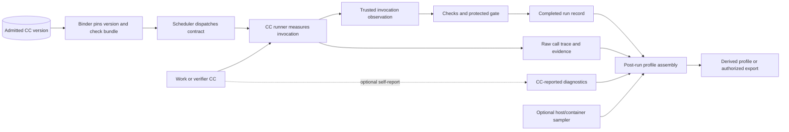
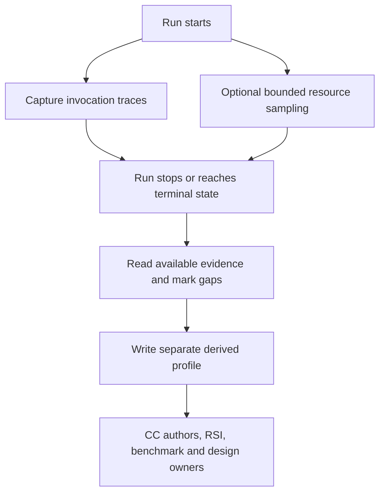

# Temporary workload profiling proposal

`Tier 2 · Part of: [Architecture overview](README.md) · Non-authoritative proposal, not an M1 standard`

> [!warning] Proposal, not current design
> This proposal is included here for easy architecture navigation. It is not a canonical M1 design standard and does not change the PRD or required behavior. M1 options below need an explicit design decision before they become coding requirements.

**Start here:** [System architecture](1-system.md) · [Capability Capsules](2-capability-capsules.md) · [Sidecar architecture](development-tools/sidecar/README.md)

## Terms used here

| Term | Meaning for this project | Main design location |
|---|---|---|
| Workload profile | A summary of time, calls, outcomes and resource use for a known run or CC invocation. It describes what ran. It does not authorize a CC or release an output. | [Invocation records](reference/derived-records.md), [run plan](reference/run-plan.md) |
| CC invocation | One work or verifier CC run with an exact admitted version, contract, inputs and outcome. A CC may wrap a tool, skill or bounded ephemeral agent. | [CC architecture](2-capability-capsules.md) |
| Trace | Ordered events from an invocation, such as model and tool calls. A trace can help explain time and behavior; it is not itself an acceptance result. | [Record layout](reference/derived-records.md) |
| Host/container sample | A time-stamped observation of the application container, another container, a Docker volume or the host. Scope matters because those resources are shared. | [Sidecar architecture](development-tools/sidecar/README.md) |
| Post-run analysis | A read-only step that packages available records and traces after a run stops. It creates a derived view; it does not rewrite the run or its gate decisions. | [Derived records](reference/derived-records.md) |

## 1. How is CC related to workload profiling?

**CCs are work units whose executions can be observed.** The platform owns run history and the trusted invocation identity. A CC author can optionally add context about internal phases that the outer runner cannot see. CC authors do not own the authoritative trace, library history, verification or gate decision.

The same model covers work CCs and verifier CCs. Their records remain separate. A verifier receives the pinned declaration and exact output under the current design. Profiling data is not added to that input and does not affect the verifier's verdict.

The diagram separates evidence sources. The observation and gate path are governed by the maintained design. The CC self-report and sampler are proposals. Post-run assembly reads what exists and leaves original records unchanged. The exact binding and dispatch flow is in [Planning and freeze](platform/planning-and-freeze.md).

## 2. What can the current M1 design tell us?

The maintained design already links invocation evidence to an exact run, node, attempt, subnode, CC version and code hashes. It specifies measured start/end time, duration, model-call count, route, outcome and effects. Raw per-call evidence may include model/tool traces, inputs and outputs, prompt and workspace copies, checks and verifier results. The [record contract](reference/field-catalog.md#invocation-observation) and [record layout](reference/derived-records.md) are the authorities.

| Layer | What the design records | What it can tell us | Limit |
|---|---|---|---|
| CC invocation | Exact CC identity, elapsed duration, model-call count, route, outcome and effects | How long a version took, whether it failed, and whether it made model calls | Does not attribute shared host memory or total container use to one CC |
| Calls and trace | Ordered model/tool calls and their available timing and outcomes | Where time was spent inside an agent or tool sequence | Full traces can contain sensitive prompts, data or workspace content |
| Run | Run start/end evidence, run bundle, artifacts, records and gate decisions | Which invocations and outputs belong to the same run, including partial runs | A stopped run can have incomplete evidence; missing must stay visibly missing |
| Host and benchmark | Hardware inventory and benchmark resource observations where required by the benchmark contract | Whether a workload fit the tested host and its conditions | Benchmark measurements do not automatically become continuous product profiling |

These are design commitments, not proof that all hooks are implemented or verified. Mandatory evidence needed for a gate follows the platform's release rules. Other trace copies and derived records may be missing without changing a gate outcome; see the [release rule](reference/derived-records.md#release-rule).

## 3. What could be added with limited M1 impact?

### Optional CC diagnostics

An optional API could let a CC report useful internal phase labels or counters. For example, a search CC might report time spent on retrieval and ranking, while a wrapped tool or ephemeral agent might report its named stages. The runner attaches the trusted invocation identity and marks the data as `CC-reported`.

| Boundary | Proposed behavior |
|---|---|
| Ownership | The CC supplies diagnostic content. The runner supplies run and invocation identity, receipt time and source label. |
| Contract | Diagnostics are outside output ports, declaration guarantees and scientific result artifacts. They are advisory observations, not verified claims. |
| Verification | Admission, check bundles, verifiers and gates do not require, test, judge or consume diagnostics. Missing or malformed diagnostics cannot block execution or acceptance. |
| Failure | No synchronous exporter dependency. If collection is unavailable, exceeds a future bound or cannot be stored, drop it and record that diagnostics are missing or truncated when possible. Required evidence keeps storage priority. |
| Access | Store separately from gate inputs. Expose only through authorized record/export paths, with the same care as other trace data. |

This is an optional M1 proposal, not current M1 behavior. The current [sidecar design](development-tools/sidecar/README.md) explicitly does not add a profiling integration, CC diagnostic API or product telemetry. A decision would be needed to change that boundary. Spec Kit should define any event vocabulary, bounds and storage mechanics if the option is accepted.

### Docker and host resource scope

CC duration and tool-call timing can be linked to one invocation. CPU and memory have broader scopes unless processes or containers are isolated per CC, which would be a larger architecture change. A shared app-container measurement includes the runtime and overlapping work. A host measurement includes other host processes.

| Measurement | Likely source | What it attributes | Architectural limit |
|---|---|---|---|
| Per-run evidence bytes | Run bundle references or a run-scoped directory scan | Files associated with one run | Does not equal total shared Docker volume usage |
| Docker volume size | Authorized host-side measurement | Space used by a persistent volume | A shared volume contains many runs and product data; sidecar must not mount app volumes or receive the Docker socket |
| App-container CPU and memory | Optional host/launcher observation | The whole app container over time | Includes API, runtime and other overlapping activity, not one CC |
| Host CPU and memory | Host-level sampler | The server while a run is active | Includes unrelated processes and users of the machine |
| GPU or storage I/O | Host/runtime-specific collector | Device or container totals where the host exposes them | Availability and attribution depend on hardware, runtime and isolation |

The sidecar can request only operations exposed by the host-launcher boundary. The host retains Docker authority; the sidecar does not get a Docker socket, broad host shell or direct access to application volumes. See [sidecar host executor](development-tools/sidecar/README.md#host-executor). Volume size and other extra readings remain optional diagnostics unless a separate design decision makes them required.

## 4. What could M2 add?

M2 could sample container and host resources during a run, then assemble the samples with invocation traces after the run reaches a terminal state. Sampling must happen during execution to capture peaks and time series. Packaging and summary analysis can happen after execution, including after a partial or failed run.

The packager is read-only with respect to authoritative records and artifacts. It can report available measurements, sampling interval and scope, missing intervals, and whether the run completed or stopped early. It cannot infer that a missing sample means zero resource use. The collector and packager should remain optional so their failure cannot stop a research run or alter a gate.

| M2 option | Useful to | Reason |
|---|---|---|
| Container/host time-series and peaks | System architect and operator | Find memory, CPU, disk or GPU pressure and size a supported host profile |
| Invocation-to-trace links | CC authors and RSI workbench | Compare exact CC versions and inspect expensive internal calls or phases |
| Matched benchmark summaries | Benchmark runner and verifiers | Compare versions under the same task, host, data and protocol; keep environment differences visible |
| Post-run profile bundle | All authorized readers | Package traces, records, resource samples, scope and gaps without changing run evidence |

Profile data can inform a future Planner or library selection policy only through a separately designed, validated input. A profile alone does not establish CC quality, eligibility or scientific validity. RSI must not treat a faster but incorrect or incomplete result as an improvement.

## 5. Who may use it?

| Reader | Useful information | Boundary |
|---|---|---|
| CC authors | Time, call patterns, failures and optional internal phase diagnostics for their exact CC version | Self-reported diagnostics are not independent evidence of correctness |
| Verifiers and check maintainers | Context for diagnosing a failed or slow invocation and coverage gaps | Profile data does not expand verifier input or replace required checks |
| RSI workbench | Matched execution evidence when comparing parent and child versions | Profiling is one input; admission, hidden-fixture rules and independent evaluation still govern |
| Platform benchmark runner | Repeatable duration/resource summaries across pinned cases and hosts | Comparisons require matched protocol and recorded host conditions |
| Planner and library owners | Potential evidence about feasible resources or prior execution behavior | No automatic selection or eligibility effect in M1; any later use needs a governed contract |
| Platform and data owners | Storage growth, resource pressure and missing evidence | Shared volume/container totals are not per-CC measurements |

## Design references

| Topic | Maintained design |
|---|---|
| Overall boundaries and run flow | [System architecture](1-system.md) |
| CC roles and execution | [Capability Capsules](2-capability-capsules.md), [library and checking](capability-capsules/library-and-checking.md) |
| Binding and dispatch | [Planning and freeze](platform/planning-and-freeze.md), [run plan](reference/run-plan.md) |
| Evidence and derived views | [Derived records](reference/derived-records.md), [field catalog](reference/field-catalog.md) |
| Sidecar and host access | [Sidecar architecture](development-tools/sidecar/README.md), [platform benchmark runner](side-systems/benchmark-runner.md) |
| Verification and release | [Checking architecture](checking/README.md) |

Industry patterns to consider, not integrations or compatibility claims: [OpenTelemetry traces and spans](https://opentelemetry.io/docs/concepts/signals/), [Grafana trace-to-profile links](https://grafana.com/docs/grafana/latest/datasources/pyroscope/configure-traces-to-profiles/), and [Docker runtime metrics](https://docs.docker.com/engine/containers/runmetrics/).
