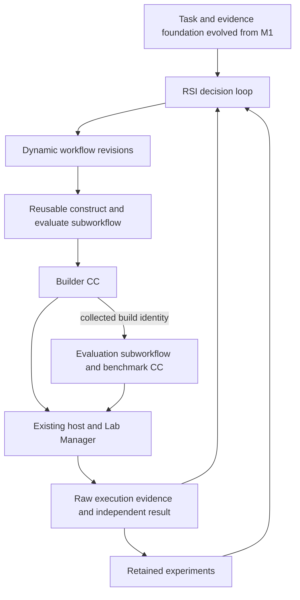

# 20261117 CC Workflow RSI Design Review prepresentation

The system is the evolved M1 inference-engine software factory. It retains the relevant research objectives, bounded decisions, dependencies, durable execution and evidence features. The obsolete POC workflow and older capsule path were cut away; CCv2, dynamic workflows and inference-engine CC packages extend that foundation. No return to the old M1 implementation is required.

The review should follow one actual STRATA improvement cycle: inspect retained experience, state a hypothesis, change source, build through a CC, pass the collected build identity through a reusable subworkflow into independent evaluation, and use the result to decide whether to confirm, revise or stop. The accompanying qualification record and original receipts establish which parts ran and what they measured.

## Implemented collaboration

| Part | Responsibility | Dependency on the other parts |
| --- | --- | --- |
| Evolved M1 foundation | Governing task, source and evaluation identities, budgets, decisions, durable jobs and retained evidence. | Supplies the context and authority for every workflow and CC invocation. |
| CCv2 package | A cohesive functional package containing capabilities, implementation materials and methods. Selected sealed releases identify package contents; delegated host code and runtime identities are separate dependencies. | Capabilities expose named ports to subworkflows and use the existing host for admitted effects. |
| Subworkflow | A reusable engineering procedure connecting capabilities or nested subworkflows. | Consumes CC contracts and passes actual producer values through explicit bindings. |
| Dynamic workflow | Composes procedures and records evidence-backed graph revisions. | Uses selected CC releases and the shared connection contract; it does not grant additional execution authority. |
| RSI controller | Uses historical and current evidence to choose and revise an implementation improvement. | Runs procedures through the workflow front door and relies on independently collected evaluation before accepting a candidate. |
| Lab Manager and job queue | Resource admission, build/GPU attempts, idempotency, cleanup and evaluation custody. | Remain the single job authority underneath the compositions. |



## The shared interconnect

The shared component contract is version `0.2.0`. It incorporates the downloaded pool's operations, composites, collections and materials, and the existing interconnect's executable binding fields. Native CCv2 remains the invocation contract. `factory.interconnect/1` is the compatibility profile for the existing resolver, rather than another scheduler or messaging system.

Ports retain transport, value kind, semantic type, requiredness, known payload schemas and descriptions. The live pool is exported from the task's selected sealed CC releases and current workflow definitions. The older downloaded pool remains a historical inventory; its Python entrypoint descriptions are not automatically admitted as executable leaves.

The common authoring field is `node`; the boundary also understands the existing `source` spelling. Expanded graphs retain exact node instance IDs. A binding may select ordinary outputs or the separately collected result channel, select a JSON field, and insert the value into a bounded request template. It evaluates no arbitrary expression or code.

```json
{
  "request": {
    "node": "build",
    "port": "attempt_id",
    "channel": "result",
    "assemble": {
      "template": {"stage": "screen"},
      "at": "/build_attempt_id"
    }
  }
}
```

This is the implemented build-to-screen connection. The benchmark receives the actual completed build identity; the agent does not copy it manually into a disconnected request. Lab Manager still checks task ownership, build success, immutable image identity and the frozen evaluation constraints.

The runtime preserves submission acknowledgements and collected result outputs separately. Acknowledgement is not completion. Missing fields, invalid payloads and artifact identity failures block the consumer. Schema validation, execution completion and scientific acceptance remain separate facts.

## Reusable procedures and adaptation

`strata-candidate-cycle` contains the `construct-and-evaluate` subworkflow, which nests `candidate-construction` and `candidate-screen`. Their executable leaves are existing builder and throughput CC capabilities. `strata-independent-confirmation` reuses the evaluation lifecycle and consumes the unchanged candidate identity through an explicit cross-revision binding.

The agent can choose another admitted procedure or supply a revised composition after citing collected evidence. New graph revisions preserve existing instances and attempts. Within a capability, a new implementation remains subject to the same advertised contract and provenance. This run improves STRATA source through the source-workbench CC and evaluates the resulting engine image.

Subworkflow scope summaries are derived from their owned leaves. Execution and resource budgets remain task-owned; this change does not pretend to implement independent hierarchical budget allocators or arbitrary in-place replacement of running scopes. Those are separate extensions if real use requires them.

## Accuracy and throughput experiment

The operator allows quantization changes, provided accuracy is preserved. The selected review experiment uses an arithmetic-preserving scheduling intervention and unchanged model assets. Exact generated token IDs and finish reasons against the original engine are therefore a strong bounded equivalence check. This is not a general model accuracy score or evidence for a changed-quantization candidate.

The frozen suite has three scored prompts: the retained 1,471-token discovery prompt, a new condition-variable code prompt and a new arithmetic-reasoning prompt. The scoring rule is total generated tokens divided by total measured decode time after the declared warmups. Independent analysis checks original logs, asset and image identities, full six-expert engagement, fixed placement, exact outputs and cleanup before timing is eligible.

Fresh A/A repeatability precedes a screen; only a positive screen permits unchanged-candidate A-B-B-A confirmation. The target is at least 10% conservative improvement, comparing the slowest candidate process against the fastest baseline process. The baseline stability limit remains 5%, and each scored case must avoid a greater-than-5% throughput regression. Prefill and decode are separate; decode speed is not total-request speed.

The first suite phase passed exact output checks but failed the baseline stability gate. Its original evidence remains retained. A prospectively registered second phase gives each scored case its matching unscored warmup, while preserving prompts, accuracy criteria, stability limit and target. The first two GPU processes remain charged against the original aggregate 16-process review budget; the revised phase has at most 14 remaining and the original deadline. The qualification record contains the actual outcomes rather than treating a methodological revision as an improvement.

## What to inspect during the review

1. Open the read-only `/review` view on Spark port 5175. Identify the selected task, shared catalog, graph revisions and component releases.
2. Open the graph console and the candidate cycle. Follow the collected builder output into the screen request and the unchanged candidate into confirmation.
3. Read the RSI decisions. Check the historical evidence that changed the plan, source changes, rejected outcomes and the reason for each graph revision.
4. Inspect the independently parsed throughput and accuracy gates. Compare execution status with scientific verdict; a completed rejected experiment is not a speedup.
5. Inspect source/build/image identities, the exact token and finish comparisons, resource cleanup, and the original failed baseline phase.

The review view and event replay never execute work. Fresh execution requires a fresh valid task envelope; reopening a completed graph does not renew its budget.

## Integration repairs observed during execution

Historical search now indexes bounded, digest-verified saved report artifacts, so the RSI controller can read the original report rather than relying on a later summary. The controller now distinguishes a previous terminal decision from a new decision during an authorized resume. Both paths have regression coverage. The continuation preserves the original graph, task budget and deadline.

The native build owner receipt independently records completed container removal. The older generic attempt cleanup field is retained as recorded, including its less specific container-verification label; the qualification export includes both facts rather than rewriting history.

## Package and scope

The companion package contains the implemented source overlay, base revision, patch, file hashes, changed schema, relevant tests, task and suite definitions, source candidate patch, measurement summaries and selected original evidence. Credentials, model weights, dependency environments, mutable databases and Docker image layers are excluded. Large raw stores remain on Spark with their original paths and digests.

The result is a working connection between the components and a measured experiment, with its limits visible. General accuracy under a quantization change, broad workload generalization, population confidence bounds and total-request improvements require their own evaluation. The notes distinguish these from what this run actually establishes.

The methodology helper now recognizes recorded native throughput gates without claiming a fresh raw-evidence verification. A target miss remains a target miss; it no longer automatically becomes missing repeatability. Native process limits are kept separate from the older completed-cell budget unit. Proposal outputs remain non-executable and grant no effects.


## Where the implementation lives

Paths below are relative to the packaged factory-source directory.

| Concern | Code |
| --- | --- |
| Full native port descriptors and normalized shared pool | jiuwenswarm/software_factory/cc_catalog.py and shared_catalog.py |
| Small binding contract and validation | jiuwenswarm/software_factory/interconnect.py and interconnect.schema.json |
| Nested definitions and actual dependency resolution | jiuwenswarm/software_factory/workflow_definitions.py and cc_workflow.py |
| Reusable builder/screen/confirmation procedures | jiuwenswarm/software_factory/cc_prepare.py |
| Agent and HTTP workflow front doors | jiuwenswarm/software_factory/agent_mcp.py, cc_service.py and cc_api.py |
| RSI resume, retained report discovery and methodology translation | jiuwenswarm/factory/controller.py, experiment_library.py and methodology.py |
| Frozen suite and independent result analysis | jiuwenswarm/factory/engine_adapters.py and throughput_campaign.py |
| Read-only review view | jiuwenswarm/software_factory/cc_server.py and review.html |

The existing single task authority, native CC host, durable attempts and Lab Manager are reused. The new shared representation and procedure definitions connect them rather than reproducing their responsibilities. The focused validation log records 110 passing tests and 3 passing subtests.
