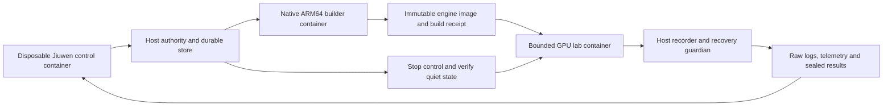

# First draft of the inference-engine factory

The product is a repeatable learning loop. A faster kernel is one possible output;
failed hypotheses, profiling tools, reproducible CCs and narrower uncertainty are
also useful outputs. The target here is the pinned DeepSeek pack, Strata revision
and DGX Spark GB10. A result from a PCIe discrete-GPU system is a research lead,
not a hardware transfer guarantee.

## Cycle

1. Acquire hypotheses from primary papers, source inspection, observed stalls,
   failed experiments and earlier reports. Record source citations, mechanism,
   hardware/model assumptions, expected observable effect and a falsification rule.
2. Inspect applicability. A CC must say whether it changes scheduling, placement,
   arithmetic, routing or weights. Missing experts and changed routing require a
   different quality policy; they cannot masquerade as an equivalent I/O tweak.
3. Choose one uncertainty to resolve. An agent selects among eligible CCs; the
   host validates operator policy, remaining budget and frozen identities. A new
   experiment gets a new child task and contract. Historical contracts are immutable.
4. Build once in the native ARM64 build environment if source changes require it.
   Preserve compiler/source/dependency/image identities. Configuration CCs can reuse
   an already-qualified immutable image.
5. Profile a bounded workload when the mechanism is unknown. Instrumented timing
   explains behavior and never substitutes for an uninstrumented speed result.
6. Quiet the factory. Run the laboratory under the exclusive lease, with only the
   queue, recorder and recovery guardian active. Persist raw streams and telemetry
   continuously. A crashed engine is an outcome, not a missing sample to discard.
7. Check mechanism engagement, correctness, resource bounds and complete cleanup.
   Compare equal work using balanced fresh-process order. Report prefill, decode,
   first-request and combined latency separately. The original drafting experiment
   demonstrated why a decode win alone is insufficient.
8. Record a verdict and update the hypothesis: supported, refuted, inconclusive or
   operationally blocked. Record applicability, not just a global winning setting.
   Choose the next cycle from that evidence. Validate combinations directly against
   the original baseline; do not multiply independently measured speedups.

## Deep profiling and expert prediction

Measure the dependency path: routing completion, expert demand, placement hit,
read requested/completed, CPU/GPU work, copy/visibility fences and time waiting for
an expert. Native phase counters are cheaper than a full timeline; Nsight traces
can identify kernels, stream dependencies and synchronization once phase counters
identify a region. Sampling and tracing overhead need a separate A/A control.

A prediction CC needs a trace contract before an implementation contest. Capture
layer/token/request identity, demanded expert IDs and weights, predicted IDs,
available lookahead time, bytes fetched, cache state, deadlines and actual stall
saved. Evaluate temporal holdouts and cold/new requests. Accuracy@k alone rewards
fetching everything. Also measure timely coverage, wasted bytes, eviction of useful
experts, contention and final inference latency. An oracle predictor is an upper
bound experiment; it is never a deployable performance claim. Begin with cheap
last-token, layer-transition and frequency baselines before a learned predictor.

On Spark, GPU and CPU share physical DRAM. GPU-resident bytes, CPU file pages,
page faults and memory bandwidth compete. Additional prefetch can reduce stalls
or simply consume bandwidth and memory headroom. Measure which happens. Preserve
all six target experts for scheduling experiments. Prediction may move data early;
it must not silently drop a demanded expert.

## What must survive a weeks-long campaign

The agent process is disposable. Durable decisions, CC receipts, jobs, contracts,
artifacts, source/image pins and budget reservations survive restart. Dispatch uses
stable idempotency keys; reconciliation checks the queue before another launch.
A terminal result is consumed once. Retried infrastructure failures consume an
explicit retry budget and retain the original failure. Repeated crashes or missing
telemetry trip a circuit breaker, and an operator stop must stop new admissions.

Operator policy should bound allowed CCs/parameters, source roots, immutable assets,
CPU/GPU/memory, disk growth, experiment time, build attempts, total GPU cells and
campaign duration. Within that envelope new child contracts can be frozen without
asking on every cycle. Novel effects or changed quality obligations require a new
policy. The system should periodically refresh a control baseline to detect drift,
reserve independent validation data, and retain negative results so it does not
repeat the same failed idea under a new name.

This first draft must demonstrate the loop and failure recovery with bounded
campaigns. It does not claim unattended weeks-long operation has been qualified.
Reboot recovery, thermal/power drift, storage retention, credential expiry and
long-horizon hypothesis selection require endurance testing before that claim.

## Implemented boundary

The new `factory.methodology_hypothesis` CC retains structured, evidence-bound
agent proposals and feeds unmeasured ablation designs. The
`factory.engine_factory_loop` CC exposes status, select, execute, collect
and stop. It reserves a decision and cycle atomically, binds the chosen hypothesis
to an operator-pinned template, creates a child task, and recovers submission using
an idempotency key. Controller and supervisor discover children from the loop
ledger, so a label alone does not grant ownership. The supervisor can quiet the
agent for child measurements and import benchmark results on recovery.

`engine.strata_prefill_chunk` changes one native parameter, with an effective-value
check in the benchmark. `factory.deep_profile` plans observer runs and analyzes
retained native/CSV evidence. `factory.expert_prediction` evaluates complete-request
temporal holdouts against frozen frequency and causal previous-token baselines.
The latter is an offline evaluator, not a live Strata predictor or speedup.

The bounded campaign driver demonstrates host orchestration of pilot then main;
it explicitly records `llm_agent=false`. Agent-driven choice uses the existing
Jiuwen controller and these native CC tools. Neither the script nor synthetic
crash-recovery tests establish an autonomous weeks-long agent run.

Automatic paper acquisition, learned hypothesis ranking, source-changing CC
synthesis, live expert-demand trace capture, disk-retention enforcement, repeated
failure circuit breakers and reboot/endurance qualification remain future work.
Existing deadlines and cycle/experiment limits are enforced; operator stop blocks
new dispatch while already queued jobs retain their own bounded execution time.

## Avoid optimizing the experiment instead of the engine

Use an inexpensive exploration tier (source checks, replay and small pilots), a
confirmation tier (paired fresh-process measurements), then an untouched final
quality/performance holdout. Freeze the split before selecting a candidate. Reusing
the 64-question regression sample across hundreds of candidates would turn it into
training feedback; it cannot remain the final validation set. Keep negative and
inconclusive trials in the ledger. Predeclare stopping rules and account for many
comparisons instead of repeatedly sampling until a confidence interval passes.

Refresh A/A controls after temperature, storage, driver or background-load changes.
Track baseline rate spread, paired ratios and order effects, not just pooled token
rates. Use a separate observer-on/off experiment to quantify profiler overhead.
Keep throughput, per-request latency, first request, prefill, decode and memory
headroom distinct. Select the objective from deployment needs before measurement.
A candidate stack needs direct ablation and final combined validation; independent
speed ratios cannot simply be multiplied. These policies are design requirements
for the longer-running system, not completed endurance evidence from this run.

## Container and recovery roles

The small CLI/test image and larger agent image have separate dependency needs.
The builder contains the native compiler/toolchain without models or provider
credentials; the engine runtime contains the executable and runtime dependencies,
with read-only model mounts. The host owns Docker/queue admission, the exclusive
lease, durable state and recovery. A worker/recorder must survive the agent exiting;
the agent must not be the only owner of logs or cleanup. Idle image layers consume
disk, not the RAM of a running factory control process. Native image construction
avoids emulating ARM64 compilation on x86; shared base layers reduce duplicated disk.

Before GPU collection, finish builds/tests and stop the control container, then
record its actual exit. During collection retain only the queue, recorder/guardian
and small supervision path. Unrelated existing services are outside the factory's
shutdown authority. After success or failure, import sealed artifacts and resume a
fresh control session from durable decisions. Reconcile incomplete intents before
launching replacements. Host reboot recovery and long-term disk quotas still need
endurance qualification; current container-crash cleanup does not prove those.
