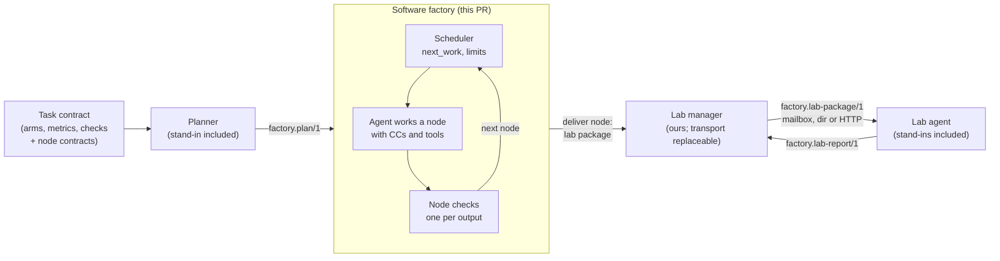

# Where the factory fits, and how to connect your component

The software factory sits after the planner and before the lab manager. It takes:

- the **node contracts** from the task contract, and
- the **plan** (a task graph) from the planner.

It schedules the nodes and works each one with capsules (CCs) and tools. Each node's outputs are checked before the node can close. The last node hands the inference engine to the lab manager, which passes it to a lab agent.

## What is ours and what you can replace

| Component | Who owns it | In this PR | The interface | How to replace it |
|---|---|---|---|---|
| Task contract | Contract or planner team | `factory.contract/2` files in `jiuwenswarm/factory/contracts/` | `schemas/contract-2.schema.json`, `contract_v2.py`, [CONTRACT.md](CONTRACT.md) | Write your contracts in this format, or convert yours to it |
| **Node contracts** | Contract or planner team writes them; the factory consumes them | Written by hand for the Spark contract (`star-deepseek-v2`, nine nodes) | `extensions["factory.node-contracts"]` in the contract, `schemas/node-contract-1.schema.json`, `node_contract.py`, [NODE-CONTRACTS.md](NODE-CONTRACTS.md) | Generate them; `node_contract.problems()` says what is wrong |
| **Planner** | Planner team | **Stand-in:** `planner.contract_plan` orders the node contracts as they are | `factory.plan/1`, `planner.py`, `plan` in the task file (`schemas/task.schema.json`) or `FACTORY_PLANNER=module:function` | Return a plan; the factory checks it against the node contracts |
| M1 run plan | M1 planner | Adapter, `run_plan_adapter.from_run_plan` | M1 `run_plan` (design package, `reference/run-plan.md`) | Use the adapter as a starting point. A research plan still needs a deliver node |
| Scheduler, task graph | **Ours** | `scheduler.py`, `taskgraph.py` | `factory.evidence.plan_next` and `plan_get`/`plan_patch` | Keep |
| Node work (agent, CCs, tools) | **Ours** | `controller.py`, `ccs/` (53 capsules), `AGENT.md` | CC v2 host (`jiuwenswarm/ccv2`) through the agent MCP tools | Keep; add capsules |
| **Node checks (verifiers)** | **Ours** | `node_check.py`, `ccs/node_check/` | `node_check.start` / `status`, `node_check` observations | Keep. Choose the reviewer model with `FACTORY_REVIEW_*` |
| Agent runtime | Runtime team | The Codex subscription runtime under `jiuwenswarm/server/runtime/codex_subscription/` | `configure_agent` in `controller.py` (MCP config, environment variables) | Point the controller at another runtime |
| Lab manager | Ours, until a lab team takes it | `lab_manager.py`, `ccs/lab_manager/` | `factory.lab-task/1`, `factory.lab-package/1`, `factory.lab-message/1`, `factory.lab-report/1` (all under `schemas/`); [LAB-MANAGER.md](LAB-MANAGER.md) | Keep the four documents; replace the transport behind `open_mailbox` |
| Lab mailbox transport | Ours | A directory, or HTTP (`lab-server`) | `lab_mailbox.py`, `lab_http.py` (`/v1/requests`, `.../messages`, `.../files/<sha256>`) | Any service that serves the same messages and files |
| **Lab agent** | Lab team | **Stand-ins:** operator, factory lab queue, lab command (`lab_agent.py`) | The mailbox protocol above; the command stand-in runs `RUNNER {package} {output} {payloads}` | Implement the mailbox side (`LabAgent` is a client you can reuse) |
| Lab kit (queue, image builder, runner) | Lab team | Bundled copy in `factory/labkit/` | `FACTORY_LAB_ROOT`, `FACTORY_JOBQ_BIN`, and the others in [REPOS.md](REPOS.md) | Point the variables at yours |
| System Ontology | Ontology team | Not merged; each builder's `ONTOLOGY.yaml` is the component map | `ontology.py`; slices can carry `node_types` (README "Component map") | Add `node_types` to slices; no factory change |
| Web UI | Ours | Factory runs page, `factory_http.py` | `/api/factory/*` ([FACTORY-RUNS-HTTP.md](FACTORY-RUNS-HTTP.md)) | Optional |

## The hand-offs, in order

1. **Contract → factory.**
   - `jiuwenswarm-factory init <task.json>` loads the task's contract.
   - A contract with node contracts must pass `node_contract.problems()`:
     - the node graph has no cycles;
     - every input comes from a predecessor's output;
     - every required output has a verifier;
     - there is exactly one leaf, a `deliver` node that hands a `lab_request` to `lab_manager`;
     - requirement ids name contract arms, checks or metrics.
2. **Planner → factory.** The task graph is seeded from the plan, with revision 1 recording which planner made it.
   - **Where the plan comes from:** the task file's `plan`, else `FACTORY_PLANNER`, else the stand-in.
   - **What a plan must do:** cover every node contract exactly once, add no other work, and keep each contract's predecessors.
   - **What each graph node takes from its node contract:** its kind, title, capability and output checks.
   - **What the planner decides:** order only, not obligations.
3. **Scheduler → agent.** Every turn, the agent's message carries `next_work`, also available from `factory.evidence.plan_next`. For each runnable node it lists:
   - the objective;
   - the inputs, resolved to the passing checks of the nodes that produced them;
   - the outputs owed, with their criteria and verifiers;
   - the helpful capsules;
   - what is left of the node's limits.

   A job that names a node is refused once the node's `node_limits` are used up.
4. **Node → node check → done.** Each output is checked by `node_check.start`:
   - **A change (`diff`)** is checked by the capsule's verifier, then by an independent reviewer that never sees the agent's context.
   - **Evidence** gets its records checked; the reviewer reads them when the output asks for review.
   - **Builds and lab requests** are checked by the host from their records.

   A node is done only when it cites the latest passing check of each required output.
5. **Factory → lab manager.**
   - Only the `deliver` node may compose the lab package, and the package records that node's id.
   - The deliver node's output check confirms that the lab task covers the node's arms, checks and metrics.
   - `send` posts the package to the lab mailbox.
6. **Lab manager → lab agent → back.** The lab agent:
   - fetches the package and the shipped engine (an image, or a source bundle that it builds);
   - runs the tests;
   - reports.

   `report` checks the report against the package and records it as `lab_report` evidence.

## What the stand-ins are for

The planner stand-in and the lab stand-ins exist so that the whole path runs today:
- on the DGX Spark;
- between machines over Tailscale;
- offline in the tests (`tests/factory/test_node_contracts.py` runs contract → plan → checked nodes → lab manager → command lab agent → recorded report).

They are not meant to be clever. Replace them through the interfaces above.
