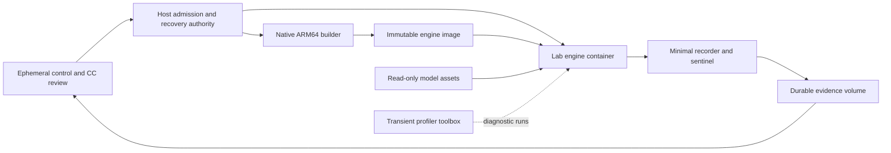

# Spark lab review and next implementation gates — 2026-11-13

This review covers the approved Spark port, oversized DeepSeek investigation, existing CC reuse, and live failure probes. It does not implement a new autonomous factory or claim a controlled performance improvement. Companion [attempt notes](SPARK-ATTEMPT-NOTES-2026-11-13.md) retain failures, tools, and evidence locations.

## Decision and measured reference

Use **Strata as the primary engine** for this model. It already runs the oversized model and already implements expert streaming. Keep llama.cpp as a stability/control option where it supports the same architecture and assets. The earlier GPT-OSS 20B llama.cpp check establishes plumbing; it is not an oversized DeepSeek performance baseline.

The active text tensors are 248,828,348,128 bytes, versus OS physical memory of 130,661,142,528 bytes. All six model files total 256,811,098,112 bytes; routed experts alone total 132,073,390,080 bytes. This is an actual out-of-core workload, not a model made small enough to fit by reducing its active experts. The measured runs use all six experts. Model sizes/mtimes match transferred provenance; full model hashes have not been recomputed.

Pinned engine: Strata `ffa80d73133ea5c548aefe57889a16e8085a938f`, GGML `3cf03257f219afbe7334045ff7c6a06ac68c627d`, image `sha256:1b6c3196f68f1c26d2aa873bf8cd9917362ffe7554fbb7e5aff2eee1f4864bbc`.

| Long-prompt screening cell | Decode tokens/s, request 1 / repeat | What it establishes |
| --- | --- | --- |
| Resident experts, no active drafting | 6.06 / 13.09 | Fixed 1,471-token prompt, 128 generated tokens each |
| Adaptive expert cache | 6.44 / 12.67 | Cache enabled; no demonstrated causal gain |
| Draft mode `auto` | 8.48 / 13.33 | Drafter unloaded by heuristic; not a drafting result |
| Forced drafting, confidence 0.65 | 8.18 / 17.65 | Actual draft engagement: 59/70 and 67/73 accepted/offered |

The forced-draft cell prefills at 54.71 / 118.61 tokens/s and retains at least 31.48 GiB host MemAvailable. Decode-interval physical reads observed strictly between samples were approximately 9.41 GB / 2.07 GB. This supports cache/IO sensitivity, not a causal decomposition of the gain. These are engine-native phase rates, not client end-to-end throughput.

Upstream's [Spark recipe](https://github.com/Niko1221/Strata/blob/main/docs/DGX_SPARK_LINUX.md) reports roughly 17–23 tokens/s for full-six-expert 2.00 bpw with a similarly sized chat prompt. Our warm 17.65 is in that reported range; request-one 8.18 is below it. Workload, caching, version, and accepted-draft differences prevent claiming parity. [Issue 5170](https://github.com/Niko1221/Strata/issues/5170) reports lower rates with a different quantization; [PR 5453](https://github.com/Niko1221/Strata/pull/5453) describes a prospective unified-memory tier. Neither is a measurement of our build. Do not promise speed from peak [Spark memory bandwidth](https://docs.nvidia.com/dgx/dgx-spark/hardware.html): this workload also incurs storage misses, placement, CPU work, and synchronization.

Maintain two references:

1. **Working reference:** the retained full-six-expert forced-draft profile, `engine-investigation/measured-profile.json`, with its functional evidence. It is the best tested long-prompt configuration here.
2. **Mechanism baseline:** freeze an unmodified engine, explicit no-draft configuration, placement, cache protocol, tokenizer, prompt, metric, and correctness policy. Run A/A first. This baseline is proposed and has not yet been accepted. In particular, distinguish `none`, `off`, and `auto` draft behavior through effective startup evidence, not flag names alone.

## Repository gaps with consequences

| Area | Existing useful implementation | Gap and consequence | Next acceptance gate |
| --- | --- | --- | --- |
| Target admission | `targets.py`, target-aware `manager.py`, Spark build/runtime workers | `lab_runner.py:151` and `ab_runner.py:41` still require `jetson-orin`; successful Strata cells bypassed that generic CC path | Run the same Spark image/workload through the lab CC; preserve Jetson tests and reject mismatches |
| Engine inspection | Existing inspector and expert-streaming CC | Inspector assumes `/app/<tool>` and llama configuration/logs; multi-file Strata placement and protocol absent | Strata adapter identifies pack, all shards, effective six experts, placement/cache/draft state, and unknown fields |
| CC applicability | Existing native applicability capability and ontology | Actual explicit-path call fails `INVALID_INPUT: Invalid contract identifier` without a scored task contract; helper sees only first shard and returns `unknown` | Read-only pre-contract inspection works; malformed identities fail explicitly; no fabricated contract |
| Engagement | `parse_engagement` for llama stderr hooks | Real Strata stderr produces `not_measured` for all mechanism groups; its protocol/timing is substantially stdout | Versioned Strata parser; absence remains unknown, never zero or success |
| Performance contract | AB runner, frozen evidence, methodology material | Llama `eval_ms_per_token`, LLAMA environment, and raw stdout SHA do not match Strata timing-bearing stdout | New typed contract preserves raw integrity and separately checks canonical token IDs/finish; existing strict contracts unchanged |
| Process recovery | Queue exclusion, host bridge, cancellation, controller reconcile | SIGKILL of collector leaves Docker workload running and final report missing | Independent guardian reconciles exact durable intent/CID after recorder death and imports partial failure |
| Quiet phase | Existing exclusive queue for participating jobs | No global factory lifecycle barrier or budgeted quiet lease; unrelated jobs and builds need admission checks | Heavy factory work cannot start while lab lease held; record actual residual processes/RSS |
| Durability | Store uses SQLite WAL/FULL; telemetry events fsync | Collector raw streams flush but do not fsync; final manifest only in `finally`; store commit and telemetry are not atomic | Durable chunks/intent, bounded tail-loss policy, recovery without final manifest, replay-safe import |
| Dependencies | Minimal ARM64 factory CLI image, pinned runtime image, native build | Compiler and libraries borrowed from host; inherited base not independently rebuilt; test apt not pinned; collector and paths external | Reproducible native builder/runtime receipts, dependency locks and explicit host ABI boundary |
| Authority | No Docker socket in factory container; bridge validates requests | Trusted same-user bridge and broad writable workspace, not hostile-code isolation | Narrow per-role mounts/operations; cleanup authority remains host-owned |

The production CLI image contains factory code and CC execution dependencies. A standalone image probe confirms it does **not** contain the full agent/server runtime, Docker client, Git, or CUDA compiler. Containerizing this CLI must not be described as containerizing the entire autonomous software factory.

## Container roles and dependency hygiene

Build natively on Spark ARM64; keep build output and OCI layers local. This avoids an emulated x86-to-ARM build path. We did not benchmark an x86 comparison. The initial eight-worker native build took 158.94 seconds. The approved first port intentionally used the existing host compiler; the builder image below is the next cleanup step, not an already completed migration.

| Role | Contents and scope | During scored lab run |
| --- | --- | --- |
| Control/review | Minimal Python + CC/store; optional separately scoped agent runtime; no Docker socket or GPU | Exited; restarted to review durable results |
| Native builder | Pinned ARM64 CUDA 13 development tools, GCC, CMake/Ninja; source and configuration-keyed cache | Exited before admission; no concurrent builds |
| Engine runtime | Immutable executable and required CUDA/system libraries; read-only models; no compiler/controller | Running with explicit CPU/memory/time limits |
| Recorder/sentinel | Small host-facing sampler, durable journal, exact-owner cleanup/recovery interface | Only critical telemetry and lifecycle work; measured budget |
| Profiler/validator | Nsight/debug tools or pytest/Git and validation dependencies | Absent for scoring; transient for traced diagnostics or offline verification |

Roles need not imply five always-running services. Build, validate, stop them, run the engine plus recorder, then restart review. The tiny host authority and kernel/driver/Docker integration remain outside containers. Record driver/runtime ABI compatibility; do not hide those dependencies inside a claim of complete hermeticity.

Pin builder inputs by source, submodules, image digest, toolchain versions, configuration and flags; segregate caches by that identity. Runtime packaging must verify required shared libraries and hashes before trimming the current large base. Mount source read-only except owned build output; mount only the role's evidence/queue directories. The current broad workspace bind is an interim convenience.

Measured image accounting: engine approximately 8.29 GB total, 7.00 GB shared and 1.29 GB unique; factory approximately 338 MB and validation 467 MB. These are Docker accounting figures, not a measured total workspace increment. No before/after shared build-cache baseline exists. Reuse model files and image layers. Maintain an ownership/retention manifest; remove only expired owned artifacts after useful evidence is sealed. Do not prune shared data or clear system caches.

## Quiet lab and recovery protocol to implement

Desired host-enforced states:

`ACTIVE → BUILD → SEAL_INTENT → ADMIT_AND_QUIET → RUN → SEAL_RESULT / RECOVER_PARTIAL → REVIEW → RELEASE`

Before quieting, fsync an immutable run intent and parent directory: attempt and nonce, exact image, model/workload identities, effective configuration expectation, limits, unique container name, ownership labels, output paths, deadline, recovery policy and previous factory state. Persist CID immediately after create. Include boot ID and PID start time for process checks; a recycled PID/PGID after reboot is not an ownership credential.

The host acquires an exclusive lab lease and blocks new participating builds, heavy tests, agents, and other lab cells. Check unrelated GPU work and available host memory before admission. Record the residual factory process set and memory. Stop only owned, authorized processes. Existing unrelated services on Spark remain untouched. A lease expiry triggers reconciliation, not indiscriminate host cleanup.

During RUN, retain only the engine, minimal collector/sentinel and required queue/host authority. Reserve measured memory for those processes and the OS. CUDA unified-memory allocations were not fully visible in the original cgroup reading: the failed configuration reached 7.72 GiB host available while its cgroup showed only 10.17 GiB. A container limit alone does not establish safety; retain the host guard and headroom. The current 104 GiB/no-extra-swap limit and 8 GiB guard are tested boundaries, not a recommendation to allocate literally all memory.

The collector should append sequence-numbered raw chunks, phase events, monotonic timestamps and samples with periodic bounded fsync. Record the maximum possible unsynced tail. Atomically seal manifests and hashes after exit; retain partial records on failure. Keep immutable status transitions so an incomplete run cannot become a successful result merely because recovery found logs. A tiny independent guardian must survive collector SIGKILL and use the durable intent plus exact image/CID/labels to stop an orphan. Queue process-group cleanup alone cannot do this.

On restart, reconcile the inbox before scheduling anything: inspect owned containers, capture final state, recover partial data, record missing artifacts, clean exact owned resources, and idempotently append observations. Restart the controller against the existing store; do not require its previous RAM state. Restore only the factory services that were explicitly active before quieting, then release the lab lease. A controller crash is separate from an engine failure and should be recorded separately.

The review's recovery harness proves this can work for process death, including a missing CID receipt. It is not the production guardian. Host reboot, Docker daemon restart, disk full, power loss, GPU reset, and automatic factory-service restoration remain untested. Current store durability does not compensate for unsealed external collector files. A future boot service must reconcile boot identity safely before touching processes.

## What to reuse and what should become CCs

Existing methodology, integration and expert-streaming materials were sealed/materialized through the CC runner. Existing evidence publish/query succeeded, and a fresh container read the same durable observation. Reuse that store and protocol; do not add a second registry or resurrect removed research machinery.

| CC work | Status | Bounded responsibility |
| --- | --- | --- |
| Extend existing builder | Proposed | Native toolchain admission, build/cache identity, artifact/image receipts |
| Extend engine inspector and expert-streaming CC | Proposed | Backend-specific pack inventory, applicability, effective configuration and engagement |
| Extend existing lab client | Proposed | Versioned engine adapter: launch, protocol, metrics, correctness, artifacts and recovery references |
| Lab lifecycle / quiet lease | Proposed host capability + CC interface | Prepare/quiet/status/restore; host enforces ownership, resource exclusion and lifecycle |
| Durable lab telemetry | Proposed collector capability + CC interface | Journal/chunks/phase capture and scoped diagnostic profiling; collector overhead measured |
| Out-of-core experiment methodology | Proposed material capsule | Cache protocol, A/A validity, paired blocks, correctness policy, failure/quality/throughput reporting |
| Crash recovery methodology | Proposed material capsule | Fault matrix and recovery gates; uses host lifecycle capability, grants no arbitrary kill authority |
| Existing evidence CC | Exercised successfully | Publish/read/query artifacts and observations, including negative findings |

A CC is appropriate when it provides a reusable capability or versioned method with explicit inputs, outputs, effects, applicability and verification. Ordinary engine internals remain code behind the adapter. Authoritative cleanup and admission remain host mechanisms; a generated capsule must not widen its own authority.

Future automatic CC creation should consume retained episodes: hypothesis, applicability, source mapping, exact change, tools needed, failed attempts, evidence, limitations, and resource/overhead costs. Generate a candidate capsule, test its schema and bounded effects, replay against successful and negative cases, verify engine correctness and observer overhead, and then request the configured promotion review. Discovery, sealing, enabling, and promotion are separate decisions. Missing measurements in today's candidate ranking are inspection priorities, not estimated benefits.

## Apply the expert-streaming method to Strata

Strata already has expert placement/load/copy, asynchronous flow, speculation, RAM-store preloading, and ahead/lane mechanisms. In the pinned `src/dsv41/ds4_model.cu`, inspect `place_experts` (~5372), `load_experts_mx` (~5679), `copy_experts` (~5842), `flow_push/spec/rest/pump/layer` (~4578–4896), `preload_store` (~6652), `store_sync` (~6723), `store_watch` (~8812), and `ahead_ask` (~9347), plus `ds4_store.hpp`. Line numbers refer to this source revision.

The existing expert-streaming component patches target llama.cpp commit `cf34d311332e362198f0a410c466d1e940287d02`. Port concepts and evidence requirements after source mapping; do not apply those patches blindly to Strata. First expose what Strata already does. Measure ready-at-demand bytes, queued/in-flight/resident hits, duplicate demand, wasted asynchronous bytes, critical-path wait, per-phase physical reads, effective CPU/GPU placement, and draft acceptance. IO completion alone does not establish readiness at use.

Start with observation only, then one mechanism change. Candidate experiments include tuning existing ahead depth, duplicate-inflight joins if missing, or unified resident-slot reads. Each requires evidence that its prerequisite bottleneck exists, explicit resource cost, and a separate untraced A/B run. The upstream unified-tier change remains a candidate to examine, not an assumed improvement.

## Experiment methodology and acceptance

1. Freeze model/pack/tokenizer/prompt identities and full-six-expert policy, target, image, limits, draft/cache settings, output cap, seed and environment. Hash large assets once outside timed work and retain the provenance limitation until done.
2. Establish A/A repeatability before any optimization claim. Static configurations reproduced token IDs on short repeats; adaptive-cache/draft repeats sometimes differed. Define correctness expectations before looking at B. Keep raw-stream hashes for evidence integrity; canonical token IDs and finish reason are a distinct semantic protocol. No task accuracy evaluation has been run.
3. Declare two workloads: first request after fresh engine initialization, and steady state after fixed warmups. Neither is automatically cold SSD. A 249 GB model cannot be wholly warmed in 128 GB RAM. Capture residency/read counters; prohibit global `drop_caches`. Hardlinks do not isolate page cache; private copies would need an explicit storage/time budget.
4. Run fresh-container counterbalanced blocks such as ABBA with fixed warmups and repeated blocks. Change one variable, retain all failures, and report paired latency differences, dispersion and uncertainty. Report decode, prefill, end-to-end latency, memory, physical reads, accepted drafts and quality separately. Do not combine exploratory configuration differences into a claimed percentage speedup.
5. Keep traced explanation runs separate from scoring. Measure recorder-only A/A overhead, set a budget, and use a profiler only when a concrete uncertainty requires it. Do not run builds or analysis agents concurrently with scored runs.
6. Recompare the final combined candidate against the frozen original directly; individually promising changes need not compose. Preserve failed/null ideas with rejection reasons and applicability limits.

## Next implementation order

**P0: trustworthy lab lifecycle.** Add the Strata adapter and target-aware generic lab path; integrate durable intent, independent orphan recovery, quiet lease and replay-safe evidence import. Acceptance: same full model through the lab CC; fault probes leave no owned workloads; fresh controller reads partial failure; heavy jobs blocked during lease; recovery does not touch unrelated containers.

**P1: reproducible baseline and packaging.** Build the native ARM64 builder image, lock dependencies, import model identities, establish A/A, and run a small predeclared ABBA comparison. Acceptance: rebuild receipts, reproducible engine identity or explained variance, effective configuration, bounded observer overhead, correctness gate and uncertainty report.

**P2: streaming instrumentation and one-knob trials.** Map existing mechanisms, measure readiness/inflight/waste and critical-path stalls, then test the most supported hypothesis. Acceptance: diagnostic signal provenance, no observer-induced gain, full-expert correctness and independent scoring.

**P3: automatic capsule discovery and promotion.** Derive candidate methods/components from episodes once lifecycle and evaluation are dependable. Acceptance: negative replay cases, explicit effects and applicability, separate promotion authority, and rollback. The factory should learn from crashes before it is allowed to automatically compound experiments.
