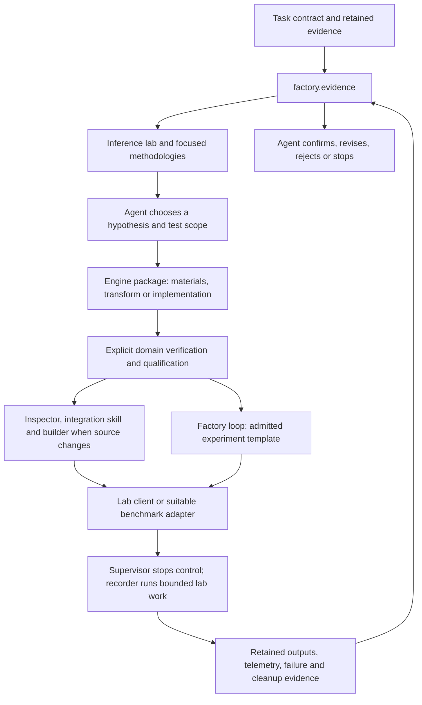

# Whole CC library review

Review date: 2026-11-14. Three GPT-6.1 Sol subagents reviewed every active factory
entry in separate groups; the coordinating agent checked coverage, cross-package
handoffs, demo/reference packages and the findings against source and retained
experiment evidence. This review changes documentation only. It runs no engines,
installs no dependencies, changes no runtime code and claims no new test pass.

## Main assessment

The current library is a useful bounded inference-research toolkit. It can retain
evidence, advise an agent, apply certain configuration changes, build admitted
source, run controlled experiments, recover bounded failures and preserve negative
results. It is not yet a general library of independently certified, portable
Strata optimizations or a weeks-long autonomous engine-development system.

A CC is a package of capabilities and/or passive materials. The eight nested
expert-streaming components are legitimate source/material packages; they are not
eight executable streaming services. Conversely, a nine-tool methodology package
is not nine new optimization algorithms. Tools, source components, methods and
verification have distinct roles and evidence requirements.

The inventory contains:

| Library root | Authoring declarations | Distinct IDs within root | Role |
|---|---:|---:|---|
| Active factory `jiuwenswarm/factory/ccs` | 31 | 31 | 23 top-level packages plus eight nested components; 61 executable capabilities and 11 materials-only packages |
| `demo/ccs` | 4 | 4 | Synthetic service, client, inspection and methodology examples |
| Local protocol/reference examples | 11 | 8 | Transport, delegate, service, paper-method and native-product fixtures |
| Pinned Muxite protocol/reference examples | 13 | 9 | Related examples, including explicit producer/reviewer separation |

There are **44 distinct declared IDs across these roots**, with intentional copies
of reference IDs. This is not 59 independent tools installed in the factory.
Historical evidence copies, generated sealed releases and request specifications
are excluded from maintained-library counts. [INVENTORY.json](INVENTORY.json)
records every included declaration, hash, capability, binding and material.

## Individual factory CC map

Detailed per-package analyses cover implementation, dependencies/effects, materials,
verification, applicability, retained live evidence, overlap and improvements:
[engine packages](ENGINE.md), [methods](METHODOLOGY.md),
[operations](OPERATIONS.md). [Reference analysis](REFERENCES.md) covers every demo
and distinct reference identity, including mirrored declarations.

| Package | Role | Important boundary |
|---|---|---|
| `factory.evidence` | Durable observations, artifacts, decisions and work graph | Publishing an assertion is not verifying it |
| `factory.builder` | Submit/reconcile a build and retain source/image identity | Requires configured queue/toolchain and admitted clean source |
| `factory.engine_inspector` | Source/image/configuration preflight and Strata asset inventory | Engine-specific probes are not interchangeable |
| `factory.lab_client` | Build-linked model runs and A/B evaluations | Uses its own admission/contracts, not every benchmark adapter |
| `factory.lab_lifecycle` | Reconcile/recover retained Strata lab evidence | Currently restricted to `strata-v1`; status may perform reconciliation |
| `factory.integration_skill` | Instructions for source integration, repair and preflight | Passive; much of the procedure is still legacy Jetson/llama-specific |
| `factory.standard_benchmark` | Fixed quality/speed benchmark campaigns | v1/v2 score different metrics; execution success is not acceptance |
| `factory.engine_factory_loop` | Reserve/select/execute/collect/stop bounded experiment cycles | Agent chooses among exact admitted templates; no automatic novel patch admission |
| `factory.cc_qualification` | Inspect a sealed package, independently check a unit, assess scoped eligibility | Supports one specialized configuration checker; not universal certification |
| `factory.inference_lab` | Group scope selection, diagnosis, hypotheses, ablation, followup, profile and prediction methods | Aggregates existing implementations; advice does not grant execution |
| `factory.methodology_ab` | Passive single-change ABBA methodology | Legacy component/engine assumptions need explicit scoping |
| `factory.methodology_diagnosis` | Identify uncertainties and candidate investigations from reports | Heuristic diagnosis, not a measured causal explanation |
| `factory.methodology_ablation` | Design a one-variable comparison | Does not freeze or admit a test |
| `factory.methodology_followup` | Convert uncertainty into a proposed next input | Does not authorize or execute that input |
| `factory.methodology_hypothesis` | Retain an agent-authored hypothesis and falsification obligations | Citations and predictions remain unverified claims |
| `factory.methodology_out_of_core` | Recommend memory/cache/phase controls from evidence | Does not implement a paging or expert-residency policy |
| `factory.deep_profile` | Plan observer runs and analyze retained native/Nsight evidence | No general profiler launcher; the retained native profiler run crashed |
| `factory.expert_prediction` | Offline causal trace evaluation against baseline predictors | Needs real routing/readiness traces before any runtime-benefit claim |
| `factory.engine_component` | Preserve the original component patch and baseline material | Legacy seed example, not a universal engine module |
| `engine.expert_streaming` | Package component knowledge and applicability/engagement checks | Its llama patch family and Strata runtime path require separate reasoning |
| `factory.components.expert_fill` | Source patches for expert materialization/fill | Passive legacy patch stack; prerequisites and engagement matter |
| `factory.components.expert_pregate` | Source patches for pregating expert loading | Not automatically equivalent to Strata routing/prefetch |
| `factory.components.mmap_advice` | Source patch for mmap access advice | Storage/cache effects require isolated measurement |
| `factory.components.router_prefetch` | Source patch for router-informed prefetch | Must verify availability, timeliness and actual runtime engagement |
| `factory.components.thread_names` | Source patch for worker thread naming | Observability utility; not a performance optimization claim |
| `factory.components.expert_readiness` | Source patch for readiness/wait observation | Requires meaningful signal and bounded observer overhead |
| `factory.components.inflight_join` | Source patch for joining in-flight expert work | Concurrency correctness and prerequisites need independent checks |
| `factory.components.phase_stats` | Source patch for phase-level observations | Traced measurements explain behavior; they do not establish untraced speed |
| `engine.strata_verified_drafting` | Pure profile transformation enabling native verified drafting | Transformer is not the verifier; benchmark scope determines benefit |
| `engine.strata_prefill_chunk` | Pure bounded chunk-size profile transformation | Configuration validity is not numerical parity or speed |
| `engine.strata_prefill_workbench` | Inspect/design/transform/check/run/analyze native prefill experiments | Configuration unit and subsystem runtime result remain separate |

## How the roles compose

This is a map of available responsibilities, not a compulsory execution sequence.
A component invariant may need no GPU work; offline prediction evaluation needs
no full text generation; a kernel/subsystem result cannot justify an end-to-end
quality/speed claim. Source-building and frozen configuration experiments are
separate paths. The engine product itself need not contain any CC declarations.

## What the latest real run establishes

The retained task `spark-agent-improvement-001` used 19 capabilities across five
packages: evidence, inference_lab, prefill_workbench, cc_qualification and
engine_factory_loop. It completed one actual screen/review cycle with two control
generations and explicit stopped-control proof during measurement.

Configuration verification passed, but native output differed: baseline token9544
versus candidate token5 on all seven requests in each arm. The descriptive prefill
medians were4368.7ms and3211.6ms. The agent rejected the candidate, declined
confirmation and retained a diagnostic followup. This establishes a useful bounded
negative-result loop, **not an accepted speedup or whole-library live qualification**.

See [actual run analysis](../SPARK-AGENT-IMPROVEMENT-2026-11-14.md) and
`/home/user2/software-factory-spark-20261113/results/agent-improvement-proof.json`.
Earlier full benchmark results and the failed profiler run remain separate evidence
with different contracts. Neither a unit test nor a protocol example establishes
actual Spark/model performance.

## Cross-library findings and priorities

| Priority | Finding | Recommended next change |
|---|---|---|
| 1 | Generic diagnosis does not normalize the newer scoped report or its correctness verdict | Add versioned report adapters preserving treatment/prompt identities, explicit correctness failures and metric scope. The retained screen contains14requests/two cells, but diagnosis recognizes zero request metrics and zero failures; see the replay below. |
| 1 | `builder.status/cancel/result` checks task ownership but not build-attempt kind; Builder then delegates to generic Jobs | Add an explicit `kind == build` boundary and a same-task lab-attempt regression test. This is a source-confirmed routing gap, not evidence of cross-task access or an observed exploit. |
| 1 | The current candidate fails exact cross-chunk output agreement despite valid configuration | Add a numerical-parity package: reference replay, logit/margin comparison, first-divergent-layer capture and scoped numerical checks. Establish fresh-process repeatability; do not guess whether rounding, routing or a defect caused it. |
| 1 | Most executable factory CCs are thin wrappers over external factory modules, store, queue and image bindings | Describe and pin the complete relevant implementation/environment closure. A wrapper release hash alone does not identify backend behavior. Preserve portable package identity separately from deployment binding. |
| 2 | Explicit verification-unit material/qualification coverage is narrow | Publish a per-capability claim/evidence matrix. Add meaningful independent domain units to packages as needed; do not require a full benchmark for every call or present one passed unit as whole-package certification. |
| 2 | Current method/input documentation diverges from implementation | Update Jetson-only integration steps, v1-only benchmark guidance, observation/query examples and route discovery. Retained live input errors provide concrete usability evidence. |
| 2 | Aggregates and focused methodology CCs share implementations and copied materials | Keep one authoritative method/ontology source, expose focused and aggregate views intentionally, and distinguish agent-authored hypotheses from heuristic defaults. Avoid counting wrappers as independent methods. |
| 2 | Expert prediction and deep profiling lack a complete successful current Strata evidence path | Build/admit routing and readiness trace capture, retention and failure triage before prediction interventions. Preserve observer overhead and untraced performance boundaries. |
| 3 | Source/repo/paper-derived intake is mostly a pattern and special cases, not a general factory pipeline | Add pinned source/license/applicability receipts, explicit build/test dependencies, domain units and task-scoped admission. Reuse the MAPIE/delegate/independent-review reference patterns without assuming their domain applicability. |
| 3 | Bounded experiments do not establish weeks-long autonomous operation | Qualify failure/restart/reboot paths, resource/storage budgets, experiment deduplication and held-out integration confirmation; then expand the admitted test envelope. |

These are review recommendations. Runtime fixes, new packages, retraining/predictor
work and further experiments have not been implemented in this review.

## Report-to-method compatibility check

A read-only call to the current `methodology.diagnose` on the retained screen
confirmed the report-shape gap: two cells/fourteen requests and
`scoped_correctness_failed` became one generic episode, zero recognized request
metrics, zero recognized failures and `repeatability: not_established`.
[REPORT-SHAPE-REPLAY.json](REPORT-SHAPE-REPLAY.json) records the input source and
returned summary. This is an analysis replay, not a fresh model experiment or
new test-suite result. The correct domain result remains retained; the live agent
reasoned from it independently. The generic followup should not have to rely on
that compensation in repeated automated cycles.

Normalization must preserve arm/configuration identity and metric scope. Simply
flattening all requests could incorrectly call different treatments an A/A test
or interpret the one-token test's negligible decode timing as realistic output
throughput. The existing domain verifier should remain authoritative for its claim.

## Which CCs to give an agent

| Task | Primary package set | Escalation or prerequisite |
|---|---|---|
| Understand an experiment and propose a next input | evidence + inference_lab | Use the focused aliases for compatibility, not as independent methods |
| Change one admitted Strata configuration | prefill_workbench or the appropriate pure profile transformer + qualification + engine_factory_loop | Run only the adapter/template matching the claim; correctness failures stop promotion |
| Implement a source-level component | applicable engine component materials + integration_skill + engine_inspector + builder | Target-specific guide and source qualification; build-linked lab evaluation afterward |
| Investigate a bottleneck | evidence + deep_profile + expert_streaming inspection where compatible | Successful, bounded observer capture is a prerequisite; current native profiler failure needs triage |
| Evaluate expert prediction | expert_prediction + inference_lab + real retained trace | A routing/readiness trace emitter and live implementation are still missing for a Spark speed claim |
| Evaluate overall quality/speed | standard_benchmark or lab_client, according to the frozen contract | Both are distinct from subsystem checks and have different admission routes |
| Recover a failed experiment | evidence + lifecycle/importer matching the adapter | lab_lifecycle is not currently a universal recovery facade |

Prefer a small relevant package set and discover more capabilities when evidence
requires them. Keep duplicate narrow packages as explicit compatibility surfaces
while making the aggregate's delegated implementation clear. Capability selection
should follow the task, applicability and claim scope; a large catalog is not a
reason to apply every component or combine multiple changes in one experiment.

## Reading order and evidence hygiene

Start with this map, then the relevant per-package report. Inspect the inventory
for exact declarations, and follow cited implementation/tests before assigning a
capability. Use current task/source/contract identities for qualification. Some
older architecture notes still say a then-pending live run has not happened; the
new retained run report supersedes that historical status, not the old bytes.

For portability, these reports and the inventory use repository-relative source
paths wherever practical. The referenced Spark evidence remains in the existing
verified handoff/export bundles; this review does not rewrite those historical
archives. The new review directory can be copied separately with the repository.
