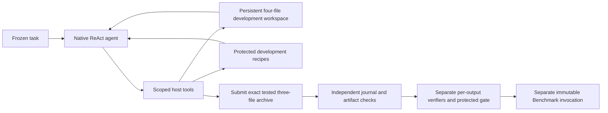

# Native agentic Builder and independent Pi protocol

This is a candidate on `builder/bounded-build-test-20261023`, based on
`79ffb21d4c85c30d5295190e535e2a854832d4c4`. It replaces the earlier
three-candidate controller. It is separate from shared M1 `60f65abe`.
The live acceptance preflight is **blocked**: this Linux test environment has no
governed model socket, executor socket or installed VCS-qualified SDK distribution.
Native tests use the real SDK source at the exact reviewed commit; they do not
establish an authenticated build or measured Pi improvement.

The earlier native candidate `m1-14` is preserved at `8e096ef9`. Release `m1-15`
also prevents the SDK from treating protected tool failures or cancellation as
a reason to make another model call. Historical receipt readers remain supported.

## Runtime and custody

Builder `m1-15` uses the native OpenJiuwen `ReActAgent` underlying Jiuwenswarm's
code harness, at `9e3390195a9ea15235b2b5f7412cb2aa440622cc`. The invocation-scoped
model client serializes native conversation history and tool definitions into
the existing governed Codex subscription call. It translates a strict action
envelope into native tool calls. The observed provider identity and call claims
remain those captured by the governed bridge. No API credential is fabricated.
The production carrier also checks the installed SDK's VCS pin.

The agent chooses actions; there is no prescribed edit/test/repair ordering:

The tools list/search/read files, write with expected hashes, apply one-context
patches, run registered checks, inspect issued logs, submit, or report blocked.
The workspace permits only `requirements.txt`, `poc_patch.py`, `run_benchmark.py`
and separate `tests.py`; the immutable delivery ZIP contains the first three.
Development code runs through host-owned recipes and the existing root executor.
The agent cannot choose a command, interpreter, host path, credential, reference
answer, network policy, lock or outcome rule. No SDK filesystem/shell fallback,
MCP discovery, automatic subagent, background continuation, external memory,
context repair or hidden model retry is enabled.

Limits are 600 seconds, 20 actual model calls, 40 tool operations and 12 generated
development jobs. Compilation is a host CPython compilation check without execution; unit and smoke runs use
fresh protected jobs capped at 30 seconds with the existing memory/process,
network and one-MiB output bounds. Invalid actions consume their allowance.
Budget refusal, cancellation and infrastructure failure stop the invocation.
Durable claims prevent uncertain or changed operations from being rerun.

Every edit invalidates previous passing checks. Submission needs compilation,
a nonempty executed unittest suite and a protocol smoke pass on the same complete
workspace fingerprint. Host action records bind exact model output, authorized
effect and before/after snapshots. Receipt 4.0.0 points to the protected journal,
submitted archive and development evidence. Independent checks replay edits,
compare manifest/archive bytes and inspect final test/isolation evidence. A
producer's own tests confer no independent correctness or acceptance authority.
Full drained kernel receipts and stop events survive interrupted checks.

## Separate Pi release and seven inputs

The normal classification pipeline remains the default. Its new Benchmark
consumer is `m1-7-agent-pi`, accepting Builder receipt 4 while retaining its
original output contract and downstream Evaluation compatibility. Pi is an
explicitly authored separate `research.benchmark` release, `pi-m1-1`, recorded
under `capsule_catalog.json` → `protocols.pi.benchmark`. It requires separate
admission/activation; authoring and registration never create admission.
The root Pi job factory refuses other Benchmark release identities.

Both Benchmark releases take exactly these roles:

| Input | Purpose |
|---|---|
| `hypothesis_blueprint` | Frozen task, baseline identity, metric, seed and repetitions |
| `poc_manifest` | Accepted candidate's file and archive identities |
| `poc_artifact_bundle` | Exact accepted immutable three-file ZIP |
| `build_receipt` | Protected development provenance; independent gate still required |
| `baseline_resource` | Captured baseline source |
| `validation_resource` | Public rows for classification; a precision request for Pi |
| `environment_lock` | Exact approved offline environment |

`capture_pi_task` creates a prepared frozen assignment without claiming Search
or Screening occurred. It captures a standard-library lock, a correct Decimal
Gauss–Legendre baseline, the public request and a timing blueprint. Builder
inputs use its existing `blueprint`, `lock`, `baseline_resource` and
`validation_resource` names. Accepted candidate refs fill the remaining three
Benchmark inputs through the protected caller; supplying refs to this authoring
helper alone grants no acceptance or execution authority.

The candidate chooses its algorithm. `approximate_pi(digits)` must return `3.`
plus exactly `digits` decimal places, truncated, for integer precision 0–100000.
The harness reads `/resources/validation/data.json` and prints exactly
`{"digits": N, "decimal": "3...."}`. Timing fields and duplicate JSON keys are
rejected. Public development cases include 0, 1, 2, 17, 10000 and 100000.

The host generates its 100000-place reference before measurement using two
independent implementations: Decimal Gauss–Legendre and integer Chudnovsky
binary splitting. They must agree; source and reference bytes are hashed.
Reference bytes remain in a root-owned private file, outside artifact inputs,
Builder tools and generated-code mounts. Three distinct additional precisions
in 20000–100000 are selected and frozen in the protected profile before execution.

The separate Benchmark performs 27 fresh-process jobs: five baseline then five
candidate harness runs at 10000 places, the same at 100000, then three unseen
and four boundary correctness runs. Additional correctness jobs call the
submitted `approximate_pi` directly. The host issues jobs only in this order.
It validates the whole prefix after process exit and records raw protected times,
median, spread, correctness, hardware, effective CPU affinity and execution refs.
The primary comparison is median elapsed time at 100000 places; 10000 is
diagnostic. The executor clock includes startup, output emission and protected
drain/capture overhead; provisioning and reference generation are excluded.
Candidate timing claims are never used. Incorrect/failed runs keep evidence and
null measured values. Slower correct programs are valid negative results.
Benchmark results never trigger automatic post-submission Builder repair.

## Design amendment, evidence and limits

The user's approved implementation plan changes the maintained design package's
`reference/capsules/builder.md` restrictions on execution and internal repair,
and replaces its single credential-bearing coding process with a scoped native
agent calling the governed subscription bridge. This branch amendment does not
silently rewrite the maintained design repository or historical imported notes.
Independent check ownership, per-output review, immutable artifacts and protected
acceptance remain. No RSI or model-router implementation is included.

The source candidate reuses Jiuwenswarm's bridge, store/custody, invocation
authorization, approved environment provisioning, readonly resources, namespace
and cgroup executor, durable RPC claims, verification and acceptance machinery.
Its custom part is the scoped Builder tool provider and registered Pi protocol.
It does not load the full chat adapter or claim a general repository agent.

See `agentic-builder-verification.json` for exact commands, source hashes, test
counts, release refs and live limitations. JUnit files separate controlled native
runtime tests, protected-boundary fixtures and existing regressions. High
precision, unseen requests, direct interface checks and literal scans reject
several hardcoding strategies; they do not prove all possible implementations
perform genuine computation. Live authenticated acceptance, a real submitted Pi
candidate, independent verifier assessments and actual performance measurements
remain unavailable until the preflight blockers are resolved on a qualified host.
