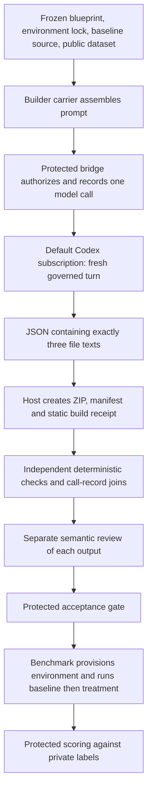

# Builder before the upgrade

Historical inspection of `60f65abe`. On `builder/bounded-build-test-20261023`,
[the Builder upgrade](builder-upgrade.md) supersedes the behavior below.

Source inspection: 2026-10-23, based on M1 commit `60f65abe`.
Work branch: `builder/current-flow-20261023`.

The registered scientific Builder is `research.builder` release `m1-12`, backed
by `research/capsules/builder_text.py`. Its module docstring still says m1-11;
the registration and admitted release pins determine the active version.
This note describes implementation, not evidence of a live successful run.

## What happens

1. The carrier reads the frozen intervention, approved requirements, baseline
   source and one public `data.json`. Public data contains labeled training rows
   and unlabeled test rows. Private test labels are withheld.
2. It makes one model call requesting exactly `requirements.txt`, `poc_patch.py`
   and `run_benchmark.py`, returned as JSON strings. This is currently a bounded
   classification proof of concept, not a general repository coding session.
3. Generated `poc_patch.py` supplies `predict(train, test)`. The requested harness
   reads the public dataset, uses the registered seed, calls the predictor once,
   and prints one batch of row-ID/string-label predictions. It must not score
   itself, run the baseline or manage repeat experiments.
4. Host Python packages the returned text into a deterministic ZIP. It checks
   archive members and size, dependency pins, Python compilation/AST rules,
   forbidden imports/calls and the visible prediction-output shape. It creates
   the manifest and build receipt without running generated code or installing
   packages. The inspector enforces a one-MiB compressed and expanded bound.
5. Protected checks independently re-read the archive, manifest, receipt and
   model-owner records. They require one completed observed producer call and
   byte equality between its returned file texts and the captured files.
6. If deterministic checks pass, the runner obtains a separately bound semantic
   review for each output (manifest and bundle). Review uses the declaration and
   output; it cannot prove hidden-input fidelity or runtime correctness. The
   protected gate decides whether the outputs advance.
7. Benchmark owns provisioning, baseline-first execution, repeats, prediction
   validation and protected scoring. A failed baseline halts treatment execution.

## Is it just Codex?

Codex supplies the generated code on the default fixed route. The carrier,
content store, static checks, independent reviewer invocations, gate, executor
and scorer are additional system components. Current m1-12 bypasses the older
dedicated tool-using Builder launcher and uses the governed text-call path.

The Codex subscription service starts a fresh ephemeral app-server thread with
read-only sandbox and never-approval settings, submits one turn, records the
resolved model and usage where reported, and returns text. There is no Builder
edit/run/test/repair loop. The prompt prohibits tools and execution; these
settings and source inspection alone are not live tool-confinement qualification.

Separate producer/reviewer invocations do not establish model diversity. Reviewers
use the fixed subscription route and may share the producer's underlying model
and blind spots. A configured model name is not proof of the model used in a run:
the protected call records retain requested and observed effective identities.
Optional provider routing is an existing seam; no router or RSI work is added here.

## What READY establishes

The receipt explicitly says `trial_executed: false` and
`packages_installed: false`. `READY` means the package passed the Builder's static
preparation checks. It does not establish that imports work in the target
environment, the predictor implements the intended intervention, or accuracy
improves. Semantic review and subsequent protected Benchmark evidence supply
different checks; none should be replaced by producer self-assurance.

## Source map and extent of this change

All paths below are relative to the repository root:

- `jiuwenswarm/research/capsules/assets.py`: release selection and registration.
- `jiuwenswarm/research/capsules/builder_text.py`: inputs, prompt, packaging, receipt.
- `jiuwenswarm/research/capsules/_common.py`: common model-call contract.
- `jiuwenswarm/research/checks/prediction_bundle.py`: archive/static output checks.
- `jiuwenswarm/research/checks/builder_text.py`: independent evidence joins.
- `jiuwenswarm/research/bridge.py`: protected dispatch and release-specific path.
- `jiuwenswarm/server/runtime/codex_subscription/service.py`: governed Codex turn.
- `jiuwenswarm/research/router_client.py`: fixed route and optional routing seam.
- `jiuwenswarm/research/runner.py`: review bindings and output acceptance gates.
- `jiuwenswarm/research/capsules/benchmark.py`: execution and scoring handoff.

This branch adds this explanation and a navigation link. It changes no runtime
code, immutable release pins or model settings. No live model, sandbox execution
or scientific improvement is claimed by this inspection.
