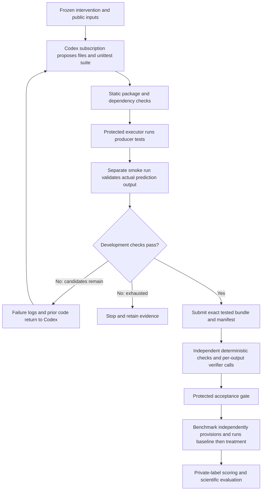

# Builder upgrade branch

Historical three-candidate implementation (`m1-13`). The current branch upgrade
is documented in [Native agentic Builder](agentic-builder.md); keep the evidence
below separate from the newer implementation's verification.

Branch `builder/bounded-build-test-20261023`, based on merged M1 `60f65abe`.
This is a source candidate for one eventual AI4R integration. It has not been
merged into `ai4r_M1`, admitted in an installed library, deployed or qualified by
a live authenticated research run.

## Behavior

Builder now makes at most **three candidates**: an initial implementation and
up to two internal repairs. A candidate contains the same three deliverable files
as before, plus a separate development unittest script. The suite is evidence,
not a fourth deliverable file. No frozen intervention, data, lock, scoring rule,
baseline or outcome criterion may change during repair.

Each candidate must pass static ZIP, Python, dependency and output checks before
execution. The existing protected offline provisioner prepares the exact approved
environment once per Builder invocation. Only its frozen wheel inventory may be
installed; Builder has no network/package-discovery command interface.

The existing RestrictedExecutor runs two separate jobs: a host-launched unittest
suite with a nonzero test-count requirement, then the generated prediction harness.
Both use read-only candidate/public-data mounts, a separate writable scratch
workspace, executor identity, network isolation, cgroup/process limits and captured
isolation proof. Neither job mounts the baseline, run state, credentials or private
labels. Benchmark's trusted scorer is not called during development tests.

The host parses smoke stdout against the public test IDs and declared class
vocabulary. Failed tests or invalid predictions produce bounded log excerpts for
the next edit. Invalid static code never reaches execution. Missing infrastructure,
missing isolation evidence, model-call failure or cancellation stops execution;
uncertain effects are never silently replayed.

Limits: at most 600 seconds of Builder work (further narrowed by the bound contract
and live owner deadline); at most three model calls and six generated-code jobs;
each job at most 30 seconds; at most 1 MiB per stdout/stderr stream, with kill on
overflow; at most 1 MiB compressed and expanded deliverable archive; tests at most
64 KiB. Memory and process ceilings use the existing protected runtime profile.
Previous-candidate repair context is bounded and oversized candidate text remains
in the original protected model-call evidence.

## Codex and reused components

Codex remains a **governed text-model call through the existing subscription**.
It returns edited file contents; the host executes tests. No new API key or
separate Builder model credential is needed by this path. The older dedicated
tool-using CLI launcher remains available to its historical releases but is not
activated for this upgrade. Its dedicated-credential requirement was not removed.

Reused components include `CapsuleRunner`, governed bridge/model-call claims,
`ScienceExecutionAdapter`, exact lock provisioning and resource mounting,
`RestrictedExecutor` and its kernel lifecycle, invocation-bound executor RPC,
durable `ClaimLedger`, check registration, per-output semantic verification,
protected gates, and the existing Benchmark/scorer path. No new agent framework,
router, RSI or general arbitrary-shell RPC is introduced.

The RPC accepts only exact candidate/test Refs and an ordinal. It resolves frozen
inputs on the protected side, reauthorizes against the live owner and claims the
ordinal before effects. A changed replay is rejected; an interrupted/unknown claim
is not rerun. Internal repairs happen before submission to independent acceptance.
A rejected independent check does not restart the Builder or scheduler node.

## Independent authority

`LoopBuilderChecks` recomputes archive/file/dependency checks and joins every tested
candidate and test source to its actual protected model-call response. It requires
the final model response, submitted manifest/bundle and final successful test report
to identify the same exact bytes. It checks the protected execution records and
isolation proof, and independently reparses final smoke predictions. A producer
success statement or a substituted report cannot establish readiness.

Producer tests can be incomplete or misleading. A successful smoke test only
establishes execution/output-shape compatibility on public data. It proves neither
intervention fidelity nor scientific improvement. The existing separate verifier
calls review each output, the gate retains release authority, and Benchmark still
owns fresh baseline-first experiments, repeats and private-label scoring. Separate
model invocations may use the same underlying model; model diversity is not claimed.

## Design comparison and versioned compatibility

Maintained authority was read from
`C:/Users/m50066326/huawei/jiuwenswarm/docs/architecture/design-package/`:
`reference/capsules/builder.md`, `reference/capsules/research-benchmark.md`, and
decisions D43/D45 in `method/decisions.md`.

| Maintained design clause | Authorized behavior on this branch |
|---|---|
| Builder writes/packages, runs no code, installs nothing, performs no repair | User explicitly authorizes bounded development execution and internal repair; approved offline environment preparation is host-owned |
| One synchronous tool-using Codex CLI invocation, dedicated revocable credential | Up to three governed subscription text calls plus protected executor tests; credential stays outside generated-code jobs |
| Build receipt has `trial_executed=false`, `packages_installed=false` | New prediction build receipt 3.0.0 records actual development execution and provisioning, with `development_only=true` and exact test-report Refs |
| Independent output review, protected acceptance and separate Benchmark | Preserved; development feedback never substitutes for acceptance or scientific measurements |
| Failed blocking independent check halts node | Preserved; no scheduler retry, post-rejection repair, replan or pin substitution |

This is an explicit user-authorized amendment candidate, not a claim of unchanged
compliance with those no-execution/no-repair clauses. The existing M1 public-data
classification scope remains; a general research repository builder is not added.

Scientific Builder is `m1-13`; its receipt-consuming Benchmark is
`m1-6-builder-tests`. Core Planner is `m1-14` solely to correct its host-record
description for versioned Builder receipts. Existing PDF and unrelated scientific
releases retain their pins. The authored static plan selects the new scientific
pins and reserves **five** Builder-node calls: three edits and two reviews. Static
remains the default. Recovery and scheduler joins accept only the appropriate
versioned receipt for the selected Builder. Old receipt schemas remain readable.

Authoring is explicit through `deploy/m1/freeze_builder_release.py --write` and
the existing Planner release authoring tool; startup verifies committed pins.
Reusing a captured old profile does not grant the new release permission. Actual
deployment requires a deliberate new matching build, profile, admission and runtime
operation mapping. No running DAG is changed by this branch.

## Verification and remaining qualification

**121 passed, 3 deselected** in the final Linux run (61.49 seconds). The
[Linux check evidence](builder-upgrade-linux-checks.xml) records the selected
unit/connected-component suite. A fresh Windows checkout of `5bc3ca70` also
passed 15 focused checks and both release-pin checks; its worktree was clean.
See the [verification receipt](builder-upgrade-verification.json) for exact commands.
The checks exercise repair/exhaustion, failure feedback,
wrong identity/bytes, protected smoke parsing, missing isolation proof, cancellation,
durable replay, static release pins and verifier-budget reservations. Controlled
model and kernel fixtures are clearly labelled in the tests. Three previously
excluded connected scheduler cases remain outside this suite; they are not passes.

No authenticated Codex-to-executor campaign, actual new Builder namespace/cgroup
qualification, target deployment, private-label result or measured scientific
improvement is claimed. The local WSL test environment did not have `bwrap`.
The production path fails closed when required execution infrastructure is absent.
