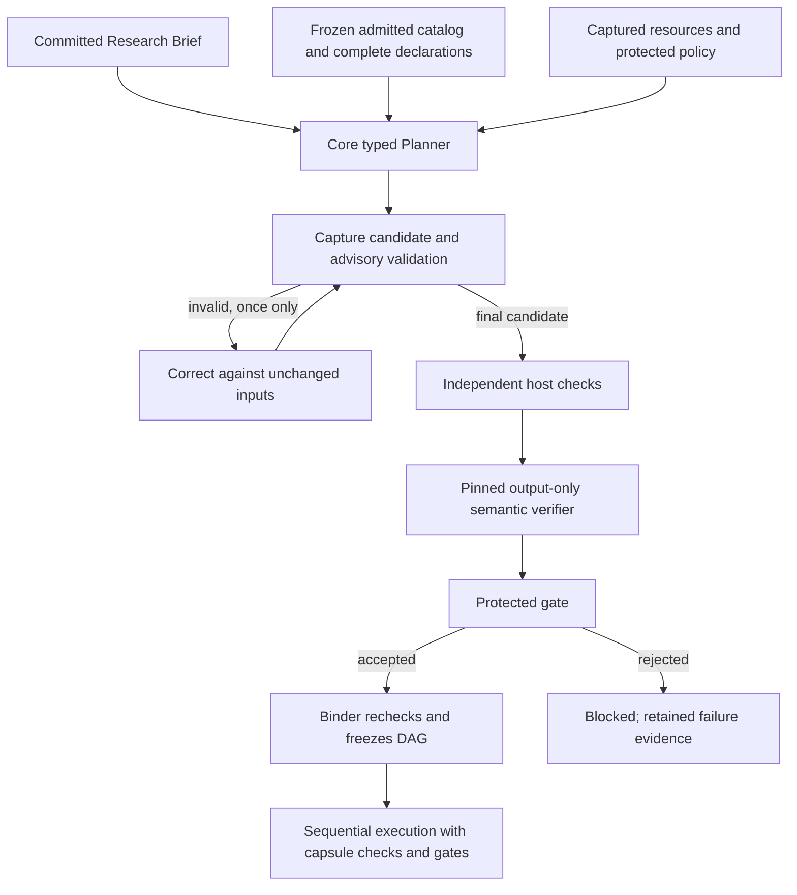

# Core typed Planner for M1

The normal app supports `plan_source: planned` through `research.planner`.
The Planner assembles a typed DAG from the accepted Brief, all selectable
admitted capsule declarations, the frozen library snapshot, resources and policy.
It does not choose only between the two historical paper/scientific shapes.
Generic work can use any compatible checked terminal capsule. Scientific
experiment work retains Scientific Evaluation and scientific Delivery, plus
its required Search/Screening/Hypothesis obligations. The existing qualified
PDF summary path remains supported. Dependencies and declared ports determine
ordering; input list order does not authorize execution. The node ceiling is
12, with at most two Generalist assignments when that capsule is installed.

## Validation and correction

A host-captured `capsule_contracts` input carries complete exact selectable
capsule declarations: purpose, ports, guarantees, needs, effects and budgets.
It is bound to the frozen snapshot. Host checks verify declarations against
original pinned bytes. The worker receives descriptive data, without live
Library access or authority to admit capsules, waive checks or execute a graph.

The user direction on October 23 amends earlier one-generation wording:
there are at most **two model generations inside one Planner work invocation**.
An invalid JSON/typed candidate receives one correction with its exact response
and public deterministic diagnostics. Both candidates and advisory diagnostics
are retained and exported. A valid first candidate uses one generation.
Authentication, runtime and budget failures are not proposal repair conditions.
An explicit bounded `INFEASIBLE:` reply is terminal for this invocation.

The final candidate still requires the original independent twelve-check bundle,
the pinned semantic verifier, a protected advancing gate and Binder validation.
Checks cover schema, Brief IDs/coverage, exact membership, matching port schemas,
dependencies, cycles, terminal placement, mandatory checking pins, effects,
resources and budgets. Unknown suggested checks remain advisory and are dropped.
There is no automatic static fallback, executed-graph mutation or node dispatch
retry. A rejected graph never becomes an executable partial plan.

The existing D30 route from final `plan_infeasible` to one linked new Compiler
attempt remains separately bounded: original run plus one linked run. Each
Planner invocation has its own maximum two generations and one separately
budgeted verifier call. This is neither MCTS nor an open-ended optimizer.
Semantic review remains declaration plus exact output (D20/D24); host checks
handle hidden Brief linkage. Output conformance does not prove research quality,
truth, optimality or Generalist reliability. A Generalist cannot promote its
output to independently verified scientific evidence.

## Operation and migration

Deployment commands remain `python deploy/m1/ai4r.py`; see
[operations](../../deploy/m1/OPERATIONS.md). New local captures use
`local-research-unified-v3`, core integrated policy v2 and the newly authored
Planner release. Existing configuration/state is preserved: use a fresh named
deployment profile or a reviewed explicit migration and requalification. Do not
edit captured declarations, manifests, credentials or accepted plans in place.
Startup does not regenerate pins or silently activate changed installed releases.

Static remains the default source per D39. Select `plan_source: planned` in a
normal submission or a supplied sequential benchmark case. Case omission uses
the app's selected default. The runner freezes this choice into its durable
submission before dispatch and preserves it on resume. Its sequential collection
and interface remain unchanged. For example, add `"plan_source": "planned"`
to an ordinary `sequential-cases:1` case; no held-out tests ship here.

Fresh production catalogs still need actual protected calibration. Fixture
checking assets are not production qualification. The explicit authoring command
`python deploy/m1/freeze_planner_release.py --version NEW_VERSION` freezes only
the core Planner and affected PDF Planner checker closure; `--check` verifies
pins without rewriting them. Scientific capsule and PDF work identities remain
unchanged. No M2 VM, factory or per-capsule-container dependency is introduced.

## Design alignment and evidence

M1 D19/D26 require integrated bounded typed planning; D39 preselects source and
retains static default. The implementation checkout's older design package is
preserved. The maintained AI4R design was inspected in the design-owner checkout
(`jiuwenswarm`, `ai4r_muk`), including `platform/planning-and-freeze.md`,
`reference/capsules/planner.md`, `reference/run-plan.md`, and `method/decisions.md`.
Their inspected byte identities are recorded in `typed-planner-sources.json`.
The full declaration context and one structural correction above are explicit
user-directed amendments, not claims that the earlier package already said so.

Tests distinguish controlled model replies from live-model quality. Connected
compiler/runner/check/gate/Binder tests establish acceptance boundaries, not a
completed scientific experiment. Native runtime integration, authenticated
model runs, Docker execution, ARM64 and Spark runs require separate evidence.

## Capsule factory consequence

New capsules become usable through complete declarations, independently qualified
checking assets, admission and activation. The factory should publish purpose,
typed ports, operating preconditions, effects, resource needs and explicit
limitations; do not add new hardcoded workflow alternatives to the Planner.
A broad packet schema alone does not describe an operation's configuration.
When contracts cannot express a required conversion, build and admit an explicit
adapter. Factory proposals remain candidates until the normal gates accept them.

Current checks and limitations: [validation receipt](typed-planner-validation.md).
