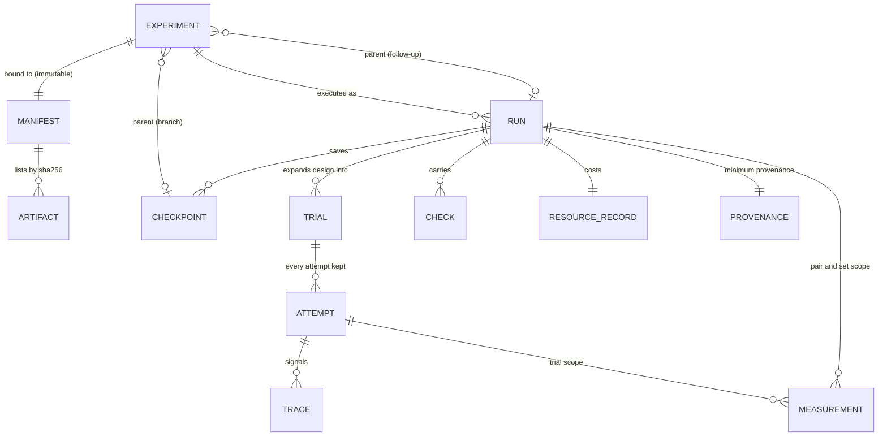

# Data model: PAS-M1-001 - Base simulator
Supporting artifact for [plan.md](plan.md). Field names and semantics come from SIMLAB-IF-001@r1 ([TASK.md §4](TASK.md#simlab-if-001-at-r1)); this page only shows how this TASK stores and relates them. It adds no shared fields.

## Entities and relationships

## Storage layout (under `SIMLAB_DATA_DIR`, outside the repository)
| Path | Holds | Mutability |
| --- | --- | --- |
| `simlab.sqlite` | Experiments, manifests, runs, trials, attempts, measurements, checks, checkpoints, provenance, resource records, registry | Rows for submitted experiments and manifests are write-once (enforced by triggers that reject UPDATE and DELETE); attempt rows append only |
| `drafts/<draft_id>/` | Authoring workspace before `bind` | Mutable until bound; never read by runs |
| `blobs/sha256/<aa>/<digest>` | Bound artifacts and checkpoint payloads, content-addressed | Immutable |
| `runs/<run_id>/<trial_id>/<attempt_id>/<signal>.npy` | Trace arrays (first column simulation time) | Immutable after the attempt ends |
| `runs/<run_id>/result.json` | Exported Result record | Rewritten only while the run is not terminal |
| `runner.sock` | JSON-RPC socket | Runtime only |

## State transitions
- **Run:** `QUEUED → RUNNING → COMPLETED | CANCELLED | FAILED`. `QUEUED → CANCELLED` is allowed. `FAILED` means infrastructure failure only. `PAUSED` arrives in phase 4 (PAS-M1-013).
- **Attempt:** `RUNNING →` one of `COMPLETED`, `INVALID` (with exactly one `invalid_reason`), `LIMIT_REACHED`, `INTERRUPTED`; or `BLOCKED` without ever running. A resumed trial gets a new attempt row; the interrupted one stays.
- **Experiment:** draft → bound (manifest hash fixed) → submitted (immutable). A change creates a new experiment.

## Validation rules (from spec)
| Rule | Spec reference |
| --- | --- |
| `objective_kind` in the seven kinds; kind never causes rejection | AC-003 |
| Every predicate, threshold, arm, variable and trial count has an `origin` | Edge Cases; PRD SL-1.S (builder side in PAS-M1-002) |
| `parent` resolves to an existing run or checkpoint | AC-003 |
| Each comparison declares `unit_of_inference`, `pairing`, `aggregation`, `required_precision` | AC-009 |
| The design yields at least one trial | Edge Cases |
| Checkpoints only at declared procedure points | Edge Cases |
| MJCF compiles; referenced assets are in the manifest with matching SHA-256 | AC-004, AC-005 |
| MuJoCo `ipc` flag not enabled (breaks exact replay) | research.md R7 |
| Unknown fields rejected | AC-002 |
