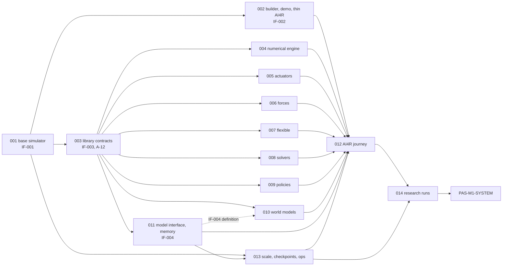

# TASKS: PAS-M1
Program register for milestone PAS-M1 (SIMLAB on the PhysicalAI-Sim lab). It is not a second implementation checklist; progress is read from each TASK's native tasks.md. Program folder per the owner's coding prompt: `labs/physicalai_sim/missions/PAS-M1/` (not `docs/code/Missions/`).

## 1. Identity and source baselines
| Field | Value |
| --- | --- |
| Program ID and objective | PAS-M1. Build SIMLAB, the PhysicalAI-Sim lab's installed simulation application (`labs/physicalai_sim/`), and its two AI4R capsules (`jiuwenswarm/research/capsule_extensions/simlab_*/`). Completion boundary: Architecture Main, "Completion boundary"; completes at the phase 5 exit on the local workstation with `reports/PAS-M1_Final_Test_Report.md` |
| Register revision/date | r2, 2026-10-31 (Session 2: sources re-registered at r0.4.3; see §6 C-04). r1, 2026-10-30 (Session 1) |
| Program coordinator | Suraj (owner). Coding agent: Claude Code. Bookkeeping responsibility only, not an approval gate |
| Full PRD path / revision / SHA256 / bytes | `source/PRD_main_body/PRD_main_body.md`, r0.4.3, `f22451f532ae7d9c9e556ca467e47821865e65fc0b7167210c0503cec889023f`, 7710 B. `source/PRD_context/PRD_context.md`, r0.4.3, `f6f5b8278b4be56037ae5e11e6d203d9044c2c4c65d463fd6ba9bb8bd33ec2b0`, 3565 B. `source/PRD_context/hypothesis-register.json`, schema `simlab-hypothesis-register:1`, `5004478ee90590e766bac4c6ce151b9a9ea54e8fb6f9a776c78ac758ccce6f56`, 50740 B |
| Architecture source and rendered views / revision / SHA256 | `source/Architecture_main_body/Architecture_main_body.md`, r0.4.3, `43ff166a6b223fcc772d59abeb193502b12b69b7be3193f796a33d586c8b6c03`, 10885 B. `source/Architecture_context/Architecture_context.md`, r0.4.3, `9e0b13c01e7a45984904cc883a22bd73b70e33821d8412fbd073e6ffdedf38af`, 8234 B (contains the system-picture mermaid view) |
| Verification sources | `source/Verification/README.md`, `00fb5584026b9a35791f878c4d9fee637744a7818172a293079d38c334d7b3bf`, 861 B. `source/Verification/benchmark-and-test-plan.md`, r0.4.3, `7eb5ef323804821fed61a48056fb3e566667486682aeede99c25999ef7c7981e`, 10919 B. `source/Verification/official-benchmarks-catalogue.md`, checked 2026-10-30, `580dce93bc77228e9b51c752a00af875dc9ecc7f99dd917c91c5fe82642fa7bd`, 51084 B |
| Other registered inputs | `source/received/ai4r-labs-and-capsules-brief-2026-10-23.txt`, `aa4e97244fd07ee758a30565ca19b5c976e2ac1b933ba77d971bbec46f950c68`, 5013 B. `source/README.md`, r0.4.3, `14978af243cd2692b356059f817f5a2cd732663391925fb2eacff56f39fe0a20`, 563 B. `source/.gitattributes`, `447e419fa5f75da5a3c26b3938314c55f41b4dc42013e2f1c44cab4f0f74f9c1`, 138 B. External, not committed: Fit2Form arXiv:2011.06498v1 PDF, 4122358 B, `d303487f6844fa02659ed14d9318c0e8a545e67c01afbcb7841f163a67a273a7` |
| Source set digest | `source-baseline.json` (revision `r0.4.3`, captured 2026-10-31T22:38:48Z) aggregate `3049f0bc9972e18b531c54b86003f154cac46bb6f8b5dd1b65e75f86aa4a3aba` (method: SHA-256 of compact sorted JSON of the ordered file receipts). All 11 files rehashed 2026-10-31 in Session 2: every size and SHA-256 matches, and the aggregate recomputes. r0.4.3 bytes are uncommitted owner edits on top of `d3054741d` (which holds r0.4.2, aggregate `3d2308fc…67a1`) |
| AI4R baseline consumed (not modified) | `AI4Research-Main` as forked, at `PhysicalAI-Sim` HEAD `d3054741d2cdeae2d57f80e40a2f7a460902596b` (AI4R tree identical to `0b5292625`; `d3054741d` changed only SIMLAB sources): capsule format `docs/architecture/design-package/reference/declaration.md` (schema 1.0.0), `benchmark-payload:field-contract:2` (`reference/capsules/research-benchmark.md` §4.1), typed Planner (`docs/capsules/typed-planner-m1.md`), check runner pattern `deploy/m1/capsule_checks.py`, benchmark requirements v0.12 (`docs/verify/BENCHMARK_REQUIREMENTS_Oct_14.md`), Harbor case format (`benchmarks/harbor_suite/AUTHORING.md`). Merging a newer `AI4Research-Main` is a recorded update in §6 followed by rerunning the affected checks (Architecture Main, "AI4R connection") |
| Scope inclusions and exclusions | Included: PRD Main SL-1 to SL-10 Definition/Scope/Blacklist parts; PRD Context user stories, in-scope list and hardware; all Architecture Main exits X1.1 to X5.2; Architecture Context IF-001 to IF-004, flows, failure behavior and open inputs; the test plan's test benches, families, adopted benchmarks, phase rows, check groups and reports. Excluded with reason: SL-5 and SL-10 Future State, PRD Context "Not now", Architecture Main "M2 (later)", portability across machines (SL-7), F5 x86 vs arm64 and the M2 rows of the adopted-benchmark table (all M2 or later per the sources); the brief's findings, continuation and improvement, which stay in AI4R (PRD Context, Sources) |
| System-verification TASK | [PAS-M1-SYSTEM](PAS-M1-SYSTEM/TASK.md) |
| Integrated candidate | NOT_BUILT |

**Locators used below.** `PRD` = PRD Main, `PRDC` = PRD Context, `ARCH` = Architecture Main, `ARCHC` = Architecture Context, `VER` = Verification README, `TP` = benchmark and test plan, `CAT` = catalogue, `HR` = hypothesis register, `BRIEF` = received brief. SL clause parts: `.D` Definition & Expectation, `.S` Scope (Whitelist), `.B` Blacklist, `.F` Future State. Architecture nodes (ARCH "Responsibilities" and ARCHC "System picture"): N-REQ requester (AI4R or another agent), N-BLD builder, N-RUN runner and experiment core, N-EXE executors, N-LIB libraries, N-MOD model interface and memory, N-CHK checks, N-REG capability registry, N-TOOL tool interface, N-RCAP run capsule, N-DATA data/traces/records, N-SRC sources. Placement nodes (ARCH "Placement"): PL-AI4R (`ai4r` container, only service on `127.0.0.1:5175`), PL-RUN (`simlab-runner`, no credentials, private network), PL-ROUTE (lab model route). Edges: E1 N-REQ→N-BLD, E2 N-BLD→N-RUN via tools, E3 N-RUN→N-EXE, E4 N-RUN→N-LIB, E5 N-RUN→N-MOD→PL-ROUTE, E6 N-RUN→N-DATA, E7 N-DATA→N-REQ, E8 N-REG→N-BLD, E9 N-SRC→N-BLD.

## 2. Task register and dependency graph
| TASK ID / entry link | Bounded outcome | Executor | Required for program? | Prerequisite TASK/block/IF IDs | Native feature directory | Progress/evidence source |
| --- | --- | --- | --- | --- | --- | --- |
| [PAS-M1-001](PAS-M1-001/TASK.md) | Phase 1 base simulator: local feasibility (X1.1), experiment core, MuJoCo executor, authoring tools, records, checks, world-state save/branch, traces, tool interface (MCP/Python/CLI), registry, doctor, check groups, F1/F5 bench; exits X1.1 to X1.6 | Claude Code for Suraj | Yes (ARCH build order phase 1) | None. A-13 is resolved by its own X1.1 block | `labs/physicalai_sim/missions/PAS-M1/PAS-M1-001/` | [tasks.md](PAS-M1-001/tasks.md) |
| [PAS-M1-002](PAS-M1-002/TASK.md) | Phase 2 builder (`simlab.experiment_build`) and run capsule (`simlab.benchmark`), feasibility records, first demonstration, changed follow-up, thin AI4R connection; exits X2.1 to X2.6 | Claude Code for Suraj | Yes (phase 2) | PAS-M1-001 (IF-001@r1 phase 1 operations, authoring path, records); O-12; Fit2Form preflight | `labs/physicalai_sim/missions/PAS-M1/PAS-M1-002/` | tasks.md (created at specify) |
| [PAS-M1-003](PAS-M1-003/TASK.md) | Phase 3 shared library contracts (IF-003: runtime, observation, timing, save/restore), A-12 laptop admission, conformance harness, one integration path, interacting components and a three-library scene; exit X3.2 and the X3.1 harness | Claude Code for Suraj | Yes (phase 3 first) | PAS-M1-001 | `labs/physicalai_sim/missions/PAS-M1/PAS-M1-003/` | tasks.md (created at specify) |
| [PAS-M1-004](PAS-M1-004/TASK.md) | Numerical engine executor and second-engine cross-checks (TB-10, F5 MuJoCo vs numerical, Drake, ContactNets real data); X3.1 for engines | Claude Code for Suraj | Yes (phase 3 library) | PAS-M1-003 (IF-003@r1) | `labs/physicalai_sim/missions/PAS-M1/PAS-M1-004/` | tasks.md (created at specify) |
| [PAS-M1-005](PAS-M1-005/TASK.md) | Actuators library wrapping MuJoCo `dcmotor`/`pid` (TB-11); X3.1 | Claude Code for Suraj | Yes (phase 3 library) | PAS-M1-003 | `labs/physicalai_sim/missions/PAS-M1/PAS-M1-005/` | tasks.md (created at specify) |
| [PAS-M1-006](PAS-M1-006/TASK.md) | Extra forces library: magnets, thrust, tires (TB-12); X3.1 | Claude Code for Suraj | Yes (phase 3 library) | PAS-M1-003 | `labs/physicalai_sim/missions/PAS-M1/PAS-M1-006/` | tasks.md (created at specify) |
| [PAS-M1-007](PAS-M1-007/TASK.md) | Flexible parts library wrapping MuJoCo cable/flex (TB-13, PyElastica, `CantileverIntoCircle`); X3.1 | Claude Code for Suraj | Yes (phase 3 library) | PAS-M1-003 | `labs/physicalai_sim/missions/PAS-M1/PAS-M1-007/` | tasks.md (created at specify) |
| [PAS-M1-008](PAS-M1-008/TASK.md) | Solver library (TB-14 LQR); X3.1 | Claude Code for Suraj | Yes (phase 3 library) | PAS-M1-003 | `labs/physicalai_sim/missions/PAS-M1/PAS-M1-008/` | tasks.md (created at specify) |
| [PAS-M1-009](PAS-M1-009/TASK.md) | Frozen policies library and released-policy adapters (TB-15); X3.1 | Claude Code for Suraj | Yes (phase 3 library) | PAS-M1-003 | `labs/physicalai_sim/missions/PAS-M1/PAS-M1-009/` | tasks.md (created at specify) |
| [PAS-M1-010](PAS-M1-010/TASK.md) | World models library: scoring (TB-16), labeled preview, real world model error vs physics (X3.4), F9 | Claude Code for Suraj | Yes (phase 3 library) | PAS-M1-003; IF-004@r1 (definition, for a model reached through the model route); A-12 | `labs/physicalai_sim/missions/PAS-M1/PAS-M1-010/` | tasks.md (created at specify) |
| [PAS-M1-011](PAS-M1-011/TASK.md) | Model interface and memory under test (IF-004 owner): call log, timing modes, budgets, fallbacks, memory state (TB-17), real model in the loop (X3.3), fresh replication operation, F8 | Claude Code for Suraj | Yes (phase 3 library) | PAS-M1-003 (IF-003@r1 timing and save/restore); A-12 | `labs/physicalai_sim/missions/PAS-M1/PAS-M1-011/` | tasks.md (created at specify) |
| [PAS-M1-012](PAS-M1-012/TASK.md) | Phase 4 AI4R journey connection: Planner-selected, gated SIMLAB capsules; question to report (X4.1); overall test inside AI4R (X4.2); payload compatibility; live view (X4.5, Conditional); F7 phase 4 | Claude Code for Suraj | Yes (phase 4); X4.5 Conditional on the UI owner (PRD SL-10.D) | PAS-M1-002 (IF-002@r1, thin connection); PAS-M1-003 to PAS-M1-011 joined (ARCH "AI4R connection": phase 4 is never the first connection); PAS-M1-013 checkpoints for the F7 branch case; O-03; O-07 | `labs/physicalai_sim/missions/PAS-M1/PAS-M1-012/` | tasks.md (created at specify) |
| [PAS-M1-013](PAS-M1-013/TASK.md) | Phase 4 scale, whole-state checkpoints and operations: scale run (X4.3), quiescent checkpoint and branch (X4.4), concurrency, crash recovery, pause/resume/stream, F6 | Claude Code for Suraj | Yes (phase 4) | PAS-M1-001; PAS-M1-003; PAS-M1-011 (memory and model-call history in whole state) | `labs/physicalai_sim/missions/PAS-M1/PAS-M1-013/` | tasks.md (created at specify) |
| [PAS-M1-014](PAS-M1-014/TASK.md) | Phase 5 first research runs: five frozen register candidates end to end (X5.1), held-out F4 set | Claude Code for Suraj | Yes (phase 5) | PAS-M1-012; PAS-M1-013; HR | `labs/physicalai_sim/missions/PAS-M1/PAS-M1-014/` | tasks.md (created at specify) |
| [PAS-M1-SYSTEM](PAS-M1-SYSTEM/TASK.md) | Integrated candidate on the local workstation: completion-boundary journey, all exits' checks on one candidate, final test report (X5.2) | Claude Code for Suraj | Yes (system TASK) | All TASKs above | `labs/physicalai_sim/missions/PAS-M1/PAS-M1-SYSTEM/` | tasks.md (created at specify) |

Order follows ARCH "Build order": phase 1 (001), phase 2 (002), phase 3 (003 first, then 004 to 011 in parallel where IF-003 is ready, merged through 003's integration path), phase 4 (013 and 012), phase 5 (014), then SYSTEM. There are no cycles. Definition-time dependencies on IF-001 to IF-004 are satisfied by the agreements embedded in Session 1; implementation-time dependencies are listed in each TASK. A general core improvement during development is allowed when it is reviewed and the affected evidence is rerun (ARCH "Build order"); record it in the owning TASK's change table.

**AC IDs.** PAS-M1-001's ACs are defined in its [spec.md](PAS-M1-001/spec.md). For every other TASK, the AC IDs in §3 are reserved by this register: its spec.md must define them with those IDs and allocations, may add ACs, and may drop an allocation only by updating this section.

## 3. Source coverage allocation
| Source clause ID / exact locator | Architecture node/edge IDs | Owning TASK / AC references | Allocation decision and completeness |
| --- | --- | --- | --- |
| PRD-DESC: PRD Main "Description" (build, run, return all data, take the next request; any research objective is valid; the requester does the science) | E1 to E7 | PAS-M1-001/AC-003, PAS-M1-002/AC-007, PAS-M1-SYSTEM/AC-002 | Allocated |
| SL-1.D: accept requests from AI4R or any agent (objective with sources, or follow-up referencing a run or checkpoint); record objective kind without judging | N-REQ, E1 | 001/AC-003 (request fields, seven kinds, parent reference, no judgement); 002/AC-007 (builder intake) | Allocated |
| SL-1.S: builder writes the full protocol with origins, frozen before the counting run; halts on ambiguity or conflicting sources | N-BLD | 002/AC-007 | Allocated |
| SL-1.B: no refusing non-claim work; no invented predicates, thresholds, arms or trial counts | N-BLD, N-RUN | 002/AC-007; 001/AC-003 (validation never rejects by kind) | Allocated |
| SL-2.D: construct and modify every experiment part through normal tools | N-TOOL, N-BLD | 001/AC-004 (authoring tools for each part category); 002/AC-008 (builder uses only them) | Allocated |
| SL-2.S: authoring tools produce runnable artifacts bound by an immutable manifest; follow-up is a new experiment with the same tools; inexpressible change is a capability gap | N-TOOL, N-BLD | 001/AC-004 (artifacts, extension points, manifest); 001/AC-002 (capability-gap record); 002/AC-005 (follow-up); 002/AC-008 (gap recording) | Allocated |
| SL-2.B: no core edits for one experiment | N-RUN | 002/AC-005; 012/AC-002; 014/AC-003; SYSTEM/AC-002 | Allocated |
| SL-3.D: arms, factors, conditions, replicates, episodes, paired trials, declared randomness, pilot runs never count, measurements per trial/pair/set | N-RUN | 001/AC-006 (all except pilot); 002/AC-009 (pilot never counts) | Allocated |
| SL-3.S: keep every trial/attempt/failure/interruption; instability is a result; six invalid reasons only; immutable after submission; fresh execution = new run identity | N-RUN, N-DATA | 001/AC-007, 001/AC-008; 013/AC-001 (interruptions from crashes) | Allocated |
| SL-3.B: no verdicts in the runner; no silent reruns | N-RUN | 001/AC-008 | Allocated |
| SL-4.D: validation (all findings at once), sanity watchdogs, reruns across engine settings and assumed values, independent recomputation, known-answer checks or control arms | N-CHK | 001/AC-005, 001/AC-009; 002/AC-003 (planted defects) | Allocated |
| SL-4.S: unanchored, not refused; failed required check marks measurements invalid; counted comparisons declare unit of inference, pairing, aggregation, precision | N-CHK | 001/AC-009 | Allocated |
| SL-4.B: never hide or average away a failed check | N-CHK | 001/AC-009; 002/AC-003 | Allocated |
| SL-5.D: one simulator with built-in libraries; each passes its known-answer case before research use | N-EXE, N-LIB, N-REG | 001/AC-010 (MuJoCo), 001/AC-016 (admission by conformance); 003/AC-006; 004/AC-001; 005/AC-001; 006/AC-001; 007/AC-001; 008/AC-001; 009/AC-001; 010/AC-001; 011/AC-003 | Allocated. Tire known answer PENDING_SOURCE (§6 Q-04) |
| SL-5.S: source's simulator when it runs here, else MuJoCo or numerical, with reason; world models as labeled preview or test subject | N-EXE, N-BLD, N-LIB | 001/AC-002 (engines and why); 002/AC-010; 010/AC-003 | Allocated |
| SL-5.F: training; fluids, granular, large FEM; photoreal; real hardware | N/A | None | Excluded: Future State (PRD SL-5; PRDC "Not now") |
| SL-6.D: a model deciding during a trial, or a memory module across episodes, as the thing under test | N-MOD | 011/AC-004, 011/AC-006 | Allocated |
| SL-6.S: record every call; waiting, measured-latency and fixed-latency timing; budgets; declared fallbacks | N-MOD, E5 | 011/AC-002 | Allocated |
| SL-6.B: no training or fine-tuning of the model under test | N-MOD, N-LIB | 011/AC-007; 009/AC-003 | Allocated |
| SL-7.D: save, restore, branch the whole state (world, controllers, planners, memory, random state, pending events, action and model-call history) | N-RUN, N-LIB, N-MOD | 001/AC-012 (world, random state, pending events, action history); 003/AC-008 (controller and planner state via IF-003); 011/AC-003 (memory); 013/AC-002 (whole state including model-call history) | Allocated by part |
| SL-7.S: replay on same machine and build; fresh replication is a new run; fresh checkout; quiescent M1 checkpoints with no unrecorded model request; follow-ups from saved state | N-RUN | 001/AC-011 (replay); 001/AC-017 (fresh checkout); 011/AC-004 (fresh replication); 013/AC-002 (quiescent checkpoints, follow-up from saved state) | Allocated. Portability across machines excluded (M2, SL-7.S) |
| SL-8.D: all data queryable by run, arm, trial, time and signal | N-DATA, E6, E7 | 001/AC-013; 011/AC-002 (model calls) | Allocated |
| SL-8.S: feasibility record per dependency; missing dependency → arms BLOCKED; minimum provenance in a declared durable location | N-DATA, N-BLD | 001/AC-014; 002/AC-004 | Allocated |
| SL-8.B: no undeclared proxy for a missing dependency | N-BLD | 002/AC-004 | Allocated |
| SL-9.D: MCP, Python client and CLI with the same operations; builder and run capsules in AI4R, Planner-selected, checked and gated; next question returns with references | N-TOOL, N-RCAP, PL-AI4R | 001/AC-015; 002/AC-006; 012/AC-003 | Allocated |
| SL-9.B: no second chat entry point or host port; no interpretation in SIMLAB | PL-AI4R, PL-RUN, N-RUN, N-RCAP | 001/AC-019, 001/AC-008; 002/AC-014; SYSTEM/AC-005 | Allocated |
| SL-10.D: local x86-64 workstation; registry; doctor; concurrent runs; crash recovery; resource records; live view Conditional | N-REG, N-RUN | 001/AC-001, 001/AC-016; 013/AC-003; 012/AC-004 (Conditional) | Allocated |
| SL-10.S: verification per VERIFICATION.md and the test plan; a completion report per phase and a final report | All | 001/AC-022; 002/AC-013; 003/AC-007; 013/AC-007; 014/AC-005; SYSTEM/AC-001 | Allocated |
| SL-10.F: DGX Spark, arm64, large VLA/world models, full lineage, RL/training, further engines | N/A | None | Excluded: M2 and later (PRD SL-10) |
| PRDC Sources table | N-SRC | §1 registration; HR → 002/AC-011, 014/AC-001, 014/AC-002; Fit2Form → 002/AC-001; AI4R PRD → 012/AC-006 | Allocated |
| PRDC US-SL01 question → report traced to runs | E1 to E7 | 012/AC-001; SYSTEM/AC-004 | Allocated |
| PRDC US-SL02 follow-up without core edits | N-BLD | 002/AC-005; 012/AC-002 | Allocated |
| PRDC US-SL03 checks and what ran vs missing | N-CHK, N-DATA | 001/AC-009, 001/AC-014; 002/AC-004 | Allocated |
| PRDC US-SL04 model or memory under test; replay vs fresh repeat | N-MOD | 011/AC-004, 011/AC-006 | Allocated |
| PRDC US-SL05 world-model preview then physics confirmation | N-LIB | 010/AC-003 | Allocated |
| PRDC US-SL06 save whole state and branch | N-RUN | 001/AC-012; 013/AC-002 | Allocated |
| PRDC US-SL07 another agent drives SIMLAB through tools | N-TOOL | 001/AC-015 | Allocated |
| PRDC US-SL08 phase reports and benchmark results | All | 001/AC-022; SYSTEM/AC-001 (and each phase report AC under SL-10.S) | Allocated |
| PRDC "Scope and deployment": in-scope list | N-EXE, N-LIB, N-MOD | 001/AC-010; 004 to 011 (library ACs above) | Allocated; "Not now" excluded with SL-5.F |
| PRDC hardware: M1 local workstation only; model access only through the lab's model route; API or small local models | PL-AI4R, PL-ROUTE | 001/AC-001; 003/AC-005; 011/AC-001 | Allocated |
| PRDC Terms: "the overall test" | E1 to E7 | 012/AC-002; SYSTEM/AC-002 | Allocated |
| ARCH "Completion boundary" and its non-completion list | E1 to E7 | SYSTEM/AC-002 | Allocated |
| ARCH Responsibilities: Builder | N-BLD | 002/AC-007, 002/AC-008 | Allocated |
| ARCH Responsibilities: Runner and experiment core | N-RUN | 001/AC-006, 001/AC-007, 001/AC-008 | Allocated |
| ARCH Responsibilities: Executors (MuJoCo first, numerical, source simulator when admitted; pinned; admitted by conformance) | N-EXE | 001/AC-010; 004/AC-001, 004/AC-004; 002/AC-010 | Allocated |
| ARCH Responsibilities: Libraries (library interface; wrap MuJoCo models; admitted after known-answer checks) | N-LIB | 003/AC-001, 003/AC-006; 005/AC-001; 007/AC-001 | Allocated |
| ARCH Responsibilities: Model interface and memory | N-MOD | 011/AC-001 | Allocated |
| ARCH Responsibilities: Checks (owned separately from the code they check) | N-CHK | 001/AC-009, 001/AC-020 | Allocated |
| ARCH Responsibilities: Capability registry (admission only by conformance) | N-REG | 001/AC-016 | Allocated |
| ARCH Responsibilities: Tool interface (same operations for every agent, including authoring) | N-TOOL | 001/AC-004, 001/AC-015 | Allocated |
| ARCH Responsibilities: Run capsule (no interpretation, no reruns to improve results) | N-RCAP | 002/AC-014 | Allocated |
| ARCH Responsibilities: requester owns objectives, design, thresholds, interpretation | N-REQ | 001/AC-008; 002/AC-007 | Allocated |
| ARCH Placement: `ai4r` only service on `127.0.0.1:5175`; `simlab-runner` without credentials on a private network; declared execution modes; confined agent-authored code; model calls only via the model interface; M1 on the laptop; data directory outside the repo, curated evidence committed; lab folder self-contained; capsules in `capsule_extensions/simlab_*` | PL-AI4R, PL-RUN, PL-ROUTE | 001/AC-001, 001/AC-004, 001/AC-014, 001/AC-019; 003/AC-001; 011/AC-001; 002/AC-006 | Allocated |
| ARCH Build order (phases 1 to 5; reviewed core improvements with evidence rerun; bespoke core change in phase 5 is a capability gap) | All | §2 order; 014/AC-003 | Allocated |
| ARCH X1.1 | PL-AI4R, PL-ROUTE, PL-RUN | 001/AC-001 | Allocated |
| ARCH X1.2 | N-EXE, N-CHK | 001/AC-018 (with 001/AC-010, 001/AC-011) | Allocated |
| ARCH X1.3 | N-CHK | 001/AC-005 | Allocated |
| ARCH X1.4 | N-TOOL | 001/AC-015 | Allocated |
| ARCH X1.5 | N-RUN | 001/AC-011 | Allocated |
| ARCH X1.6 | All | 001/AC-017 | Allocated |
| ARCH X2.1 | N-EXE | 002/AC-001 | Allocated; depends on O-12 |
| ARCH X2.2 | N-BLD | 002/AC-002 | Allocated |
| ARCH X2.3 | N-CHK | 002/AC-003 | Allocated |
| ARCH X2.4 | N-BLD, N-DATA | 002/AC-004 | Allocated |
| ARCH X2.5 | N-BLD | 002/AC-005 | Allocated |
| ARCH X2.6 | N-RCAP, PL-AI4R | 002/AC-006 | Allocated |
| ARCH X3.1 | N-LIB, N-REG | 003/AC-006 (harness); 004/AC-003; 005/AC-002; 006/AC-002; 007/AC-002; 008/AC-002; 009/AC-002; 010/AC-005; 011/AC-008 | Allocated by library |
| ARCH X3.2 | N-LIB | 003/AC-002, 003/AC-003 | Allocated |
| ARCH X3.3 | N-MOD | 011/AC-004 | Allocated |
| ARCH X3.4 | N-LIB | 010/AC-002 | Allocated |
| ARCH X4.1 | E1 to E7 | 012/AC-001 | Allocated |
| ARCH X4.2 | E1 to E7 | 012/AC-002 | Allocated |
| ARCH X4.3 | N-RUN | 013/AC-001 | Allocated |
| ARCH X4.4 | N-RUN | 013/AC-002 | Allocated |
| ARCH X4.5 | N-RUN, PL-AI4R | 012/AC-004 | Allocated, Conditional (O-07) |
| ARCH X5.1 | E1 to E7 | 014/AC-001 | Allocated |
| ARCH X5.2 | All | SYSTEM/AC-001 | Allocated |
| ARCH Required proof rules (counts only through the real system; earlier exits' checks keep running; each exit stands alone; no mocks at BOUNDARY/SYSTEM; fixtures cannot prove a real model; BLOCKED and NOT_RUN are not PASS) | All | SYSTEM/AC-003; 001/AC-018 (check groups rerun) | Allocated |
| ARCH "M2 (later)" | N/A | None | Excluded: M2 |
| ARCH "AI4R connection and prompt use" (r0.4.3): SIMLAB owns its interfaces and AI4R's current formats never limit its capabilities; the two capsules are the adapter (anti-corruption layer) that follows AI4R's capsule format, Planner, gates and process rules and translates SIMLAB results into what AI4R accepts; anything untranslatable is attached by reference or reported, never dropped silently; a small AI4R patch on `PhysicalAI-Sim` only if the capsules cannot bridge a gap, recorded as a deviation with reason and removal condition and offered upstream; pinned baseline; merges recorded and followed by rerunning the affected checks, including the capsules' contract checks | N-RCAP, PL-AI4R | 002/AC-006; 012/AC-006 | Allocated (text updated for r0.4.3, §6 C-04) |
| ARCH "AI4R connection": no AI4R imports in `labs/physicalai_sim/`, enforced by an import check | PL-RUN | 001/AC-019 | Allocated |
| ARCH "AI4R connection": phase 3 parallel only where contracts are ready; joins the baseline continuously; phase 4 is never the first connection | N-LIB | 003/AC-004 | Allocated |
| ARCHC SIMLAB-IF-001 | N-TOOL, N-RUN, N-DATA | Owner PAS-M1-001 (§4); 001/AC-002, 001/AC-015 | Allocated |
| ARCHC SIMLAB-IF-002 | N-BLD, N-RCAP | Owner PAS-M1-002 (§4); 002/AC-006, 002/AC-014; 012/AC-005 | Allocated; §6 Q-05 open |
| ARCHC SIMLAB-IF-003 | N-LIB | Owner PAS-M1-003 (§4); 003/AC-001 | Allocated |
| ARCHC SIMLAB-IF-004 | N-MOD, E5 | Owner PAS-M1-011 (§4); 011/AC-001 | Allocated |
| ARCHC flow 1 research run (optional pilot, gate, counted run with checks) | E1 to E7 | 002/AC-006, 002/AC-009; 012/AC-001 | Allocated |
| ARCHC flow 2 follow-up | E1, E2 | 002/AC-005; 012/AC-002 | Allocated |
| ARCHC flow 3 model in the loop | E5 | 011/AC-002, 011/AC-004 | Allocated |
| ARCHC flow 4 save and branch | N-RUN | 001/AC-012; 013/AC-002 | Allocated |
| ARCHC flow 5 recovery | N-RUN | 013/AC-001 | Allocated |
| ARCHC failure: ambiguity, source conflict, missing capability → builder halts | N-BLD | 002/AC-007 | Allocated |
| ARCHC failure: missing dependency → BLOCKED | N-RUN, N-BLD | 001/AC-014; 002/AC-004 | Allocated |
| ARCHC failure: numerical failure, protocol violation, wrong intervention, missing observation, corrupted record, invalid action → trial invalid, run continues | N-RUN | 001/AC-007 | Allocated |
| ARCHC failure: physical divergence → completed, stopped at declared limits | N-RUN | 001/AC-007 | Allocated |
| ARCHC failure: no control or known-answer check → unanchored | N-CHK | 001/AC-009 | Allocated |
| ARCHC failure: required validity check failed → affected measurements invalid; unexpected control-arm outcome is a result | N-CHK | 001/AC-009 | Allocated |
| ARCHC failure: model timeout, refusal, bad answer → declared fallback | N-MOD | 011/AC-002 | Allocated |
| ARCHC failure: budget or limit → `LIMIT_REACHED` | N-RUN, N-MOD | 001/AC-007; 011/AC-002 | Allocated |
| ARCHC failure: model route unavailable → halt or BLOCKED with real evidence | PL-ROUTE | 001/AC-001; 011/AC-002 | Allocated |
| ARCHC evidence levels: preview, simulation, measured, validated range | N-DATA | 001/AC-009 (simulation); 010/AC-003 (preview); 004/AC-005 (measured, validated range) | Allocated |
| ARCHC worked example (Fit2Form and tactile-slip follow-up) | N-BLD | 002/AC-001, 002/AC-005 | Allocated as guidance for 002 |
| ARCHC required reading | N/A | Read in Session 1; path drift in §6 C-02 | Allocated (process) |
| ARCHC open inputs O-03 / O-07 / O-12 / A-12 / A-13 | N/A | 012/AC-006 / 012/AC-004 / 002/AC-001 / 003/AC-005 / 001/AC-001 | Allocated; see §6 |
| ARCHC [confirm] values | N/A | Pendulum 0.5% → 001/AC-010; agreement 5 pp on 20 objects, pilot 3 → 002/AC-001; rerun samples 5 per arm → 001/AC-009; scale 1,000 → 013/AC-001; research 3 of 5 → 014/AC-001 | Allocated; owner confirmation open (§6 Q-01) |
| VER: test positive and failure paths (malformed, missing dependency, numerical failure, divergence, failed known-answer, model timeout and bad answer, budgets, crashes, cancellation, restart) | All | 001/AC-005, 001/AC-007, 001/AC-009, 001/AC-014; 011/AC-002; 013/AC-004 | Allocated by failure class |
| VER: preserve inputs, commands, expected and observed; fixtures cannot prove a real model; halt does not replace completion; runtime evidence reported separately from document checks | All | Every TASK's evidence rules; SYSTEM/AC-003 | Allocated |
| TP Rules (levels; B01, B02, B03, B05, B08, B12, B17; three variants and three repeats; per-family results, no weighted score; never graded by the builder or its model family; local M1 evidence; replay on the same machine and build) | N-CHK | 001/AC-020; 002/AC-003, 002/AC-011; 014/AC-002; SYSTEM/AC-001 | Allocated |
| TP TB-01 to TB-08 | N-EXE | 001/AC-010 | Allocated; TB-03 to TB-08 tolerances open (§6 Q-02) |
| TP TB-09 | N-RUN | 001/AC-011 | Allocated |
| TP TB-10 / TB-11 / TB-12 / TB-13 / TB-14 / TB-15 / TB-16 / TB-17 | N-EXE, N-LIB, N-MOD | 004/AC-001 / 005/AC-001 / 006/AC-001 / 007/AC-001 / 008/AC-001 / 009/AC-001 / 010/AC-001 / 011/AC-003 | Allocated |
| TP F1 known-answer physics | N-CHK | 001/AC-020 (phase 1); 003/AC-006 (phase 3 cases) | Allocated |
| TP F2 reproduction | N-EXE | 002/AC-001 | Allocated |
| TP F3 planted defects | N-CHK | 002/AC-003 | Allocated |
| TP F4 hypothesis cases | N-CHK | 002/AC-011 (development); 014/AC-002 (held-out) | Allocated |
| TP F5 agreement | N-RUN, N-EXE | 001/AC-020 (replay); 002/AC-011 (phase 2 replay); 004/AC-002 (MuJoCo vs numerical) | Allocated; x86 vs arm64 excluded (M2) |
| TP F6 operations | N-RUN | 013/AC-004 | Allocated |
| TP F7 follow-up construction | N-BLD | 002/AC-005 (phase 2); 012/AC-007 (phase 4) | Allocated |
| TP F8 models in the loop | N-MOD | 011/AC-005 | Allocated |
| TP F9 world models | N-LIB | 010/AC-004 | Allocated |
| TP F10 feasibility honesty | N-BLD | 002/AC-004 | Allocated |
| TP case format (Harbor-style `case.json`, independent `oracle.py`, visible and referee files, frozen SHA-256 releases, `smoke` and `campaign` profiles, no retries, private held-out volume, dated report folders with no aggregate score) | N-CHK | 001/AC-020 establishes `labs/physicalai_sim/benchmarks/`; every family AC uses it | Allocated |
| TP adopted: MuJoCo engine tests, Drake incline and friction tests, arXiv 2603.14634 seven tests, ContactBench criteria (phase 1; rerun on every MuJoCo upgrade) | N-CHK | 001/AC-021 | Allocated |
| TP adopted: MuJoCo state and batch API (phase 1) | N-RUN | 001/AC-011 | Allocated |
| TP adopted: MuJoCo `testspeed` (phase 1); MuJoCo Warp benchmarks (phase 4) | N-RUN | 001/AC-021; 013/AC-006 | Allocated |
| TP adopted: Menagerie, YCB, Google Scanned Objects (phase 2, licenses per item) | N-BLD | 002/AC-012 | Allocated |
| TP adopted: DeepMind Control Suite, Gymnasium MuJoCo v5 (phase 2; scenes and frozen policies) | N-BLD, N-LIB | 002/AC-012; 009/AC-001 | Allocated |
| TP adopted: PyElastica cases, MuJoCo `CantileverIntoCircle` (phase 3) | N-LIB | 007/AC-001 | Allocated |
| TP adopted: ContactNets cube toss and Acosta et al. impacts (phases 3, 5) | N-EXE | 004/AC-005; 014/AC-004 | Allocated |
| TP adopted: LIBERO with PRO/Plus, π0.5 | N/A | None | Excluded: M2 (needs the Spark) |
| TP adopted: law-governed SIMLAB rollouts, PhyWorld style (phases 3, 5); Physics-IQ | N-LIB | 010/AC-004; 014/AC-004 | Allocated; Physics-IQ excluded (M2) |
| TP adopted: Drake second engine (phase 3) | N-EXE | 004/AC-004 | Allocated |
| TP adopted: NewtonBench, Gym-Anything creation-and-audit loop (phases 2, 4) | N-BLD | 002/AC-012; 012/AC-008 | Allocated |
| TP constraints: Isaac Sim not admitted on the laptop; ManiSkill3 reference only; VLAs admitted per checkpoint, task and runtime; restrictive licenses; saturated or frozen suites; memory-benchmark gap | N-REG | 001/AC-016 (registry records excluded engines with reason); 003/AC-005 (VLA and model admission); 002/AC-012 and 014/AC-004 (licenses) | Allocated. The memory gap is an observation, not a requirement |
| TP phase 1 row (BLOCK: schemas, statuses, measurements, typed errors; BOUNDARY: X1.1, TB-01 to TB-09 through the tools, X1.3, X1.4, X1.5, X1.6; F1, F5) | All phase 1 | 001/AC-002, 001/AC-005, 001/AC-007, 001/AC-009 (BLOCK); 001/AC-001, 001/AC-010, 001/AC-011, 001/AC-015, 001/AC-017 (BOUNDARY); 001/AC-020 (families) | Allocated |
| TP phase 2 row (BLOCK: builder tools, halts, feasibility inspection; BOUNDARY: X2.1 to X2.5; SYSTEM: X2.6; F2, F3, F4, F5, F7, F10) | Phase 2 | 002/AC-007, 002/AC-010 (BLOCK); 002/AC-001 to 002/AC-005; 002/AC-006; families as above | Allocated |
| TP phase 3 row (BLOCK: library units, TB-16 and TB-17 machinery; BOUNDARY: TB-10 to TB-15, X3.2, X3.3, X3.4; F1, F5, F8, F9) | Phase 3 | 003/AC-001; 010/AC-001; 011/AC-003; 004 to 009 AC-001; 003/AC-002, 003/AC-003; 011/AC-004; 010/AC-002; families as above | Allocated |
| TP phase 4 row (BLOCK: concurrency, resume, checkpoint units; BOUNDARY: payload compatibility, negative controls; SYSTEM: X4.1 to X4.5; F6, F7) | Phase 4 | 013/AC-005; 012/AC-005; 013/AC-004; 012/AC-001, 012/AC-002, 012/AC-004; 013/AC-001, 013/AC-002 | Allocated |
| TP phase 5 row (SYSTEM: X5.1, X5.2; F4 held-out) | Phase 5 | 014/AC-001, 014/AC-002; SYSTEM/AC-001 | Allocated |
| TP "Always: no network from executors, and no host port besides 5175" | PL-RUN, PL-AI4R | 001/AC-019; SYSTEM/AC-005 | Allocated |
| TP Reports and evidence (per-check evidence, check-group runs, phase snapshots, phase reports, final report) | All | 001/AC-018, 001/AC-022; 002/AC-013; 003/AC-007; 013/AC-007; 014/AC-005; SYSTEM/AC-001 | Allocated |
| TP Check groups (`core`, `executors`, `libraries`, `models`, `builder`, `benchmark`, `operations`, `all`; no network; [confirm: 4 GB] cap; read-only source; exit 2 on source change; exit 124 on timeout; negative controls per group; live/model tests opt-in, never mocked) | N-CHK | 001/AC-018 (runner, `core`, `executors`, `benchmark`, `all`); 002/AC-013 (`builder`); 003/AC-004 (`libraries`); 011/AC-005 (`models`); 013/AC-004 (`operations`) | Allocated |
| BRIEF: a lab is an AI4R fork, its CCs and installed application code; the application owns domain behavior | PL-RUN, N-RCAP | 001/AC-019; 002/AC-006 | Allocated |
| BRIEF: robotics loop; time-sensitive control stays in application code | N-RUN, N-MOD | 001/AC-006; 011/AC-002 | Allocated |
| BRIEF: findings retained, continuation, RSI improvement, central qualification, library admission | N/A | None | Excluded: owned by AI4R (PRDC Sources: "findings, continuation and improvement stay in AI4R") |
| BRIEF patterns (startup checks, progress records, recovery that reconciles interrupted operations, MCP, versioned registry entries, modular scenes) | N-TOOL, N-REG, N-RUN | Design references for 001/AC-015, 001/AC-016; 013/AC-001 | Allocated as design inputs, not extra requirements |
| HR (122 entries, desk dry runs, nothing simulated) | N-SRC | 002/AC-011; 014/AC-001, 014/AC-002 | Allocated |
| CAT (official benchmarks catalogue, verified 2026-10-30) | N-CHK | Reference for the TP adopted rows above; A.1 case list informs 001/AC-010 | Allocated as reference |
| Owner coding prompt r0.4.2 "COMPUTE TRACKING" (per-run wall, CPU, peak RAM, GPU and peak VRAM, disk; `compute-log.csv`; compute summary in each phase report) | N-DATA | 001/AC-016 (resource records), 001/AC-022; 002/AC-013; 003/AC-007; 013/AC-007; 014/AC-005; SYSTEM/AC-006 | Allocated (owner instruction, uses the resource records SL-10.D already requires) |

Coverage check: every SL part, every exit X1.1 to X5.2, every TP phase row, TB-01 to TB-17 and F1 to F10 has at least one owning AC. Excluded rows cite their source basis.

## 4. Interface index
| IF ID / revision | Canonical owning TASK section | Provider TASK | Consumer TASKs | Boundary verification location |
| --- | --- | --- | --- | --- |
| SIMLAB-IF-001@r1 Experiment, result and tools | [PAS-M1-001 TASK §4](PAS-M1-001/TASK.md#simlab-if-001-at-r1) | PAS-M1-001 (shared fields, authoring, phase 1 operations); PAS-M1-002 (preview, pilot, release inspection); PAS-M1-011 (fresh replication); PAS-M1-013 (pause, resume, stream) | 002, 003 to 011, 012, 013, 014, SYSTEM, external agents | PAS-M1-001 plan.md V IDs for AC-002 and AC-015; consumer TASKs' boundary checks |
| SIMLAB-IF-002@r1 Capsule ports | [PAS-M1-002 TASK §4](PAS-M1-002/TASK.md#simlab-if-002-at-r1) | PAS-M1-002 | 012, 014, SYSTEM | PAS-M1-002 AC-006 and AC-014; PAS-M1-012 AC-005 |
| SIMLAB-IF-003@r1 Library interface | [PAS-M1-003 TASK §4](PAS-M1-003/TASK.md#simlab-if-003-at-r1) | PAS-M1-003 | 004 to 011, 013 | PAS-M1-003 AC-001 to AC-003; each library's X3.1 AC |
| SIMLAB-IF-004@r1 Model interface | [PAS-M1-011 TASK §4](PAS-M1-011/TASK.md#simlab-if-004-at-r1) | PAS-M1-011 | 010, 012, 013, 014 | PAS-M1-011 AC-001 to AC-004 |

## 5. System verification entry
- System TASK and native spec/plan/tasks: [PAS-M1-SYSTEM/TASK.md](PAS-M1-SYSTEM/TASK.md); spec, plan and tasks are created when that TASK is specified.
- Complete journeys and cross-cutting requirements: SYSTEM/AC-001 to AC-006 (§3).
- Candidate component/version manifest: PENDING_DESIGN (defined in SYSTEM plan.md). Phase 1 candidate: `simlab-runner:dev` `sha256:daeb5923f7f0…`, build_id `d5339f6d04a9…` (PAS-M1-001 tasks.md).
- Final system run evidence: NOT_RUN.
- Required child-task evidence for the candidate: [PAS-M1-001 tasks.md](PAS-M1-001/tasks.md) matrix (2026-11-01: 18 of 22 ACs PASS; AC-001 FAIL; AC-010 and AC-017 BLOCKED on owner actions). Other TASKs: none yet.
- Phase 1 exits (2026-11-01): X1.1 not passed (FAIL: signed-in account lacks the route's model, Q-09); X1.2 BLOCKED (owner tolerance confirmation); X1.3, X1.4, X1.5 PASS; X1.6 BLOCKED (owner commit). Report: [reports/PAS-M1_Phase1_Completion_Report.md](reports/PAS-M1_Phase1_Completion_Report.md); snapshot `verification/20261101/`.
- Program conclusion: NOT_READY.
- Unverified scope and reason: phases 2 to 5 not started (one TASK at a time; phase 1 open owner actions above).

VERIFIED requires full source allocation, valid evidence for every required task, block and boundary on the candidate, and the system TASK passing on that candidate.

## 6. Source changes and unresolved inputs
| Change/question ID | Source or IF revision / question | Affected TASK/AC/block/check IDs | Action and evidence invalidation | Executor / resolution condition |
| --- | --- | --- | --- | --- |
| C-01 | `source-baseline.json` field `revision` read `r0.4` while every page header read r0.4.2 | None (registration identity) | **Resolved 2026-10-31:** at r0.4.3 the field reads `r0.4.3`, matching every page header | Closed |
| C-02 | ARCHC required reading named `placement.md` and `capsules.md`, which do not exist in the design package | None | **Resolved 2026-10-31:** r0.4.3 names `method/design-method.md`, `method/principles.md`, `2-capability-capsules.md`, `platform/README.md` and `reference/field-catalog.md`, all of which exist | Closed |
| C-03 | The AI4R platform design runs M1 on the GB10 server and publishes container port 5173 privately (`platform/README.md`, D35). SIMLAB M1 runs AI4R on the laptop at `127.0.0.1:5175` (ARCH Placement, AGENTS.md) | 001/AC-001 (X1.1), 012 | Already source-recorded as A-13; X1.1 checks it first | Owner decides any milestone change if X1.1 fails; AI4R exits do not move silently |
| C-04 | Sources r0.4.3 (owner, 2026-10-31; aggregate `3049f0bc…3aba`). Material change: ARCH "AI4R connection and prompt use" now says SIMLAB owns its interfaces, AI4R's formats never limit it, the capsules are an anti-corruption adapter, untranslatable content is attached by reference or reported, a small recorded AI4R patch is allowed on `PhysicalAI-Sim` when the capsules cannot bridge a gap, and merges rerun the capsules' contract checks. Also: ARCHC required-reading paths corrected (C-02), baseline revision field corrected (C-01); other files changed only their revision and date | §1 hashes; §3 "AI4R connection" row; Q-05; 002 IF-002 open question | Re-registered §1. No PAS-M1-001 requirement, AC or evidence changes (phase 1 has no capsule; its import check, AC-019, is unchanged). PAS-M1-002 TASK §4/§5 updated for Q-05 | Recorded |
| C-05 | Owner coding prompt r0.4.2 RULES: "Do not modify AI4R stages, contracts, PRD or design", versus r0.4.3 ARCH "AI4R connection": "a small patch to AI4R on `PhysicalAI-Sim` is allowed, recorded as a deviation". The source allows a recorded patch; the prompt forbids changes to stages, contracts, PRD and design | 002, 012 | No phase 1 impact: PAS-M1-001 changes no AI4R file. Until the owner reconciles the prompt, any AI4R patch is limited to what both allow (none touching stages, contracts, PRD or design) and needs the owner's explicit go-ahead | Owner reconciles the coding prompt before phase 2 |
| Q-01 | [confirm] values: pendulum tolerance 0.5%; first-demonstration agreement 5 pp on 20 objects (pilot 3), one paired observation per object; rerun samples 5 per arm; scale run 1,000; research candidates at least 3 of 5; check-group memory cap 4 GB | 001/AC-009, AC-010, AC-018; 002/AC-001; 013/AC-001; 014/AC-001 | Used as declared values in frozen cases; any change invalidates the cases that use it | Owner confirms |
| Q-02 | TB-03 to TB-08 tolerances are not given (TP "Test benches": "tolerances are [confirm] values"; only TB-01 0.5% and TB-02 0.1% exist; TB-09 requires identity, so it needs no tolerance) | 001/AC-010 | Clarified 2026-10-30 (owner chose the recommended option): the agent proposes each tolerance with a reason in the frozen case before its first run, marked [confirm]; measured error always reported | Owner confirms the proposed values; AC-010 and X1.2 cannot be PASS before that |
| Q-03 | O-12 first demonstration: Fit2Form or the reconstruction case; Fit2Form code and data are not yet fetched at a pinned commit, and licenses are not recorded (owner preflight) | 002/AC-001, AC-002, AC-005 | No phase 1 impact | Owner, before phase 2 |
| Q-04 | No known-answer case exists for the tire force (PRD SL-5 requires one per library; TB-12 covers magnets and thrust only) | 006/AC-001, AC-002 (tire part) | Tire admission PENDING_SOURCE; magnets and thrust are unaffected | Owner supplies a case, or PAS-M1-006 proposes one marked [confirm] |
| Q-05 | IF-002 run capsule output versus AI4R `benchmark-payload:field-contract:2`, which allows only `baseline` and `treatment` roles (each with `repeat_count` runs) and requires `blueprint_ref`, `poc_ref`, `environment_lock_ref` and `provisioning_receipt_ref`, while SIMLAB experiments can have any number of arms, factors and conditions | 002/AC-006, AC-014; 012/AC-005 | **Direction set by r0.4.3 (ARCH "AI4R connection") and the owner, 2026-10-31:** SIMLAB owns IF-001 and IF-002, and the AI4R payload never limits them. The run capsule is the adapter (anti-corruption layer): it translates each SIMLAB result into the `benchmark_payload@2` that AI4R accepts and attaches everything the payload cannot carry (other arms, factors, conditions, checks, traces, feasibility) by reference to the full SIMLAB result, reporting it rather than dropping it. A small AI4R patch on `PhysicalAI-Sim` is allowed only if the capsule cannot bridge a gap, recorded as a deviation with its reason and removal condition and offered upstream (see C-05). No phase 1 impact | PAS-M1-002 plan decides the exact translation and records it in its IF-002 change table; any AI4R patch is a recorded deviation |
| Q-06 | O-03 (M1 owners accept SIMLAB capsules in journeys) and O-07 (live view in the AI4R web app) | 012/AC-004, AC-006 | Phase 4 only | Stellven and the UI owner |
| Q-07 | A-12: models under test and world models must fit the laptop beside AI4R | 003/AC-005; 010/AC-002; 011/AC-004 | Phase 3 only | PAS-M1-003 first block |
| Q-08 | AI4R's local-research profile (`AI4R_LOCAL_RESEARCH=1`, the compose default) does not start on a fresh state volume: its capture needs the science resources `baseline_resource`, `environment_lock` and `validation_resource` from an imported public dataset (`JIUWENSWARM_M1_EXTERNAL_DATASET`, plus scoring pins), for either plan source (`jiuwenswarm/research/local_profile.py`). X1.1 ran with `AI4R_LOCAL_RESEARCH=0` (AI4R's refusal-only research mode; local chat available) | 002/AC-006 (X2.6); 012 (X4.1, X4.2) | No phase 1 impact beyond the X1.1 configuration (recorded in its evidence) | Owner or AI4R owners supply the dataset, or PAS-M1-002 records how the capsules' journey obtains its resources |
| Q-09 | X1.1 model-route entitlement (refines plan U-01): AI4R's governed local-chat route requires `gpt-6.1-sol`. The owner's AI4Research ChatGPT team workspace disallows device-code sign-in ("contact your workspace admin to enable device code authentication"); the personal Free account that signed in instead offers only `gpt-6-luna`, `gpt-5.6-terra` and `gpt-5.6-luna`, so the request failed (`Codex: TURN_FAILED`, 2026-11-01) | 001/AC-001 (X1.1); every later AI4R journey (002, 012, 014, SYSTEM) | X1.1 not PASS; evidence `PAS-M1-001/evidence/RUN-x11-20261101.md` | A workspace admin enables device-code authentication for Codex, or an entitled account signs in; then rerun V-X1.1 (T007) |
