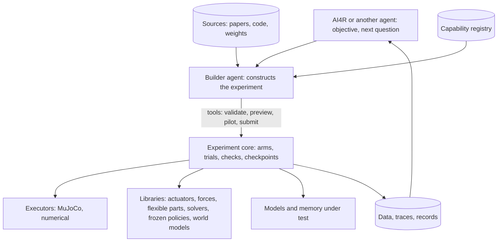

# SIMLAB: supporting architecture context

**Architecture Design Context · r0.4.1.** Read the [Main entrypoint](../Architecture_main_body/Architecture_main_body.md) first. This page gives the shared interfaces, flows, failure behavior, worked example, required reading and open inputs.

## System picture

## Shared interfaces

Field tables are the design contract; the owning task writes exact schemas. Agents must not invent competing shared fields.

| Interface | Must carry |
|---|---|
| **SIMLAB-IF-001** Experiment, result and tools | *Experiment:* objective and declared stand-ins; protocol items with origins; sources; feasibility; engines and why; resolved configuration; assets; arms and components; design (factors, conditions, pairing, replicates, episodes, randomness); procedure, events, interventions and checkpoints; measurements, probes and trace signals; predicates; limits; deviations; parent run or checkpoint. *Result:* run kind (original, replay, fresh replication), status, identity and hardware, trials with status and measurements, cross-trial measurements, checks, model-call log, checkpoints, traces, feasibility, deviations, capability gaps, resources. *Authoring:* tools that create and change geometry and collision assets, model files, procedures and interventions, measurements and observations, and component code at declared extension points, ending in an immutable manifest that binds them to one experiment. *Operations:* capability, validate, submit, status, result, query, fetch, replay, cancel, branch (phase 1); preview, pilot, release inspection (phase 2); fresh replication (phase 3); pause, resume, stream (phase 4). Typed errors |
| **SIMLAB-IF-002** Capsule ports | Builder capsule: AI4R outputs, sources, registry and earlier runs in; an experiment or a halt out. Run capsule: experiment and AI4R run reference in; the AI4R benchmark payload with referenced results and traces out |
| **SIMLAB-IF-003** Library interface | Identity and kind; execution mode (in-process, process or service); what it adds to the registry; its sensitivity settings; its known-answer cases. *Runtime contract:* lifecycle (initialize, reset, step or callback, terminate); inputs and outputs with units and frames; timing (update rate, simulation clock, when actions apply); state it saves and restores; how it composes with forces, actuators, controllers and measurements; typed errors and unsupported combinations |
| **SIMLAB-IF-004** Model interface | Model identity and version; inputs and answer per call; timing mode and latency; budgets; fallback; state kept in checkpoints. Calls travel from the runner to the lab's model route; no executor holds credentials |

## Key flows

1. **Research run:** objective → builder constructs the experiment (optional pilot) → AI4R gate → the run that counts, with checks → data → AI4R evaluates.
2. **Follow-up:** AI4R sends the next question with references → builder constructs a changed experiment with the same tools → anything it cannot express becomes a capability gap.
3. **Model in the loop:** at each decision point the runner sends the declared inputs, applies the answer per the timing mode, records the call and enforces budgets; replay feeds recorded answers instead.
4. **Save and branch:** whole-state checkpoints at declared points; what-ifs and follow-ups branch from them.
5. **Recovery:** completed trials persist. An interrupted trial is recorded as an interrupted attempt; resuming it is a new attempt with its own identity, never a silent rerun, and nothing is counted twice.

## Failure behavior

| Failure | Behavior |
|---|---|
| Ambiguity, source conflict, missing capability | Builder halts with findings; AI4R decides |
| Missing dependency | Affected arms BLOCKED with the reason |
| Numerical failure, protocol violation, wrong intervention, missing required observation, corrupted record, invalid action delivery | Trial invalid with the reason; run continues |
| Physical divergence | Trial completed and measured, stopped at declared limits |
| No control or known-answer check declared | Run reported as unanchored |
| A required validity check ran and failed | Affected measurements marked invalid for the claims that depend on them. An unexpected outcome in an ordinary control arm is a result, not a failure |
| Model timeout, refusal or bad answer | Declared fallback; recorded |
| Budget or limit reached | Trial ends `LIMIT_REACHED` |
| Model route unavailable | Halt or BLOCKED with real failure evidence |

Reports state an evidence level: *preview* (world model only), *simulation* (checks passed), *measured* (compared with independent physical data) or *validated range*.

## Worked example: Fit2Form and a follow-up

Fit2Form (CoRL 2020) compares gripper finger designs in PyBullet. The first demonstration reproduces its baseline protocol with the authors' code, then rebuilds the two non-learned designs in MuJoCo, records the engine change, and compares the two. Protocol values come from the paper; the success rule and time step come from the released code. The authors release pretrained generator weights and processed test data, so the learned-design arm is a feasibility question (dependencies, resources), not a missing input. Its claimed advantage is a separate result from the non-learned comparison. **Follow-up:** the source already applies pushes from a restored post-grasp state, so a push alone is not new. A sharper follow-up asks whether a tactile contact signal predicts slip onset under a disturbance profile the source did not test, with a declared slip criterion and analysis.

## Required reading by dependency

`AI4Research-Main` (the repository's default branch) is authoritative; `PhysicalAI-Sim` forks from it. Recheck these paths there before building.

| Read | Take from it |
|---|---|
| `AGENTS.md`, `.specify/memory/constitution.md`, `docs/code/Code_SOP.md`, `SPEC_KIT_WORKFLOW.md`, `VERIFICATION.md`, `GIT_WORKFLOW.md` | Rules, Spec Kit process, evidence, git |
| AI4R design package (`design-method.md`, `principles.md`, `capsules.md`, `placement.md`, `reference/field-catalog.md`) | Capsule format, checking, placement, field conventions |
| `docs/capsules/agentic-builder.md`, `typed-planner-m1.md` | Builder tool-loop pattern; Planner selection |
| Benchmark requirements v0.12, `benchmarks/harbor_suite/`, `deploy/m1/capsule_checks.py` | Benchmark rules and format, check runner, evidence files |

## Open inputs

| ID | Input | Owner | Needed before |
|---|---|---|---|
| O-03 | M1 owners accept SIMLAB capsules in journeys, with findings and continuation in AI4R | Stellven | Phase 4 |
| O-07 | Live view inside the AI4R web app | Stellven, UI owner | Phase 4 |
| O-12 | First demonstration: Fit2Form, or the reconstruction case from review (needs its paper link and policy checkpoints; Isaac Sim runs on the Spark, not the laptop) | Owner | Phase 2 |
| A-12 | Models under test and world models fit the laptop beside AI4R; admitted per checkpoint, task and runtime | Phase 3 first block | Phase 3 |
| A-13 | AI4R's app runs on the laptop beside SIMLAB (its M1 design targets the team's GB10 server). Checked first, by X1.1. If it fails, the owner decides the milestone change; the AI4R exits do not move silently | X1.1 | Phase 1 start |

[confirm] values: pendulum tolerance 0.5%; first-demonstration agreement 5 percentage points on 20 objects (pilot 3), with one paired observation per object as the unit of inference; rerun samples 5 per arm; scale run 1,000; research candidates: at least 3 of 5 completed.
